# Frontend Data-Boundary Architecture

## Subsystem In DVT Context

This subsystem belongs to the DVT `UI / Visualization Domain` and is implemented in `apps/web`.
It is a browser client and never an execution authority.

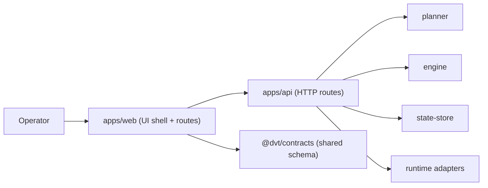

## Current Topology (As-Is)

The current code now routes service and capability wiring through one governed
composition root, and UI state is split across named store slices instead of an
aggregate shell store.

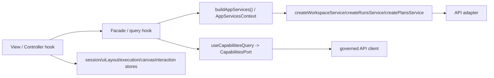

Current friction points:

- `workspaceService`, `runsService`, `plansService` are hybrid boundaries (ports, adapter selection, and mapping in one module).
- store responsibilities now have named slices, but route-level facades still
  need continued tightening around read-model ownership.
- not every route uses a dedicated application facade yet; some still depend on app-level hooks directly.
- capability querying is now composition-owned, but broader query standardization remains a later slice.
- the removed aggregate store and duplicate store barrel must stay absent; new
  state paths must be added to the named slices or a new bounded slice.

## Ports And Communication Matrix

Inbound ports:

- route intents from shell/workbench views;
- shell actions (navigation, panel state, UX events);
- plugin-contributed commands.

Outbound ports:

- `WorkspacePort`
- `RunsPort`
- `PlansPort`
- `CapabilitiesPort`
- `SessionContextPort`
- `ShellFeedbackPort`

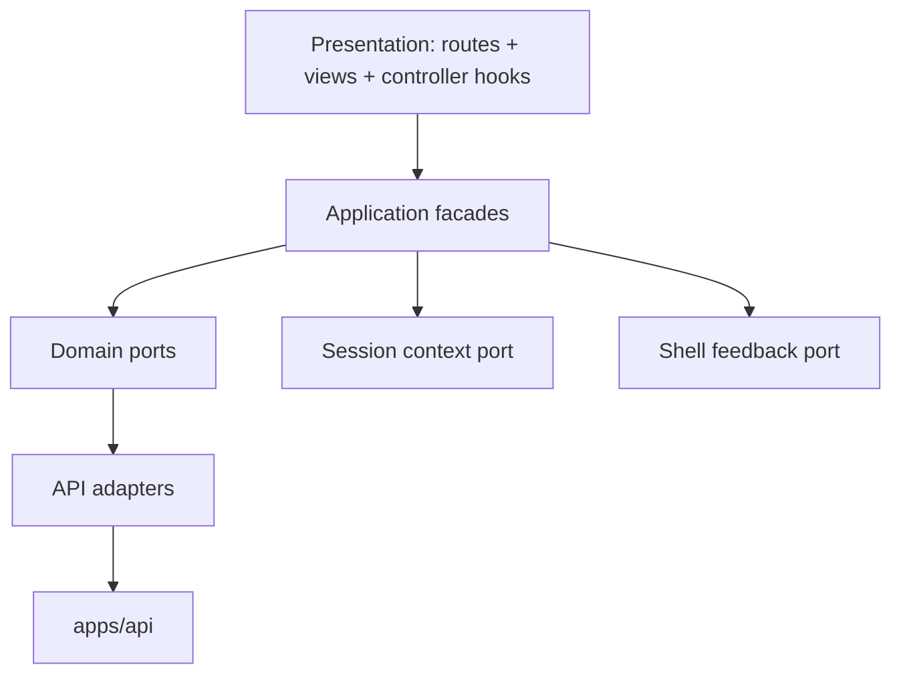

## Target Model (Hexagonal + SRP + Fowler)

Chosen model: capability-centered hexagonal frontend.

- Presentation owns rendering and intent collection only.
- Application owns orchestration and route use-cases.
- Domain contracts own port interfaces and UI-facing view-model rules.
- API adapters implement those ports for product runtime.
- Tests inject explicit port doubles through the composition root.

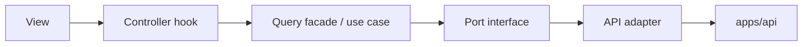

## Monaco Positioning Inside This Subsystem

Monaco is a presentation primitive inside the browser client, not a shell or
composition authority.

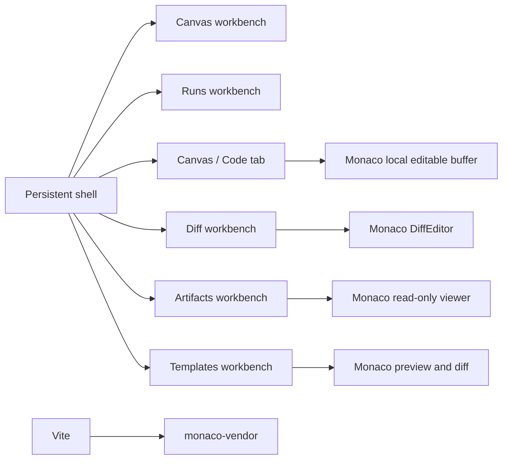

Positioning rules:

- Canvas stays graph-first.
- Runs stays execution-first.
- Monaco becomes first-class only in `Code`, `Diff`, `Artifacts`, and
  `Templates`, and only through route-safe lazy gateways.
- Monaco vendor dependencies stay isolated in the named `monaco-vendor` chunk.
- API client and route composition stay owned by the frontend composition root,
  not by Monaco surfaces.
- Future docking, if ever needed, is a later layout decision and not part of
  this boundary model.

## Migration And Consequences

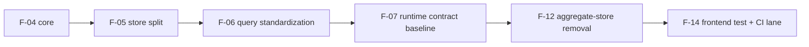

Expected gains:

- one product data authority;
- no transport-selection drift;
- lower coupling from views to transport concerns;
- clearer ownership for store and query behavior.

Expected cost:

- more modules and interfaces now;
- migration overhead for route/controller rewiring;
- stricter discipline required for new capabilities.

## Reuse From Current System

- Keep `platform-health` as the reference capability pattern.
- Keep `createApiClient` as the transport base.
- Keep `sessionStore` as session authority.
- Keep plugin registry as extension seam (app-first composition).

## System-Level Improvements Enabled

- earlier visibility of contract drift;
- repeatable pattern for future capabilities;
- cleaner path for execution-template/source-generation workbench slices;
- better CI hardening once frontend test lane is formalized.

## Runtime Contract Baseline Link

Runtime route truth for Runs is governed by the dedicated F-07 docs pack:

- [Frontend Fowler Implementation Pattern](frontend-data-boundary-architecture.md#section-frontend-fowler-implementation-pattern)
- [Frontend Runtime Contract Technical Manual](./runs/frontend-runtime-contract-technical-manual.md)
- [Frontend Runtime Contract User Manual](runs/frontend-runtime-contract-technical-manual.md#section-frontend-runtime-contract-user-manual)

## F-04 Frontend Data Boundary User Manual

### Who This Is For

- Product and QA teams validating frontend behavior.
- Integrators wiring API-backed frontend ports.
- Operators triaging frontend/backend data mismatches.

### What Changed

- Product runtime uses the API as its single data authority.
- Views read data through stable frontend ports and service context.
- Tests inject explicit port doubles without enabling a product runtime mode.
- Query cache keys are standardized to avoid stale data behavior drift.

### Expected Behavior

1. App startup creates one API-backed service graph for the session.
2. Views load data from shared service context.
3. Platform health and capabilities report backend-owned runtime truth.
4. Canvas/runs/cost/lineage stay aligned with centralized query key policy.
5. Starting a run requires a valid `planRef` on the current execution plan.

### Troubleshooting

#### Symptom: stale data after navigation

- check if the route uses registered query keys.
- verify no ad-hoc inline cache key was introduced.

#### Symptom: fixture behavior appears in product runtime

- confirm product composition imports only API adapters.
- confirm test doubles enter through explicit test overrides only.

#### Symptom: inconsistent UI state across panels

- verify features use sliced stores by concern.
- avoid re-introducing retired monolithic store selectors.

#### Symptom: "Plan reference is unavailable"

- this is a boundary guard, not a transport error.
- expected behavior: run start is blocked and plan modal is reopened.
- resolution path:
  - backend plan preview/import payload must include canonical `planRef`;
  - tests that exercise run start must inject a plan fixture with `planRef`.

### Validation Checklist (User-Facing Confidence)

- `RunsView` opens run workspace with consistent state.
- `LineageView` and `CostView` data refresh behavior is consistent.
- Top app bar environment selectors and shell controls remain functional.
- Platform status banner matches backend health state.

### Operational Map

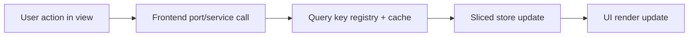

### Non-Goals

- This guide does not define backend contracts.
- This guide does not replace technical architecture docs.
- This guide does not include plugin authoring details.

> Section status: Active. Owner: Frontend / Product. Colocation does not merge component responsibilities.

## Frontend Fowler Implementation Pattern

### Purpose

This document defines the canonical frontend implementation pattern for DVT
routes that consume multiple backend read models.

It is the baseline for `F-07` and for future route-level capabilities.

### Anti-Pattern To Avoid

Do not compose route behavior with mixed concerns in one layer:

- view calls `create*Service` directly;
- service mixes gateway strings, DTO translation, mode switching, and
  route-specific fallback policy;
- route consumes one overloaded aggregate type that hides read-model boundaries;
- UI infers detail from missing arrays or placeholder values.

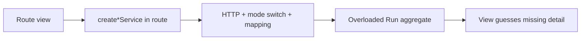

### Target Fowler Pipeline

The route must be implemented with explicit layers:

- `Gateway`: transport and route strings;
- `Assembler`: DTO normalization and mapping to frontend read models;
- `Service Layer / Facade`: route-level orchestration and fallback policy;
- `Presentation Model`: route-facing model consumed by the view.

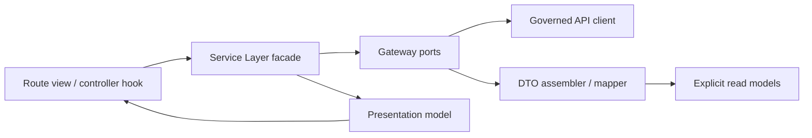

### Read-Model Split

The frontend must keep read models explicit and separate:

- `RunSummaryItem`: list and index concerns
- `RunSnapshot`: lifecycle snapshot authority
- `RunEventTimelinePage`: ordered event feed
- `RunWorkspaceViewModel`: route-facing composition model

No single `Run` type should hide these semantics.

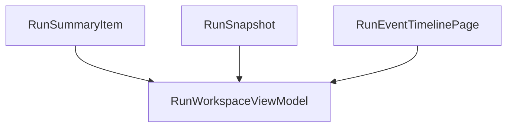

### Canonical Route Rule

For active route flows covered by a Fowler pilot:

- no transition model that pretends snapshot payloads are full aggregates;
- no route-level fallback that fabricates steps, artifacts, or metrics from
  empty placeholders;
- no direct route ownership of transport endpoints.

### Fowler Rationale

- Service Layer owns route policy: loading, partial, degraded, not-found.
- Gateway owns endpoint strings and transport details.
- Assembler owns DTO normalization and mapping discipline.
- Presentation model isolates the view from backend payload shape drift.

### Delivery Sequence

Use strict docs-first and TDD-first ordering.

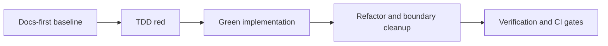

### F-07 Worked Example

`F-07` applies this pattern to Runs:

- gateway contract uses `POST /runs/start`, `GET /runs`, `GET /runs/:runId`,
  `GET /runs/:runId/events`;
- facade composes snapshot + timeline into `RunWorkspaceViewModel`;
- route consumes the presentation model and never invents missing detail.

### Related Pages

- [Frontend Data-Boundary Architecture](frontend-data-boundary-architecture.md)
- [Runs Frontend Architecture](runs/component-runs.md#section-dvt-runs-frontend-architecture)
- [Frontend Runtime Contract Technical Manual](runs/frontend-runtime-contract-technical-manual.md)

> Section status: Active. Owner: Frontend / Architecture. Colocation does not merge component responsibilities.

## F-04 Frontend Data Boundary Technical Manual

### Goal

Define the technical boundary for frontend data access in the web app using composition-root wiring, explicit ports, and store slices.

### Runtime Model

- Composition root wires the API client and typed service ports once.
- UI modules consume ports/hooks, not transport-specific clients.
- State is split by concern (`session`, `uiLayout`, `execution`, `canvasInteraction`).

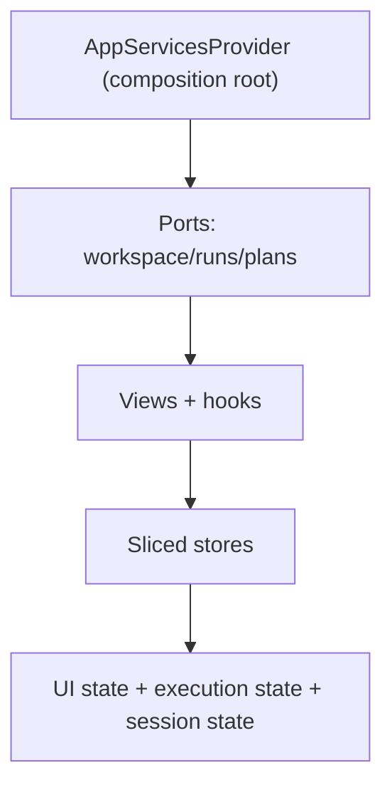

### Ownership Rules

1. Product runtime has one API-backed data authority; transport selection is not a frontend concern.
2. Runtime query keys must come from `queryKeys.ts`.
3. Runtime modules must not import removed aggregate store surfaces.
4. Feature views must depend on ports (`app/ports/*`) and shared services from context.

### Current Technical Invariants

- `queryKey` inline arrays are blocked by architecture test.
- direct import of removed aggregate store surfaces in runtime source is blocked
  by architecture test.
- reintroduction of a data-source mode or runtime transport singleton is blocked
  by architecture test.
- `startRun` must use `ExecutionPlan.planRef`; runtime start is rejected in UI when `planRef` is missing.

### Query-Key Ownership And Invalidation Baseline

All runtime query keys are defined in `apps/web/src/app/queries/queryKeys.ts`.

| Domain                | Query-key owner                                     | Read keys                                                                                                                                                   | Invalidation owner                        | Invalidation rule                                                         |
| --------------------- | --------------------------------------------------- | ----------------------------------------------------------------------------------------------------------------------------------------------------------- | ----------------------------------------- | ------------------------------------------------------------------------- |
| platform health       | shell capability (`usePlatformHealthSnapshotQuery`) | `queryKeys.shell.platformHealthSnapshot()`                                                                                                                  | shell health capability only              | passive polling; no cross-feature manual invalidation                     |
| runs list + detail    | runs route hooks/facade                             | `queryKeys.runs.summaries(workspaceLayoutKey)`, `queryKeys.runs.snapshot(workspaceLayoutKey, runId)`, `queryKeys.runs.eventFeed(workspaceLayoutKey, runId)` | runs domain hooks and run-control actions | invalidate `queryKeys.runs.root()` after a successful run-control command |
| workspace graph reads | canvas and analysis workbench hooks                 | `queryKeys.workspace.graphDraft(workspaceLayoutKey)`, `queryKeys.workspace.graphForView(viewId)`                                                            | workspace graph owner hooks/services      | invalidate workspace graph keys only when graph-mutating actions complete |

### StartRun PlanRef Boundary

`ExecutionPlan` in the web app now carries optional `planRef` metadata for
run-start.

On the API path, `planRef` is backend-owned:

- `POST /plans/preview` returns `{ plan, planRef }` after successful preview and
  persistence.
- `POST /plans/import` returns `{ plan, planRef }` for a readable persisted
  plan.
- `plansService.api` maps `planRef` directly from that envelope and rejects
  payloads that omit it.

The runtime boundary is fail-closed:

1. `useCanvasExecutionActions` resolves `planRef` from `currentPlan`.
2. If `planRef` is absent, the hook must:
   - not call `runsService.startRun`,
   - emit an explicit user error,
   - reopen the plan modal.
3. If `planRef` exists, start-run continues through `IRunsPort`.

Tests may inject deterministic port doubles, but product runtime must never
reconstruct `uri`, `sha256`, or version fields client-side.

This keeps runtime behavior aligned with the engine contract boundary where run
execution is `PlanRef`-driven.

### Required Test Layers

- `unit`: service adapters, selectors, mappers.
- `integration`: view + hook behavior per route.
- `architecture`: boundary checks for imports, query keys, API-only product
  composition, and explicit test-double injection.

### Refactor Guidance (>200 line files)

When a file exceeds policy target, split by responsibility:

1. view shell layout
2. state selectors/actions
3. domain transforms/mappers
4. presentational fragments

Avoid extracting only to move complexity; each split must reduce boundary width and improve testability.

### Aggregate Store Removal Status

- `stores/appStore.ts` has been removed.
- `stores/index.ts` has been removed.
- active runtime state is owned by `sessionStore`, `uiLayoutStore`,
  `executionStore`, and `canvasInteractionStore`.
- new state concerns must extend a named slice or introduce a new bounded slice;
  do not recreate an aggregate shell store or store barrel.

> Section status: Active. Owner: Frontend / Architecture. Colocation does not merge component responsibilities.

## Frontend API Runtime User Manual

### Purpose

This manual explains the single supported frontend runtime posture. Raven reads
and changes product data through governed API ports. There is no selectable
local or fixture-backed product mode.

### Runtime Posture

- `VITE_API_BASE_URL` selects the backend address, not a data authority.
- Views consume backend-backed data through the ports composed by
  `AppServicesProvider`.
- Unsupported or unavailable operations fail closed.
- Component and integration tests inject explicit port doubles; those doubles
  are not product runtime options.

### Capability Interpretation

Using the API does not imply that every operation is available. Operators must
distinguish:

- selected execution adapter;
- granted workspace and project scope;
- backend-reported capability;
- platform readiness;
- route startup or operability posture.

Canvas authoring requires protected workspace-draft authority and the relevant
capabilities. Source Import appears only when its governed connection,
discovery, probe, and import rails are available for the active context.

### Shell States

The shell exposes explicit states:

- `loading`: authoritative backend state is being resolved;
- `empty`: no data exists for the selected context;
- `degraded`: only part of the required backend surface is available;
- `offline`: the backend cannot be reached;
- `read-only`: inspection is allowed but mutation is not.

No route substitutes fixture data or fake success for these states.

### Route Behavior

- Canvas renders graph and planning actions through controller hooks and typed
  ports.
- Runs reads snapshots and events through `RunsPort`.
- Workspace files, diff, artifacts, and administration use their governed API
  queries and commands.
- Platform diagnostics display the literal API transport and resolved base URL.

### Failure Interpretation

An unavailable capability, authorization denial, readiness failure, or network
error is a product state. Retry and recovery actions must use the existing
governed rails and cannot switch the frontend to another data authority.

> Section status: Active. Owner: Frontend / Product / Docs. Colocation does not merge component responsibilities.

## Frontend Query Boundary Component

This component owns the TanStack Query boundary for `apps/web`. Views and plugin
panels may consume query hooks, but they must not own cache keys, query
functions, invalidation, or direct `@tanstack/react-query` imports unless the
file is explicitly listed as a query boundary.

### Public API

| Module                                                                                     | Public hooks                                                                                                                                                                                                                                                                                     | Owned rail                  |
| ------------------------------------------------------------------------------------------ | ------------------------------------------------------------------------------------------------------------------------------------------------------------------------------------------------------------------------------------------------------------------------------------------------ | --------------------------- |
| `apps/web/src/app/queries/workspaceQueries.ts`                                             | `useWorkspaceDiffChangesQuery` `useWorkspacePluginCatalogQuery` `useWorkspaceGraphForViewQuery` `useWorkspaceFileTreeQuery` `useWorkspaceFileContentQuery` `useWorkspaceFileHistoryQuery` `useWorkspaceRolesQuery` `useWorkspaceAuditQuery` `useWorkspaceArtifactsQuery` | Workspace query read models |
| `apps/web/src/app/queries/runsQueries.ts`                                                  | `useScopedRunSummariesQuery` `useScopedRunSummariesQueryForHistory` `useRunSnapshotQuery`                                                                                                                                                                                                  | Run summary/status queries  |
| `apps/web/src/app/queries/runEventFeedQuery.ts`                                            | `useRunEventFeedQuery`                                                                                                                                                                                                                                                                           | Run event feed query        |
| `apps/web/src/app/views/runs/useRunWorkspace.ts`                                           | `useRunWorkspace`                                                                                                                                                                                                                                                                                | Run workspace projection    |
| `apps/web/src/capabilities/platform-health/presentation/usePlatformHealthSnapshotQuery.ts` | `usePlatformHealthSnapshotQuery`                                                                                                                                                                                                                                                                 | Platform health query       |
| `apps/web/src/app/queries/useCapabilitiesQuery.ts`                                         | `useCapabilitiesQuery`                                                                                                                                                                                                                                                                           | `GetRuntimeCapabilities`    |

### Invariants

1. Query keys are created only through `apps/web/src/app/queries/queryKeys.ts`.
2. Operator views consume query hooks instead of importing `@tanstack/react-query`
   directly.
3. Service ports remain behind query hooks; views do not construct query
   functions from ports. Runtime capabilities resolve through the composed
   `CapabilitiesPort`; capability modules do not construct an alternate HTTP
   query boundary.
4. Cache mutation helpers stay in named cache modules such as
   `canvasDraftQueryCache.ts`, not in controller hooks.
5. Route facades may compose multiple query hooks, but they do not invent cache
   keys or own invalidation policy.

### Transitions

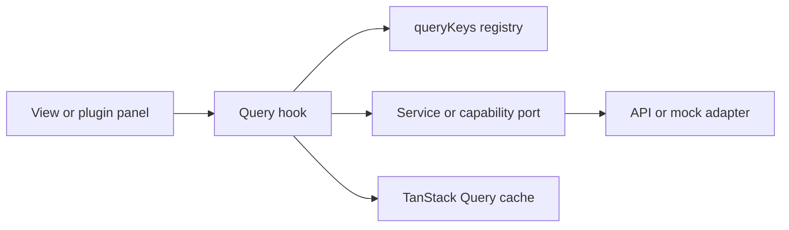

The F-06 hard cut moved run workspace, admin roles/audit, artifact loading, and
dbt run history queries out of view/plugin modules and into the query boundary.

### Consumers

| Consumer                                  | Query hooks consumed                                                                  |
| ----------------------------------------- | ------------------------------------------------------------------------------------- |
| `RunsView` / `useRunWorkspace`            | `useScopedRunSummariesQuery`, `useRunSnapshotQuery`, `useRunEventFeedQuery`           |
| `AdminView` / `useAdminViewData`          | `useWorkspaceRolesQuery`, `useWorkspaceAuditQuery`                                    |
| `ArtifactsView` / `useArtifactsViewModel` | `useWorkspaceArtifactsQuery`                                                          |
| `DbtNodeRenderer` history panel           | `useRunSnapshotQuery`, `useScopedRunSummariesQueryForHistory`, `useRunEventFeedQuery` |

### Guardrails

`apps/web/src/app/queries/queryKeyPolicy.architecture.test.ts` is the semantic
architecture guard. It fails when selected operator views or plugin panels
import `@tanstack/react-query` directly, when runtime files use inline query key
arrays, or when removed aggregate store imports return.

> Section status: Active. Owner: Web / Architecture. Colocation does not merge component responsibilities.

## API Service Boundary

### Purpose

This document defines the current frontend service boundary in `apps/web`.
The API is the single product data authority. Product runtime has no selectable
data-source strategy, local-data mode, or fallback adapter.

### Operational Contract

`AppServicesProvider` creates one `AppServices` graph through
`buildAppServices()`. That graph contains the API client and the typed ports
used by workspace, plans, runs, capabilities, session, feedback, and Canvas
features.

Views and plugins consume typed hooks. They do not select transports, construct
API clients, or infer availability from a runtime mode.

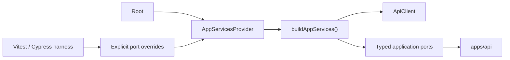

### Public Composition Surface

- `buildAppServices(overrides?)`
- `AppServicesProvider`
- typed hooks such as `useWorkspaceGraphSnapshotQueryPort()`,
  `useRunsService()`, `usePlansService()`, and `useCapabilitiesPort()`
- explicit `AppServicesOverrides` for tests

There is deliberately no `DataSourceMode`, mode hook, environment selector, or
mutable transport singleton.

### Responsibility Matrix

| Owner                 | Responsibility                                             | Forbidden responsibility                    |
| --------------------- | ---------------------------------------------------------- | ------------------------------------------- |
| Views and plugins     | Render state and submit user intent through typed hooks    | Transport selection or service construction |
| `AppServicesProvider` | Publish one stable service graph                           | Product behavior or route decisions         |
| `buildAppServices`    | Compose API-backed ports and apply explicit test overrides | Selecting among product data authorities    |
| API adapters          | HTTP transport and DTO mapping                             | UI state or test-fixture semantics          |
| Test harnesses        | Inject explicit port doubles                               | Enabling a product runtime branch           |

### Readiness And Capability Truth

API transport is fixed, but feature availability is not assumed. Routes use
the existing capability, authorization, and platform-readiness queries. Missing
or unavailable backend behavior remains explicit and fail-closed.

Canvas mutation posture therefore depends on platform readiness and granted
capabilities, never on a data-source label.

### Command And Query Rails

This boundary is internal composition and introduces no command or query rail.
Each injected port continues to implement its existing domain-owned command or
query. Removing the exhausted strategy does not rename or duplicate those
rails.

### Test Boundary

Tests inject port doubles through `AppServicesOverrides`. Product source must
not import test doubles or expose a switch that enables them. Architecture
tests enforce both the API-only composition boundary and the absence of the
removed strategy symbols.

### Invariants

- API is the single product data authority.
- Product composition has no one-value strategy abstraction.
- Views and plugins cannot select or construct transports.
- Test doubles are explicit dependencies, never runtime modes.
- Workspace defaults and Canvas readiness remain independent of transport
  selection.
- Platform diagnostics may state the literal transport fact `API`; they do not
  expose it as a configurable mode.

> Section status: Active. Owner: Frontend / Architecture. Colocation does not merge component responsibilities.

## API Client Auth Component

### Purpose

This guide defines the local frontend component that supplies bearer-token
posture to `createApiClient()` without moving authentication policy into route
views.

The component is intentionally narrow:

- production auth remains owned by the protected runtime and OIDC posture;
- the coordinated local dev stack may expose a bounded refresh endpoint for
  local protected-runtime sessions;
- frontend API calls must not send a JWT that is already expired or inside the
  refresh skew.

### Public API

| API                                 | Owner                            | Responsibility                                                        |
| ----------------------------------- | -------------------------------- | --------------------------------------------------------------------- |
| `resolveApiBearerToken(...)`        | `apiAuthConfig.ts`               | Read the configured bearer token from the active environment.         |
| `resolveApiBearerTokenRefreshUrl`   | `apiAuthConfig.ts`               | Read `VITE_API_BEARER_TOKEN_REFRESH_URL` when present.                |
| `canRefreshApiBearerToken(...)`     | `apiAuthConfig.ts`               | Tell transport code whether a refresh path is available.              |
| `resolveApiBearerTokenForRequest`   | `apiAuthConfig.ts`               | Return a fresh usable token or omit auth when a token is expired.     |
| `canRecoverLocalApiBearerSession`   | `apiAuthConfig.ts`               | Tell public recovery UI whether local dev-session recovery is wired.  |
| `recoverLocalApiBearerSession`      | `apiAuthConfig.ts`               | Force one local refresh and cache the bearer token for later use.     |
| `createApiClient().requestRaw(...)` | `createApiClient.ts`             | Attach auth/session headers and retry one retryable `401` request.    |
| `startLocalProtectedRuntimeAuth`    | `scripts/run-dev-stack.auth.cjs` | Start the local JWKS posture and refresh endpoint for `pnpm dev:app`. |

### Invariants

- Views, route controllers, and service adapters do not decode JWTs.
- `apiAuthConfig.ts` owns token expiration inspection and refresh URL lookup.
- `createApiClient.ts` owns transport retry policy and must retry at most once
  after a `401`.
- Request bodies are retryable only when absent or string-backed.
- Expired tokens are omitted when no refresh endpoint is available.
- The local refresh endpoint is a dev-stack bootstrap aid. It is not a product
  login flow and must not be documented as one.
- Public recovery UI may ask this component to force one local refresh, but it
  must not decode JWTs, mint permissions, or infer backend authorization.
- Session headers remain attached by `createApiClient()` when requested; token
  refresh must not bypass tenant/project scoping.
- Local protected-runtime tokens publish the same tenant action vocabulary that
  the dev-stack grant seed applies. The backend still authorizes against grants,
  while `/session` exposes scopes for frontend command admission.
- First-authoring live proof tokens may assert run-unique additional projects,
  but only when the proof runner also seeds matching backend grants.

### Transitions

#### Request auth resolution

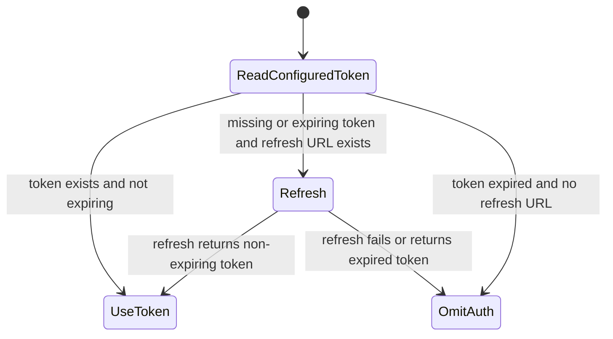

#### Protected request retry

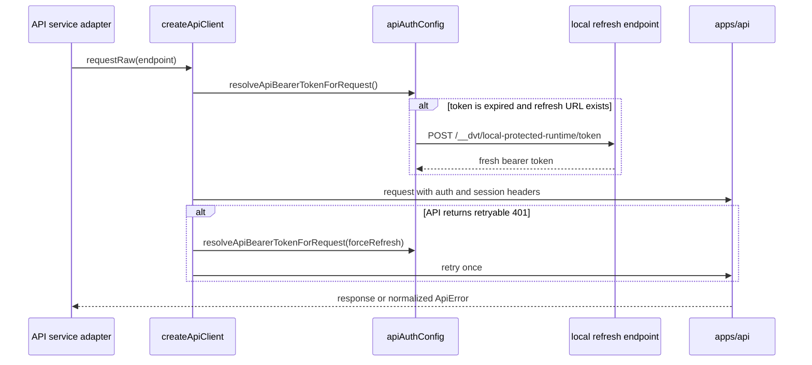

### Consumers

Direct consumers:

- `createApiClient.ts`
- `/login` public route recovery UI
- API-mode workspace, plans, runs, capabilities, and plugin services
- `scripts/run-dev-stack.auth.cjs`
- `scripts/run-selected-closure-live-proof.cjs`
- `scripts/run-canvas-first-authoring-live-proof.cjs`

Indirect consumers:

- Canvas protected draft reads and saves
- startup capability and backend-health checks
- live browser proof lanes that run through `pnpm dev:app`

### Fowler Reading

| Pattern             | Local expression            | Maturity rule                                                 |
| ------------------- | --------------------------- | ------------------------------------------------------------- |
| Gateway             | `createApiClient()`         | One transport boundary owns auth/session headers.             |
| Policy Object       | `apiAuthConfig.ts`          | Token expiry and refresh eligibility are testable outside UI. |
| Circuit Breaker     | one retry after `401`       | Retry is bounded and only runs when the body is safe.         |
| Application Service | local dev-stack auth server | Dev bootstrap satisfies the real protected-runtime contract.  |

### Negative Coverage

Primary tests:

- `apps/web/src/app/services/api/createApiClient.test.ts`
- `scripts/run-dev-stack.auth.test.cjs`
- `apps/web/src/app/views/canvas/canvasDraftRecoveryBoundary.architecture.test.ts`

The guard verifies that auth refresh remains in the API client component and
does not drift into Canvas route code.

### Drift To Watch

- Do not add route-level JWT decoding as a Canvas workaround.
- Do not make the local refresh endpoint a product login or permission model.
- Do not retry non-replayable request bodies after `401`.
- Do not let a stale token produce a "draft denied" UI when a dev-stack refresh
  endpoint can issue a fresh token.
- Do not let local token project assertions and seeded backend grants diverge;
  the UI can pass route startup while the API later denies draft commands.
- Do not remove action scopes from local dev-stack tokens without replacing the
  `/session` permission projection consumed by Canvas command admission.

> Section status: Active. Owner: Frontend / Architecture. Colocation does not merge component responsibilities.
