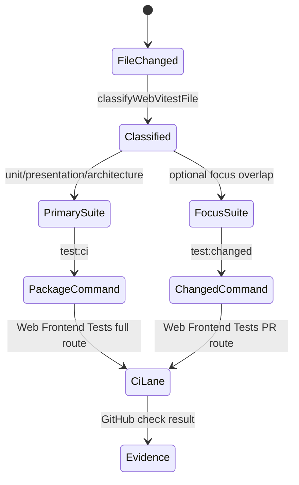
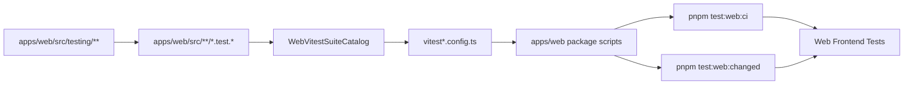

# Frontend Test Governance Component

## Purpose

Own the `@dvt/web` Vitest execution boundary and keep frontend tests visible as
test support rather than production source.

Owned concern: `WebVitestSuiteCatalog` is the semantic owner for web test suite
assignment, package-level web test commands, and the dedicated GitHub Actions
web test lane.

This component does not own product behavior, Cypress browser flows, backend
contract validation, or engine determinism tests.

## Governing Sources

- [web component](./index.md)
- [Testing and CI Capabilities](../../../guides/testing-and-ci-capabilities.md)
- [Web Vitest changed-suite router](./web-vitest-changed-suite-router-component.md)

## Public API

<!-- markdownlint-disable MD060 -->

| Surface                          | Type     | Responsibility                                       |
| -------------------------------- | -------- | ---------------------------------------------------- |
| `WEB_VITEST_PRIMARY_SUITE_NAMES` | constant | Names primary non-overlapping web test suites.       |
| `WEB_VITEST_FOCUS_SUITE_NAMES`   | constant | Names allowed overlapping focus suites.              |
| `WEB_VITEST_SUITES`              | catalog  | Defines include and exclude rules for each suite.    |
| `createWebVitestConfig`          | function | Builds Vitest config from the suite catalog.         |
| `classifyWebVitestFile`          | function | Classifies a test file into primary and focus lanes. |
| `pnpm --filter @dvt/web test`    | command  | Runs the governed web primary-suite composition.     |
| `pnpm test:web:ci`               | command  | Runs governed web primary suites.                    |
| `pnpm test:web:changed`          | command  | Runs the changed-file web suite route.               |
| `Web Frontend Tests`             | CI job   | Runs changed PR routing or full primary suites.      |

<!-- markdownlint-enable MD060 -->

## Invariants

- Every web Vitest file belongs to exactly one primary suite.
- Focus suites may overlap with primary ownership only when they are explicitly
  listed in `WEB_VITEST_FOCUS_SUITE_NAMES`.
- Catalog overlap does not require duplicate execution: the changed-suite plan
  absorbs a Canvas focus run only into its complete primary equivalent, with
  file containment and execution-configuration equivalence guarded by tests.
- Feature-owned focus suites may narrow local feedback loops without changing
  primary suite ownership.
- Architecture tests are excluded from unit and presentation suites.
- The `unit` and `architecture` primary suites and their `canvas-unit` and
  `canvas-architecture` focus suites default to Node. Tests that exercise browser
  APIs, browser-backed persistence, or browser-derived language explicitly
  declare `@vitest-environment jsdom`; the declaration applies in both primary
  and Canvas focus routes. Presentation, mixed Canvas, other focus suites, and
  the aggregate watch config retain jsdom. Environment selection does not
  change file ownership or changed-suite routing.
- Tests using `installWorkspaceScopeHarness` explicitly declare jsdom because
  the harness updates the real persisted session store. The catalog architecture
  guard checks this dependency. Localized presentation-model tests likewise keep
  their browser environment; Node's host-language default must not change their
  expected copy across contributor operating systems.
- Every CI file retains an isolated fork. The GH-2900 experiment found that
  ten-file shared-fork batches introduce presentation-test interference; bounded
  memory alone is not sufficient evidence to remove isolation. See the
  [benchmark evidence and closeout in issue #2900](https://github.com/dunay2/dvt/issues/2900).
- The `Web Frontend Tests` job has fixed `vitest` and `browser` variants;
  the existing required aggregate requires both. Each variant uses its own
  existing Turbo-cache producer identity, with matrix fail-fast disabled.
- Ordinary web pull requests route through the same `pnpm test:web:changed`
  plan with `--phase=vitest` or `--phase=browser`. Local default execution
  remains both phases, and browser admission is never replaced by Vitest.
- Pushes to `main`, manual workflow runs, and root-build-sensitive PRs route
  through `pnpm test:web:ci`.
- The package default `test` command delegates to the same primary-suite
  composition as `test:web:ci`, so root `turbo run test` and the dedicated web
  CI lane exercise the same governed coverage instead of parallel web routes.
- CI Vitest configs bound worker count, worker old-space capacity, and hosted
  runner fork topology in the suite catalog so full web coverage avoids worker
  OOMs and retained fork queues.
- Hosted CI web Vitest routes must also export the same Node old-space value as
  `NODE_OPTIONS` at the workflow step boundary. That keeps the actual Vitest
  parent and forked worker processes aligned when GitHub runners execute
  `pnpm test:web:ci` or root `turbo run test` through `pnpm ci:full`.
- Each `Web Frontend Tests` variant retains a 25-minute budget: Vitest no
  longer consumes the browser lifecycle's deadline. The CI worker cap still
  trades parallelism for memory and process-exit stability; ordinary PRs remain
  on changed-suite routing. This is not a timeout increase or evidence waiver.
- Test support under `apps/web/src/testing/**` remains test-only and must not
  become a production adapter surface.
- `vitest*.config.ts` files are adapters over the suite catalog. They do not own
  suite partition semantics.

## Transitions

## Consumers

- Local developers use `pnpm --filter @dvt/web test:unit`,
  `test:presentation`, `test:architecture`, `test:canvas`, `test:monaco`, and
  `test:shell-session`, and `test:workspace-services`.
- GitHub Actions uses `pnpm test:web:changed` for ordinary web pull requests
  and `pnpm test:web:ci` for full web coverage routes.
- Architecture tests use `classifyWebVitestFile` to prevent suite drift.
- Planning and closeout evidence cite the named web test lane instead of an
  implicit generic test step.

## Component Flow

## Negative Rules

- Do not add a second web suite catalog.
- Do not run web tests only through the generic `Run Tests` job.
- Do not classify test harnesses as runtime services.
- Do not add route-specific CI commands when a suite or focus-suite entry can
  express the same intent.

## Frontend Test Governance User Stories

### F-14 Stories

#### Story 1 - Local frontend developer runs targeted suites

As a frontend developer, I want named web test suites so that I can run the
smallest meaningful Vitest lane without guessing file globs.

Acceptance:

- `pnpm --filter @dvt/web test:unit` runs TypeScript unit tests.
- `pnpm --filter @dvt/web test:presentation` runs TSX presentation tests.
- `pnpm --filter @dvt/web test:architecture` runs semantic architecture tests.
- Each command uses `test:deps` before raw Vitest execution.

#### Story 2 - Reviewer sees a dedicated web check

As a reviewer, I want a `Web Frontend Tests` check so that frontend test status
is visible without opening the generic `Run Tests` log.

Acceptance:

- `.github/workflows/test.yml` contains a `web-frontend-tests` job.
- The job runs `pnpm test:web:changed` for ordinary web pull requests.
- The job runs `pnpm test:web:ci` for pushes to `main`, manual runs, and
  root-build-sensitive pull requests.
- The generic affected-package job no longer owns the web test step.

#### Story 3 - Test support remains test-only

As a maintainer, I want harnesses and doubles to be documented as test support
so that they are not mistaken for production adapters.

Acceptance:

- `apps/web/src/testing/**` is documented by the component guide.
- Test doubles remain consumers of test files, not product services.
- Architecture tests fail if the component guide disappears.

#### Story 4 - Suite drift is rejected

As a CI owner, I want suite classification to fail closed so that new test files
cannot bypass the governed web lanes.

Acceptance:

- Every `apps/web/src/**/*.{test,spec}.{ts,tsx}` file maps to one primary suite.
- Focus suites may overlap only through explicit focus-suite registration.
- Architecture tests assert package scripts, config files, docs, and workflow
  wiring together.

#### Story 5 - Future suite partitioning has a safe extension point

As the owner of F-14-A, I want this boundary to be stable so that changed-file
routing can later pick the smallest safe suite without changing product code.

Acceptance:

- F-14 does not introduce changed-file routing.
- F-14-A can extend `WebVitestSuiteCatalog` and CI tooling without inventing a
  second frontend test taxonomy.

> Acceptance scope status: Active. Owner: Frontend / CI.
