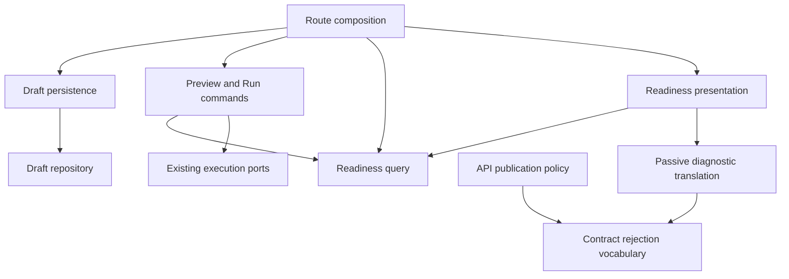
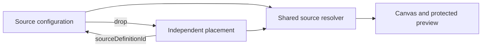
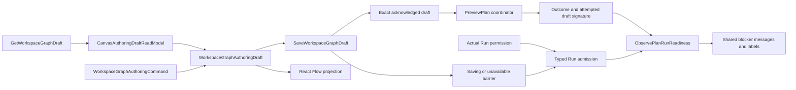
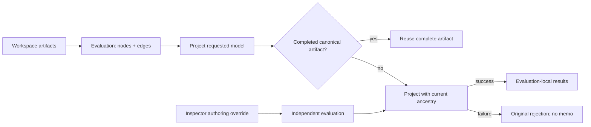
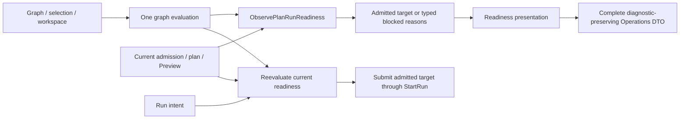
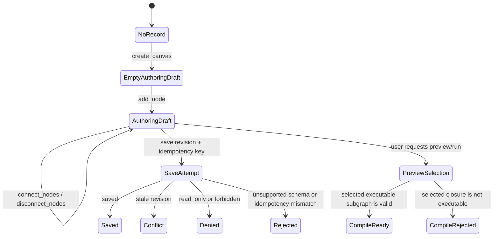
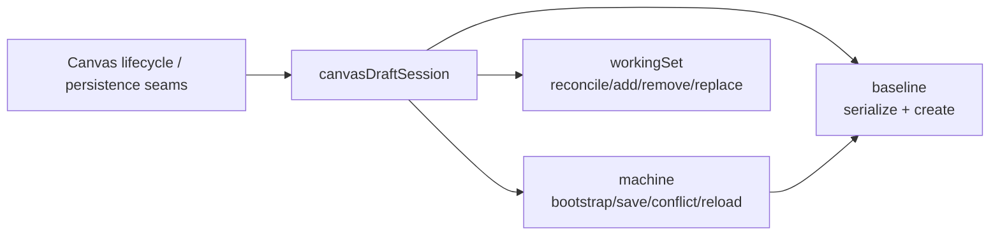
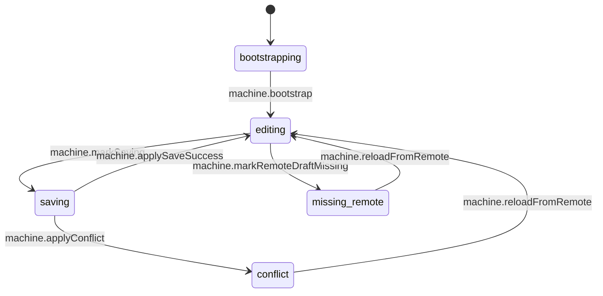
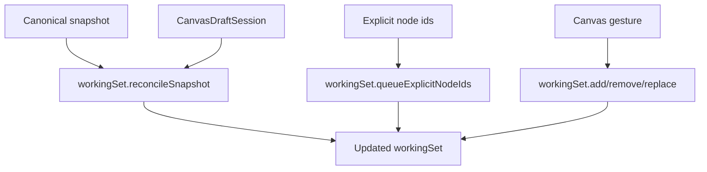

# Canvas Authoring Draft Boundary Component

## Purpose

Canvas persists `WorkspaceGraphAuthoringDraft` through the existing protected
read/save port. `CanvasAuthoringDraftReadModel` preserves its revision,
capability, audit and semantic graph; `CanvasDraftRepository` confirms save
receipts against the canonical remote revision. Renderer projections remain
disposable and are not the save payload.

Planning DB owns the current component/file/responsibility associations. In the
save/readiness slice, persistence scheduling, Preview coordination and execution
readiness have separate owners. The Canvas controller composes them; the API
continues to own protected publication admission. Saving a disposition and
executing it are distinct operations.

The root `dependency-cruiser` configuration enforces the affected import
directions through the existing `arch:deps` gate, including type-only imports:
readiness projections do not depend on command implementations or transports;
autosave does not depend on Preview/Run coordination; execution coordination does
not depend on route composition. The API publication policy does not depend on
UI, infrastructure or composition roots, and contracts do not import applications.
Readiness presentation may consume passive diagnostic translation; its evaluation
cannot import copy, locale or presentation modules. Commands may consume the
readiness query and ports; the route composes these owners.

The current Planning DB definitions name each responsibility's concrete reason
to change and the concerns it delegates. Preview/Run coordination references both
existing command rails; readiness remains on `ObservePlanRunReadiness`. These
records describe current code and do not introduce additional product commands.

## Owned Concern

### Persistence And Execution Readiness

Selecting a native model disposition updates the existing authoring aggregate and
uses `SaveWorkspaceGraphDraft`. Saving `view`, `table` or `ephemeral` does not
assert that the current execution profile admits it or that its destination is
complete. Preview/Run rejection must not be presented as failure to save.

Run readiness preserves the reason supplied by its owner: actual permission
denial, pending draft persistence, unavailable/recovering draft, and Preview
validity are distinct blockers. The operational drawer renders each blocker's
message, not the same global summary for every row. A Preview rejection belongs
to the exact draft signature that produced it and expires when that identity
changes, including when no PlanRef was accepted.

Autosave scheduling follows semantic draft identity and revision. Equivalent
projection objects from unrelated renders must not postpone an authorized save
indefinitely. Genuine edits restart the bounded debounce; a sent save still
acknowledges only its own snapshot, and failed/scope-changed/unmounted attempts
retain the existing guarded recovery behavior.

Owned concern: keep Canvas authoring commands, protected draft reads, protected
draft writes, and React Flow projections aligned with the
`WorkspaceGraphAuthoringDraft` aggregate.

This component does not own:

- protected API authorization;
- HTTP route parsing;
- compare-and-swap storage;
- planner compile semantics;
- preview or run admission;
- standalone layout persistence beyond projecting authoring node positions from
  the aggregate into the renderer.

## DDD Assessment

The target design is DDD-aligned only when the following ownership split is
preserved:

| Concern                 | DDD owner                                             | Rule                                                                          |
| ----------------------- | ----------------------------------------------------- | ----------------------------------------------------------------------------- |
| Editable graph truth    | `WorkspaceGraphAuthoringDraft` aggregate              | The aggregate is the only save payload.                                       |
| Mutation language       | `WorkspaceGraphAuthoringCommand` command value object | UI commands produce aggregate commands before save.                           |
| Protected read envelope | `WorkspaceGraphDraftReadResponse` read model          | Capability, audit, format, revision, and record remain boundary facts.        |
| Protected save receipt  | `WorkspaceGraphDraftSaveResponse` command receipt     | Saved, conflict, denied, schema, and idempotency outcomes stay typed.         |
| Canvas route state      | `CanvasAuthoringDraftReadModel` read model            | Canvas keeps authoring draft and metadata together under Canvas-owned names.  |
| Renderer projection     | `CanvasViewportGraphModel` projection                 | React Flow nodes and edges are derived and disposable.                        |
| Compile projection      | `ExecutableSubgraph` read model                       | Preview/run derives compile input only from an explicit executable selection. |

Canvas-owned state uses `CanvasAuthoringDraftRecord` and
`CanvasAuthoringDraftReadModel`. The former route-local projection DTO names are
not current architecture; protected contract and port names still use
`WorkspaceGraphDraft` intentionally.

## Governing Sources

- `AGENTS.md`
- `docs/planning/status/governance-document-rule-inventory.md`
- `docs/architecture/command-query-rail-governance.md`
- `docs/architecture/fowler-opportunity-planning-governance.md`
- [Workspace graph draft persistence v1](../../../../contracts/planner/workspace-graph-draft-persistence-v1.md)
- [Workspace authoring draft aggregate](../../planner/workspace-authoring-draft-aggregate.md)
- [Canonical API architecture authority](../../api/index.md)
- [TF-E2-A authoring draft hard cut implementation plan](../../../../planning/proposals/mandatory/frontend-and-ux/tf-e2-a-authoring-draft-hard-cut-implementation-plan-20260503.md)

## Public API

| API                                                       | Owner                | Behavior                                                                                                                   |
| --------------------------------------------------------- | -------------------- | -------------------------------------------------------------------------------------------------------------------------- |
| `IWorkspaceGraphDraftAuthoringPort.readGraphDraft()`      | web composition port | Reads the protected draft envelope and preserves boundary-native outcomes.                                                 |
| `IWorkspaceGraphDraftAuthoringPort.saveGraphDraft(input)` | web composition port | Saves `WorkspaceGraphAuthoringDraft` with revision and idempotency key.                                                    |
| `CanvasAuthoringDraftRecord`                              | this component       | Canvas-owned record containing revision, saved time, and `WorkspaceGraphAuthoringDraft`.                                   |
| `CanvasAuthoringDraftReadModel`                           | this component       | Route-facing read model that keeps authoring draft, semantic graph, capability, audit, format, and revision data together. |
| `SaveCanvasDraftInput`                                    | draft repository     | Saves the aggregate with revision and idempotency identity.                                                                |
| `CanvasDraftRepository`                                   | draft persistence    | Reads protected state and confirms saved/conflicting remote revisions.                                                     |

## Invariants

### Source definitions and explicit instances

A registered input owns source configuration. Each explicit catalogue drop
creates a fresh input identity referencing it via `sourceDefinitionId`. The
instance persists no metadata or path override. The shared contracts resolver
supplies current configuration to Canvas and protected preview projections.
Missing, self, chained and incompatible references fail closed. Removing one
instance retains its source definition and siblings. Existing placed definitions
remain valid without migration. These semantics remain on `CreateCanvasNode`
and `SaveWorkspaceGraphDraft`, with existing permission and concurrency gates.

Placement identities use the shared `@dvt/crypto` UUID primitive, not the
secure-context-only browser `crypto.randomUUID` API. The primitive requires
cryptographically secure entropy and fails explicitly when it is unavailable;
there is no timestamp or pseudo-random fallback. The existing injected identity
seam remains available for deterministic tests.

- `WorkspaceGraphAuthoringDraft` is the only protected save payload.
- `apps/web/src/app/ports/workspace.ts` must not export
  `WorkspaceGraphDraft`, `WorkspaceGraphDraftRecord`,
  `SaveWorkspaceGraphDraftInput`, or `SaveWorkspaceGraphDraftResult`.
- `apps/web/src/app/services/workspace/workspaceService.ts` must not re-export
  route-local draft types that were removed from the generic workspace port.
- Route-local types must not be named `WorkspaceGraphDraft`.
- Canvas save, cache, session, and working-set modules must not import
  projected draft records from the generic workspace port.
- compile-ready Substrait plans must not appear in Canvas draft persistence
  modules.
- Read success preserves capability, audit, format metadata, revision, and the
  authoring aggregate.
- Read denial, format error, unsupported schema version, idempotency mismatch,
  conflict, and not-found remain typed outcomes.
- A draft save must lock every Canvas identity in the aggregate and reject the
  complete save when any Canvas is already bound to file-backed authority.
- File-authority binding and graph-draft persistence use the same scoped
  transaction lock identity. A preflight read is advisory only; both write
  paths revalidate ownership inside their transaction.
- Zero nodes, one node, disconnected graphs, and partially connected graphs
  are valid authoring states.
- Compile validity is evaluated only after explicit preview/run selection.
- React Flow nodes and edges are projections; they are not aggregate truth and
  cannot be used as save payloads.
- Layout can project from authoring positions, but it cannot replace protected
  graph truth.

## Command And Query Rails

| Rail                                  | Type    | Bounded context             | DDD owner                                     | Application port                                     | Negative tests                                                                                                                                    |
| ------------------------------------- | ------- | --------------------------- | --------------------------------------------- | ---------------------------------------------------- | ------------------------------------------------------------------------------------------------------------------------------------------------- |
| `GetWorkspaceGraphDraft`              | query   | Workspace authoring         | `WorkspaceGraphDraftReadResponse` read model  | `IWorkspaceGraphDraftAuthoringPort.readGraphDraft()` | unauthenticated, forbidden, not found, format error, unsupported schema                                                                           |
| `SaveWorkspaceGraphDraft`             | command | Workspace authoring         | `WorkspaceGraphAuthoringDraft` aggregate      | `SaveWorkspaceGraphDraftUseCase.execute()`           | rate limited, read-only, forbidden, stale revision, idempotency mismatch, unsupported schema, file-authority conflict, concurrent authority claim |
| `ApplyWorkspaceGraphAuthoringCommand` | command | Canvas authoring            | `WorkspaceGraphAuthoringCommand` value object | Canvas authoring application service                 | duplicate node id, missing node ref, invalid edge ref, non-writable posture                                                                       |
| `ProjectCanvasAuthoringViewportGraph` | query   | Canvas presentation         | `CanvasViewportGraphModel` projection         | Canvas viewport mapper                               | projection cannot mutate draft, missing semantic node fails closed                                                                                |
| `ProjectSelectedExecutableSubgraph`   | query   | Planner execution selection | `ExecutableSubgraph` read model               | planner preview/run boundary                         | loose unselected nodes do not block selected executable closure                                                                                   |

No implementation for `TF-E2-A` may add a UI action, service method, route
helper, Cypress workflow, or architecture test outside these rails without
updating this component and the implementation plan first.

Node duplication remains an `add_node` operation under
`ApplyWorkspaceGraphAuthoringCommand`, gated by writable draft posture. When the
node carries a canonical Substrait document, the copied semantic objects receive
fresh RelationIds and FieldIds through the shared contracts allocator. Every
internal relation, source-field and parent-field reference is remapped together.
The semantic plan and physical provenance remain equivalent; the original node
and its identities remain unchanged. Negative tests retain missing-source,
read-only and duplicate-node admission rejection through the same aggregate.

## Current Boundary

The Preview application command owns validation and the pre-submit flush. Its
React adapter handles cache invalidation, feedback and modal presentation. The
attempt stores outcome and draft signature together; editing expires its visible
diagnostic synchronously without discarding the stale-plan identity guard.

### Preview Receipts Preserve Confirmed Effects

`CanvasPlanActionResult` carries readonly `writtenArtifactPaths` for both success
and failure. Only paths acknowledged by the existing atomic graph-derived dbt
publication command enter that receipt. Later compilation rejection, compilation
exceptions or Preview exceptions do not erase those effects or imply rollback.
Failures before publication acknowledgement carry an empty effect list; planned
paths and unknown outcomes are not reported as confirmed writes.

The Preview command owns the per-attempt effect accumulator and receipt. Its
existing React adapter invalidates the affected workspace file tree, artifacts
and exact file-content keys before presenting either success or failure. A failed
attempt retains its failure message and cannot install a successful Preview,
open its success modal or start Run merely because publication succeeded. This
uses the existing `PreviewPlan` command and compilation/query ports; it does not
introduce a parallel command, compensating deletion or cross-service transaction.

### Preview Strategy Capabilities

`CanvasPlanExecution` reuses the registered strategy discriminator. Only
`planner_generic_preview` requires the workspace-file query, artifact publication
command and model compilation query. Protected DVT and authoritative project-file
Preview retain their existing strategy shape without those adapters. Unavailable
and null strategies retain their existing fail-closed result.

The React handler binds these capabilities at its composition boundary and passes
one execution value to the existing command. Shared permission, draft flush,
selection and confirmed-effect receipt handling stay in `PreviewPlan`. The command
consumes only `previewPlan` from the plan port and the two session methods it uses;
it does not require plan import or session subscription capabilities.

### Readiness Evaluation And Presentation

`ObservePlanRunReadiness` evaluates identity and blockers without an application
language or copy lookup. It owns one persisted-record/identity evaluation and
returns either an admitted plan/PlanRef target or blocked reasons without a
target. Actual permission, draft barriers, execution capability and current
Preview/graph evidence are its inputs. Future-only backpressure and degraded
adapter slots are not current readiness facts and must not be exposed without a
real governed producer.

Current blockers are `plan_integrity`, `capability_mismatch`,
`authorization_denied`, `draft_saving` and `draft_unavailable`. The first reason
from current admission/capability takes precedence; cause-specific graph and
Preview evidence remains available for each affected problem row.

`evaluateCanvasExecutionGraph` resolves the existing strategy fallback and graph
projection once for the exact graph, selection and workspace identity. The React
boundary memoizes those graph facts; plan, language and modal changes do not
recompute them. The admitted protected or dbt projection owns execution eligibility
and the successful semantic draft signature. An absent or rejected projection, or
missing graph authority, has no usable signature (`null`), so a previously
attempted Preview becomes stale.
Readiness retains the current projection failure without a second structural
validator, fallback signature algorithm or unused validation presentation DTO.
Preview reevaluates after draft flush
because it may receive a genuinely changed authoritative snapshot.

For a graph-authored dbt Preview, the existing workspace-artifact projection owns
the content identity: source table/schema, projected columns and materialization
are included through the exact SQL/YAML artifacts in the existing execution-intent
signature. The projection returns those same artifacts and model selectors to the
Preview command; publication does not render them again. Artifact projection
failure leaves no executable graph identity. File-authoritative dbt Preview passes
an explicit absent artifact set because its existing revision/provenance owns
content identity; protected DVT keeps its own projection identity.

The dbt plugin's import-free `normalizeDbtIdentifier` policy in
`plugins/dbt/dbtIdentifier.ts` owns identifier spelling for authoring metadata,
model artifacts, planner selectors, test artifacts and Code file scope. It trims
optional input, separates camel-case boundaries, replaces runs outside ASCII
letters/digits with underscores, removes boundary underscores and lowercases.
An empty normalized value returns the caller's fallback unchanged. Each consumer
imports the policy directly; neither a second normalizer nor a Canvas re-export
owns this behavior. The DVT normalizer currently produces the same spelling but
belongs to PostgreSQL/native authoring and retains its own reason to change;
template naming follows a different policy. Those domains are not generalized
by this extraction. This pure calculation performs no workspace read or write.

`createDbtModelArtifactProjector` owns one synchronous graph evaluation. The
workspace artifact builder creates it once for the selected models and reuses
completed canonical model artifacts when projecting their dependents. Reuse is
private to that evaluation and keyed by the canonical node object; no result
survives into a later graph snapshot. Only successful projections are retained.
Cycle checks and rejected projections keep their current ancestry and diagnostics.
An Inspector authoring override or a model object outside the snapshot starts an
isolated evaluation, so neither a previous canonical success nor an earlier edit
can hide a cycle or change the canonical result. All consumers use this factory;
there is no second one-shot
projection API. The graph, metadata and generated artifact remain the authorities;
memoization introduces no independent admission rule.

`deriveCanvasExecutionState` associates current Preview evidence with that graph
identity and delegates readiness to the shared policy. `StartRun` reevaluates the
current readiness query when invoked and consumes only its admitted target. It
does not trust a cached toolbar boolean or choose messages/modal recovery. The
existing protected backend continues to validate scope and authorization.

`canvasReadinessPresentation` maps those facts to the existing readiness consumer
DTO, shared blocker labels/messages, localized diagnostics and typed Run
rejections. Projection failures have named causes; original lower-level
diagnostic strings remain unparsed evidence. The hook composes policy and
presentation explicitly. The presenter cannot change Preview/Run decisions or
mutate the evaluation. Dependency-cruiser forbids the graph, projection and
evaluation modules from importing presentation, copy or locale dependencies,
including type-only imports; the Run command also remains separate from copy and
presentation. The presenter remains separated from commands and transports.

The operational registrar preserves the complete readiness DTO, including
diagnostic, and observes semantic diagnostic changes in its memoization keys.
Consumers use `planRunReadiness.summary` as the single summary source. The
standalone readiness panel has no product consumer and is retired together with
its test, source bindings and obsolete documentary claims.

## Transitions

## Consumers

- `apps/web/src/app/ports/workspaceGraphDraftAuthoring.ts`
- `apps/web/src/app/services/workspace/workspaceGraphDraftAuthoring.api.ts`
- `apps/web/src/app/services/workspace/workspaceGraphDraftAuthoring.mock.ts`
- `apps/web/src/app/views/canvas/canvasActiveGraphStrategy.test.ts`
- `apps/web/src/app/views/canvas/canvasAuthoringGraphProjection.ts`
- `apps/web/src/app/views/canvas/canvasAuthoringProjection.architecture.test.ts`
- `apps/web/src/app/views/canvas/canvasCenterSurface.types.ts`
- `apps/web/src/app/views/canvas/canvasCreateCanvasDocumentCommand.test.ts`
- `apps/web/src/app/views/canvas/canvasCreateCanvasDocumentCommandPolicy.ts`
- `apps/web/src/app/views/canvas/canvasCreateCanvasDocumentSaveResult.ts`
- `apps/web/src/app/views/canvas/canvasDraftAuthoringComponent.architecture.test.ts`
- `apps/web/src/app/views/canvas/canvasDraftAutosaveExecution.ts`
- `apps/web/src/app/views/canvas/canvasDraftAutosaveScheduling.ts`
- `apps/web/src/app/views/canvas/canvasDraftLifecycleSnapshot.ts`
- `apps/web/src/app/views/canvas/canvasDraftLocalNodeCatalog.ts`
- `apps/web/src/app/views/canvas/canvasDraftReadModel.ts`
- `apps/web/src/app/views/canvas/canvasDraftRepository.ts`
- `apps/web/src/app/views/canvas/canvasDraftAuthoring.ts`
- `apps/web/src/app/views/canvas/canvasDraftQueryCache.ts`
- `apps/web/src/app/views/canvas/canvasDraftSession.ts`
- `apps/web/src/app/views/canvas/canvasDraftSession.types.ts`
- `apps/web/src/app/views/canvas/canvasDraftSessionBaseline.ts`
- `apps/web/src/app/views/canvas/canvasDraftSessionMachine.ts`
- `apps/web/src/app/views/canvas/canvasDraftStructuralSignature.ts`
- `apps/web/src/app/views/canvas/canvasDraftSessionWorkingSet.ts`
- `apps/web/src/app/views/canvas/canvasHostCycleState.ts`
- `apps/web/src/app/views/canvas/useCanvasController.ts`
- `apps/web/src/app/views/canvas/useCanvasAuthoringProjection.architecture.test.ts`
- `apps/web/src/app/views/canvas/useCanvasAuthoringProjection.ts`
- `apps/web/src/app/views/canvas/useCanvasDraftAutosave.ts`
- `apps/web/src/app/views/canvas/useCanvasDraftBaseline.ts`
- `apps/web/src/app/views/canvas/useCanvasDraftBootstrapSync.ts`
- `apps/web/src/app/views/canvas/useCanvasDraftBootstrapping.ts`
- `apps/web/src/app/views/canvas/useCanvasDraftCanonicalReconcile.ts`
- `apps/web/src/app/views/canvas/useCanvasDraftInitialBootstrap.ts`
- `apps/web/src/app/views/canvas/useCanvasDraftLifecycle.ts`
- `apps/web/src/app/views/canvas/useCanvasDraftMissingRemoteSync.ts`
- `apps/web/src/app/views/canvas/useCanvasDraftPersistence.ts`
- `apps/web/src/app/views/canvas/useCanvasDraftRecoveryActions.ts`
- `apps/web/src/app/views/canvas/useCanvasDraftReloadHydration.ts`
- `apps/web/src/app/views/canvas/useCanvasExecutionActions.ts`
- `apps/web/src/app/views/canvas/canvasDraftRecoveryBoundary.architecture.test.ts`

## Architecture Guard Requirements

The implementation must add or update a semantic architecture test that proves:

- `apps/web/src/app/ports/workspace.ts` no longer exports route-local draft
  types;
- `apps/web/src/app/services/workspace/workspaceService.ts` no longer
  re-exports route-local draft types;
- active Canvas draft save inputs do not import `WorkspaceGraphDraft` from
  `apps/web/src/app/ports/workspace.ts`;
- Canvas route modules do not import `WorkspaceGraphDraft` or
  `WorkspaceGraphDraftRecord` from
  `apps/web/src/app/ports/workspace.ts`;
- `canvasDraftRepository.ts` saves `WorkspaceGraphAuthoringDraft` directly;
- `canvasDraftAuthoring.ts` does not compile or validate execution plans;
- DVT compile projection consumes the canonical Substrait authority;
- the component guide, Planning DB architecture record, and GitHub issue all
  name the same command/query rails without duplicating task lifecycle.

## Extension Rules

- Add authoring fields to
  `packages/@dvt/contracts/src/contracts/planner/WorkspaceGraphAuthoringDraft.v1.ts`
  before adding route-local fields.
- Keep transport-only outcomes in the authoring port.
- Keep UI projections in Canvas presentation modules under Canvas-owned names.
- Keep compile projection at the canonical Substrait boundary.
- Delete route-local draft types instead of adding compatibility aliases.
- Do not add compatibility paths accepting compile artifacts,
  `WorkspaceGraphDraft`, projected records, React Flow nodes, or canonical graph
  side channels as protected draft save payload.

## Canvas Draft Session Component

### Purpose

Define the local component model for Canvas draft-session state in `apps/web`.

This page is intentionally narrower than the broader Canvas architecture reviews.
It explains:

- what `canvasDraftSession` is
- which files make up the component
- how the files relate to each other
- which API is public to the rest of the Canvas slice
- which invariants and transitions the component owns

### Governing Sources

- [Canvas Controller Current To Target Architecture](canvas-authoring-runtime-component.md#section-canvas-controller-current-to-target-architecture)
- [Canvas Component Map And Modernization Review](graph-frontend-architecture.md#section-canvas-component-map-and-modernization-review)
- [Graph Sequences And State Machines](graph-frontend-architecture.md#section-graph-sequences-and-state-machines)
- [canvasDraftSession.ts](../../../../../../apps/web/src/app/views/canvas/canvasDraftSession.ts)
- [canvasDraftSession.types.ts](../../../../../../apps/web/src/app/views/canvas/canvasDraftSession.types.ts)
- [canvasDraftSessionMachine.ts](../../../../../../apps/web/src/app/views/canvas/canvasDraftSessionMachine.ts)
- [canvasDraftSessionBaseline.ts](../../../../../../apps/web/src/app/views/canvas/canvasDraftSessionBaseline.ts)
- [canvasDraftSessionWorkingSet.ts](../../../../../../apps/web/src/app/views/canvas/canvasDraftSessionWorkingSet.ts)
- [canvasDraftSession.test.ts](../../../../../../apps/web/src/app/views/canvas/canvasDraftSession.test.ts)
- [canvasDraftSession.architecture.test.ts](../../../../../../apps/web/src/app/views/canvas/canvasDraftSession.architecture.test.ts)

### Component Reading Rule

Read the component in this order:

1. `canvasDraftSession.ts`
   the public API entrypoint for the component
2. `canvasDraftSession.types.ts`
   the aggregate vocabulary
3. `canvasDraftSessionMachine.ts`
   the sync-state transitions and baseline replacement rules
4. `canvasDraftSessionBaseline.ts`
   deterministic baseline serialization and baseline creation
5. `canvasDraftSessionWorkingSet.ts`
   visible-node, visible-edge, and pending-explicit-node policy

If a change does not fit one of those concerns, it probably belongs in another
Canvas seam instead of this component.

### Why This Component Exists

`CanvasDraftSession` is the authoritative route-local draft aggregate for Canvas
authoring. It is the local truth for:

- sync posture
- remote draft baseline
- visible working-set scope
- pending explicit-node admission
- draft revision tracking

It is not responsible for:

- React Flow event translation
- transport or repository calls
- route wiring
- shell startup publication
- render projection

### Public API

The public entrypoint is `canvasDraftSession`.

It is a namespaced API, not a loose set of top-level helper exports. The
component is read through three explicit sub-surfaces:

- `canvasDraftSession.baseline`
  deterministic draft serialization and baseline creation
- `canvasDraftSession.machine`
  aggregate state transitions
- `canvasDraftSession.workingSet`
  aggregate working-set mutation and reconcile policy

This is a hard-cut shape. New call sites should use the namespaced API instead
of reintroducing flat helper imports.

### File Responsibilities

<!-- markdownlint-disable MD060 -->

| File                              | Owned concern                                                       | Public to other modules |
| --------------------------------- | ------------------------------------------------------------------- | ----------------------- |
| `canvasDraftSession.ts`           | component entrypoint and namespaced API export                      | yes                     |
| `canvasDraftSession.types.ts`     | aggregate types and transition argument vocabulary                  | yes                     |
| `canvasDraftSessionBaseline.ts`   | deterministic baseline serialization and baseline creation          | baseline API only       |
| `canvasDraftSessionMachine.ts`    | sync-state transitions over the aggregate                           | machine API only        |
| `canvasDraftSessionWorkingSet.ts` | visible scope mutation, reconcile, and pending explicit-node policy | working-set API only    |

<!-- markdownlint-enable MD060 -->

### Topology

### Transition Model

### Working-Set Policy Model

### Invariants

- `CanvasDraftSession` remains the authoritative route-local draft aggregate.
- Baseline serialization is deterministic for the same draft payload.
- Working-set mutation does not own transport concerns.
- Sync-state transitions do not own React Flow adapter semantics.
- `missing_remote` may only leave fail-closed posture through authoritative
  remote reload; route-local projection must not reopen editing.
- The public API stays namespaced under `canvasDraftSession`; no parallel flat
  helper API should be reintroduced.

### Consumer Rules

- Runtime and lifecycle seams may call `canvasDraftSession.machine`.
- Authoring command seams may call `canvasDraftSession.workingSet`.
- Payload projection and save-signature logic may call
  `canvasDraftSession.baseline`.
- Consumers should not reach into subordinate files directly unless they are the
  component owner and are changing the component itself.

### Drift To Watch

- if `machine` starts accumulating serialization or payload shaping concerns,
  that logic should move back into `baseline` or another narrower seam
- if `workingSet` starts owning UI fallout, selection, or inspector policy, the
  command seam is regressing
- if `canvasDraftSession.ts` becomes a passive re-export barrel again, the
  component loses semantic entrypoint value

> Section status: Active. Owner: Frontend / Architecture. Colocation does not merge component responsibilities.
