# Canvas Authoring Runtime Component

## Purpose

Define the local component model for the Canvas authoring-runtime seam in
`apps/web`.

This page is intentionally narrower than the broader controller and graph pack.
It explains:

- what the authoring-runtime component is
- which files define its public contract and subordinate seams
- which API is public to the rest of the Canvas slice
- which invariants and transitions it owns
- which consumers may depend on it

## Governing Sources

- [Graph Frontend Architecture](./graph-frontend-architecture.md)
- [Canvas Controller Current To Target Architecture](./canvas-controller-current-to-target-architecture.md)
- [Graph Canvas Runtime Model](graph-frontend-architecture.md#section-graph-canvas-runtime-model)
- [Canvas Draft Session Component](canvas-authoring-draft-boundary-component.md#section-canvas-draft-session-component)
- [Canvas Authoring Projection Component](canvas-authoring-runtime-component.md#section-canvas-authoring-projection-component)

## Component Reading Rule

Read the component in this order:

1. `canvasAuthoringRuntime.types.ts`
   the public local contract and argument vocabulary
2. `canvasBackendPosture.ts`
   backend readiness and transport-mutation posture
3. `useCanvasDraftBaseline.ts`
   protected draft repository plus query baseline seam
4. `useCanvasAuthoringRuntimeDraftFlow.ts`
   internal composition over baseline, projection, lifecycle, and local session
   state
5. `canvasAuthoringState.ts`
   route-safe authoring scope, recovery posture, and mutation capability
6. `useCanvasAuthoringRuntime.ts`
   public application-service seam that composes the component

If a change does not fit one of those concerns, it probably belongs in the
controller facade, the draft aggregate, or the projection component instead.

## Why This Component Exists

The Canvas controller needs one route-local application service for authoring:

- it must understand backend posture
- it must own the draft-flow orchestration seam
- it must expose route-safe authoring state to the controller facade

That creates a real local component:

- the contract file defines the public vocabulary
- subordinate seams own one concern each
- the top-level runtime hook composes them without becoming another bag of
  unrelated route helpers

The component is the command-side counterpart to the authoring-projection
component:

- projection explains what the route can see
- runtime explains how authoring posture is composed

## Public API

The public entrypoint is `useCanvasAuthoringRuntime(...)`.

The public contract vocabulary is:

- `UseCanvasAuthoringRuntimeArgs`
- `UseCanvasAuthoringRuntimeDraftFlowArgs`
- `CanvasAuthoringRuntimeBaselineArgs`
- `CanvasAuthoringRuntimePlatformHealthQuery`
- `CanvasAuthoringRuntimePreviewProvenanceConfig`
- `CanvasNodePositions`

This is a hard-cut component API. Internal seams must depend on the contract
file, not on the parent runtime hook.

## Draft Lifecycle DTO Boundary

The draft-flow seam must hand authoring lifecycle state to
`useCanvasDraftLifecycle.ts` through a semantic DTO instead of a flat argument
bag.

Lifecycle-local vocabulary in `canvasDraftLifecycle.types.ts`:

- `CanvasDraftLifecycleDto`
- `CanvasCurrentDraftPayloadDto`
- `CanvasCreateCanvasDocumentCommandDto`

Canonical grouping:

- `baseline`: protected-draft repository, query/cache state, and authority
  posture
- `session`: local draft-session machine plus canonical snapshot and position
  updates
- `projection`: visible graph nodes, canonical graph edges/nodes, and authoring
  provenance needed to build the current payload
- `policy`: explicit persistence posture such as `canPersistGraphDraft`

Inside the lifecycle seam, `useCanvasCurrentDraftPayload.ts` repeats the same
rule: one DTO expresses the current projection and authoring context instead of
another long positional call.

The first-canvas save path follows the same rule. `useCanvasDraftLifecycle.ts`
should compose one narrow create-canvas command seam rather than keeping the
authoritative save and conflict choreography inline in the hook body.

## File Responsibilities

<!-- markdownlint-disable MD060 -->

| File                                    | Owned concern                                                             | Public to other modules |
| --------------------------------------- | ------------------------------------------------------------------------- | ----------------------- |
| `canvasAuthoringRuntime.types.ts`       | component contract and local argument vocabulary                          | yes                     |
| `canvasBackendPosture.ts`               | backend readiness and transport-mutation posture                          | backend posture API     |
| `useCanvasDraftBaseline.ts`             | draft repository plus query/cache baseline for the runtime component      | baseline API only       |
| `useCanvasAuthoringRuntimeDraftFlow.ts` | composition over draft baseline, projection, lifecycle, and session state | draft-flow API only     |
| `canvasCreateCanvasDocumentCommand.ts`  | authoritative first-canvas save and conflict/no-op choreography           | lifecycle-local only    |
| `canvasAuthoringState.ts`               | route-safe visible, UI, execution, and recovery authoring state           | authoring-state API     |
| `useCanvasAuthoringRuntime.ts`          | public application-service composition seam                               | yes                     |

<!-- markdownlint-enable MD060 -->

## Topology

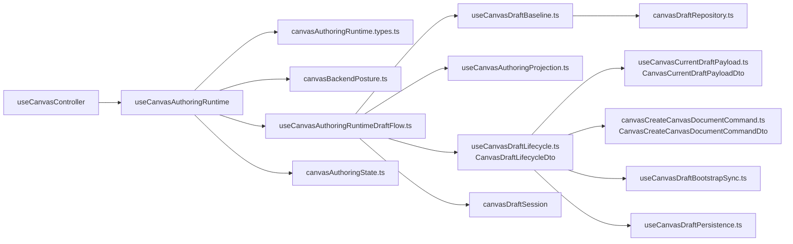

## Transition Model

This component does not own the full aggregate state machine. It owns a
composition transition:

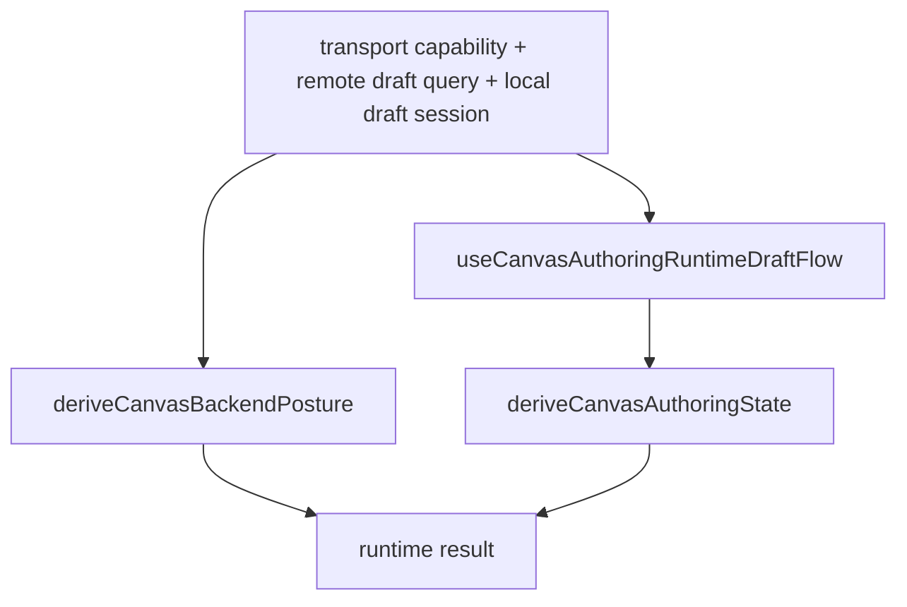

Interpretation rule:

- backend posture determines whether transport-backed editing is even allowed
- draft-flow composition determines the current protected-draft, projection, and
  lifecycle state
- authoring-state derivation turns that runtime truth into route-safe scopes and
  recovery posture

## Invariants

- subordinate seams depend on `canvasAuthoringRuntime.types.ts`, not on
  `useCanvasAuthoringRuntime.ts`
- `useCanvasAuthoringRuntime.ts` stays a composition seam and must not absorb
  query creation, React state creation beyond composition, or repository
  construction
- the runtime contract receives draft persistence authority as
  `canPersistGraphDraftTransport`; using graph editability or `canEditEdges` as
  this transport input is drift
- graph mutation authority remains a separate runtime input named
  `canMutateGraphTransport`; it may depend on `canEditEdges`, but it must not
  decide first-canvas document creation
- `useCanvasDraftBaseline.ts` owns the query baseline and repository/cache
  wiring, not backend posture or recovery rules
- `useCanvasAuthoringRuntimeDraftFlow.ts` owns runtime-local draft-flow
  composition, not route-shell or controller logic
- `useCanvasDraftLifecycle.ts` receives one semantic DTO boundary; adding new
  flat parameters to the hook or to `useCanvasCurrentDraftPayload.ts` is drift
- first-canvas creation remains a dedicated lifecycle-local command seam; do
  not regrow the save, conflict, and status choreography inline in
  `useCanvasDraftLifecycle.ts`
- `canvasAuthoringState.ts` derives route-safe scopes and recovery posture from
  draft truth; it is not a persistence seam
- the public contract must not retain dead parameters or controller-only
  dependencies

## Consumers

Direct consumer:

- `useCanvasController.ts`

Indirect consumers through the controller facade:

- `useCanvasMutationHandlers.ts`
- `useCanvasGraphHandlers.ts`
- `useCanvasExecutionActions.ts`
- route presentation and shell composition through `Canvas.tsx`

## Fitness Functions

The canonical fitness checks for this component are:

- `canvasAuthoringRuntimeComponent.architecture.test.ts`
- `useCanvasAuthoringRuntime.architecture.test.ts`
- `useCanvasAuthoringRuntimeDraftFlow.architecture.test.ts`
- `useCanvasDraftLifecycle.architecture.test.ts`

Those tests must keep proving:

- the runtime contract remains explicit and local
- draft persistence authority remains named separately from graph editability
- draft-flow no longer learns its argument contract from the parent runtime hook
- lifecycle and current-payload seams stay on DTO boundaries instead of
  regrowing transport-shaped parameter lists
- baseline, lifecycle, and authoring-state seams remain separate
- runtime stays a composition seam instead of regrowing into a monolith

## Drift To Watch

- if controller-only dependencies appear in `canvasAuthoringRuntime.types.ts`,
  the component contract is leaking upward
- if `useCanvasAuthoringRuntimeDraftFlow.ts` imports from
  `useCanvasAuthoringRuntime.ts` again, dependency direction has regressed
- if `useCanvasAuthoringRuntime.ts` starts creating queries, repositories, or
  large inline policies, the component is regrowing in the wrong place
- if `useCanvasDraftLifecycle.ts` or `useCanvasCurrentDraftPayload.ts` regrow
  wide positional or transport-shaped parameter lists, the DTO boundary has
  drifted
- if first-canvas save logic migrates back into `useCanvasDraftLifecycle.ts`
  as a large inline branch, the lifecycle seam has started absorbing too much
  policy again
- if route-shell or viewport concerns appear here, the runtime seam is absorbing
  presentation responsibilities

<a id="section-canvas-handler-contracts-component"></a>

## Canvas Handler Contracts Component

### Purpose

Define the local component model for handler contracts and contract builders in
the Canvas route.

This page is intentionally narrower than the broader controller and graph
architecture pack. It explains:

- what the handler-contract component is
- which APIs are public
- which invariants it owns
- how broad route interaction seams are transformed into smaller handler seams
- which facades and handlers consume the component

### Governing sources

- [Canvas Controller Current To Target Architecture](canvas-controller-current-to-target-architecture.md)
- [Canvas Component Map And Modernization Review](canvas-component-map-and-modernization-review.md)
- [Canvas Graph Lifecycle Component](canvas-authoring-runtime-component.md#section-canvas-graph-lifecycle-component)

### Component reading rule

Read the component in this order:

1. `canvasGraphHandlerContracts.ts`
   graph interaction vocabulary for handler seams
2. `canvasGraphHandlerContractBuilders.ts`
   graph contract-builder API
3. `canvasMutationHandlerContracts.ts`
   mutation vocabulary for handler seams
4. `canvasMutationHandlerContractBuilders.ts`
   mutation contract-builder API
5. `useCanvasGraphHandlers.ts` and `useCanvasMutationHandlers.ts`
   composition facades that consume the component

If a change does not fit one of those concerns, it probably belongs in the
controller, in `canvasGraphLifecycle`, or in a specific handler instead.

### Why this component exists

The Canvas route now uses grouped `state`, `effects`, and `policy` contracts to
avoid parent-shaped `Pick<>` inheritance across handler seams.

That creates a real local component:

- contracts define the semantic vocabulary for adapter seams
- builders map broad route interaction seams into smaller sub-handler contracts
- facades consume the namespaced API instead of rebuilding contract shapes
  inline

This component keeps adapter composition explicit without turning handlers into
another domain layer.

### Public API

The public component APIs are:

- `canvasGraphHandlerContractBuilders.edgeAuthoring(...)`
- `canvasGraphHandlerContractBuilders.selection(...)`
- `canvasGraphHandlerContractBuilders.layout(...)`
- `canvasGraphHandlerContractBuilders.nodeAuthoring(...)`
- `canvasMutationHandlerContractBuilders.graphChange(...)`
- `canvasMutationHandlerContractBuilders.sourceImport(...)`

The public contract vocabularies are:

- `CanvasGraphInteractionContracts`
- `CanvasEdgeAuthoringContracts`
- `CanvasSelectionContracts`
- `CanvasLayoutContracts`
- `CanvasNodeAuthoringContracts`
- `CanvasMutationContracts`
- `CanvasGraphChangeContracts`
- `CanvasSourceImportContracts`

### File responsibilities

<!-- markdownlint-disable MD060 -->

| File                                       | Owned concern                                                 | Public to other modules |
| ------------------------------------------ | ------------------------------------------------------------- | ----------------------- |
| `canvasGraphHandlerContracts.ts`           | semantic graph-interaction contract vocabulary                | yes                     |
| `canvasGraphHandlerContractBuilders.ts`    | namespaced mapping from broad graph seams to sub-contracts    | yes                     |
| `canvasMutationHandlerContracts.ts`        | semantic mutation contract vocabulary                         | yes                     |
| `canvasMutationHandlerContractBuilders.ts` | namespaced mapping from broad mutation seams to sub-contracts | yes                     |
| `useCanvasGraphHandlers.ts`                | graph facade that consumes graph contract builders            | consumer only           |
| `useCanvasMutationHandlers.ts`             | mutation facade that consumes mutation contract builders      | consumer only           |

<!-- markdownlint-enable MD060 -->

### Topology

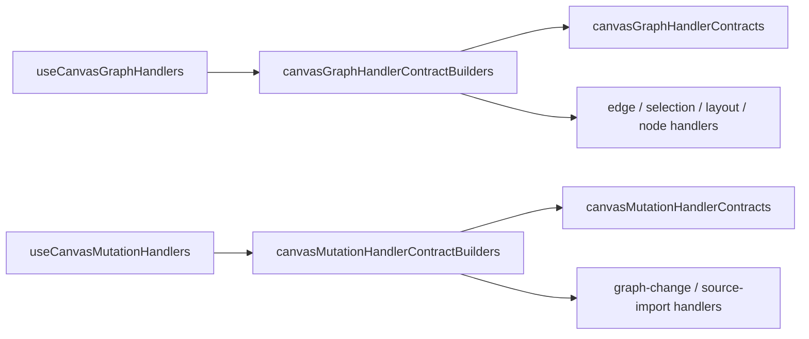

### Contract transitions

This component does not own a domain state machine. Its transitions are
contract-shaping transitions.

#### Graph transition model

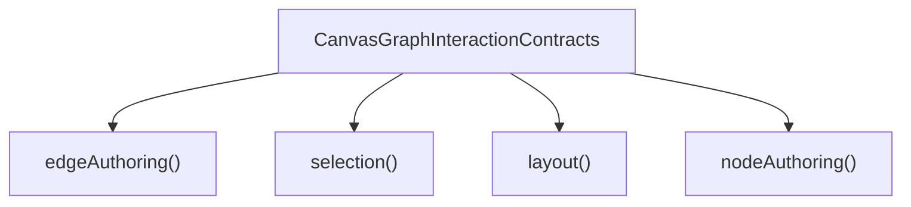

#### Mutation transition model

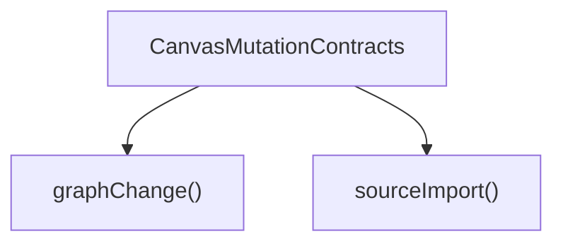

### Invariants

- Contracts use local semantic groupings: `state`, `effects`, and `policy`.
- Builders only map contracts. They do not own React hook state, toast policy,
  graph lifecycle semantics, or persistence logic.
- Handler facades consume namespaced builder APIs instead of rebuilding
  sub-contracts ad hoc.
- Parent-shaped `Pick<>` inheritance is not an accepted contract strategy for
  this slice.
- Graph semantics remain in `canvasGraphLifecycle`, not in this component.

### Consumers

- `useCanvasGraphHandlers.ts`
- `useCanvasMutationHandlers.ts`

Indirect consumers through those facades:

- `useCanvasEdgeAuthoringHandlers.ts`
- `useCanvasSelectionHandlers.ts`
- `useCanvasLayoutHandlers.ts`
- `useCanvasNodeAuthoringHandlers.ts`
- `useCanvasGraphChangeHandlers.ts`
- `useCanvasSourceImportHandlers.ts`

### Fitness functions

The canonical fitness checks for this component are:

- `canvasHandlerContracts.architecture.test.ts`
- `useCanvasGraphHandlers.architecture.test.ts`
- `useCanvasMutationHandlers.architecture.test.ts`

Those tests must keep proving:

- the builder APIs stay namespaced
- facades consume those namespaced APIs
- builders do not absorb hooks, toast, or graph lifecycle ownership

### Drift to watch

- if selection or inspect semantics become domain commands, they belong in an
  adjacent route-command component, not in the contract builders
- if builders begin importing lifecycle or persistence code, the component has
  absorbed the wrong concern
- if broad parent param bags return, the semantic contract hardening has
  regressed

> Section status: Active. Owner: Frontend / Architecture. Colocation does not merge component responsibilities.

<a id="section-canvas-authoring-projection-component"></a>

## Canvas Authoring Projection Component

### Purpose

Define the local component model for the Canvas authoring-projection seam.

This page is intentionally narrower than the broader Canvas architecture pack.
It explains:

- what the authoring-projection component is
- which APIs are public
- how protected draft truth becomes route-facing semantic truth
- where viewport projection begins and ends
- which invariants and consumers the component owns

### Governing Sources

- [Graph Frontend Architecture](graph-frontend-architecture.md)
- [Canvas Controller Current To Target Architecture](canvas-controller-current-to-target-architecture.md)
- [Frontend Fowler Implementation Pattern](../frontend-data-boundary-architecture.md#section-frontend-fowler-implementation-pattern)

### Component Reading Rule

Read the component in this order:

1. `workspaceGraphDraftProjection.ts`
   the protected-boundary projection seam
2. `canvasDraftReadModel.ts`
   the route-facing read-model translation seam
3. `canvasAuthoringGraphProjection.ts`
   the semantic authoring merge seam
4. `useCanvasAuthoringProjection.ts`
   the route-facing composition hook
5. `useCanvasViewportGraphModel.ts`
   the viewport-only projection seam
6. `canvasCanonicalSnapshot.ts`
   the execution-safe canonical snapshot derived from semantic truth

If a change does not fit one of those concerns, it probably belongs in the
repository, the draft aggregate, or the controller read model instead.

### Why This Component Exists

The Canvas route now hard-cuts active authoring semantics to protected
`workspaceGraphDraft` truth.

That requires a local projection component with three separate responsibilities:

- map protected draft payloads into route-facing read models
- compose semantic authoring truth from protected graph semantics plus
  route-local explicit additions
- project that already-composed semantic truth into React Flow state

This component exists to keep those responsibilities explicit instead of
blending them into one hook or one controller-local helper file.

### Public API

The public APIs of the component are:

- `projectProtectedWorkspaceGraphDraftRecord(...)`
- `projectCanvasDraftReadModel(...)`
- `buildCanvasAuthoringGraphProjection(...)`
- `resolveCanvasAuthoringVisibleEdgeId(...)`
- `useCanvasAuthoringProjection(...)`
- `useCanvasViewportGraphModel(...)`
- `buildCanvasCanonicalSnapshot(...)`
- `resolveDvtSubstraitProjectionSource(...)`

This is a multi-surface component, not one namespaced object, because it spans:

- protected-boundary mapping
- read-model translation
- semantic projection
- React hook composition
- viewport projection

### File Responsibilities

<!-- markdownlint-disable MD060 -->

| File                                | Owned concern                                                                        | Public to other modules |
| ----------------------------------- | ------------------------------------------------------------------------------------ | ----------------------- |
| `workspaceGraphDraftProjection.ts`  | project the protected draft boundary into route-facing draft and semantic models     | yes                     |
| `canvasDraftReadModel.ts`           | translate authoring-port outcomes into route-facing draft read models                | yes                     |
| `canvasAuthoringGraphProjection.ts` | compose semantic authoring truth from protected semantics and scoped local additions | yes                     |
| `useCanvasAuthoringProjection.ts`   | compose semantic projection, canonical snapshot, and viewport projection             | yes                     |
| `useCanvasViewportGraphModel.ts`    | project semantic authoring truth into React Flow viewport state only                 | yes                     |
| `canvasCanonicalSnapshot.ts`        | derive execution-safe canonical snapshots from semantic authoring truth              | yes                     |

<!-- markdownlint-enable MD060 -->

### Topology

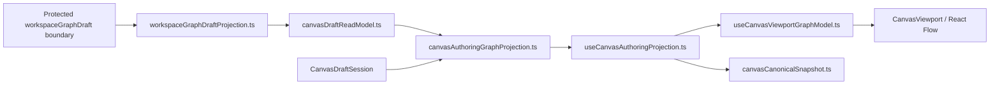

### Projection Transition Model

This component does not own a domain state machine. Its transitions are
projection transitions.

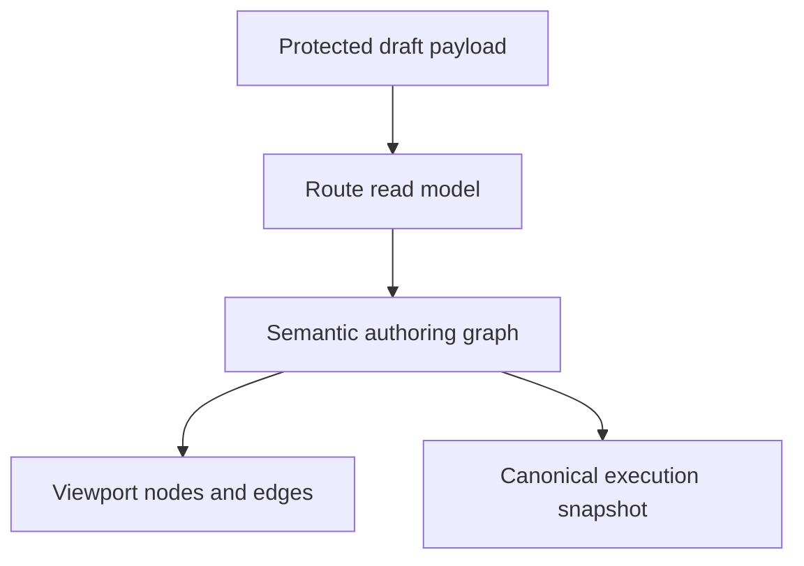

Rule:

- boundary mapping is not semantic merge
- semantic merge is not viewport projection
- viewport projection is not execution snapshot derivation

### Invariants

- protected semantic graph is the first authority when a protected draft record
  exists
- route-local supplementation may add only scoped, explicit, non-persisted
  authoring members that are absent from protected semantic truth
- `useCanvasViewportGraphModel.ts` must not import or understand protected
  draft types
- React Flow node and edge state remain a projection, never semantic authority
- canonical execution snapshot must be derived from semantic canonical nodes
  and edges, not from viewport state
- lossy record projection must not replace semantic graph truth

### Outer Canvas And Model Boundary

The main Canvas projects real Source-to-Model dependencies directly between
their ports. Each dependency retains its own identity, selection, removal and
execution gate. It does not project the Model's internal JOIN/Set operation as
an edge badge, shared relational junction, synthetic node or shared trunk.
Substrait remains the semantic authority inside the Model; internal operations
are inspected and edited in the semantic editor reached from the Model.

The outer node inspector shows factual columns and read-only canonical code,
alongside metadata and the existing Open semantic editor action. It must not
mount composition starters or relation/operator forms in Columns, including
when the Model already contains a canonical projection. Pending and applied
relational editing share the Model Workbench and its selected-node forms.
Shared semantic constructors remain with their existing owners; no compatibility
editor, automatic conversion or second draft authority is retained.

Workspace navigation follows the same controller/view boundary:
`CanvasWorkspaceModelTabs` prepares localized tab data and dispatches navigation;
`CanvasWorkspaceModelTabsTemplate` owns only markup, accessibility and semantic
class names. Shared workspace tab styles remain in `styles/index.css`;
component-specific styles belong to `canvasSemanticEditor.css`, not utility
strings or style attributes in the template. The passive template consumes no
stores, effects, queries or persistence ports.

This presentation follows #3293/#3296 and supersedes the grouped edge badge
presentation from #3227. It does not change persisted graph topology or the
execution snapshot. `canvasViewportEdgeProjection.ts` must not decode internal
Model composition to render an external dependency.

### Operator Form Boundary

The semantic editor's operator form is a local component, not another mutation
authority. `CanvasRelationalTreeOperatorForm` composes a controller with an inline
or modal view. Its `relational-operator-form/` members own:

- `useOperatorForm`: discardable input state, exact integer conversion and
  dispatch to the existing `applyCanvasRelationalOperatorTool` command owner.
- `OperatorFormView`: form submission, error presentation and explicit actions.
- `OperatorFormFields` and `SortKeyFields`: controlled input presentation.
- `operatorFormCopy`: shared English/Spanish presentation copy.

Views receive values and actions; they do not receive persistence ports or call
semantic mutations. Cancelling discards local input. Accepted edits update only
the editor draft; persistence still belongs to explicit Apply through the
existing authoring rail. Selecting a card opens its properties without fetching
rows, running the model or applying a semantic revision.

Applied inspection dispatches by the selected canonical operation, including the
transition immediately after Apply. Sort and Fetch show their projected key/order
or limit/offset summary in Properties and retain the selected data dock. They do
not mount the scalar predicate viewer: a sort-key reference is not a JOIN
condition, and Fetch has no scalar predicate. Read-only inspection follows the
same rule. JOIN and other expression-owning operations retain their existing
expression tree. This boundary must hold while navigation waits for Apply; it
must not reset selection, swallow projection errors or change the saved plan.

Admission and relation kind are separate facts. A rejected Sort or Fetch remains
visibly unsupported and must never enter the JOIN expression viewer, even when
its canonical relation contains expression references. Selection follows the
stable RelationId within the same Model across Apply, not a digest-bearing tree
locator; a removed relation or a different Model falls back to its current root.
Switching selected relations resets the local operator form, not the saved plan.

The `relational-inspection/` component owns the applied inspector presentation
model and panel. An exhaustive operator policy selects source, CROSS, summary,
scalar expressions or unsupported content. Scalar inspection requires the
operator's declared expression slot and a stable relation identity; an arbitrary
nonempty expression list is not admission to that viewer. The parent workbench
only composes its operation shelf, graph and inspector panel. This disposable
view model does not re-decode Substrait or define operation semantics.

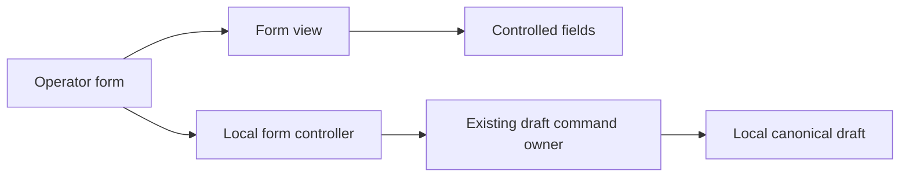

### Relational Card Movement And Reusable Inputs

The #3342 product need distinguishes a connected source or transformed result,
each use of that input in a branch, and its disposable screen position. Reuse
must support inputs as-is and independently transformed branches, not just
self-JOINs of raw Reads. Countries separated by filters and employee/manager
roles are examples, not product-specific types or rules. Occurrence identity
must not be collapsed to the physical source identity during editing or reload.

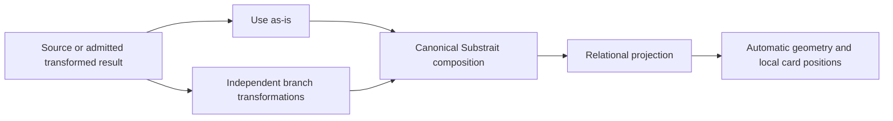

Card movement belongs to the presentation model. It must not mutate the plan,
reorder operands, save a semantic revision, fetch rows or invalidate data.
Positions live only in the open Model editor session, including transitions
between inspection and local editing; they are not persisted in the sidecar.
Pointer movement accounts for zoom; cancellation restores the starting position.
Keyboard movement uses Alt plus arrow keys. Port endpoints follow the card.

The movement microcut does not admit new relation shapes. General reusable-input
authoring remains an open design/delivery criterion in #3342: it must establish
the standard Substrait representation, stable RelationId/FieldId bindings,
shared-upstream versus branch-local edit behavior, reload and PostgreSQL
projection before exposure. A display alias is not a new physical table or a
substitute for this identity boundary.

Occurrence creation and edits must reuse ConfigureCanvasDvtNode and the protected
authoring save rail; preview must reuse PreviewCanvasTransformRows. Business-entity
contracts, hierarchy-cycle validation and recursive operations are outside this
slice. A self-JOIN condition is not a data-quality constraint: invalid source
rows must not be silently hidden by an injected inequality.

The shared PostgreSQL JOIN inspector separates document admission, physical Read
bindings, stage propagation and predicate binding. Its internal
`join-inspection/` modules consume the same Plan and identity sidecar; the public
`inspectDvtSubstraitJoinDraft` and `inspectNInputJoinStructure` entry points remain
the only inspection API. Repeated named-table Reads may share a physical source
while retaining distinct RelationIds and FieldIds. Their schema, table and field
schema must agree; repeated provenance is not permission to change the queried
table. The protected API checks exact physical dependency coverage, not equality
between the number of Read occurrences and graph Sources. Every occurrence
resolves to one authorized source and every selected dependency is used.
Selected-operation preview may use a subset of that already validated closure.

Shared-reader/API admission alone does not complete repeated-input authoring.
Generic transformed branches and end-to-end browser/provider acceptance remain
open in #3342; the bounded occurrence controls below expose only admitted shapes.

The `relational-source-occurrence/` component separates canonical JOIN Read
identity allocation from physical graph binding. Existing Reads are preserved
only by their RelationId, never by matching a table name or physical source.
Each physical binding verifies field names, types and nullability. Repeated
Reads retain separate entries in the relational projection and its reopen seed;
the left source catalogue remains one entry per physical source. A physical
entry with several occurrences cannot arbitrarily select or edit the first one.

Read relation display names follow the existing human-name contract, not the
physical table name. Aliases do not change plan bytes, SQL or protected source
coverage. JOIN edits preserve these labels. The identity foundation does not
admit transformed-result reuse.
Retaining a single Read also preserves its label and identities. If its types or
required-field nullability cannot be expressed by the current projection profile,
removal rejects without changing the draft; it must not silently widen the schema.

#### Explicit Source occurrence controls

The [bounded UI plan](https://github.com/dunay2/dvt/issues/3342#issuecomment-5763838796)
reuses ConfigureCanvasDvtNode. `sourceOccurrencePolicy` owns admission and the
immutable Read-label edit; `sourceOccurrenceActions` prepares the discardable
append intent. Catalogue action, alias properties and append form are separate
presentation components. `useCanvasRelationalTreeDraftState` owns local reset and
hydration; it does not save, query or run the model.

```text
Physical catalogue -> Add instance -> admission -> existing predicate form
                                             -> new canonical Read identity
Read click -> Properties -> alias by RelationId -> local draft
Local draft -> Apply -> existing graph save / CAS -> reopen
Read selection -> existing bottom data dock -> explicit protected data query
```

Add instance admits an existing JOIN accepted by the shared JOIN reader and
compatible connected fields. It does not replace a Project, CROSS, Set or wrapped
composition to manufacture support. The unavailable action explains its reason
and performs no write. Confirmation allocates a Read, not a physical Source or
graph edge. Repeated field options use aliases and, where labels repeat, ordinal
disambiguation; their values remain canonical FieldIds.

A single Read click opens Properties and the existing selected data dock. Alias
edits use the canonical human-name contract, preserve Plan bytes and source
bindings, and remain cancelable until Apply. Read-only inspection exposes no
mutation controls. Non-JOIN alias editing is explicitly unavailable where the
current reader does not admit it. These boundaries do not close #3342: initial
repeated-source construction from a single projection, general transformed reuse
and browser-through-live-PostgreSQL acceptance remain separate pending work.

```text
Canonical document -> document admission -> Read bindings -> JOIN stages
                                                           -> predicate bindings
                   <- verified input/stage/output read model
```

### Consumers

Direct consumers:

- `canvasDraftRepository.ts`
- `useCanvasAuthoringRuntime.ts`
- `useCanvasController.ts`

Indirect consumers:

- `useCanvasControllerReadModel.ts`
- `useCanvasExecutionActions.ts`
- `CanvasViewport.tsx`

### Fitness Functions

#### Compositional regression boundaries (#3352)

Source-append admission is a pure read model, separate from draft construction
and operation-choice presentation. Consumers import that policy directly; there
is no compatibility facade. The operation catalogue remains the single owner of
the supported choice list and its order.

```text
Canonical Substrait -> wrapper admission -> existing JOIN / Set base reader
                                        -> shared bounded Aggregate / Window AST
Protected selected query -> identity-preserving Sort / Fetch removal -> same reader
```

Aggregate and Window inspection share one bounded wrapper policy in
`@dvt/postgres-projection`. JOIN and Set retain their existing base readers and
canonical selectors. Wrapper removal preserves relation and field identities;
generated aggregate outputs do not claim source-field lineage. SQL remains a
projection, never an additional authoring authority.

Protected Preview intent must inspect the base composition through the existing
`peelCanvasDvtSubstraitSortFetch` policy. An admitted ordering or limit wrapper
does not change its physical source closure. Rejected wrappers are not peeled
and must not become executable through a fallback. This inspection is read-only:
the saved canonical document, identities and signature retain every wrapper.

Function reference integrity and bounded-profile admission are separate concerns.
The shared `substrait-profile/` inspection component resolves the referenced
function anchor and its URN anchor unambiguously. Other functions declared in the
same extension module do not change that identity. Missing or duplicate referenced
anchors reject explicitly. COUNT and ROW_NUMBER validators own their invocation
constraints; the calculated-expression and grouped-wrapper readers share them.
Their executable registrations refer to the existing capability catalogue and
do not create another semantic catalogue or import PostgreSQL rendering code.

```text
Plan + functionReference -> reference integrity -> registered invocation validator
Root relType -> registered wrapper inspector -> admitted read model / unsupported reason
Admitted read model -> existing PostgreSQL AST projection
```

Wrapper dispatch selects exactly one inspector by the canonical relation kind.
Failure does not try a different operation. Consumers require the precise
capability they can project: registering another aggregate must not cause a
COUNT-only wrapper to render it as COUNT. Unsupported profile shapes are not
reported as universally invalid Substrait. This boundary does not widen the
existing aggregate, window ordering/frame, or base-document admission profiles.

Canonical correctness is the first acceptance gate: tests assert Substrait
relation selectors, input order, expressions, stable identities and lossless
encode/decode across selection and editing. SQL text or database rows are not an
oracle for the canonical document. PostgreSQL is only the downstream fidelity
gate.

PostgreSQL regression tests must project canonical documents through the API
before executing SQL. Handwritten SQL wrappers around a base projection do not
prove that canonical composition is supported. Browser tests separately prove
Apply, selected-relation identity and data navigation.

The canonical fitness checks for this component are:

- `workspaceGraphDraftProjection.test.ts`
- `canvasAuthoringGraphProjection.test.ts`
- `canvasAuthoringProjection.architecture.test.ts`
- `useCanvasAuthoringProjection.architecture.test.ts`
- `useCanvasViewportGraphModel.architecture.test.ts`

Those tests must keep proving:

- protected-boundary projection stays outside viewport code
- semantic merge stays outside React Flow state ownership
- viewport code does not re-import protected boundary semantics
- canonical snapshot stays derived from semantic truth

#### Browser Scenario Boundaries

`canvas-relational-tree-workbench.cy.ts` owns keyboard entry and workspace
navigation only. The sibling `canvas-relational-workbench-*.cy.ts` specs isolate
viewport behavior, contextual removal, pending JOIN creation, source append,
predicate editing, chain persistence, CROSS preview and UNION creation.
`canvas-relational-workbench-append.cy.ts` proves explicit producer-to-port
connection without publishing before Apply. Instance identity and alias
reopening are covered by `CanvasRelationalTreeWorkbench.source-reopen.test.tsx`
and `relational-source-occurrence/joinOccurrenceIdentity.test.ts`. The retired
source-composition, source-occurrence and contextual-removal browser specs
encoded implicit append gestures; they are not an interaction authority.
Each spec selects its scenario explicitly from
`cypress/support/relationalWorkbench/scenario.ts`; test titles never select
fixtures. Shared support owns navigation, geometry assertions, chain setup and
saved-document inspection, not a parallel semantic implementation.

These browser tests exercise the real Web against controlled API responses.
They assert canonical persisted documents and revision-bound query parameters;
they do not replace PostgreSQL integration tests or prove database results.
The focused suite is run with:

```sh
pnpm --filter @dvt/web test:e2e:native --spec 'cypress/e2e/canvas/canvas-relational-tree-workbench.cy.ts,cypress/e2e/canvas/canvas-relational-workbench-*.cy.ts'
```

### Drift To Watch

- if `canvasDraftReadModel.ts` drops `semanticGraph`, the route becomes lossy
  again
- if `useCanvasViewportGraphModel.ts` starts importing protected draft types,
  the projection boundary has regressed
- if `canvasAuthoringGraphProjection.ts` starts reading React Flow state
  directly, semantic authority has leaked into the adapter layer
- if execution snapshot starts deriving from viewport nodes, command scope is
  no longer governed by semantic truth

> Section status: Active. Owner: Frontend / Architecture. Colocation does not merge component responsibilities.

<a id="section-canvas-graph-lifecycle-component"></a>

## Canvas Graph Lifecycle Component

### Purpose

Define the local component model for graph lifecycle semantics in the Canvas
route.

This page is intentionally narrower than the broader Canvas and Graph
architecture pack. It explains:

- what `canvasGraphLifecycle` is
- which files make up the component
- which API is public to other Canvas seams
- which invariants the component owns
- how the component relates to the draft aggregate and the React Flow adapters

### Governing Sources

- [Graph Frontend Architecture](graph-frontend-architecture.md)
- [Canvas Controller Current To Target Architecture](canvas-controller-current-to-target-architecture.md)
- [Canvas Draft Session Component](canvas-authoring-draft-boundary-component.md#section-canvas-draft-session-component)
- [Graph Sequences And State Machines](graph-frontend-architecture.md#section-graph-sequences-and-state-machines)

### Component Reading Rule

Read the component in this order:

1. `canvasGraphLifecycle.ts`
   the public namespaced API entrypoint
2. `canvasGraphLifecycle.types.ts`
   graph lifecycle vocabulary and mutation-state shape
3. `canvasGraphLifecycle.node.ts`
   node mutation semantics
4. `canvasGraphLifecycle.edge.ts`
   edge mutation semantics
5. the fallout helper used by adapter seams
   UI-state application from already-computed semantic results

If a change does not fit one of those concerns, it probably belongs in another
Canvas seam instead of this component.

### Why This Component Exists

`canvasGraphLifecycle` is the semantic command surface for graph mutation inside
the Canvas bounded frontend authoring context.

It is the local truth for:

- node removal fallout
- node change application when graph mutation is semantic rather than purely
  visual
- visible-edge replacement from canonical edge truth
- edge change application into the draft working set
- explicit-node admission and import queueing

Adjacent command seams, not this component, own:

- duplicate-node identity generation through
  `canvasDuplicateNodeCommand.ts` and `useCanvasNodeDuplicateHandlers.ts`
- reconnect-edge validation over an existing edge identity through
  `confirmReconnect(...)` in `canvasConnectionAggregate.ts` and
  `useCanvasEdgeAuthoringHandlers.ts`

It is not responsible for:

- draft sync-state transitions
- repository or transport calls
- route bootstrapping
- shell publication
- React Flow event timing quirks
- duplicate-node naming or placement policy
- reconnect-edge proposal validation

### Public API

The public entrypoint is `canvasGraphLifecycle`.

It is a namespaced API, not a flat helper set. The component is read through
two explicit sub-surfaces:

- `canvasGraphLifecycle.node`
  node lifecycle semantics, including apply-change and remove behavior
- `canvasGraphLifecycle.edge`
  edge lifecycle semantics, including replace and apply-change behavior

This is a hard-cut shape. New call sites must use the namespaced API instead of
reintroducing flat helper imports.

### File Responsibilities

<!-- markdownlint-disable MD060 -->

| File                            | Owned concern                                       | Public to other modules |
| ------------------------------- | --------------------------------------------------- | ----------------------- |
| `canvasGraphLifecycle.ts`       | component entrypoint and namespaced API export      | yes                     |
| `canvasGraphLifecycle.types.ts` | mutation-state and lifecycle result vocabulary      | yes                     |
| `canvasGraphLifecycle.node.ts`  | node lifecycle semantics and node-change ownership  | node API only           |
| `canvasGraphLifecycle.edge.ts`  | edge lifecycle semantics and visible-edge ownership | edge API only           |

<!-- markdownlint-enable MD060 -->

### Topology

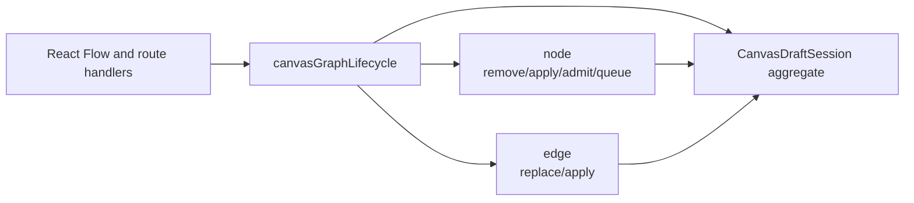

### Command Model

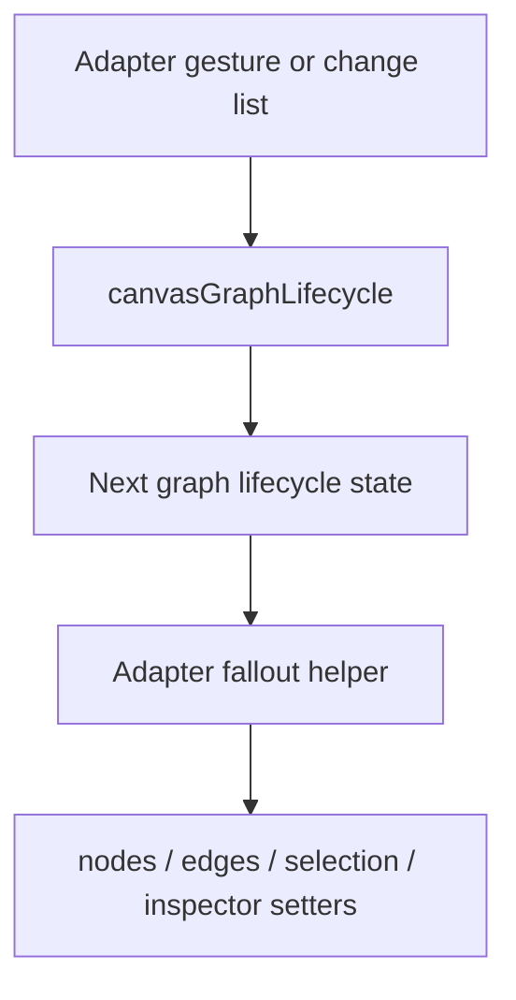

### Adjacent Command Topology

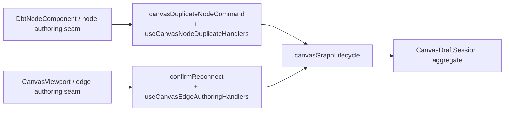

### Relationship To State Machines

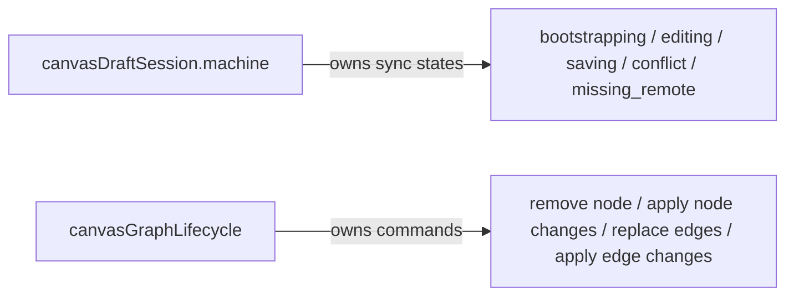

Rule:

- sync lifecycle remains in `canvasDraftSession.machine`
- topology mutation remains in `canvasGraphLifecycle`
- do not collapse both concerns into one monolithic state machine

### Invariants

- `CanvasDraftSession` remains the authoritative route-local draft aggregate.
- `canvasGraphLifecycle` owns graph mutation semantics, not transport.
- React Flow nodes and edges remain projections or command inputs, not the
  source of semantic truth by themselves.
- node and edge adapters may translate events into lifecycle commands, but they
  must not recreate graph lifecycle policy independently.
- no flat compatibility surface should remain once the component exists.

### Consumers

- `useCanvasNodeChangeHandlers.ts`
- `useCanvasNodeRemovalHandlers.ts`
- `useCanvasNodeDropHandlers.ts`
- `useCanvasNodeDuplicateHandlers.ts`
- `useCanvasEdgeChangeHandlers.ts`
- `useCanvasEdgeAuthoringHandlers.ts`
- `useCanvasSourceImportHandlers.ts`

### Drift To Watch

- if selection or inspect semantics become shared domain commands, promote them
  into an adjacent lifecycle or route-command component instead of inflating the
  graph adapters
- if duplicate or reconnect policy gets pushed down into `DbtNodeComponent.tsx`
  or `CanvasViewport.tsx`, the passive-adapter boundary has regressed
- if sync-state transitions start appearing here, they belong back in
  `canvasDraftSession.machine`
- if flat helper exports reappear, the hard cut has regressed

> Section status: Active. Owner: Frontend / Architecture. Colocation does not merge component responsibilities.
