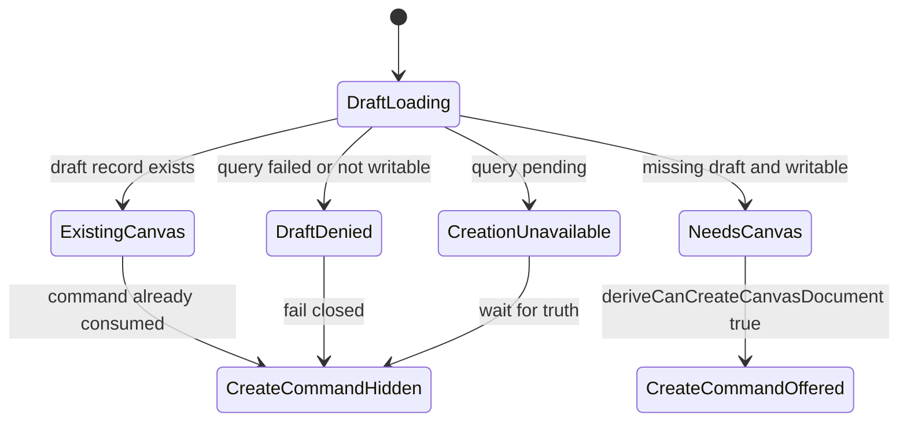
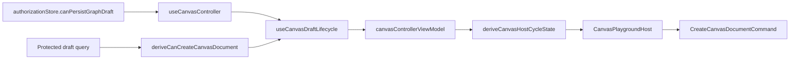

# Canvas First Canvas Creation Capability Component

## Owned Concern

This component owns the local policy that decides whether the Canvas route may
expose the first Canvas document creation command for the active workspace.

It also owns the semantic rule that draft persistence authority and graph edit
authority are separate capabilities. It does not own graph node or edge
mutation, template rendering, protected draft transport, command execution, or
shell navigation.

## Public API

| API                                           | Kind             | Responsibility                                                                             |
| --------------------------------------------- | ---------------- | ------------------------------------------------------------------------------------------ |
| `CanvasCreateCanvasDocumentAvailabilityInput` | parameter object | Carries protected draft read posture and write posture into the policy.                    |
| `deriveCanCreateCanvasDocument(input)`        | policy function  | Returns whether `CreateCanvasDocumentCommand` may be offered for a missing draft document. |
| `UserPermissions.canPersistGraphDraft`        | capability       | Carries server-projected draft persistence authority from session startup into Canvas.     |

## Invariants

- Availability follows protected draft persistence eligibility.
- Availability requires a missing authoritative draft record.
- Availability closes while draft truth is loading or failed.
- Availability closes when the workspace cannot persist graph draft changes.
- Availability must not inspect `canEditEdges`; graph/node/edge mutation begins
  only after a typed Canvas document exists.
- Protected route session projection must map `workspace:graph-draft:save` to
  `canPersistGraphDraft`; explicit `canEditEdges: false` must not remove draft
  persistence authority when the draft-save scope is granted.
- `useCanvasController` must pass `canPersistGraphDraft` into the authoring
  runtime. Passing `canEditEdges` as draft persistence transport is drift.
- The policy must remain pure and side-effect free.

## Transitions

## Component Flow

## Consumers

- `protectedRouteSessionContext.ts`
- `authorizationStore.ts`
- `useCanvasController.ts`
- `useCanvasAuthoringRuntime.ts`
- `useCanvasDraftLifecycle.ts`
- `canvasControllerViewModel.ts`
- `canvasRouteViewState.ts`
- `canvasShellPropsBuilder.tsx`
- `canvasShellLayoutBuilder.tsx`
- `canvasCenterSurfaceWorkbench.tsx`
- `canvasHostCycleState.ts`
- `CanvasPlaygroundHost.tsx`

## Drift To Prevent

- Reintroducing `canEditEdges` into first-canvas document creation
  availability.
- Reintroducing `canEditEdges` as the authoring-runtime draft persistence
  transport handoff.
- Copying protected draft query conditionals into route builders.
- Treating browser e2e proof as a replacement for local policy tests.
- Creating a second first-canvas command rail outside
  `CreateCanvasDocumentCommand`.

## Semantic Fitness Function

- Unit tests must prove that `workspace:graph-draft:save` projects to
  `canPersistGraphDraft` even when explicit graph edit permission is denied.
- Controller tests must prove that first-canvas creation can be available while
  graph handlers remain closed.
- Architecture tests must prove that the authoring runtime accepts
  `canPersistGraphDraftTransport` and that `useCanvasController` does not pass
  `canEditEdges` into the draft persistence seam.

## Canvas First Canvas Creation Capability User Stories

### US-CANVAS-CREATE-CAP-001: Writable missing draft exposes first-canvas creation

As an operator entering an active workspace with no persisted Canvas document, I
can choose a Canvas template because the route can persist the first document
through the protected draft boundary.

Acceptance:

- Given the protected draft query is resolved with no record
- And the workspace can persist graph draft changes
- When the Canvas entry state is rendered
- Then `deriveCanCreateCanvasDocument` returns true
- And the route may offer `CreateCanvasDocumentCommand`

### US-CANVAS-CREATE-CAP-002: Existing draft hides first-canvas creation

As an operator with an existing Canvas document, I should not see first-start
creation choices again.

Acceptance:

- Given the protected draft query has an authoritative record
- When availability is derived
- Then first-canvas creation is false
- And graph-ready or typed-empty route posture owns the next commands

### US-CANVAS-CREATE-CAP-003: Pending or failed draft truth fails closed

As an operator, I should not create a first Canvas document before the route has
authoritative draft truth.

Acceptance:

- Given the protected draft query is pending or failed
- When availability is derived
- Then first-canvas creation is false
- And no local fake success path is introduced

### US-CANVAS-CREATE-CAP-004: Read-only workspace fails closed

As an operator in a read-only workspace, I can inspect governed route state but
cannot create the first Canvas document.

Acceptance:

- Given `canPersistGraphDraft` is false
- When availability is derived
- Then first-canvas creation is false
- And `canEditEdges` remains irrelevant to this decision

### US-CANVAS-CREATE-CAP-005: Graph mutation remains separate from document creation

As a maintainer, I need first-canvas document creation to stay independent from
graph edge mutation so the first Canvas can be created before the graph is
editable.

Acceptance:

- Given no Canvas document exists
- And graph mutation is closed because there is no typed document
- When the draft is writable and missing
- Then first-canvas creation remains available
- And architecture tests fail if lifecycle code inlines the policy or reuses
  `canEditEdges`

### US-CANVAS-CREATE-CAP-006: Draft-save scope survives explicit graph edit denial

As an operator whose session can save the workspace graph draft but cannot edit
existing graph edges, I can still create the first Canvas document because that
is a document lifecycle transition.

Acceptance:

- Given the session grants `workspace:graph-draft:save`
- And explicit `canEditEdges` is false
- And no Canvas document exists
- When protected route session context is projected into Canvas
- Then `canPersistGraphDraft` is true
- And `canEditEdges` remains false
- And first-canvas creation remains available

### US-CANVAS-CREATE-CAP-007: Missing draft-save scope fails closed

As an operator without draft persistence authority, I cannot create a first
Canvas document even if the route can inspect the draft state.

Acceptance:

- Given the session lacks `workspace:graph-draft:save`
- And no explicit `canPersistGraphDraft` permission is granted
- When protected route session context is projected into Canvas
- Then `canPersistGraphDraft` is false
- And `CreateCanvasDocumentCommand` is not exposed

> Acceptance scope status: Active. Owner: Frontend / Canvas.
