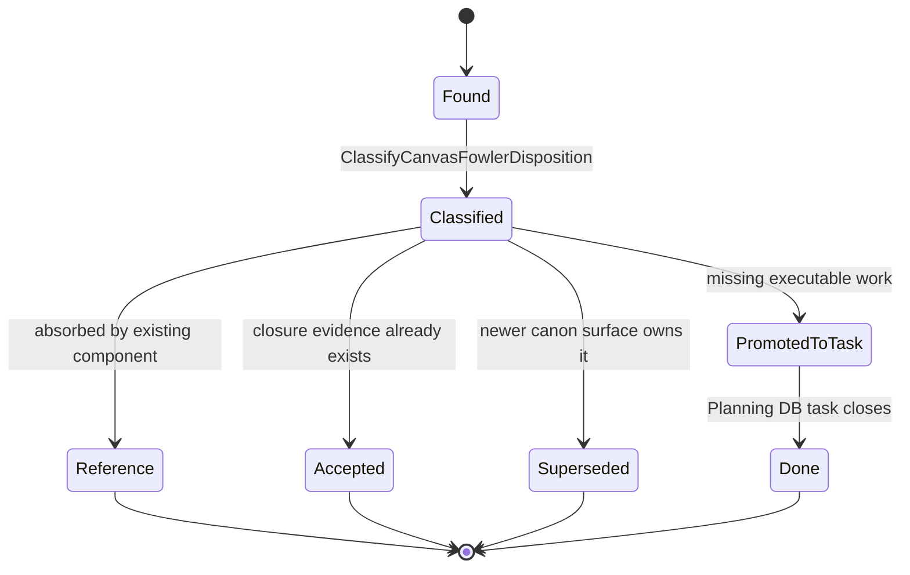
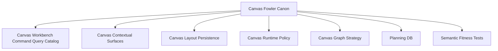

# Canvas Fowler Canon Component

> Owned concern: the Canvas Fowler canon component owns the disposition of
> Canvas Fowler proposals and reviews into explicit component ownership,
> Planning DB tasks, or reference evidence.

## Public API

- `RecordCanvasFowlerCanon(input)`: records a Canvas Fowler input as `closed`,
  `reference`, `accepted`, `superseded`, or `promoted-to-task`.
- `ClassifyCanvasFowlerDisposition(input)`: returns the canonical owner,
  affected component guide, proof expectation, whether Planning DB work is
  required, and the current component owner for rendered Canvas proof.

## Invariants

- A Canvas Fowler review or proposal must not become an execution queue unless
  Planning DB owns the task.
- Runtime Canvas behavior remains owned by the existing Canvas component guide
  family, not by this canon component.
- Shell navigation and Canvas contextual surfaces remain separate read models.
- Browser visual proof remains component evidence, not product authority.
- Docs, user stories, review status, component guide links, and architecture
  tests must name the same owner and rail.

## Transitions

## Consumers

- Canvas maintainers use this component to decide whether a Fowler finding is
  already owned by TF-E2/F-15-era component work or needs a new task.
- Frontend maintainers use it to keep shell navigation, Canvas contextual
  surfaces, layout projection, and visual proof separated.
- Planning stewards use it to prevent mandatory proposals from becoming orphan
  queues.
- Browser proof reviewers use it to route Cypress claims through the current
  component owner and evidence row.

## Command And Query Rail

| Rail                                 | Type    | Owner                                | Surface                                             |
| ------------------------------------ | ------- | ------------------------------------ | --------------------------------------------------- |
| `RecordCanvasFowlerCanon`            | command | Canvas Fowler canon aggregate        | Planning DB task closure and review-board updates   |
| `ClassifyCanvasFowlerDisposition`    | query   | Canvas Fowler disposition read model | Component guide, plan, and review status board      |
| `RenderCanvasContextualGraphSurface` | query   | Canvas contextual graph surface      | Current browser/component proof for rendered Canvas |

## Semantic Fitness Function

`tools/ci/canvas-fowler-canon.test.mjs` validates that the plan, component
guide, user stories, review-board disposition, graph index, and canonical
Fowler mechanization tokens exist together and use the same semantic rails.

It intentionally checks semantic ownership, not only barrel thinness or link
presence.

## Component Grouping

## Related Docs

- [Canvas Fowler Canon User Stories](canvas-fowler-canon-component.md#section-canvas-fowler-canon-user-stories)
- [Canvas Workbench Command Query Catalog](./canvas-workbench-command-query-catalog.md)
- [Canvas Workbench Screen Composition](canvas-shell-component.md#section-canvas-workbench-screen-composition-component)
- [Canvas Layout Persistence Component](./canvas-layout-persistence-component.md)
- [Canvas Fowler Canon Plan 2026-05-23](../../../../planning/proposals/mandatory/frontend-and-ux/canvas-fowler-canon-plan-20260523.md)
- [Canvas Fowler Canon Mailbox Analysis](https://github.com/dunay2/dvt/blob/2df68680de46b9104282a58fd203a7eef551ca38/buzon/20260523-codex-fowler-canvas-workbench-canon.md)

## Canvas Fowler Canon User Stories

> Owned concern: these stories define how Canvas Fowler review inputs are
> consumed without creating duplicate queues, duplicate rails, or hidden UI
> authority.

### Stories

#### Canvas maintainer

As a Canvas maintainer, I want a Canvas Fowler finding to resolve to one
component owner so that graph strategy, runtime policy, contextual surfaces,
layout projection, and browser proof do not compete for the same decision.

Acceptance:

- Accepted TF-E2-L graph-strategy findings remain owned by the graph-strategy
  and admission components.
- Accepted TF-E2-POL runtime-policy findings remain owned by the runtime-policy
  boundary.
- Contextual Canvas surface findings route to their active component owner.
- Layout findings route to `CanvasLayoutPersistence`.

#### Frontend maintainer

As a frontend maintainer, I want global shell navigation and Canvas contextual
surfaces to stay separate so that mature-workbench behavior does not drift into
a single navigation model.

Acceptance:

- `ListShellNavigationItems` remains a shell query.
- `RenderCanvasContextualGraphSurface` remains a Canvas-local query.
- Browser proof stays attached to the component evidence row without redefining
  product semantics.

#### Planning steward

As a planning steward, I want mandatory Canvas proposals to have explicit
Planning DB ownership so that proposed work is either closed, reference-only,
accepted, superseded, or promoted to a task.

Acceptance:

- `F-MAND-CANVAS-FOWLER` is the owning task for this canonization.
- Future Canvas Fowler findings that still need implementation become Planning
  DB tasks before code changes begin.
- Review prose does not act as the work queue.

#### Browser proof reviewer

As a browser proof reviewer, I want Cypress and visual proof to map to a named
query rail so that geometry assertions remain explainable and reviewable.

Acceptance:

- Graph composition proof maps to the current Canvas component evidence row.
- Label readability proof maps to the component or presenter that owns the
  rendered surface.
- Route locality proof checks Canvas outlet ownership rather than shell-nav
  placement.

#### Product reviewer

As a product reviewer, I want Canvas authoring improvements to reference the
same canon owner so that UI polish, route behavior, and governance evidence can
be compared without reading every historical review.

Acceptance:

- The review status board names the canonical disposition.
- The graph architecture index links this canon component.
- The buzon analysis records patterns, antipatterns, drift, and future lessons.

> Acceptance scope status: Active. Owner: Frontend / Architecture.
