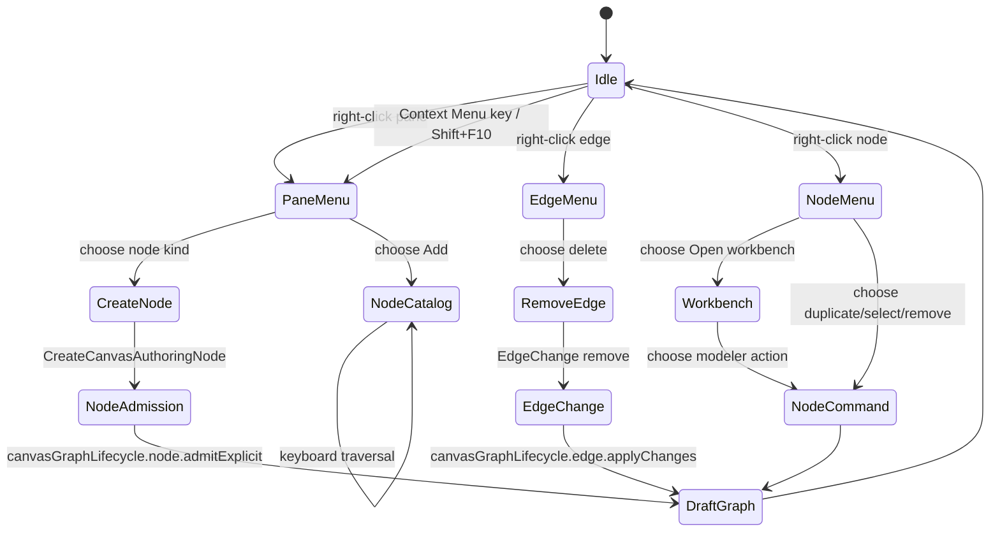
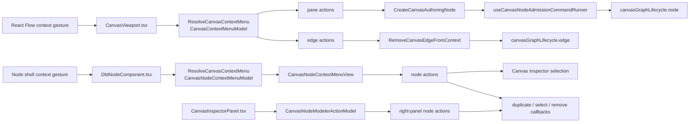
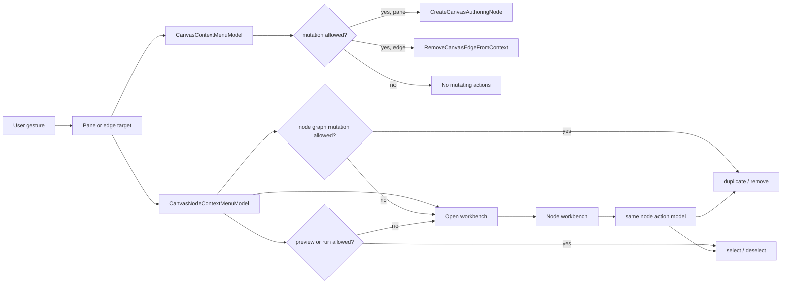
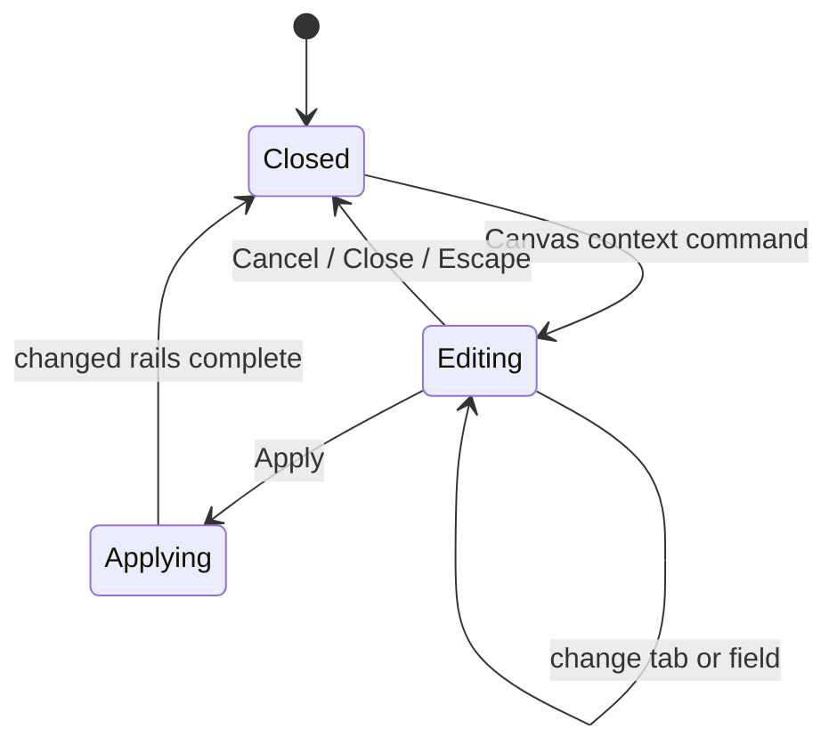
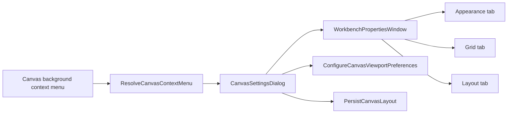

# Canvas Interaction Command Surface Component

## Purpose

This component owns the route-local contextual interaction contract for Canvas
graph targets.

It turns a user gesture on a graph background, edge, or node into an
intention-revealing command model without making React Flow, the browser context
menu, a node renderer, or a toolbar dropdown the source of graph meaning.

It does not own viewport state, node-shell rendering, node identity, graph
lifecycle mutation, or Inspector content. Those concerns stay in their owning
components; this component only normalizes target gestures into rail-backed
node action read models and routes selected actions to existing command seams.
The right Inspector may consume the same node action model for its local
modeler command strip, but the Inspector remains the owner of property content.

## Governing Sources

- `docs/architecture/command-query-rail-governance.md`
- `docs/architecture/fowler-opportunity-planning-governance.md`
- `docs/adr/ADR-0056-web-ui-authority-is-server-projected.md`
- `docs/adr/ADR-0058-warehouse-source-import-rails.md`
- `docs/adr/ADR-0059-canonical-node-identity.md`
- `docs/architecture/components/web/graph/canvas-authoring-runtime-component.md`
- `docs/architecture/components/web/graph/canvas-workbench-command-query-catalog.md`

## Public API

Local public API:

```ts
type CanvasContextMenuTarget =
  | { kind: 'pane'; screenPosition: Point; flowPosition: Point }
  | { kind: 'edge'; edgeId: string; screenPosition: Point };

type CanvasNodeContextMenuModel = {
  target: { kind: 'node'; nodeId: string };
  actionGroups: CanvasNodeContextMenuActionGroup[];
};

type CanvasNodeModelerActionModel = {
  target: { kind: 'node'; nodeId: string };
  actionGroups: CanvasNodeModelerActionGroup[];
};

type CanvasContextMenuModel = {
  kind: 'pane' | 'edge';
  screenPosition: Point;
  flowPosition?: Point;
  edgeId?: string;
  createNodeActions: CanvasContextMenuCreateNodeAction[];
  edgeActions: CanvasContextMenuEdgeAction[];
};

function buildCanvasContextMenuModel(args): CanvasContextMenuModel;
function buildCanvasNodeContextMenuModel(args): CanvasNodeContextMenuModel;
function buildCanvasNodeModelerActionModel(args): CanvasNodeModelerActionModel;
function buildCanvasEdgeContextRemovalChange(edge): EdgeChange<Edge>;
```

Related command seams:

- `ResolveCanvasContextMenu` builds a read model for the visible contextual
  actions.
- `CreateCanvasAuthoringNode` admits a governed node kind into the draft graph.
- `RemoveCanvasEdgeFromContext` converts an edge gesture into the existing
  React Flow edge-change contract, which is then consumed by
  `canvasGraphLifecycle.edge`.
- Node-level actions use the same `ResolveCanvasContextMenu` rail, then dispatch
  to existing workbench, selection, duplicate, and remove-node callbacks
  supplied by the Canvas route. Selection availability follows preview/run
  posture; duplicate and remove availability follows graph mutation posture.
- The Inspector modeler action strip reuses the node action model minus the
  workbench open action. It is not a new command/query rail and does not
  own role, status, or catalog vocabularies.

## File Responsibilities

- `canvasInteractionCommandSurface.ts`: pure pane/edge contextual menu read
  model and edge-removal change construction.
- `canvasNodeContextMenuModel.ts`: pure node-target contextual menu and
  Inspector modeler-action read models.
- `CanvasNodeContextMenuView.tsx`: node context-menu presentation template; it
  renders groups/actions from `CanvasNodeContextMenuModel` and does not own
  workbench sections.
- `CanvasViewport.tsx`: React Flow pane/edge gesture adapter and menu renderer;
  it does not own contextual action policy.
- `CanvasNodeShell.tsx`: React Flow node shell and context-menu trigger; it
  delegates the menu template to `CanvasNodeContextMenuView`.
- `DbtNodeComponent.tsx`: node card adapter; it does not own contextual action
  policy, menu presentation, or node identity semantics.
- `CanvasInspectorPanel.tsx`: right-panel consumer of the node modeler-action
  read model; it delegates command execution to route-supplied handlers and
  does not declare graph mutation policy.
- `canvasAuthoringNodeCommand.ts`: canonical authoring-node command, including
  optional caller-owned origin.
- `useCanvasAuthoringNodeCreationHandlers.ts`: node admission command execution
  and route fallout.
- `canvasGraphLifecycle.edge.ts`: edge-change semantic application into visible
  draft graph state.

## Invariants

- Background right-click opens app-owned contextual actions, not the browser
  default menu.
- The focused background surface opens the same contextual model through the
  Context Menu key or `Shift+F10` at a deterministic point inside the surface.
- Opening a custom Canvas menu captures its opener and focuses the first
  visible menu item after the menu model renders or changes.
- `ArrowUp` and `ArrowDown` wrap through visible menu items; `Home` and `End`
  move to the first and last item. Native button `Enter` and Space activation
  remains unchanged.
- Escape and ordinary outside-pointer close restore focus to the opener. An
  action that transfers focus ownership to a Radix dialog closes without
  overriding Radix focus management.
- Edge right-click opens an edge-specific menu; it does not show node creation
  actions.
- Node right-click opens node-specific actions; it does not show background
  creation or edge-removal actions.
- Open workbench always remains available when the route can inspect the node
  because it is a route-local read/selection action.
- Read-only execution posture produces no execution-selection action.
- Blocked graph mutation posture hides graph-edit actions such as duplicate,
  remove, and schema attachment. Execution selection stays governed by
  preview/run posture.
- Node workbench sections such as Properties, Inputs / Outputs, Tests, SQL,
  Preview, Runs, and Lineage are not node context-menu actions.
- Context-menu node creation uses the clicked flow position, not a hidden
  default slot.
- Toolbar and context-menu node creation share `CreateCanvasAuthoringNode`.
- Edge deletion reuses the existing edge-change lifecycle path instead of
  bypassing draft-session edge replacement.
- `canvasInteractionCommandSurface.ts` is pure: no React hooks, no React Flow
  rendering, and no direct draft mutation.
- `canvasNodeContextMenuModel.ts` is pure: no React hooks, no node rendering,
  and no direct draft mutation.
- The action model may reflect route-local selection state, such as
  execution-selection posture, but domain statuses, roles, node-kind catalogs,
  and authorization vocabularies must come from their owning canonical read
  models or plugin registrations rather than component literals.
- React Flow nodes and edges remain projection state; protected draft
  authority stays behind the existing graph lifecycle and draft session.
- Source connection authority remains server-projected through ADR-0058 rails;
  this component must not simulate source credentials.

## Transitions



## Component Flow



## Consumers

- `CanvasViewport.tsx` consumes the pure model and renders the menu.
- `DbtNodeComponent.tsx` consumes the node model and renders node-shell actions.
- `CanvasInspectorPanel.tsx` consumes the node modeler-action model through the
  route-owned Inspector authoring contract.
- `CanvasShellMainPanel.tsx` passes the active authoring catalog and graph
  command seam into the viewport.
- Fixed toolbar and palette insertion surfaces are retired; creation flows
  through the viewport context menu and the same `CreateCanvasAuthoringNode`
  command seam.
- `useCanvasEdgeChangeHandlers.ts` consumes edge removal as a normal
  `EdgeChange`.

## Fowler Reading

The previous posture mixed a working but hard-coded node-level context menu with
pure pane/edge read models. That is duplicate semantics plus boundary drift:
users could right-click each graph target and see app actions, but only
background and edge gestures were governed by a reusable contextual read model.

The applied pattern is Presentation Model plus Command Gateway. The component
builds a contextual read model, then routes selected actions to existing command
seams. It does not create a second graph aggregate.

## Drift To Prevent

- Do not put context-menu action decisions directly in `CanvasViewport.tsx`.
- Do not put node context-menu action decisions directly in
  `DbtNodeComponent.tsx`.
- Do not put node modeler action decisions directly in `CanvasInspectorPanel.tsx`;
  consume the shared node action model and route-owned handlers.
- Do not call draft-session mutation directly from a context-menu button.
- Do not create another node creation command for background clicks.
- Do not create another node properties command for the context menu; use the
  existing Inspector selection/opening behavior.
- Do not fabricate source connectivity in the context menu; source import
  remains behind `ListWarehouseConnections`, `ListWarehouseConnectionSourceObjects`,
  and `ImportWarehouseSources`.
- Do not let edge deletion bypass `canvasGraphLifecycle.edge`.

## Validation

- `apps/web/src/app/views/canvas/canvasInteractionCommandSurface.test.ts`
- `apps/web/src/app/components/canvas/canvasNodeContextMenuModel.test.ts`
- `apps/web/src/app/views/canvas/CanvasViewport.test.tsx`
- `apps/web/src/app/views/canvas/canvasInteractionCommandSurface.architecture.test.ts`

<a id="section-canvas-interaction-command-surface-user-stories"></a>

## Canvas Interaction Command Surface User Stories

### Stories

- `US-CANVAS-INTERACTION-001`: as a workflow author, I can right-click the
  Canvas background and create a node there. Acceptance: the browser menu is
  suppressed, app actions appear, and the new node uses the clicked point.
- `US-CANVAS-INTERACTION-002`: as a workflow author, I can right-click an edge
  and remove only that edge. Acceptance: the edge menu contains delete, and
  deletion flows through edge lifecycle changes.
- `US-CANVAS-INTERACTION-003`: as a read-only reviewer, I do not see graph
  mutation actions when the graph is not editable. Acceptance: context-menu
  models fail closed for duplicate, remove, and schema attachment when graph
  mutation posture denies graph edits.
- `US-CANVAS-INTERACTION-004`: as a Canvas maintainer, I can reason about
  contextual actions without reading React Flow code. Acceptance:
  `CanvasContextMenuModel` owns target/action semantics and is unit tested.
- `US-CANVAS-INTERACTION-005`: as an architecture reviewer, I can detect drift
  mechanically. Acceptance: architecture tests check docs, rails, stories,
  mailbox analysis, and owned-concern modules.
- `US-CANVAS-INTERACTION-006`: as a workflow author, toolbar Insert and
  right-click creation produce the same node shape. Acceptance: both paths call
  `CreateCanvasAuthoringNode`; only the position source differs.
- `US-CANVAS-INTERACTION-007`: as a data engineer, context menus do not pretend
  to authenticate warehouse sources. Acceptance: source connectivity remains
  documented as ADR-0058 server-owned import rails.
- `US-CANVAS-INTERACTION-008`: as a QA reviewer, I can test contextual behavior
  without native browser menus. Acceptance: presentation tests call React Flow
  context callbacks and assert rendered app actions.
- `US-CANVAS-INTERACTION-009`: as a workflow author, I can right-click a node
  and open its contextual workbench. Acceptance: the action uses the existing
  node inspection/opening behavior and does not create separate context-menu
  actions for Properties, Inputs / Outputs, Tests, SQL, Preview, Runs, or
  Lineage sections.
- `US-CANVAS-INTERACTION-010`: as a read-only reviewer, I can still inspect a
  node but I do not see duplicate, remove, or execution-selection actions.
  Acceptance: the node context-menu read model keeps inspect available, hides
  graph mutation actions when graph edits are denied, and hides execution
  selection when preview and run are denied.
- `US-CANVAS-INTERACTION-011`: as a data modeler, the node Properties panel
  presents available node facts in table-like sections. Acceptance: General,
  Columns, Keys, Indexes, Foreign Keys, Constraints, Comments, Code, and Summary
  sections render available facts or explicit empty states without fabricated
  records.
- `US-CANVAS-INTERACTION-012`: as a data modeler, I can run available node
  commands from the right Properties panel while inspecting a node. Acceptance:
  the panel action strip reuses the node command model, dispatches through
  route-owned handlers, keeps destructive actions unavailable when mutation is
  blocked, and does not embed role, status, or catalog vocabularies.

### Scenario Matrix

- Background create node: `ResolveCanvasContextMenu` ->
  `CreateCanvasAuthoringNode`; primary test: `CanvasViewport.test.tsx`.
- Edge delete: `ResolveCanvasContextMenu` -> `RemoveCanvasEdgeFromContext`;
  primary test: `CanvasViewport.test.tsx`.
- Read-only fail closed: `ResolveCanvasContextMenu`; primary test:
  `canvasInteractionCommandSurface.test.ts`.
- Clicked position retained: `CreateCanvasAuthoringNode`; primary test:
  `canvasAuthoringNodeCommand.test.ts`.
- Architecture drift guard: all rails above; primary test:
  `canvasInteractionCommandSurface.architecture.test.ts`.
- Node workbench: `ResolveCanvasContextMenu` -> node workbench opening and
  modeler-action strip; primary tests:
  `canvasNodeContextMenuModel.test.ts`, `canvasShellPanelsBuilder.test.ts`,
  `CanvasInspectorPanel.test.tsx`.



> Acceptance scope status: Active. Owner: Frontend / Architecture.

<a id="section-canvas-view-menu-component"></a>

## Canvas Properties Window Component

### Purpose

Define the single contextual surface for editing Canvas presentation properties.
The Canvas background context menu opens a properties window composed from the
shared workbench dialog, tab, field, and command components.

This component owns:

- one buffered edit session for Canvas appearance, grid, and layout properties;
- localized tabs, labels, accessible names, focus return, and keyboard dismissal;
- dispatch to the existing Canvas preference and layout command rails only after
  the user selects `Apply`;
- removal of Canvas-specific properties from the global `View` menu.

It does not own graph truth, protected draft persistence, execution commands,
project snapshots, or backend command/query rails.

### Public API

- `WorkbenchPropertiesWindow`: shared modal shell with header, tabs, scrollable
  content, and `Cancel` / `Apply` footer commands.
- `WorkbenchPropertiesSection`: typed tab contribution contract.
- `CanvasSettingsDialog`: Canvas adapter that builds the edit buffer and maps
  fields to the existing callbacks.
- `ResolveCanvasContextMenu`: query rail that exposes the background
  `Canvas properties` command.
- `ConfigureCanvasViewportPreferences`: command rail for local visual
  preferences.
- `PersistCanvasLayout`: command rail used when automatic layout is applied.

### Invariants

- The background context menu is the only entry point for Canvas properties.
- The global `View` menu contains global view controls only: panels, focus mode,
  and language.
- `CanvasSettingsDialog` composes `WorkbenchPropertiesWindow`; it does not create
  a second modal shell or a parallel settings store.
- Field changes remain in the edit buffer until `Apply`.
- `Cancel`, the close command, and `Escape` discard the edit buffer.
- `Apply` invokes only rails whose values changed.
- Automatic layout is unavailable when graph-edit permission is absent.
- Labels and accessible names resolve through the Canvas copy catalog in English
  and Spanish.
- The shell menu must not import Canvas controller hooks, Canvas property state,
  or Canvas-specific contribution stores.

### Transitions



### Component Flow



### Consumers

- `CanvasShell`
- `CanvasViewport`
- `ShellMenu`
- `CanvasSettingsDialog.test.tsx`
- `WorkbenchPropertiesWindow.test.tsx`
- `CanvasSettingsDialog.architecture.test.tsx`
- `TopAppBar.test.tsx`

### User Stories Covered

See [Canvas View Menu User Stories](canvas-interaction-command-surface-component.md#section-canvas-view-menu-user-stories). The
historical story names remain stable; their accepted surface is now the
contextual Canvas properties window.

### Fitness Functions

- `pnpm --filter @dvt/web test:presentation:run -- src/app/components/TopAppBar.test.tsx`
- `pnpm --filter @dvt/web test:canvas-presentation:run -- src/app/views/canvas/CanvasSettingsDialog.test.tsx`
- `pnpm --filter @dvt/web test:canvas-architecture:run -- src/app/views/canvas/CanvasSettingsDialog.architecture.test.tsx`
- `pnpm --filter @dvt/web typecheck`

### Drift To Watch

- Canvas background, grid, layout, or overlay controls reappearing in `View`;
- a route-to-shell contribution store returning for Canvas properties;
- immediate mutation before `Apply`;
- a Canvas-local dialog shell duplicating the shared workbench window;
- unlocalized or inaccessible tab, field, close, or footer commands;
- visual preferences crossing into protected graph or run authority.

<a id="section-canvas-view-menu-user-stories"></a>

### Canvas Properties Window User Stories

The historical `US-CANVAS-VIEW-*` identifiers remain stable, but their accepted
surface is the Canvas contextual properties window rather than the global
`View` menu.

#### UX Stories

##### US-CANVAS-VIEW-001: Keep the top bar and View menu scannable

As a Canvas user, I want Canvas properties in one contextual window so the top
bar and global `View` menu expose only global workflow and view commands.

Acceptance:

- Given I open `/canvas`, layout, overlay, background, and grid controls are not
  rendered as top-bar buttons.
- Given I open `View`, Canvas-specific properties are absent while panels, focus
  mode, and language remain available.
- Given I open the Canvas background context menu, `Canvas properties` opens the
  single properties window.

##### US-CANVAS-VIEW-002: Edit appearance transactionally

As a graph reviewer, I want to stage Canvas background and overlay choices so I
can review them before changing the active view.

Acceptance:

- Appearance groups background, Impact, Columns, Cost when supported, and the
  empty-canvas guide.
- `Apply` invokes only the existing preference callbacks whose values changed.
- `Cancel`, close, and `Escape` invoke no preference callback.

##### US-CANVAS-VIEW-003: Configure grid presentation in one tab

As a graph author, I want grid visibility, size, color, snap, and restore
defaults grouped together.

Acceptance:

- Grid controls are exposed in the localized Grid/Rejilla tab.
- Invalid colors normalize through the existing Canvas palette rules.
- Restoring defaults stages size `20px` and the canonical default grid color;
  it does not apply until `Apply`.

##### US-CANVAS-VIEW-004: Keep layout permission-aware

As an operator, I want automatic layout available in the same properties
window without bypassing graph permissions.

Acceptance:

- The Layout/Distribución tab is available only when graph editing permits
  automatic layout.
- Applying the staged layout request uses the existing layout command.
- The properties window cannot plan or start a run.

#### Architecture Stories

##### US-CANVAS-VIEW-ARCH-001: Reuse one workbench properties component

As a maintainer, I want Canvas to compose a shared properties window rather
than hand-building another modal.

Acceptance:

- `WorkbenchPropertiesWindow` owns dialog structure, tabs, scrolling, footer,
  focus return, and keyboard dismissal.
- `CanvasSettingsDialog` owns only Canvas field composition and edit-buffer to
  callback mapping.
- No Canvas-specific shell contribution store remains.

##### US-CANVAS-VIEW-ARCH-002: Architecture tests validate single-surface semantics

As an architect, I want tests to fail when Canvas properties return to global
View or bypass the shared component.

Acceptance:

- Presentation tests assert Canvas property labels are absent from `View`.
- Architecture tests assert Canvas composes `WorkbenchPropertiesWindow` and the
  retired contribution files do not exist.
- The component guide records public API, invariants, transitions, consumers,
  diagrams, and semantic fitness commands.

> Acceptance scope status: Active. Owner: Frontend / Architecture.

> Section status: Active. Owner: Frontend / Architecture. Colocation does not merge component responsibilities.
