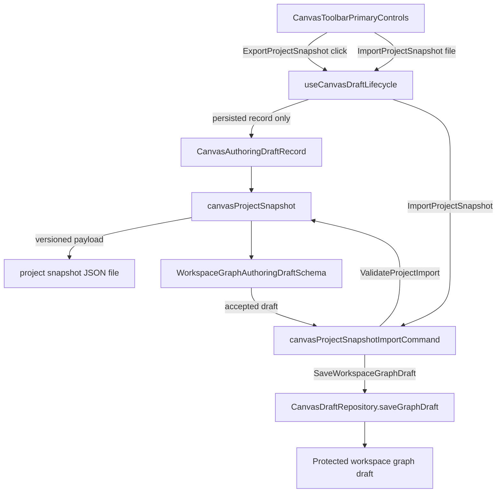
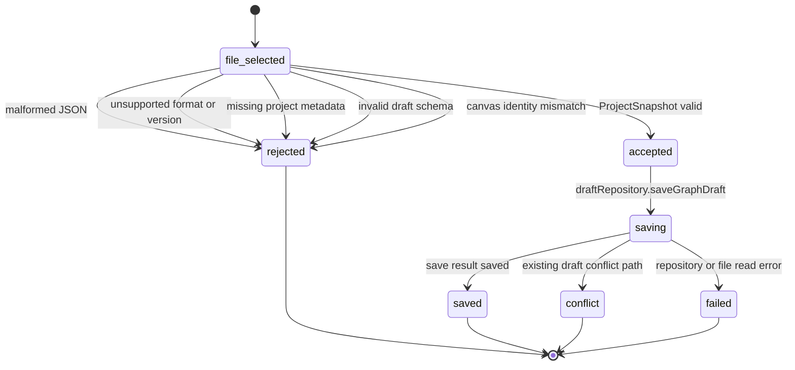
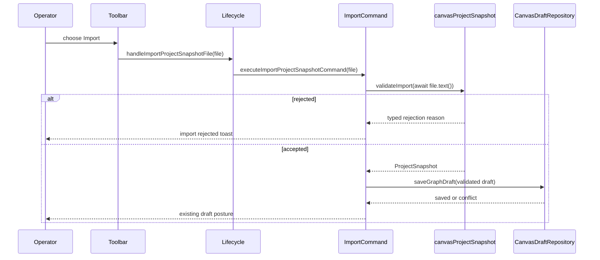
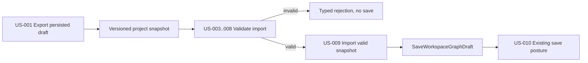
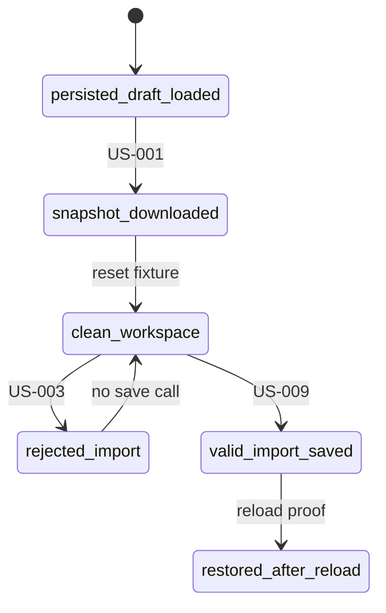

# Canvas Project Snapshot Component

## Purpose

Define the local Web Graph component that exports, validates, and imports a
Canvas project snapshot file without making the file a second graph authority.

The component is intentionally narrower than backend Project Assets. It is a
browser file handoff over the existing protected `WorkspaceGraphAuthoringDraft`
aggregate and the existing `SaveWorkspaceGraphDraft` command rail.

## Governing Sources

- [Canvas Workbench Command And Query Catalog](./canvas-workbench-command-query-catalog.md)
- [Canvas Authoring Draft Boundary Component](./canvas-authoring-draft-boundary-component.md)
- [Canvas Draft Session Component](./canvas-draft-session-component.md)
- [Canvas Project Snapshot User Stories](canvas-project-snapshot-component.md#section-canvas-project-snapshot-user-stories)
- [Stage 3 Project Snapshot Roundtrip Plan](../../../planning/proposals/mandatory/frontend-and-ux/canvas-workbench-stage-3-project-snapshot-roundtrip-plan-20260511.md)
- [Fowler mailbox analysis](https://github.com/dunay2/dvt/blob/2df68680de46b9104282a58fd203a7eef551ca38/buzon/20260511-codex-fowler-canvas-project-snapshot-analysis-and-remediation.md)

## Component Reading Rule

Read the component in this order:

1. `canvasProjectSnapshot.ts`
   the semantic public API and value-object validation boundary
2. `canvasProjectSnapshotImportCommand.ts`
   the import command that owns validation-to-save transition semantics
3. `useCanvasDraftLifecycle.ts`
   the application-controller consumer that bridges toolbar file commands to
   the existing draft repository
4. `CanvasToolbarPrimaryControls.tsx`
   the passive browser file-input surface
5. `canvasProjectSnapshot.test.ts`
   value-object and rejection proof
6. `canvasProjectSnapshotImportCommand.test.ts`
   command proof for accepted import, rejected import, and closed admission
7. `canvasProjectSnapshot.architecture.test.ts`
   semantic component guard
8. `canvas-project-snapshot-roundtrip.cy.ts`
   browser round-trip and fail-closed import proof

If a change needs backend storage, stable long-term file compatibility, or
cross-adapter contract vocabulary, it belongs in a future Project Assets slice,
not in this component.

## Public API

The public component entrypoint is the namespaced `canvasProjectSnapshot` API:

- `canvasProjectSnapshot.format`
  current file format discriminator, currently `dvt.project-snapshot`
- `canvasProjectSnapshot.schemaVersion`
  current local schema version, currently `1`
- `canvasProjectSnapshot.buildFileName(canvasTitle)`
  normalizes a Canvas title into the downloadable snapshot filename
- `canvasProjectSnapshot.exportFile(input)`
  implements `ExportProjectSnapshot` by serializing a persisted draft record
  into a versioned file payload
- `canvasProjectSnapshot.validateImport(contents)`
  implements `ValidateProjectImport` by parsing and validating a candidate file
  before any save command can run

The public value vocabulary remains:

- `ProjectSnapshot`
- `ProjectSnapshotImportReadModel`
- `ProjectSnapshotImportValidation`
- `ProjectSnapshotImportRejectionReason`
- `ExportProjectSnapshotInput`
- `ExportProjectSnapshotResult`

Consumers should prefer the namespaced API for behavior and reserve the
individual exported types for compile-time vocabulary.

## File Responsibilities

<!-- markdownlint-disable MD060 -->

| File                                                                          | Owned concern                                                                    | Public to other modules |
| ----------------------------------------------------------------------------- | -------------------------------------------------------------------------------- | ----------------------- |
| `canvasProjectSnapshot.ts`                                                    | namespaced component API, file envelope, versioning, validation, filename policy | yes                     |
| `canvasProjectSnapshotImportCommand.ts`                                       | import command transition from validated snapshot to authoritative draft save    | lifecycle consumer      |
| `canvasProjectSnapshot.test.ts`                                               | value-object round-trip and rejection semantics                                  | test only               |
| `canvasProjectSnapshotImportCommand.test.ts`                                  | command persistence, rejection, and closed-admission proof                       | test only               |
| `canvasProjectSnapshot.architecture.test.ts`                                  | semantic docs/API/boundary architecture guard                                    | test only               |
| `useCanvasDraftLifecycle.ts`                                                  | application-controller bridge to snapshot export/import commands                 | existing lifecycle API  |
| `CanvasToolbarPrimaryControls.tsx`                                            | passive export/import controls and hidden file input                             | shell consumer only     |
| `canvas-project-snapshot-roundtrip.cy.ts`                                     | browser proof for export, rejected import, valid import, and reload              | Cypress only            |
| `docs/architecture/components/web/graph/canvas-project-snapshot-component.md` | operator scenario coverage                                                       | docs                    |
| `20260511-codex-fowler-...-remediation.md`                                    | branch-level Fowler analysis and remediation rationale                           | mailbox review          |

<!-- markdownlint-enable MD060 -->

## Component Flow

## Import State Machine

## Sequence

## Invariants

- Snapshot JSON is never graph authority until
  `canvasProjectSnapshot.validateImport` accepts it.
- Import must call `CanvasDraftRepository.saveGraphDraft`; it must not seed
  repository state, local route state, or Cypress state directly.
- Export reads a persisted `CanvasAuthoringDraftRecord`; it must not export a
  failed or unsaved local working set as if it were authoritative.
- `ProjectSnapshot.format` and `ProjectSnapshot.schemaVersion` must be present
  and checked before draft validation.
- The declared Canvas identity must match the draft payload identity.
- Project metadata is audit context for the file. Import writes into the
  current workspace through the existing draft rail.
- File-read errors, malformed JSON, unsupported versions, invalid drafts, and
  repository failures remain fail-closed.

## Transitions

<!-- markdownlint-disable MD060 -->

| Transition                                 | Rail                     | Result                                                                   |
| ------------------------------------------ | ------------------------ | ------------------------------------------------------------------------ |
| persisted draft to JSON file               | `ExportProjectSnapshot`  | versioned `ProjectSnapshot` download                                     |
| file text to rejected import read model    | `ValidateProjectImport`  | typed rejection and no save attempt                                      |
| file text to accepted import read model    | `ValidateProjectImport`  | normalized `ProjectSnapshot` with validated authoring draft              |
| accepted snapshot to protected draft save  | `ImportProjectSnapshot`  | `SaveWorkspaceGraphDraft` through `CanvasDraftRepository.saveGraphDraft` |
| repository saved/conflict/failure to route | existing draft lifecycle | existing saved, conflict, or failed posture                              |

<!-- markdownlint-enable MD060 -->

## Consumers

- `useCanvasDraftLifecycle.ts`
  exposes command admission and delegates import persistence to the semantic
  command.
- `canvasProjectSnapshotImportCommand.ts`
  owns import validation fallout and repository save orchestration.
- `CanvasToolbarPrimaryControls.tsx`
  raises export/import events and does not inspect snapshot internals.
- `CanvasToolbar.tsx`, `CanvasShellMainPanel.tsx`, and shell builders
  propagate command availability and callbacks only.
- `canvasProjectSnapshot.test.ts`
  proves value-object behavior and negative cases.
- `canvas-project-snapshot-roundtrip.cy.ts`
  proves the browser route uses the same rails end to end.

## Local Traceability

- Command/query rails:
  `ExportProjectSnapshot`, `ValidateProjectImport`, `ImportProjectSnapshot`,
  and existing `SaveWorkspaceGraphDraft`
- Component guide:
  `docs/architecture/components/web/graph/canvas-project-snapshot-component.md`
- User stories:
  `docs/architecture/components/web/graph/canvas-project-snapshot-component.md`
- Mailbox:
  [Historical record](https://github.com/dunay2/dvt/blob/2df68680de46b9104282a58fd203a7eef551ca38/buzon/20260511-codex-fowler-canvas-project-snapshot-analysis-and-remediation.md)
- Unit tests:
  `apps/web/src/app/views/canvas/canvasProjectSnapshot.test.ts`
  `apps/web/src/app/views/canvas/canvasProjectSnapshotImportCommand.test.ts`
- Architecture test:
  `apps/web/src/app/views/canvas/canvasProjectSnapshot.architecture.test.ts`
- Cypress proof:
  `apps/web/cypress/e2e/canvas/canvas-project-snapshot-roundtrip.cy.ts`

## Drift To Watch

- If more than one snapshot version must be supported, split version parsing
  from import validation instead of growing one conditional blob.
- If Project Assets becomes backend persistence, create new API contracts,
  storage adapters, and an ADR; do not extend this browser file component
  silently.
- If toolbar copy, Cypress selectors, or file names start carrying product
  semantics, move the semantics back into the component API and C&Q catalog.
- If import starts reconciling into a local draft session before validation,
  the component has lost its anti-corruption boundary.

## Canvas Project Snapshot User Stories

### Purpose

Record the operator scenarios for Canvas project snapshot export/import and
tie each scenario to its command/query rail and proof surface.

The stories cover local browser file handoff only. They do not promise backend
Project Assets, multi-version compatibility, source-control import, or
cross-workspace restore semantics beyond the existing protected draft save
rail.

### User Stories

#### US-CANVAS-PROJECT-SNAPSHOT-001 Export Persisted Draft

As an operator, I can export the current persisted Canvas draft to a project
snapshot JSON file so that I can carry the workspace draft through a local file.

Acceptance:

- export is available only when a persisted draft record is loaded
- the file contains `format`, `schemaVersion`, project metadata, Canvas
  identity, source revision metadata, and the authoring draft payload
- export uses `ExportProjectSnapshot`

#### US-CANVAS-PROJECT-SNAPSHOT-002 Reject Missing Draft Export

As an operator, I cannot export a snapshot while the persisted draft is missing,
loading, failed, saving, or known failed locally.

Acceptance:

- no fake file is produced
- the route reports unavailable export posture
- the protected draft repository is not mutated

#### US-CANVAS-PROJECT-SNAPSHOT-003 Reject Malformed JSON

As an operator, I get a clear rejection when the selected import file is not
valid JSON.

Acceptance:

- validation returns `malformed_json`
- `ImportProjectSnapshot` does not call `SaveWorkspaceGraphDraft`
- Cypress proves the rejected import does not increase draft-save calls

#### US-CANVAS-PROJECT-SNAPSHOT-004 Reject Unsupported Format

As an operator, I cannot import a JSON object that is not a DVT project
snapshot.

Acceptance:

- validation returns `unsupported_format`
- no draft save is attempted

#### US-CANVAS-PROJECT-SNAPSHOT-005 Reject Unsupported Version

As an operator, I cannot import a snapshot whose schema version is not supported
by this local component.

Acceptance:

- validation returns `unsupported_version`
- no compatibility migration is implied
- no draft save is attempted

#### US-CANVAS-PROJECT-SNAPSHOT-006 Reject Missing Project Metadata

As an operator, I cannot import a snapshot that lacks tenant, project,
environment, or adapter audit metadata.

Acceptance:

- validation returns `missing_project_metadata`
- the route does not infer hidden metadata from the current URL

#### US-CANVAS-PROJECT-SNAPSHOT-007 Reject Invalid Draft Payload

As an operator, I cannot import a snapshot whose draft payload does not match
the governed `WorkspaceGraphAuthoringDraft` schema.

Acceptance:

- validation returns `invalid_draft`
- malformed node, edge, position, or Canvas payloads remain outside the draft
  repository

#### US-CANVAS-PROJECT-SNAPSHOT-008 Reject Canvas Identity Mismatch

As an operator, I cannot import a snapshot whose declared Canvas identity
disagrees with the embedded draft payload.

Acceptance:

- validation returns `canvas_identity_mismatch`
- the imported file cannot lie about the Canvas kind or title

#### US-CANVAS-PROJECT-SNAPSHOT-009 Import Valid Snapshot

As an operator, I can import a valid project snapshot into the current workspace
draft so that the Canvas graph, positions, and Canvas title are restored after a
reload.

Acceptance:

- validation accepts the file
- import uses `ImportProjectSnapshot` and existing `SaveWorkspaceGraphDraft`
- the browser proof reloads and sees the restored node and Canvas title

#### US-CANVAS-PROJECT-SNAPSHOT-010 Preserve Existing Save Failure Semantics

As an operator, I see the existing draft save conflict or failure posture when a
valid snapshot cannot be saved.

Acceptance:

- import does not create a parallel conflict model
- repository conflicts use the existing draft lifecycle conflict path
- repository failures use the existing failed save posture

### Scenario Matrix

| Story                          | Rail                      | Primary proof                                       | Negative proof                        |
| ------------------------------ | ------------------------- | --------------------------------------------------- | ------------------------------------- |
| US-CANVAS-PROJECT-SNAPSHOT-001 | `ExportProjectSnapshot`   | `canvasProjectSnapshot.test.ts`, Cypress export     | export unavailable when draft missing |
| US-CANVAS-PROJECT-SNAPSHOT-002 | `ExportProjectSnapshot`   | lifecycle command gating                            | no file for missing/failed draft      |
| US-CANVAS-PROJECT-SNAPSHOT-003 | `ValidateProjectImport`   | Cypress malformed import                            | no `saveGraphDraft` call              |
| US-CANVAS-PROJECT-SNAPSHOT-004 | `ValidateProjectImport`   | value-object rejection tests                        | `unsupported_format`                  |
| US-CANVAS-PROJECT-SNAPSHOT-005 | `ValidateProjectImport`   | value-object rejection tests                        | `unsupported_version`                 |
| US-CANVAS-PROJECT-SNAPSHOT-006 | `ValidateProjectImport`   | component invariant and future unit extension point | `missing_project_metadata`            |
| US-CANVAS-PROJECT-SNAPSHOT-007 | `ValidateProjectImport`   | value-object rejection tests                        | `invalid_draft`                       |
| US-CANVAS-PROJECT-SNAPSHOT-008 | `ValidateProjectImport`   | value-object rejection tests                        | `canvas_identity_mismatch`            |
| US-CANVAS-PROJECT-SNAPSHOT-009 | `ImportProjectSnapshot`   | Cypress valid import plus reload                    | import must use `saveGraphDraft`      |
| US-CANVAS-PROJECT-SNAPSHOT-010 | `SaveWorkspaceGraphDraft` | existing draft lifecycle conflict/failure tests     | no project-snapshot-specific conflict |

### Scenario Flow

### Test-State Model

### Out Of Scope Stories

- Backend project asset storage.
- Stable long-term snapshot compatibility across multiple versions.
- Multi-canvas project bundle export.
- Importing into a different tenant or project as an authorization bypass.
- Source-control import or external artifact registry integration.

> Acceptance scope status: Active. Owner: Frontend / Architecture.
