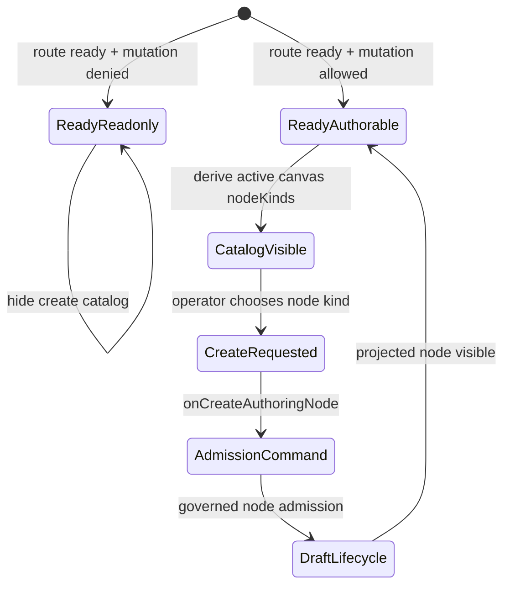
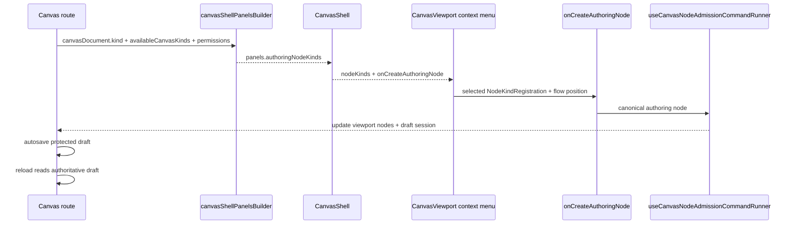

# Canvas Ready Node Authoring Entrypoint Component

## Purpose

This component owns the route-visible node creation entrypoint for a ready
Canvas document. It lets an operator add more governed nodes after the first
graph already exists.

It is intentionally a shell authoring affordance, not a new graph mutation
path. Creation still flows through the existing node admission command runner
and draft lifecycle.

## Governing Sources

- [Graph Frontend Architecture](./graph-frontend-architecture.md)
- [Canvas Shell Component](./canvas-shell-component.md)
- [Canvas Empty Authoring Entrypoint Component](./canvas-empty-authoring-entrypoint-component.md)
- [Canvas Authoring Runtime Component](./canvas-authoring-runtime-component.md)
- [Canvas Graph Lifecycle Component](canvas-authoring-runtime-component.md#section-canvas-graph-lifecycle-component)

## Public API

The public API remains the shell contract:

```ts
type CanvasShellPanels = {
  explorerResourceGroups: readonly CanvasWorkspaceResourceGroup[];
  authoringNodeKinds: readonly NodeKindRegistration[];
  // ...
};

type CanvasShellGraphCommands = {
  onCreateAuthoringNode: (registration: NodeKindRegistration) => void;
  // ...
};
```

Visible UI consumes that contract through:

- `CanvasShellMainPanel.tsx`
- `CanvasViewport.tsx`
- `useCanvasContextMenuPresenter.ts`

Contract derivation is owned by:

- `canvasShellPanelsBuilder.ts`
- `canvasShellPropsBuilder.tsx`

## Invariants

- Ready-canvas creation must use the active `canvasDocument.kind`.
- The visible creation catalog must come from the matching
  `CanvasKindRegistration.nodeKinds`.
- The Explorer rail must not call `getAllNodeKinds` or create a global catalog.
- Mutations denied by effective route permissions expose no create buttons.
- Clicking a create button must call `onCreateAuthoringNode(registration)`.
- Node admission remains owned by `useCanvasNodeAdmissionCommandRunner`.
- `DbtExplorer` must not render creation affordances or receive creation
  commands.
- The visible ready-canvas creation entrypoint is the Canvas context menu.
- Existing project-node drag/drop remains a separate affordance.
- Authored node creation and removal must round-trip through protected draft
  save/read before being treated as durable across reloads.
- Failed draft saves must not be presented as durable authoring state after a
  route reload.

## Transitions



## Sequence



## Consumers

- `CanvasShellMainPanel.tsx` wires shell panel data to the viewport.
- `CanvasViewport.tsx` renders the active ready-canvas context menu and passes
  selected node kinds to the authoring command.
- `useCanvasContextMenuPresenter.ts` routes selected menu actions to the
  existing command seam.
- `useCanvasAuthoringNodeCreationHandlers.ts` handles the command.
- `canvasShellPanelsBuilder.test.ts`, `CanvasShell.test.tsx`, and
  `DbtExplorer.test.tsx` prove behavior.
- `CanvasShell.architecture.test.tsx` proves semantic architecture.
- `canvas-ready-node-authoring.cy.ts` proves add, save, reload, remove,
  failed-save, and read-only user flows.

## Fowler Reading

The mature pattern here is an application-service command exposed through a
thin view. The view chooses from a governed catalog; the command runner owns
the mutation. Systems such as Dagster, NiFi, and dbt graph editors keep
palette/catalog selection distinct from graph admission and validation. This
slice now follows the same split for ready canvases.

## Drift Guards

- Do not reintroduce a second ready-canvas node list beside
  `CanvasKindRegistration.nodeKinds`.
- Do not let `DbtExplorer` write draft session state.
- Do not let `DbtExplorer` render node-kind creation buttons.
- Do not hide local node creation behind source import capability.
- Do not make ready-canvas creation available when `canEditEdges` is false.
- Do not route ready-canvas creation through fixed toolbar, side-rail, or
  drag/drop-only affordances.
- Do not count a local node as durable unless the protected draft save and
  subsequent authoritative read preserve it.

<a id="section-canvas-ready-node-authoring-user-stories"></a>

## Canvas Ready Node Authoring User Stories

### Scope

These stories cover adding, persisting, reloading, and removing governed nodes
from an existing ready Canvas document through the `Insert` node menu.

### Stories

#### US-WEB-CANVAS-READY-NODE-001: Add a node after the graph already exists

As an operator editing a ready transformation canvas, I can choose an available
node kind from `Insert` so that I can extend the graph without
returning to an empty-state screen.

Acceptance:

- the toolbar or top-menu `Insert` shows node kinds when mutation is allowed
- the menu lists node kinds from the active canvas kind
- selecting a node kind creates a node through the governed authoring command

#### US-WEB-CANVAS-READY-NODE-002: Keep project resources and node creation separate

As an operator, I can drag project resources from the Explorer while using
`Insert` for new local authoring nodes.

Acceptance:

- existing project nodes remain grouped by kind
- `Insert` create buttons do not replace drag/drop
- the Explorer does not duplicate node-type creation
- both paths use governed node admission

#### US-WEB-CANVAS-READY-NODE-003: Respect read-only posture

As a read-only operator, I can inspect project resources without seeing
mutating node creation actions.

Acceptance:

- `Insert` creation is disabled or hidden when `canEditEdges` is false
- the Explorer never shows `Add node`
- project resources remain visible for inspection
- import and creation commands are not exposed

#### US-WEB-CANVAS-READY-NODE-004: Use the active canvas runtime catalog

As a platform maintainer, I need ready-canvas creation to use the active canvas
runtime catalog so plugin-specific node kinds do not leak across canvases.

Acceptance:

- the catalog is selected by `canvasDocument.kind`
- no global node-kind catalog is used in the shell panels builder
- unsupported or missing canvas documents expose no ready-canvas create list

#### US-WEB-CANVAS-READY-NODE-005: Preserve admission policy

As a platform maintainer, I need button-created nodes to pass through the same
admission policy as dropped or empty-state nodes.

Acceptance:

- `CanvasToolbarPrimaryControls` only calls `onCreateAuthoringNode`
- `DbtExplorer` never receives `onCreateAuthoringNode`
- the command continues through `useCanvasAuthoringNodeCreationHandlers`
- invalid node kinds are rejected by runtime admission before effects

#### US-WEB-CANVAS-READY-NODE-006: Preserve authored nodes after reload

As an operator, I can add a governed node, let the draft save, and reload the
Canvas route so that the authored node remains visible from the authoritative
draft.

Acceptance:

- adding a node triggers a protected draft save
- reloading the route reads the saved draft state
- the authored node is visible after reload

#### US-WEB-CANVAS-READY-NODE-007: Persist node removal after reload

As an operator, I can remove an authored node, let the draft save, and reload
the Canvas route so that the removed node does not return.

Acceptance:

- removing a node triggers a protected draft save
- reloading the route reads the saved draft state
- the removed node is absent after reload

#### US-WEB-CANVAS-READY-NODE-008: Do not present failed saves as persisted

As an operator, I must not see a failed save treated as durable authoring state
after reload.

Acceptance:

- a failed save leaves the local node visible only in the current session
- reloading the route returns to the last authoritative draft
- the unsaved node is absent after reload

### Negative Scenarios

| Scenario                  | Expected behavior                                               | Guard                                    |
| ------------------------- | --------------------------------------------------------------- | ---------------------------------------- |
| Mutation denied           | `Insert` hides or disables creation and Explorer exposes none   | `canvasShellPanelsBuilder.test.ts`       |
| Save failed               | locally added node is not treated as persisted after reload     | `canvas-ready-node-authoring.cy.ts`      |
| Canvas document missing   | no ready-canvas authoring catalog is exposed                    | `canvasShellPanelsBuilder.ts` null guard |
| Wrong canvas kind         | node kinds come only from the matching `CanvasKindRegistration` | `CanvasShell.architecture.test.tsx`      |
| Global catalog temptation | shell panels builder must not call `getAllNodeKinds`            | `CanvasShell.architecture.test.tsx`      |
| UI bypass                 | Insert must call `onCreateAuthoringNode`, not draft lifecycle   | `CanvasShell.architecture.test.tsx`      |

### Coverage Matrix

- US-WEB-CANVAS-READY-NODE-001:
  `DbtExplorer.test.tsx`, `CanvasShell.test.tsx`,
  `canvas-ready-node-authoring.cy.ts`
- US-WEB-CANVAS-READY-NODE-002:
  `DbtExplorer.test.tsx`, `useCanvasGraphHandlers.nodeDrop.test.tsx`,
  `canvas-ready-node-authoring.cy.ts`
- US-WEB-CANVAS-READY-NODE-003:
  `canvasShellPanelsBuilder.test.ts`, `DbtExplorer.test.tsx`,
  `canvas-ready-node-authoring.cy.ts`
- US-WEB-CANVAS-READY-NODE-004:
  `canvasShellPanelsBuilder.test.ts`, `CanvasShell.architecture.test.tsx`
- US-WEB-CANVAS-READY-NODE-005:
  `CanvasShell.architecture.test.tsx`, `canvas-ready-node-authoring.cy.ts`,
  existing node admission tests
- US-WEB-CANVAS-READY-NODE-006: `canvas-ready-node-authoring.cy.ts`
- US-WEB-CANVAS-READY-NODE-007:
  `canvas-ready-node-authoring.cy.ts`, `useCanvasGraphHandlers.nodeRemoval.test.tsx`
- US-WEB-CANVAS-READY-NODE-008: `canvas-ready-node-authoring.cy.ts`

> Acceptance scope status: Active. Owner: Frontend / Architecture.
