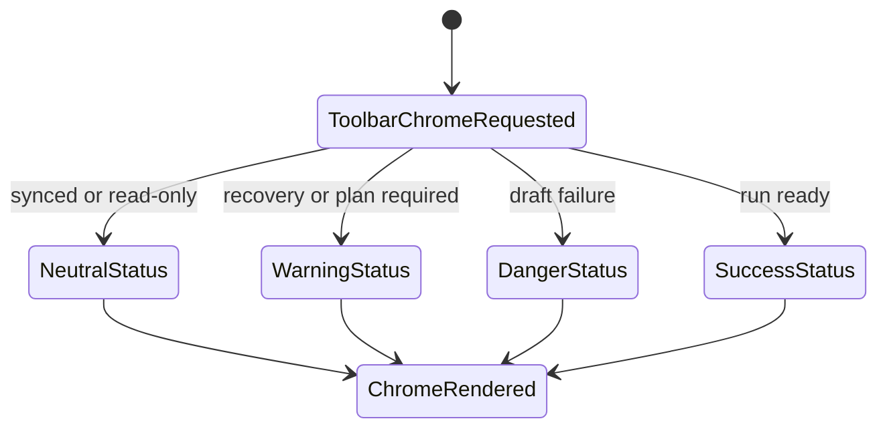
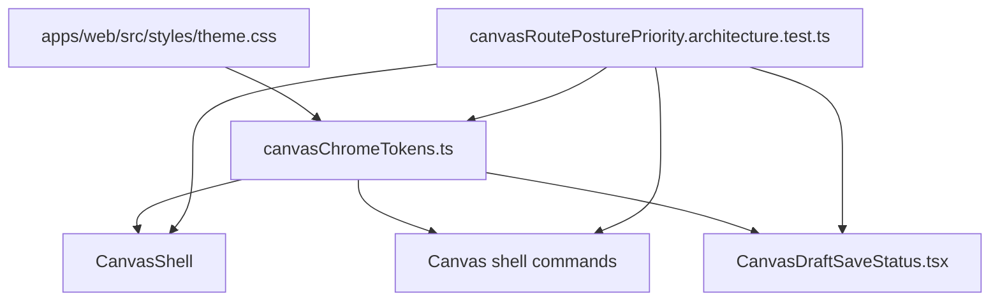

# Canvas Route Chrome Token Component

## Purpose

This component owns compact Canvas shell and status visual tokens. Canvas route
chrome can stay aligned with the operator-workbench visual system without
placing raw Tailwind color families in route controls or status templates.

Owned concern: Canvas route chrome consumes named presentation tokens;
`theme.css` owns raw semantic values.

## Public API

| API                                    | Kind         | Contract                                                   |
| -------------------------------------- | ------------ | ---------------------------------------------------------- |
| `canvasChromeClasses`                  | constant     | Shared shell, separator, button, dialog, and status chrome |
| `canvasDraftStatusToneClasses`         | constant     | Draft save and recovery tone classes                       |
| `resolveCanvasDraftStatusClassName`    | query helper | Resolves `neutral`, `warning`, or `danger` draft tone      |
| `resolveCanvasWorkflowStatusClassName` | query helper | Resolves workflow status text tone for toolbar badges      |

## Invariants

1. Canvas compact shell and draft-status presentation uses `canvasChromeTokens`.
2. Shell and status modules do not contain raw `slate-*`, `rose-*`,
   `amber-*`, `emerald-*`, `gray-*`, or `zinc-*` color classes.
3. The token component does not own Canvas command availability, graph
   mutation, draft persistence, React Flow configuration, or route policy.
4. Raw color values remain in `theme.css` or user-configurable Canvas palette
   code, not in route chrome components.
5. Low-frequency project snapshot actions stay grouped in the Canvas project
   menu instead of consuming persistent toolbar width as separate buttons.

## Transitions

## Consumers

- `CanvasDraftSaveStatus` resolves draft status tone through token helpers.
- Compact Canvas shell builders may consume button, separator, and status
  classes without owning raw color families.

## Consumer Diagram

## Negative Rules

- Do not move Canvas command policy into `canvasChromeTokens`.
- Do not move React Flow node, edge, viewport, minimap, or grid palette
  semantics into this component.
- Do not create a second Canvas toolbar color map in a route template.

## Canvas Route Chrome Token User Stories

### US-F24-CANVAS-CHROME-01: Scan Toolbar Commands With Workbench Tokens

As an operator, I need Canvas toolbar commands to use the same workbench visual
language as the rest of the app, so I can scan project export, import, plan,
and run commands without route-specific color drift.

Acceptance:

- Toolbar container, separators, command buttons, and workflow badges consume
  `canvasChromeClasses`.
- Visual token changes do not alter command enablement or click behavior.

### US-F24-CANVAS-CHROME-02: Read Draft Posture Without Local Color Rules

As a frontend maintainer, I need draft status and recovery badges to resolve
through one token helper, so draft-save posture does not duplicate warning and
danger color classes in route components.

Acceptance:

- `CanvasDraftSaveStatus` uses `resolveCanvasDraftStatusClassName`.
- `CanvasToolbarDraftStatus` delegates draft-status rendering to
  `CanvasDraftSaveStatus`.
- `canvasToolbarViewModel` uses `resolveCanvasWorkflowStatusClassName`.

### US-F24-CANVAS-CHROME-03: Keep Compact Shell Chrome Separate From Canvas Policy

As a Canvas route maintainer, I need compact shell visual chrome to use a token
component while graph-first command policy stays in shell builders and presenters,
so F-24 remains visual-system convergence rather than command-policy refactoring.

Acceptance:

- Compact Canvas shell/status presentation uses `canvasChromeClasses`.
- The token component does not import route command, graph, or draft state
  types.

### Scenario Coverage Matrix

| Story                     | Surface                                                                       | Guard                                             |
| ------------------------- | ----------------------------------------------------------------------------- | ------------------------------------------------- |
| `US-F24-CANVAS-CHROME-01` | `CanvasToolbar`, `CanvasToolbarPrimaryControls`                               | `canvasRoutePosturePriority.architecture.test.ts` |
| `US-F24-CANVAS-CHROME-02` | `CanvasToolbarDraftStatus`, `CanvasDraftSaveStatus`, `canvasToolbarViewModel` | `canvasRoutePosturePriority.architecture.test.ts` |
| `US-F24-CANVAS-CHROME-03` | compact Canvas shell/status presentation                                      | `canvasRoutePosturePriority.architecture.test.ts` |

> Acceptance scope status: Active. Owner: Web / Canvas.
