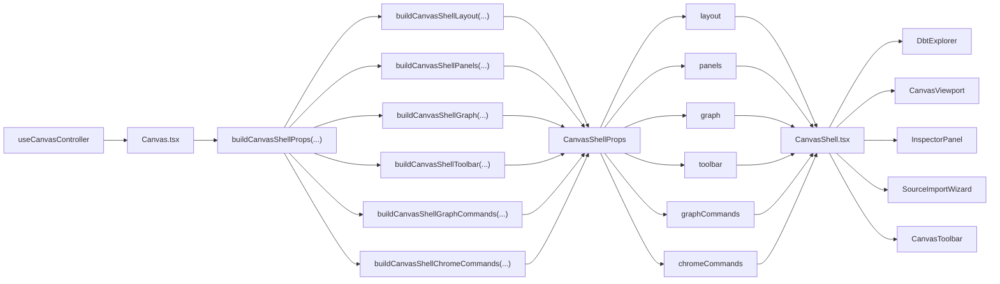
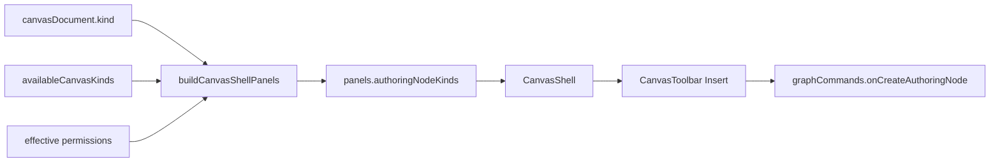
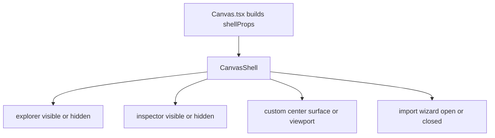
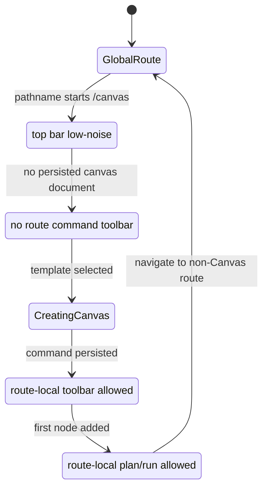
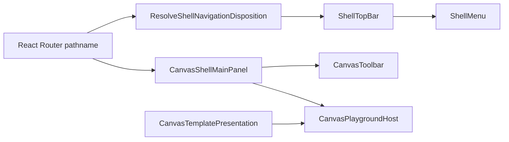
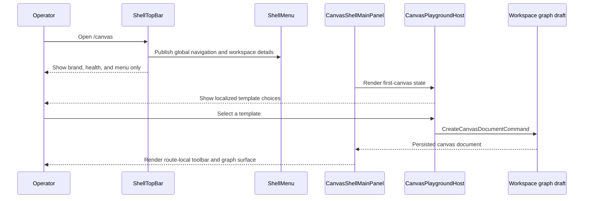

# Canvas Shell Component

## Purpose

Define the public component contract for the Canvas shell.

This component owns:

- three-panel workbench layout
- local chrome composition
- wiring of route-owned panels, viewport, and toolbar surfaces
- the semantic grouping of shell inputs by concern

It does not own draft truth, persistence, route posture derivation, or graph
mutation policy.

## Governing sources

- [Canvas Component Map And Modernization Review](./canvas-component-map-and-modernization-review.md)
- [Canvas Route Composition Component](graph-frontend-architecture.md#section-canvas-route-composition-component)
- [Canvas Route Presentation Component](graph-frontend-architecture.md#section-canvas-route-presentation-component)
- [Canvas Controller Current To Target Architecture](./canvas-controller-current-to-target-architecture.md)
- [Graph Route Bootstrap Architecture](graph-frontend-architecture.md#section-graph-route-bootstrap-architecture)

## Reading rule

Read the component in this order:

1. `canvasShell.types.ts`
   grouped public API and concern boundaries
2. `canvasShellBuilder.types.ts`
   concern-scoped builder inputs for route-owned shell assembly
3. `canvasShellLayoutBuilder.tsx`, `canvasShellPanelsBuilder.ts`,
   `canvasShellGraphBuilder.ts`, `canvasShellToolbarBuilder.ts`,
   `canvasShellGraphCommandsBuilder.ts`, and
   `canvasShellChromeCommandsBuilder.ts`
   concern-owned subbuilders for the grouped shell contract
4. `canvasShellPropsBuilder.tsx`
   orchestrator over the shell subbuilders
5. `docs/architecture/components/web/graph/graph-frontend-architecture.md`
   route-level explanation of how the shell builder fits with publication and
   modal hosting
6. `Canvas.tsx`
   route composition that delegates shell contract construction
7. `CanvasShell.tsx`
   layout and chrome composition over the grouped contract
8. `CanvasShell.test.tsx`
   behavior proofs for explorer, viewport, and import wiring

If a change introduces new top-level shell props directly in `Canvas.tsx`, the
component contract has likely regressed.

## Public API

The shell contract is public through these grouped objects:

- `CanvasShellLayout`
- `CanvasShellPanels`
- `CanvasShellGraph`
- `CanvasShellToolbar`
- `CanvasShellGraphCommands`
- `CanvasShellChromeCommands`
- `CanvasShellProps`
- `buildCanvasShellLayout(...)`
- `buildCanvasShellPanels(...)`
- `buildCanvasShellGraph(...)`
- `buildCanvasShellToolbar(...)`
- `buildCanvasShellGraphCommands(...)`
- `buildCanvasShellChromeCommands(...)`
- `buildCanvasShellProps(...)`

The canonical route builds one `CanvasShellProps` value and passes it to
`CanvasShell`.

`CanvasShellPanels.authoringNodeKinds` is the ready-canvas node creation
catalog exposed to the `Insert` surface. It must be derived from the active
`canvasDocument.kind` and its matching `CanvasKindRegistration.nodeKinds`.

## Contract rationale

The hard cut replaces an anemic prop bag with grouped semantic ownership:

<!-- markdownlint-disable MD013 MD060 -->

| Group            | Owned concern                                              | Must not absorb                           |
| ---------------- | ---------------------------------------------------------- | ----------------------------------------- |
| `layout`         | shell frame, panel visibility, center-surface slotting     | graph truth or toolbar policy             |
| `panels`         | explorer and inspector context, permissions, focus handoff | viewport wiring or toolbar workflow logic |
| `graph`          | React Flow projection inputs                               | route mutation commands                   |
| `toolbar`        | route-visible toolbar posture and workflow state           | viewport event handlers                   |
| `graphCommands`  | viewport and import interaction callbacks                  | shell chrome toggles                      |
| `chromeCommands` | shell-local chrome and toolbar command handlers            | React Flow primitive callbacks            |

<!-- markdownlint-enable MD013 MD060 -->

## File responsibilities

<!-- markdownlint-disable MD013 MD060 -->

| File                                  | Owned concern                                           | Public to other modules |
| ------------------------------------- | ------------------------------------------------------- | ----------------------- |
| `canvasShell.types.ts`                | grouped contract vocabulary                             | yes                     |
| `canvasShellBuilder.types.ts`         | concern-scoped input vocabulary for shell builder seams | local builder API       |
| `canvasShellLayoutBuilder.tsx`        | layout concern assembly                                 | local builder API       |
| `canvasShellPanelsBuilder.ts`         | panel concern assembly                                  | local builder API       |
| `canvasShellGraphBuilder.ts`          | graph concern assembly                                  | local builder API       |
| `canvasShellToolbarBuilder.ts`        | toolbar concern assembly                                | local builder API       |
| `canvasShellGraphCommandsBuilder.ts`  | viewport and import command assembly                    | local builder API       |
| `canvasShellChromeCommandsBuilder.ts` | shell chrome command assembly                           | local builder API       |
| `canvasShellPropsBuilder.tsx`         | route-owned shell contract orchestration                | yes                     |
| `useCanvasRoutePresentationSync.ts`   | route publication and bootstrap sync                    | adjacent route seam     |
| `CanvasModalHost.tsx`                 | route-owned modal hosting                               | adjacent route seam     |
| `Canvas.tsx`                          | route composition plus shell and modal handoff          | consumer only           |
| `CanvasShell.tsx`                     | three-panel shell layout and local chrome               | yes                     |
| `CanvasShell.test.tsx`                | runtime behavior proof for the shell contract           | test only               |

<!-- markdownlint-enable MD013 MD060 -->

## Current topology after hard cut

Ready-canvas authoring adds this narrower semantic flow:

## Transitions

The shell does not own domain transitions. It owns only UI composition
transitions:

## Invariants

- `CanvasShell` consumes grouped concern objects, not a flat all-fields-at-top
  prop bag.
- `Canvas.tsx` is the only route-level composition site for `CanvasShell`.
- `Canvas.tsx` delegates shell contract assembly to `buildCanvasShellProps(...)`
  instead of building banner, center-surface, and command groups inline.
- shell subbuilders consume concern-scoped builder args, not the full
  route-composer bag.
- Toolbar posture must arrive through `toolbar`, not through locally inferred
  booleans inside `CanvasShell.tsx`.
- Viewport callbacks must arrive through `graphCommands`, not through mixed
  shell chrome command bags.
- Explorer and inspector visibility belong to `layout`; node and permission
  context belong to `panels`.
- Ready-canvas node creation choices belong to `panels.authoringNodeKinds` and
  must be resolved from the active canvas runtime registration.
- `CanvasShell.tsx` must keep ready-canvas creation on the `Insert` path through
  `graphCommands.onCreateAuthoringNode`; it must not mutate draft state.
- `CanvasShell.tsx` must not pass node-kind creation catalogs or creation
  commands to the Workspace Explorer.
- `CanvasShell.tsx` may compose local UI state such as import dialog openness,
  but it must not become a persistence or route-state authority.
- `CanvasShell.tsx` must keep sizing and rail composition behind named local
  seams rather than nested inline ternary logic or one broad render body.

## Consumers

- `Canvas.tsx`
- `CanvasShell.tsx`
- `CanvasShell.test.tsx`
- `canvasShellPanelsBuilder.test.ts`

## Fitness functions

The canonical checks for this component are:

- `Canvas.architecture.test.tsx`
- `CanvasShell.architecture.test.tsx`
- `canvasShellBuilder.types.architecture.test.ts`
- `canvasShellPropsBuilder.architecture.test.ts`
- `canvasShell.types.architecture.test.ts`
- `CanvasShell.test.tsx`
- `@dvt/web` typecheck

## Drift to watch

- if `Canvas.tsx` starts passing dozens of top-level props again, semantic
  grouping has regressed
- if `Canvas.tsx` starts rebuilding the shell contract inline, the builder seam
  has regressed
- if `canvasShellPropsBuilder.tsx` starts assembling `layout`, `panels`,
  `graph`, `toolbar`, or command groups inline again, subbuilder ownership has
  regressed
- if shell subbuilders start accepting the full route-composer args bag again,
  semantic builder ownership has regressed
- if `CanvasShell.tsx` starts deriving toolbar or route posture locally, shell
  composition has leaked into presentation policy
- if `CanvasShell.tsx` or `DbtExplorer.tsx` starts constructing a global node
  catalog, ready-canvas authoring has drifted away from runtime policy
- if `DbtExplorer.tsx` receives `authoringNodeKinds`, `nodeKinds`, or
  `onCreateAuthoringNode`, resource browsing and object creation have drifted
  back together
- if viewport and chrome callbacks mix again inside one command bag, command
  ownership has drifted backwards

## Canvas Workbench Screen Composition Component

### Owned Concern

This component owns the whole `/canvas` workbench screen composition at the
boundary between persistent shell chrome and Canvas route chrome. It decides
where global navigation, workspace context, Canvas commands, first-document
copy, and visual preferences are presented.

It does not own graph persistence, protected draft semantics, Admin route
behavior, Plugins route behavior, or backend contracts.

### Public API

| API                          | Kind                   | Responsibility                                                                                                  |
| ---------------------------- | ---------------------- | --------------------------------------------------------------------------------------------------------------- |
| `ShellTopBar`                | shell renderer         | Renders low-noise global chrome and delegates hidden route-family controls to `ShellMenu`.                      |
| `ShellMenu`                  | shell renderer         | Renders global navigation, workspace context, view controls, and active Canvas view contributions.              |
| `CanvasShellMainPanel`       | Canvas route renderer  | Places Canvas tabs, route-local toolbar, banners, viewport, and center-surface states.                          |
| `CanvasToolbar`              | Canvas route renderer  | Renders graph/document commands only inside the Canvas workbench.                                               |
| `CanvasTemplatePresentation` | presentation model     | Resolves route-visible first-canvas template title and description from a `CanvasKindRegistration` plus locale. |
| `CanvasPlaygroundHost`       | Canvas host controller | Builds `CreateCanvasDocumentCommand` from the selected template presentation.                                   |

### Invariants

- Canvas workbench routes do not mount a permanent left navigation rail.
- Canvas route commands must not render inside the persistent global top bar.
- `ShellTopBar` may show global health and the menu trigger; route-local Canvas
  command controls belong in Canvas workbench chrome.
- `Admin` and `Plugins` remain reachable when the rail is hidden.
- The first-canvas state must not show disabled Plan, Run, Export, or Import
  controls before a canvas document exists.
- Workspace context is read-only on the Canvas entry screen. Switching project,
  tenant, or environment belongs to a separate governed flow.
- Visible first-canvas template title and description are resolved by a
  presentation model, not by leaking raw plugin registry strings directly into
  the route.
- The selected first-canvas command continues through `CreateCanvasDocumentCommand`;
  no parallel first-canvas rail is introduced.
- Shell copy and Canvas entry copy must not mix locale families on the same
  first viewport.

### Transitions

### Shell And Route Flow

### Sequence

### Consumers

| Consumer                              | Use                                                                     |
| ------------------------------------- | ----------------------------------------------------------------------- |
| `RootShell`                           | Resolves route family and passes shell navigation model to the top bar. |
| `ShellTopBar`                         | Applies low-noise Canvas posture and owns the menu trigger.             |
| `ShellMenu`                           | Provides hidden-rail global navigation and workspace details.           |
| `CanvasShellMainPanel`                | Applies Canvas route-local command placement.                           |
| `CanvasPlaygroundHost`                | Resolves first-canvas template presentation and command title.          |
| `CanvasToolbar.architecture.test.tsx` | Guards route-local toolbar ownership.                                   |
| `Root.shellChrome.test.tsx`           | Guards no-rail and hidden-rail global navigation.                       |

### Command And Query Rails

| Rail                                 | Type    | Owner                     | Use                                                             |
| ------------------------------------ | ------- | ------------------------- | --------------------------------------------------------------- |
| `ResolveShellNavigationDisposition`  | query   | Frontend shell            | Decides whether Canvas hides the rail.                          |
| `ListShellNavigationItems`           | query   | Frontend shell            | Supplies global route destinations for rail and menu rendering. |
| `GetEffectiveWorkspaceContext`       | query   | Frontend shell            | Supplies read-only workspace and draft posture labels.          |
| `CreateCanvasDocumentCommand`        | command | Canvas document           | Persists the first canvas document after template selection.    |
| `RenderCanvasContextualGraphSurface` | query   | Canvas graph presentation | Proves screen composition without creating product behavior.    |

No backend command/query rail changes are introduced by this component.

### Drift To Prevent

- Reintroducing `shell-top-bar-canvas-controls`.
- Rendering `CanvasToolbar` through a global top-bar portal.
- Showing disabled Canvas route commands in the first-canvas state.
- Hiding Admin or Plugins when the Canvas rail is hidden.
- Rendering raw English plugin template copy inside a Spanish Canvas route.
- Replacing command/query rails with component-local ad hoc actions.

### Canvas Workbench Screen Composition User Stories

#### Story Map

##### US-CANVAS-SCREEN-001: First Canvas Screen Uses A Low-Noise Shell

As an operator opening `/canvas` in an active workspace, I want the persistent
top bar to stay low-noise so that the first meaningful action is choosing or
working with a canvas, not reading disabled route commands.

Acceptance:

- Given `/canvas` has no persisted canvas document, then the global top bar does
  not show Plan, Run, Export, Import, read-only workflow badges, or a Canvas
  toolbar portal.
- The first viewport shows the first-canvas decision inside the Canvas
  workbench body.
- Workspace context remains visible in the Canvas body or shell menu as
  read-only information.

##### US-CANVAS-SCREEN-002: Global Navigation Survives Hidden Rail Mode

As an operator on a Canvas workbench route, I want to reach `Admin` and
`Plugins` after the left rail is hidden so that no global destination is lost.

Acceptance:

- Given the Canvas rail is hidden, when I open the shell menu, then Canvas,
  Runs, Plugins, and Admin are visible in the first navigation group.
- Plugins and Admin links navigate to `/plugins` and `/admin`.
- No Canvas workbench tab replaces those global destinations.

##### US-CANVAS-SCREEN-003: Canvas Commands Are Route Local

As an operator editing a canvas document, I want graph and execution commands in
the Canvas workbench so that global shell chrome remains stable.

Acceptance:

- Plan, Run, Export, Import, draft status, and reload actions render in the
  Canvas route-local toolbar after a canvas document or graph-operable state
  exists.
- Those controls never render in `ShellTopBar`.
- Canvas visual preferences remain in the shell `View` menu contribution.

##### US-CANVAS-SCREEN-004: First Canvas Template Copy Is Locale-Coherent

As an operator using a Spanish browser locale, I want first-canvas choices to
use Spanish visible copy so that the screen does not mix route Spanish with
English plugin labels.

Acceptance:

- With locale `es-*`, first-canvas template titles and descriptions render in
  Spanish for built-in `dbt` and `transformation` templates.
- The adapter label is localized.
- The command still goes through `CreateCanvasDocumentCommand`; no new create
  rail is added.

##### US-CANVAS-SCREEN-005: Workspace Context Is Read Only On The Entry Screen

As an operator, I want the current tenant, project, environment, and adapter to
be clear without turning the first Canvas screen into a project selector.

Acceptance:

- The first-canvas card shows tenant, project, environment, and adapter as
  text.
- The shell menu exposes the same context as read-only details.
- No combobox or selector appears in the Canvas top bar or first-canvas card.

#### Scenario Matrix

| Scenario                     | Expected Shell      | Expected Canvas Body                          | Expected Menu                     |
| ---------------------------- | ------------------- | --------------------------------------------- | --------------------------------- |
| `/canvas` needs first canvas | Brand, health, menu | First-canvas template card, no route toolbar  | Navigation plus workspace context |
| `/canvas` empty typed canvas | Brand, health, menu | Route-local toolbar plus empty graph action   | Navigation plus view controls     |
| `/canvas` ready graph        | Brand, health, menu | Route-local toolbar plus graph viewport       | Navigation plus view controls     |
| `/canvas` read-only          | Brand, health, menu | Read-only banner and local inspection surface | Navigation plus view controls     |
| `/plugins`                   | Global rail allowed | Plugins route                                 | Menu remains supplemental         |
| `/admin`                     | Global rail allowed | Admin route                                   | Menu remains supplemental         |

#### Negative Stories

- The first-canvas screen must not show a disabled Run button in the global top
  bar.
- The shell menu must not hide Admin and Plugins below route-local controls.
- The first-canvas card must not call `dbt` or `Transformation` project types.
- The template component must not construct `CreateCanvasDocumentCommand`
  directly.
- The top bar must not own Canvas route command semantics.

> Acceptance scope status: Active. Owner: Frontend / Shell / Canvas.

> Section status: Active. Owner: Frontend / Shell / Canvas. Colocation does not merge component responsibilities.
