# Canvas Shell Component

## Purpose

Define the public component contract for the Canvas shell.

This component owns:

- three-panel workbench layout
- local chrome composition
- wiring of route-owned panels, viewport, and toolbar surfaces
- the semantic grouping of shell inputs by concern

It does not own draft truth, persistence, route posture derivation, or graph
mutation policy.

## Governing sources

- [Canvas Component Map And Modernization Review](graph-frontend-architecture.md#section-canvas-component-map-and-modernization-review)
- [Canvas Route Composition Component](graph-frontend-architecture.md#section-canvas-route-composition-component)
- [Canvas Route Presentation Component](graph-frontend-architecture.md#section-canvas-route-presentation-component)
- [Canvas Controller Current To Target Architecture](canvas-authoring-runtime-component.md#section-canvas-controller-current-to-target-architecture)
- [Graph Route Bootstrap Architecture](graph-frontend-architecture.md#section-graph-route-bootstrap-architecture)

## Reading rule

Read the component in this order:

1. `canvasShell.types.ts`
   grouped public API and concern boundaries
2. `canvasShellBuilder.types.ts`
   concern-scoped builder inputs for route-owned shell assembly
3. `canvasShellLayoutBuilder.tsx`, `canvasShellPanelsBuilder.ts`,
   `canvasShellGraphBuilder.ts`, `canvasShellToolbarBuilder.ts`,
   `canvasShellGraphCommandsBuilder.ts`, and
   `canvasShellChromeCommandsBuilder.ts`
   concern-owned subbuilders for the grouped shell contract
4. `canvasShellPropsBuilder.tsx`
   orchestrator over the shell subbuilders
5. `docs/architecture/components/web/graph/graph-frontend-architecture.md`
   route-level explanation of how the shell builder fits with publication and
   modal hosting
6. `Canvas.tsx`
   route composition that delegates shell contract construction
7. `CanvasShell.tsx`
   layout and chrome composition over the grouped contract
8. `CanvasShell.test.tsx`
   behavior proofs for explorer, viewport, and import wiring

If a change introduces new top-level shell props directly in `Canvas.tsx`, the
component contract has likely regressed.

## Public API

The shell contract is public through these grouped objects:

- `CanvasShellLayout`
- `CanvasShellPanels`
- `CanvasShellGraph`
- `CanvasShellToolbar`
- `CanvasShellGraphCommands`
- `CanvasShellChromeCommands`
- `CanvasShellProps`
- `buildCanvasShellLayout(...)`
- `buildCanvasShellPanels(...)`
- `buildCanvasShellGraph(...)`
- `buildCanvasShellToolbar(...)`
- `buildCanvasShellGraphCommands(...)`
- `buildCanvasShellChromeCommands(...)`
- `buildCanvasShellProps(...)`

The canonical route builds one `CanvasShellProps` value and passes it to
`CanvasShell`.

`CanvasShellPanels.authoringNodeKinds` is the ready-canvas node creation
catalog exposed to the `Insert` surface. It must be derived from the active
`canvasDocument.kind` and its matching `CanvasKindRegistration.nodeKinds`.

## Contract rationale

The hard cut replaces an anemic prop bag with grouped semantic ownership:

<!-- markdownlint-capture -->
<!-- markdownlint-disable MD013 MD060 -->

| Group            | Owned concern                                              | Must not absorb                           |
| ---------------- | ---------------------------------------------------------- | ----------------------------------------- |
| `layout`         | shell frame, panel visibility, center-surface slotting     | graph truth or toolbar policy             |
| `panels`         | explorer and inspector context, permissions, focus handoff | viewport wiring or toolbar workflow logic |
| `graph`          | React Flow projection inputs                               | route mutation commands                   |
| `toolbar`        | route-visible toolbar posture and workflow state           | viewport event handlers                   |
| `graphCommands`  | viewport and import interaction callbacks                  | shell chrome toggles                      |
| `chromeCommands` | shell-local chrome and toolbar command handlers            | React Flow primitive callbacks            |

<!-- markdownlint-restore -->

## File responsibilities

<!-- markdownlint-capture -->
<!-- markdownlint-disable MD013 MD060 -->

| File                                  | Owned concern                                           | Public to other modules |
| ------------------------------------- | ------------------------------------------------------- | ----------------------- |
| `canvasShell.types.ts`                | grouped contract vocabulary                             | yes                     |
| `canvasShellBuilder.types.ts`         | concern-scoped input vocabulary for shell builder seams | local builder API       |
| `canvasShellLayoutBuilder.tsx`        | layout concern assembly                                 | local builder API       |
| `canvasShellPanelsBuilder.ts`         | panel concern assembly                                  | local builder API       |
| `canvasShellGraphBuilder.ts`          | graph concern assembly                                  | local builder API       |
| `canvasShellToolbarBuilder.ts`        | toolbar concern assembly                                | local builder API       |
| `canvasShellGraphCommandsBuilder.ts`  | viewport and import command assembly                    | local builder API       |
| `canvasShellChromeCommandsBuilder.ts` | shell chrome command assembly                           | local builder API       |
| `canvasShellPropsBuilder.tsx`         | route-owned shell contract orchestration                | yes                     |
| `useCanvasRoutePresentationSync.ts`   | route publication and bootstrap sync                    | adjacent route seam     |
| `CanvasModalHost.tsx`                 | route-owned modal hosting                               | adjacent route seam     |
| `Canvas.tsx`                          | route composition plus shell and modal handoff          | consumer only           |
| `CanvasShell.tsx`                     | three-panel shell layout and local chrome               | yes                     |
| `CanvasShell.test.tsx`                | runtime behavior proof for the shell contract           | test only               |

<!-- markdownlint-restore -->

## Current topology after hard cut

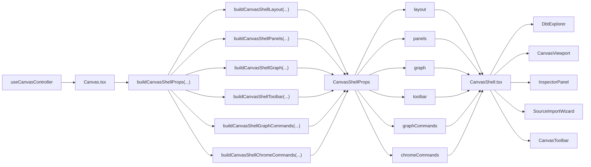

Ready-canvas authoring adds this narrower semantic flow:

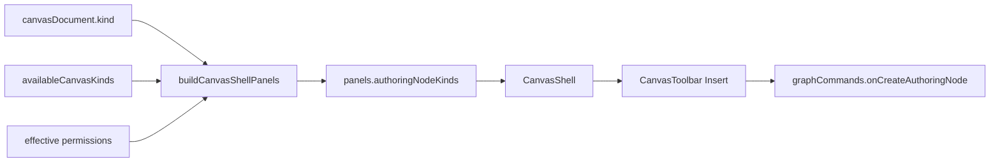

## Transitions

The shell does not own domain transitions. It owns only UI composition
transitions:

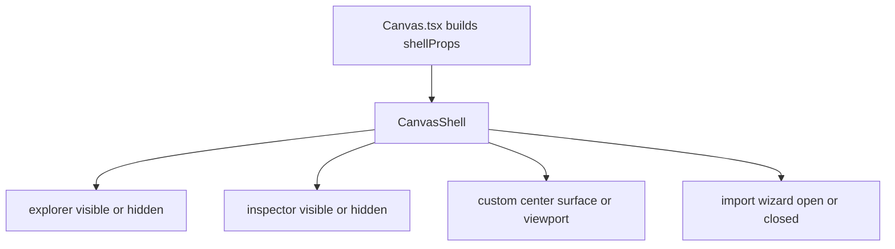

## Invariants

- `CanvasShell` consumes grouped concern objects, not a flat all-fields-at-top
  prop bag.
- `Canvas.tsx` is the only route-level composition site for `CanvasShell`.
- `Canvas.tsx` delegates shell contract assembly to `buildCanvasShellProps(...)`
  instead of building banner, center-surface, and command groups inline.
- shell subbuilders consume concern-scoped builder args, not the full
  route-composer bag.
- Toolbar posture must arrive through `toolbar`, not through locally inferred
  booleans inside `CanvasShell.tsx`.
- Viewport callbacks must arrive through `graphCommands`, not through mixed
  shell chrome command bags.
- Explorer and inspector visibility belong to `layout`; node and permission
  context belong to `panels`.
- Ready-canvas node creation choices belong to `panels.authoringNodeKinds` and
  must be resolved from the active canvas runtime registration.
- `CanvasShell.tsx` must keep ready-canvas creation on the `Insert` path through
  `graphCommands.onCreateAuthoringNode`; it must not mutate draft state.
- `CanvasShell.tsx` must not pass node-kind creation catalogs or creation
  commands to the Workspace Explorer.
- `CanvasShell.tsx` may compose local UI state such as import dialog openness,
  but it must not become a persistence or route-state authority.
- `CanvasShell.tsx` must keep sizing and rail composition behind named local
  seams rather than nested inline ternary logic or one broad render body.

## Consumers

- `Canvas.tsx`
- `CanvasShell.tsx`
- `CanvasShell.test.tsx`
- `canvasShellPanelsBuilder.test.ts`

## Fitness functions

The canonical checks for this component are:

- `Canvas.architecture.test.tsx`
- `CanvasShell.architecture.test.tsx`
- `canvasShellBuilder.types.architecture.test.ts`
- `canvasShellPropsBuilder.architecture.test.ts`
- `canvasShell.types.architecture.test.ts`
- `CanvasShell.test.tsx`
- `@dvt/web` typecheck

## Drift to watch

- if `Canvas.tsx` starts passing dozens of top-level props again, semantic
  grouping has regressed
- if `Canvas.tsx` starts rebuilding the shell contract inline, the builder seam
  has regressed
- if `canvasShellPropsBuilder.tsx` starts assembling `layout`, `panels`,
  `graph`, `toolbar`, or command groups inline again, subbuilder ownership has
  regressed
- if shell subbuilders start accepting the full route-composer args bag again,
  semantic builder ownership has regressed
- if `CanvasShell.tsx` starts deriving toolbar or route posture locally, shell
  composition has leaked into presentation policy
- if `CanvasShell.tsx` or `DbtExplorer.tsx` starts constructing a global node
  catalog, ready-canvas authoring has drifted away from runtime policy
- if `DbtExplorer.tsx` receives `authoringNodeKinds`, `nodeKinds`, or
  `onCreateAuthoringNode`, resource browsing and object creation have drifted
  back together
- if viewport and chrome callbacks mix again inside one command bag, command
  ownership has drifted backwards

## Canvas Workbench Screen Composition Component

### Owned Concern

This component owns the whole `/canvas` workbench screen composition at the
boundary between persistent shell chrome and Canvas route chrome. It decides
where global navigation, workspace context, Canvas commands, first-document
copy, and visual preferences are presented.

It does not own graph persistence, protected draft semantics, Admin route
behavior, Plugins route behavior, or backend contracts.

### Approved Menu Responsibility Contract

[The bounded menu cut](https://github.com/dunay2/dvt/issues/3622), approved under
issue #3296, replaces the older mixed `ShellMenu` placement. It does
not accept the entire Figma migration or introduce another application rail.

| Surface                | Owned concern                                                 | Existing authority                                           |
| ---------------------- | ------------------------------------------------------------- | ------------------------------------------------------------ |
| Raven application menu | Global destinations when the navigation rail is hidden; About | `ListShellNavigationItems`, `GetCompiledApplicationMetadata` |
| Project menu           | Granted project/environment selection, context and Git        | `GetEffectiveWorkspaceContext`, `SelectWorkspaceScope`       |
| File menu              | New Project and active project import/export, files and code  | `CreateProject`, existing Canvas workspace contribution      |
| View menu              | Explorer/drawer recovery, focus mode and ES/EN preference     | Existing layout commands, `ConfigureApplicationLanguage`     |
| Execution controls     | Existing explicit execution intent/readiness                  | Unchanged operational contribution                           |

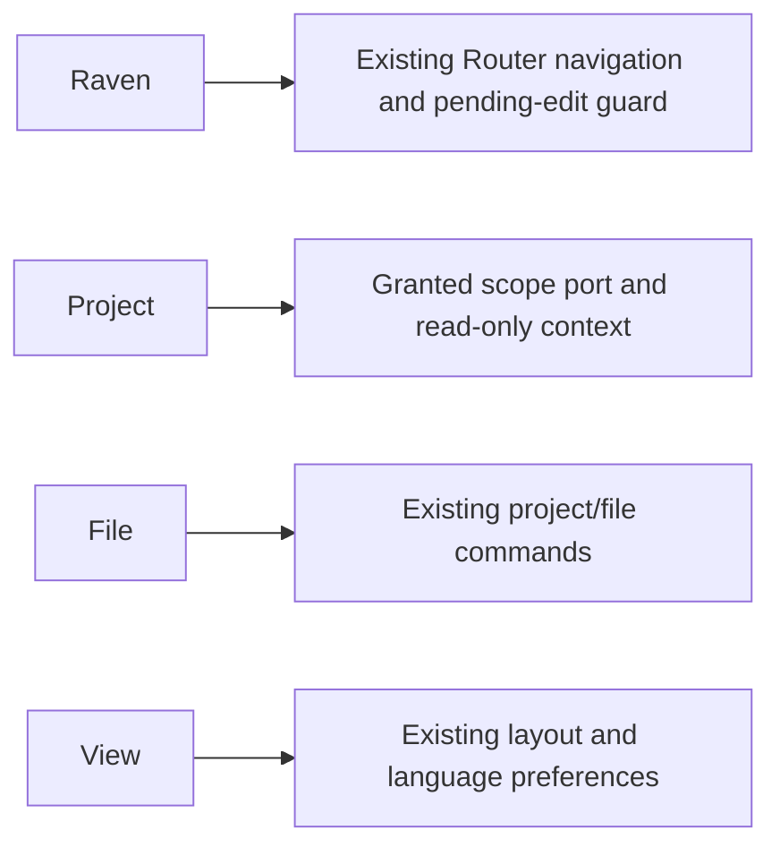

Each action has one menu owner. Controllers retain lifecycle and dispatch;
concern-specific templates own passive markup and shared chrome styles. No
generic menu framework, new store or second command catalog is introduced.
Menu opening does not execute data queries or change graph authoring state.

Focus ownership follows the selected intent: code/explorer and project creation
return to File; granted-scope recovery remains Project. A menu closing to open
an editor/dialog must not steal the receiving surface's focus. Router navigation
must preserve the existing unapplied-edit guard.

Source import still registers only; dragging creates an instance. This contract
does not add Source double-click/Insert creation, change JOIN output, or expose
unimplemented Edit/Undo/Insert/Run/Help capabilities.

### Source Occurrence Output Selection

The applied Model inspector selects the occurrence's direct contribution to the
Model's root Output. It does not remove a Model Input binding. The governing
design is Planning DB `GH-2937-SOURCE-OUTPUT-SELECTION-V12`, with rationale and
Fowler matrix in [issue #2937](https://github.com/dunay2/dvt/issues/2937#issuecomment-6419771739).
The existing `ConfigureCanvasDvtNode` and `RenderCanvasContextualGraphSurface`
rails retain command and presentation ownership.

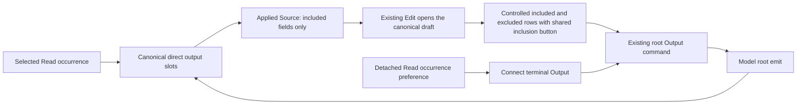

`CanvasSourceOccurrenceOutputs` is passive presentation. The applied selection
adapter reads the current session and delegates changes to
`changeSelectedRelationOutputs` through `useRelationCommand`. Direct forwarding
is resolved by canonical relation/field identity and emit mappings, including
nested JOINs and self-JOINs. Project expressions retain their own definition
identity, including expressions that only select an Input field. Only forwarded
Input slots belong to the Source inclusion control. Dependencies do not establish direct
forwarding; aggregate and SET outputs cannot be attributed independently to one
Source. Unavailable direct contributions remain visible with disabled controls.

Excluding a field changes only root Output selection. The physical Read, JOIN
predicate, calculation definitions, other occurrences and producer publication
remain intact. The applied view shows only included fields without editing
controls. The existing Edit action opens the Model draft; its Source inspector
shows included and excluded fields with the existing add/remove actions.
Apply persists the draft selection; Cancel restores the previously applied
document. The shared header action is literally `Edit`, and entering it never
writes a command. Edit shows all admitted fields in stable order by default.
The shared explicit `Solo seleccionados` selector may narrow that presentation;
a field toggle does not change the filter, reorder rows or move focus, scroll or
card coordinates. Selecting a connected Source during an already-active Model
draft does not itself enter that Source's local Edit mode.

An explicit plus on a physical Read field still published by its connected
producer but omitted from the incoming Input binding stages additive recovery.
It uses the existing `bindCanvasInputField` command on an unpublished candidate,
derives ordinary graph eligibility from its accepted edges, and includes only
the selected occurrence's direct root Output contribution. No permission
whitelist, automatic producer repair, dependency creation or Input rewiring is
admitted. Ordinary Output toggles continue to leave Input bindings unchanged.
The complete physical Read, predicates, producers and sibling Output selections
remain intact; a producer-to-Model binding does not select other occurrences.

The existing Model Apply port carries optional additive Input identities with
the semantic node draft. Its existing serialized workspace command evaluates
both on the latest unpublished candidate and CAS-publishes one aggregate only
after permission, scope, publication and semantic validation accept. Failed or
stale Apply retains the local draft; Cancel discards Input and Output together.
No workspace mutation occurs before accepted Apply, and navigation awaits it.
The protected persistence envelope and public command rails remain unchanged.

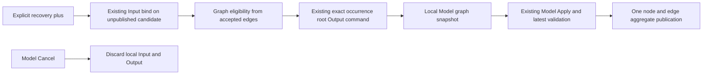

Existing command authority owns revision, permissions, rejection, rollback and
persistence. Detached Sources store optional `initialOutputFieldIds` on their
own incomplete-authoring occurrence. They never invoke the Model Input mapping
adapter. Absence uses the producer publication; an empty list selects nothing.
Creation and detached restoration normalize that default to local Read identities
before editing. An absent preference in a configured or retained operation stays
absent on restore: its saved canonical Output takes precedence. Absence after
successful consumption delegates to canonical Output ownership and cannot be
overwritten by an obsolete pending-field callback. A disconnected terminal does
not remove ownership from the configured operation's own Output inspector.
The physical Read remains complete, including keys needed by later JOINs.

Initialization waits for terminal Model Output connection, rather than narrowing
the first intermediate operation. The existing canonical Output query/command
materializes direct contributions in the terminal root. One graph-state snapshot
coordinates document replacement and consumption of reachable preferences;
obsolete or cancelled work cannot publish partially. Executable Apply is unavailable
while initialization is pending or rejected. A terminal operation without a semantic
document remains savable through the existing incomplete-authoring Apply; its
preferences persist and confer no executable authority. Shared SET/aggregate contributions reject
explicitly instead of silently losing intent. Unrelated pending Sources retain
their preferences. Once initialized, configured occurrences use the canonical
root adapter, including staged-root analysis and ancestor rebinding.
Both adapters use the same passive rows and Inspector inclusion control; CSS
consumes the existing semantic tokens without adding another style system.

The inline coordinator delegates Source/unary binding to
`CanvasRelationalTreeSelectedOperatorEditor` and the JOIN/CROSS/SET frame to
`CanvasRelationalTreeCompositionEditor`. The latter owns its property/output
pending channels; the coordinator combines them with the selected editor's
pending channel. Selecting another operation does not collapse these distinct
pending obligations into one flag.

### Inspector Code Placement And Height

The current Inspector implementation has two ownership boundaries, recorded in
Planning DB rather than source-file metadata headers:

| Component                        | Owned concern                                                                                              | Delegated concerns                                                                 |
| -------------------------------- | ---------------------------------------------------------------------------------------------------------- | ---------------------------------------------------------------------------------- |
| `SYS-WEB-CANVAS-NODE-WORKBENCH`  | Compose node sections, contributions, tab requests and the passive property read model                     | Draft edits/persistence, code projection and shared editor implementation          |
| `SYS-WEB-CANVAS-CODE-INSPECTION` | Present canonical output and request input-bound derived SQL through the existing graph projection adapter | Compiler semantics, graph edits, persistence, Run and shared Monaco implementation |

The module entrypoints are `CanvasNodeWorkbenchPanel.tsx` and
`DvtTransformCodeWorkbenchContent.tsx`. Their exact multi-file ownership,
function responsibilities and required-test evidence remain in Planning DB;
the shared Canvas folder is not a separate ownership claim for each module.

Both use `RenderCanvasContextualGraphSurface`. Inspecting code returns a read
model and updates local selection state; it does not write the draft, publish
artifacts or execute SQL. Opening the semantic editor delegates its existing
navigation callback. Mutations remain on the existing authoring command handlers.

Derived SQL belongs to the exact transform, nodes and edges references supplied
to its query. A pending query is reused for repeated selection of those inputs;
a ready result is reused only for those inputs. Changed references invalidate
the visible derived result and show canonical output until SQL is explicitly
requested again. This conservative constant-time invalidation also covers
layout-only reference changes and schedules no automatic compilation. Failures
remain visible and a subsequent explicit selection can retry. Older completions
cannot overwrite a newer request.

Canonical JSON and ready SQL use one shared Monaco rendering path. The output
view owns its flex growth directly; an extra height-distributing wrapper is not
needed between it and the code contribution.

The existing node-workbench section policy places General first and Code after
the other supported primary sections. Explicit tab requests remain authoritative;
the More action retains overflow sections. Source keeps its bounded Overview,
Columns and Inputs / Outputs order.

Canonical Transform output uses the available Inspector height through the
existing section, contribution and output flex columns. The output container
must allocate remaining height to the shared read-only Monaco surface. Editor
height is not a fixed pixel value and no JavaScript resize state is introduced.
Rendered acceptance checks code lines, containment and resizing, while preserving
the canonical document and existing semantic-editor entry action.

### Shared Inspector Form Typography

The node authoring section applies the compact Inspector form typography from
`inspectorVisualTokens`. Existing Input, Label, Textarea, native select and select
trigger slots share the same `text-xs` scale as the Inspector tabs. Plugin fields
and general name/tags/description fields inherit this one presentation boundary;
individual fields do not duplicate font-size overrides. Read-only property facts
use the same body scale in the Inspector and workbench variants. Global UI primitives,
title hierarchy, control heights, code-editor typography and mutation handlers
retain their existing owners.

General metadata and DVT authoring reuse the Inspector's shared field and group
spacing. The Inspector visual owner also defines the draft-action row layout;
the authoring composition controls its visibility and connects the shared Buttons
to the draft controller. Native selects inherit the form text color, matching Input rather than
forcing a separate palette. Destination-specific CSS owns only the schema/relation
layout and the technical target value. The Model destination connection selector
keeps its accessible name without repeating a visible Connection label under the
destination heading; explicit Sink fields retain their visible label.

The rendered acceptance compares computed label/control font sizes with the
General tab at two desktop widths, checks focus and form overflow, and retains
the protected Model save flow. A matching class string is not visual evidence.

### Native Source Overview And Provider Comments

The narrow Source Overview uses full-width stacked source and DVT sections,
compact label/value facts, and activated inline editing. It retains readable
font sizes rather than splitting the panel into two narrow columns. Table
comments come only from the canonical imported `metadata.sourceComment` snapshot;
column comments come from validated `SourceObjectColumn.comment` facts. A compact
column-row indicator opens the existing detail containing the complete plain
text comment. Missing comments render as an em dash in detail. Long text wraps
without horizontal overflow. DVT descriptions remain independently authored.

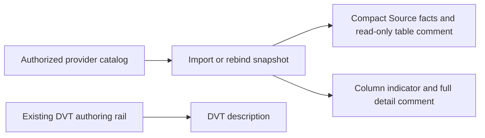

### Compact Header Reflow

The real workbench viewport proof exposed a regression at 640 x 450 CSS pixels:
the added File trigger reserved command width while the single-row header
compressed the Canvas/model identity below its tab and close-control widths.
The existing geometry assertion must remain intact; hiding labels, clipping
controls or forcing clicks would not correct the layout.

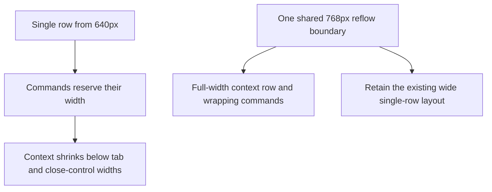

The shell bar and its two cluster styles belong together in
`shell/ShellChrome.module.css`, exposed by the named `shell/chrome.ts` contract.
All three switch to the wide layout at the same 48rem breakpoint. Below it, the existing full-width groups wrap and the header takes
its natural height; the workbench's existing flex allocation retains the footer
and inspector inside the viewport. No new layout store, JavaScript resize
handler, command/query rail or permanent shell-height assumption is introduced.

| CSS viewport width | Header posture                                   | Required evidence                                      |
| ------------------ | ------------------------------------------------ | ------------------------------------------------------ |
| 390, 640, 767 px   | Full-width context and wrapping command rows     | Visible tabs/close controls; no command overflow       |
| 768, 960, 1366 px  | Existing single-row context and command clusters | Unchanged menu ownership, execution and focus behavior |

Unit evidence checks the shared class boundary, not simulated geometry. The
existing native browser viewport proof checks actual tab/close containment at
640 x 450, inspector/footer containment and absence of graph writes. Provider
menu evidence must wait for the existing startup overlay to disappear before
interacting with the shell or inspecting the route after a visit or reload;
a mounted trigger alone does not prove route
readiness. This is an observable precondition, not an arbitrary delay or a
forced-click workaround.

### Public API

| API                          | Kind                   | Responsibility                                                                                                  |
| ---------------------------- | ---------------------- | --------------------------------------------------------------------------------------------------------------- |
| `ShellTopBar`                | shell renderer         | Composes concern-owned menus and unchanged execution/connection controls.                                       |
| `ShellAppMenu`               | shell controller       | Coordinates guarded global navigation and About.                                                                |
| `ShellProjectMenu`           | shell controller       | Coordinates granted scope selection, context and Git.                                                           |
| `ShellFileMenu`              | shell controller       | Coordinates project creation and the existing Canvas file contribution.                                         |
| `ShellMenu`                  | shell controller       | Coordinates View preferences only.                                                                              |
| `ShellMenu.templates`        | passive presentation   | Presents navigation, Project, File and View through existing Radix primitives.                                  |
| `CanvasShellMainPanel`       | Canvas route renderer  | Places Canvas tabs, route-local toolbar, banners, viewport, and center-surface states.                          |
| `CanvasToolbar`              | Canvas route renderer  | Renders graph/document commands only inside the Canvas workbench.                                               |
| `CanvasTemplatePresentation` | presentation model     | Resolves route-visible first-canvas template title and description from a `CanvasKindRegistration` plus locale. |
| `CanvasPlaygroundHost`       | Canvas host controller | Builds `CreateCanvasDocumentCommand` from the selected template presentation.                                   |

### Invariants

- Canvas workbench routes do not mount a permanent left navigation rail.
- Canvas graph/document editing commands remain route-local. The existing
  project/file contribution is rendered only inside File, not as loose top-bar
  controls.
- `ShellTopBar` shows concern-owned menu triggers, health and the unchanged
  execution controls; it does not import Canvas controller hooks.
- `Admin` and `Plugins` remain reachable when the rail is hidden.
- The first-canvas state must not show disabled Plan, Run, Export, or Import
  controls before a canvas document exists.
- Identity details remain read-only. Granted scope selection reuses
  `SelectWorkspaceScope` in Project; menu presentation does not grant access.
- Visible first-canvas template title and description are resolved by a
  presentation model, not by leaking raw plugin registry strings directly into
  the route.
- The selected first-canvas command continues through `CreateCanvasDocumentCommand`;
  no parallel first-canvas rail is introduced.
- Shell copy and Canvas entry copy must not mix locale families on the same
  first viewport.

### Transitions

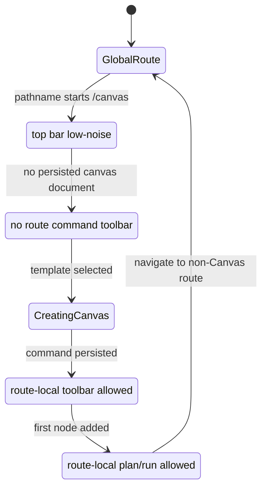

### Shell And Route Flow

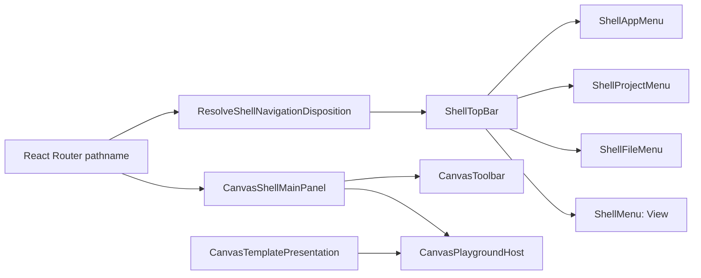

### Sequence

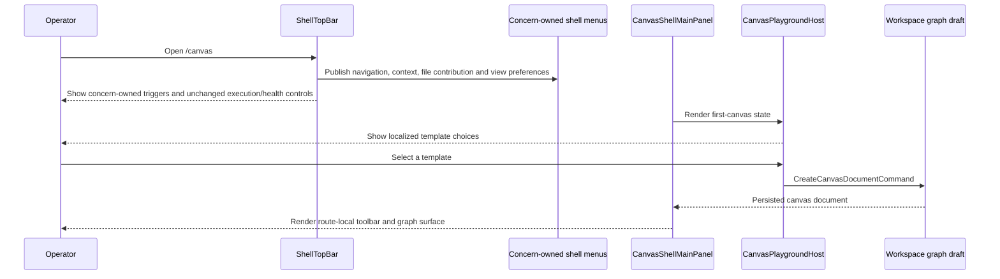

### Consumers

| Consumer                              | Use                                                                       |
| ------------------------------------- | ------------------------------------------------------------------------- |
| `RootShell`                           | Resolves route family and passes shell navigation model to the top bar.   |
| `ShellTopBar`                         | Applies low-noise Canvas posture and owns the menu trigger.               |
| `ShellAppMenu`                        | Coordinates hidden-rail navigation without bypassing pending-edit guards. |
| `ShellProjectMenu`                    | Composes the existing granted scope selector and context read model.      |
| `ShellFileMenu`                       | Reuses project creation and Canvas file commands; owns focus transfer.    |
| `ShellMenu`                           | Coordinates View preferences without navigation or project actions.       |
| `CanvasShellMainPanel`                | Applies Canvas route-local command placement.                             |
| `CanvasPlaygroundHost`                | Resolves first-canvas template presentation and command title.            |
| `CanvasToolbar.architecture.test.tsx` | Guards route-local toolbar ownership.                                     |
| `Root.shellChrome.test.tsx`           | Guards no-rail and hidden-rail global navigation.                         |

### Command And Query Rails

| Rail                                 | Type    | Owner                     | Use                                                             |
| ------------------------------------ | ------- | ------------------------- | --------------------------------------------------------------- |
| `ResolveShellNavigationDisposition`  | query   | Frontend shell            | Decides whether Canvas hides the rail.                          |
| `ListShellNavigationItems`           | query   | Frontend shell            | Supplies global route destinations for rail and menu rendering. |
| `GetEffectiveWorkspaceContext`       | query   | Frontend shell            | Supplies read-only workspace and draft posture labels.          |
| `CreateCanvasDocumentCommand`        | command | Canvas document           | Persists the first canvas document after template selection.    |
| `RenderCanvasContextualGraphSurface` | query   | Canvas graph presentation | Proves screen composition without creating product behavior.    |

No backend command/query rail changes are introduced by this component.

### Shared Relationship Summaries

Generic Inputs/Outputs use the shared `NodePropertyTable` business summary rather
than stacked raw key/value fields: direction, related node name and relation on
one line, with optional connection context below. The `nodeId` cell and an
identity-only fallback name are not presented. Canonical IDs, row keys and custom
cell context remain available to their existing owners. No navigation or mutation
is invented. Planning DB `GH-3035-RELATIONSHIP-SUMMARY-V2` records the admitted
[rationale and tests](https://github.com/dunay2/dvt/issues/3035#issuecomment-6417835229).

### Logical Column Inspection Density

Generic Model/logical Columns use `NodePropertyTable` native disclosures and the
existing `inspectorPropertyClasses.records` tokens. The compact shared summary is
12px/16px with a minimum 28px row and a centred 12px chevron. Long values wrap,
details remain complete and keyboard/focus behavior stays native. Planning DB
design `GH-3035-LOGICAL-COLUMN-DENSITY` records the rationale in
[issue #3035](https://github.com/dunay2/dvt/issues/3035#issuecomment-6417091017).
This presentation change reuses `RenderCanvasContextualGraphSurface`; it does not
dispatch a graph command or change the separate physical Source scanner below.

### Source Column Inspection Density

The existing contextual surface also presents `SourceColumnFacts` through passive
column rows and a drill-in detail. Rows retain a minimum 44 px target and two
readable lines, with reduced padding and a compact type cue. Detail height follows
its content: navigation appears directly after the facts rather than below an
artificial minimum-height area.

The detail names the column once and renders physical type, nullability and
constraint in one labelled definition list. A second summary does not repeat type
or nullability. Unknown nullability remains unknown, and long physical types and
column names remain fully readable in detail. The existing facts projection,
filtered navigation, focus restoration, transfer and local ordering own their
semantics; density changes do not issue provider requests or persist a draft.

### Source Catalogue Presentation

The existing `RenderCanvasContextualGraphSurface` query presents registered
source definitions through `CanvasGraphExplorer` and the shared
`CanvasExplorerList`. Sources use compact cards with a table icon, a minimum
44 px hit target, 4 px separation and the available schema/connection as display
context. Other explorer lists retain their existing presentation.

The source projection excludes reference instances and preserves definition
identity and catalogue order. Its derived rows change with the catalogue,
independently from graph coordinates. The shared list prepares searchable text
when its items change; an empty search returns those items directly. These are
render-local projections, never a second source authority or a global cache.

Click still inspects the definition. Drag still transfers only its identity to
the existing guarded drop command. Filtering, card styling and keyboard focus
must not place a node, write a draft or make a provider request. Missing display
metadata is omitted without inventing a connection or schema.

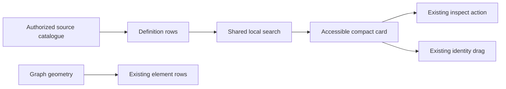

### Drift To Prevent

- Reintroducing `shell-top-bar-canvas-controls`.
- Rendering `CanvasToolbar` through a global top-bar portal.
- Showing disabled Canvas route commands in the first-canvas state.
- Hiding Admin or Plugins when the Canvas rail is hidden.
- Rendering raw English plugin template copy inside a Spanish Canvas route.
- Replacing command/query rails with component-local ad hoc actions.

### Canvas Workbench Screen Composition User Stories

#### Story Map

##### US-CANVAS-SCREEN-001: First Canvas Screen Uses A Low-Noise Shell

As an operator opening `/canvas` in an active workspace, I want the persistent
top bar to stay low-noise so that the first meaningful action is choosing or
working with a canvas, not reading disabled route commands.

Acceptance:

- Given `/canvas` has no persisted canvas document, then the global top bar does
  not show direct Plan, Run, Export or Import buttons, read-only workflow badges,
  or a Canvas toolbar portal.
- The first viewport shows the first-canvas decision inside the Canvas
  workbench body.
- Workspace context remains visible in the Canvas body or shell menu as
  read-only information.

##### US-CANVAS-SCREEN-002: Global Navigation Survives Hidden Rail Mode

As an operator on a Canvas workbench route, I want to reach `Admin` and
`Plugins` after the left rail is hidden so that no global destination is lost.

Acceptance:

- Given the Canvas rail is hidden, when I open the shell menu, then Canvas,
  Runs, Plugins, and Admin are visible in the first navigation group.
- Plugins and Admin links navigate to `/plugins` and `/admin`.
- No Canvas workbench tab replaces those global destinations.

##### US-CANVAS-SCREEN-003: Canvas Commands Keep Their Owning Surfaces

As an operator editing a canvas document, I want graph and execution commands in
the Canvas workbench so that global shell chrome remains stable.

Acceptance:

- Plan, Run, draft status and reload actions render in the Canvas route-local
  toolbar after a canvas document or graph-operable state exists.
- Snapshot Export and Import render in `ShellFileMenu` through
  `CanvasWorkspaceMenuControls`. File owns their menu placement; Canvas owns
  their commands and availability.
- `ShellTopBar` does not own Canvas command semantics.
- Canvas visual preferences remain in the shell `View` menu contribution.

##### US-CANVAS-SCREEN-004: First Canvas Template Copy Is Locale-Coherent

As an operator using a Spanish browser locale, I want first-canvas choices to
use Spanish visible copy so that the screen does not mix route Spanish with
English plugin labels.

Acceptance:

- With locale `es-*`, first-canvas template titles and descriptions render in
  Spanish for built-in `dbt` and `transformation` templates.
- The adapter label is localized.
- The command still goes through `CreateCanvasDocumentCommand`; no new create
  rail is added.

##### US-CANVAS-SCREEN-005: Workspace Context Is Read Only On The Entry Screen

As an operator, I want the current tenant, project, environment, and adapter to
be clear without turning the first Canvas screen into a project selector.

Acceptance:

- The first-canvas card shows tenant, project, environment, and adapter as
  text.
- The shell menu exposes the same context as read-only details.
- No combobox or selector appears in the Canvas top bar or first-canvas card.

#### Scenario Matrix

| Scenario                     | Expected Shell      | Expected Canvas Body                          | Expected Menu                     |
| ---------------------------- | ------------------- | --------------------------------------------- | --------------------------------- |
| `/canvas` needs first canvas | Brand, health, menu | First-canvas template card, no route toolbar  | Navigation plus workspace context |
| `/canvas` empty typed canvas | Brand, health, menu | Route-local toolbar plus empty graph action   | Navigation plus view controls     |
| `/canvas` ready graph        | Brand, health, menu | Route-local toolbar plus graph viewport       | Navigation plus view controls     |
| `/canvas` read-only          | Brand, health, menu | Read-only banner and local inspection surface | Navigation plus view controls     |
| `/plugins`                   | Global rail allowed | Plugins route                                 | Menu remains supplemental         |
| `/admin`                     | Global rail allowed | Admin route                                   | Menu remains supplemental         |

#### Negative Stories

- The first-canvas screen must not show a disabled Run button in the global top
  bar.
- The shell menu must not hide Admin and Plugins below route-local controls.
- The first-canvas card must not call `dbt` or `Transformation` project types.
- The template component must not construct `CreateCanvasDocumentCommand`
  directly.
- The top bar must not own Canvas route command semantics.

> Acceptance scope status: Active. Owner: Frontend / Shell / Canvas.
>
> Section status: Active. Owner: Frontend / Shell / Canvas. Colocation does not merge component responsibilities.
