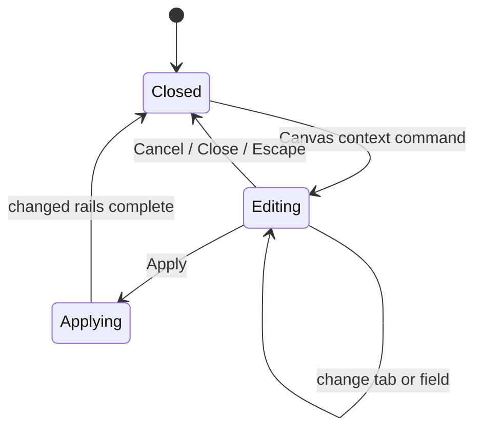
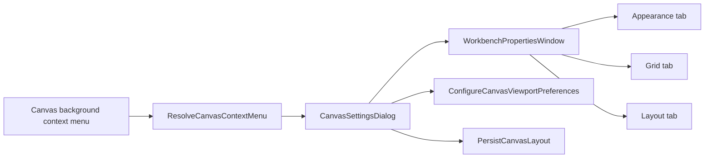

# Canvas Properties Window Component

## Purpose

Define the single contextual surface for editing Canvas presentation properties.
The Canvas background context menu opens a properties window composed from the
shared workbench dialog, tab, field, and command components.

This component owns:

- one buffered edit session for Canvas appearance, grid, and layout properties;
- localized tabs, labels, accessible names, focus return, and keyboard dismissal;
- dispatch to the existing Canvas preference and layout command rails only after
  the user selects `Apply`;
- removal of Canvas-specific properties from the global `View` menu.

It does not own graph truth, protected draft persistence, execution commands,
project snapshots, or backend command/query rails.

## Public API

- `WorkbenchPropertiesWindow`: shared modal shell with header, tabs, scrollable
  content, and `Cancel` / `Apply` footer commands.
- `WorkbenchPropertiesSection`: typed tab contribution contract.
- `CanvasSettingsDialog`: Canvas adapter that builds the edit buffer and maps
  fields to the existing callbacks.
- `ResolveCanvasContextMenu`: query rail that exposes the background
  `Canvas properties` command.
- `ConfigureCanvasViewportPreferences`: command rail for local visual
  preferences.
- `PersistCanvasLayout`: command rail used when automatic layout is applied.

## Invariants

- The background context menu is the only entry point for Canvas properties.
- The global `View` menu contains global view controls only: panels, focus mode,
  and language.
- `CanvasSettingsDialog` composes `WorkbenchPropertiesWindow`; it does not create
  a second modal shell or a parallel settings store.
- Field changes remain in the edit buffer until `Apply`.
- `Cancel`, the close command, and `Escape` discard the edit buffer.
- `Apply` invokes only rails whose values changed.
- Automatic layout is unavailable when graph-edit permission is absent.
- Labels and accessible names resolve through the Canvas copy catalog in English
  and Spanish.
- The shell menu must not import Canvas controller hooks, Canvas property state,
  or Canvas-specific contribution stores.

## Transitions

## Component Flow

## Consumers

- `CanvasShell`
- `CanvasViewport`
- `ShellMenu`
- `CanvasSettingsDialog.test.tsx`
- `WorkbenchPropertiesWindow.test.tsx`
- `CanvasSettingsDialog.architecture.test.tsx`
- `TopAppBar.test.tsx`

## User Stories Covered

See [Canvas View Menu User Stories](canvas-view-menu-component.md#section-canvas-view-menu-user-stories). The
historical story names remain stable; their accepted surface is now the
contextual Canvas properties window.

## Fitness Functions

- `pnpm --filter @dvt/web test:presentation:run -- src/app/components/TopAppBar.test.tsx`
- `pnpm --filter @dvt/web test:canvas-presentation:run -- src/app/views/canvas/CanvasSettingsDialog.test.tsx`
- `pnpm --filter @dvt/web test:canvas-architecture:run -- src/app/views/canvas/CanvasSettingsDialog.architecture.test.tsx`
- `pnpm --filter @dvt/web typecheck`

## Drift To Watch

- Canvas background, grid, layout, or overlay controls reappearing in `View`;
- a route-to-shell contribution store returning for Canvas properties;
- immediate mutation before `Apply`;
- a Canvas-local dialog shell duplicating the shared workbench window;
- unlocalized or inaccessible tab, field, close, or footer commands;
- visual preferences crossing into protected graph or run authority.

## Canvas Properties Window User Stories

The historical `US-CANVAS-VIEW-*` identifiers remain stable, but their accepted
surface is the Canvas contextual properties window rather than the global
`View` menu.

### UX Stories

#### US-CANVAS-VIEW-001: Keep the top bar and View menu scannable

As a Canvas user, I want Canvas properties in one contextual window so the top
bar and global `View` menu expose only global workflow and view commands.

Acceptance:

- Given I open `/canvas`, layout, overlay, background, and grid controls are not
  rendered as top-bar buttons.
- Given I open `View`, Canvas-specific properties are absent while panels, focus
  mode, and language remain available.
- Given I open the Canvas background context menu, `Canvas properties` opens the
  single properties window.

#### US-CANVAS-VIEW-002: Edit appearance transactionally

As a graph reviewer, I want to stage Canvas background and overlay choices so I
can review them before changing the active view.

Acceptance:

- Appearance groups background, Impact, Columns, Cost when supported, and the
  empty-canvas guide.
- `Apply` invokes only the existing preference callbacks whose values changed.
- `Cancel`, close, and `Escape` invoke no preference callback.

#### US-CANVAS-VIEW-003: Configure grid presentation in one tab

As a graph author, I want grid visibility, size, color, snap, and restore
defaults grouped together.

Acceptance:

- Grid controls are exposed in the localized Grid/Rejilla tab.
- Invalid colors normalize through the existing Canvas palette rules.
- Restoring defaults stages size `20px` and the canonical default grid color;
  it does not apply until `Apply`.

#### US-CANVAS-VIEW-004: Keep layout permission-aware

As an operator, I want automatic layout available in the same properties
window without bypassing graph permissions.

Acceptance:

- The Layout/Distribución tab is available only when graph editing permits
  automatic layout.
- Applying the staged layout request uses the existing layout command.
- The properties window cannot plan or start a run.

### Architecture Stories

#### US-CANVAS-VIEW-ARCH-001: Reuse one workbench properties component

As a maintainer, I want Canvas to compose a shared properties window rather
than hand-building another modal.

Acceptance:

- `WorkbenchPropertiesWindow` owns dialog structure, tabs, scrolling, footer,
  focus return, and keyboard dismissal.
- `CanvasSettingsDialog` owns only Canvas field composition and edit-buffer to
  callback mapping.
- No Canvas-specific shell contribution store remains.

#### US-CANVAS-VIEW-ARCH-002: Architecture tests validate single-surface semantics

As an architect, I want tests to fail when Canvas properties return to global
View or bypass the shared component.

Acceptance:

- Presentation tests assert Canvas property labels are absent from `View`.
- Architecture tests assert Canvas composes `WorkbenchPropertiesWindow` and the
  retired contribution files do not exist.
- The component guide records public API, invariants, transitions, consumers,
  diagrams, and semantic fitness commands.

> Acceptance scope status: Active. Owner: Frontend / Architecture.
