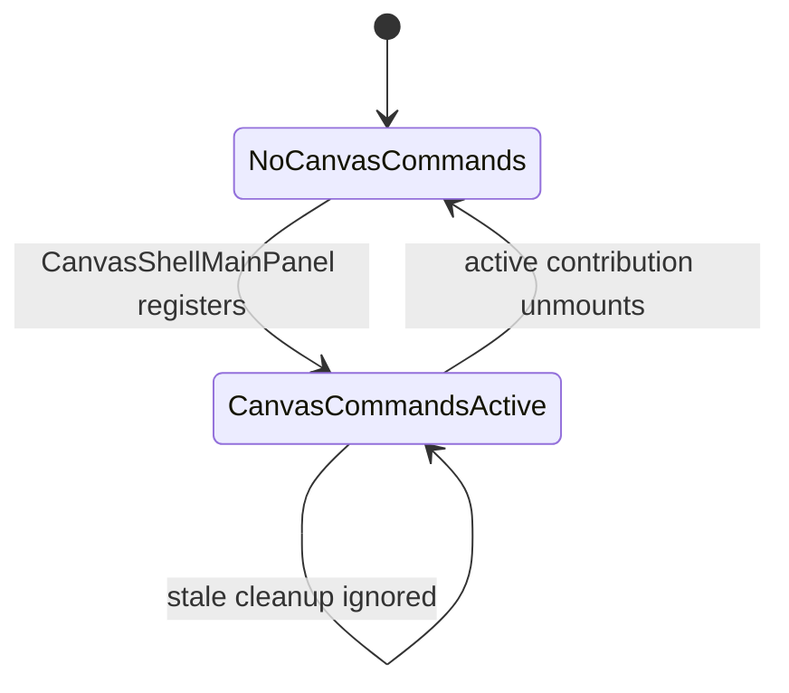
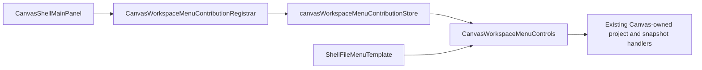

# Canvas Workbench Command Menu Component

## Owned Concern

The existing Canvas workspace contribution publishes project/file capabilities
and handlers without transferring Canvas controller ownership to the shell.
[GH-3622](https://github.com/dunay2/dvt/issues/3622) places those existing actions
in File; it does not add Insert or another application rail.

This component owns contribution registration, capability-gated presentation
and identity-guarded cleanup. It does not own graph truth, draft persistence,
planning, execution, project storage or authorization.

## Public API

- `CanvasWorkspaceMenuContribution`
- `useCanvasWorkspaceMenuContributionStore`
- `CanvasWorkspaceMenuContributionRegistrar`
- `CanvasWorkspaceMenuControls`
- `CanvasWorkspaceTopBarIdentity`

`CanvasShellMainPanel` registers the active contribution. The shell
`ShellFileMenuTemplate` composes `CanvasWorkspaceMenuControls`; the owning
Canvas handlers still execute project import, files/code and snapshots.
`CanvasWorkspaceTopBarIdentity` presents the active Canvas/model tabs separately.

## Invariants

- Canvas file actions exist only while their route contribution is active.
- File menus do not duplicate Canvas controller hooks, stores or command rails.
- Disabled or missing handlers cannot dispatch through menu selection.
- Pointer and keyboard share Radix selection semantics, not raw click callbacks.
- Snapshot selection retains its input until the native chooser produces a
  change; cancellation does not import, and the same file can be selected again.
- Project creation reuses its existing dialog and port; it does not require a
  Canvas contribution.
- Code/explorer return focus to File. Granted-scope recovery remains Project.
- Source import registers a source only; dragging creates the graph instance.
- Graph-local insertion and execution retain their existing owners. File does
  not become a second Run or Insert surface.
- Identity-guarded cleanup cannot clear a newer route contribution.

## Transitions

## Component Flow

## Command And Query Rails

The presentation reuses `ResolveCanvasProjectSnapshotActions`,
`ImportProjectSnapshot`, `ExportProjectSnapshot`, `ImportDbtProject` and the
existing workspace-file/code queries. Their capability and authorization
checks remain in the owning application ports and route controllers.
Project scope selection remains `SelectWorkspaceScope` in Project.

## Consumers And Evidence

- `CanvasShellMainPanel`
- `ShellFileMenuTemplate`
- `ShellTopBar` (identity only)
- `CanvasWorkspaceMenuControls.test.tsx`
- `TopAppBar.test.tsx`
- `canvas-workbench-screen-composition.cy.ts`
- `canvas-project-snapshot-roundtrip.cy.ts`
- `code-workbench-workspace-files.cy.ts`

## Fitness Functions

- `pnpm --filter @dvt/web exec vitest run --config vitest.presentation.config.ts src/app/components/TopAppBar.test.tsx src/app/views/canvas/CanvasWorkspaceMenuControls.test.tsx`
- `pnpm --filter @dvt/web exec vitest run --config vitest.architecture.config.ts src/app/shell/shellNavigationDisposition.architecture.test.ts`
- `pnpm --filter @dvt/web typecheck`
- `pnpm docs:feature-mechanization:implementation`
- `pnpm verify:prepush`

## Drift To Prevent

- Reintroducing file commands or global navigation into Project or View.
- Changing granted scope through File or hiding the existing recovery path.
- Closing the native snapshot receiver before a selected file reaches it.
- Bypassing pending-edit guards or contribution capabilities.
- Claiming implementation of Insert or other absent shell capabilities.
