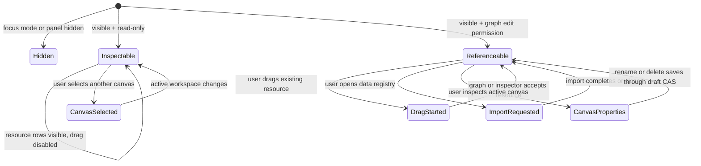
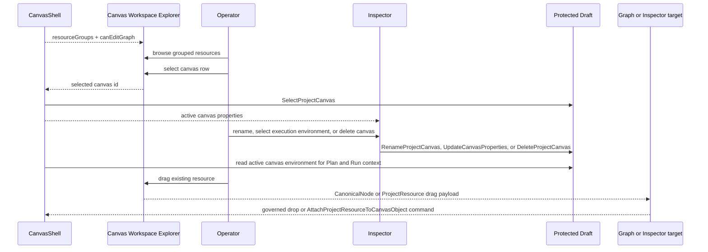

# Canvas Workspace Explorer Component

## Purpose

The Canvas Workspace Explorer renders existing project resources available to
the active Canvas route. It is the left contextual panel for discovery and
reference actions. It also exposes the project canvas worksheet catalog: users
can see every canvas stored in the draft, select the active worksheet, and send
canvas lifecycle edits to the Inspector and protected draft command rails.

It does not create new node kinds. Fresh graph object creation belongs to the
top-menu or toolbar `Insert` command.

## Governing Sources

- [Canvas Shell Component](./canvas-shell-component.md)
- [Canvas Ready Node Authoring Entrypoint Component](./canvas-ready-node-authoring-entrypoint-component.md)
- [Canvas Workbench Command Query Catalog](./canvas-workbench-command-query-catalog.md)
- [Canvas Workspace Explorer Fowler Review](https://github.com/dunay2/dvt/blob/5f1cb78d83b467d8b133380d9115d50b10dd14e7/docs/planning/reviews/architecture-and-governance/20260527-canvas-workspace-explorer-fowler-review.md)
- `docs/planning/proposals/mandatory/frontend-and-ux/canvas-workspace-explorer-console-theme-modeling-plan-20260527.md`

## Public API

The implementation currently lives in `DbtExplorer.tsx`. The semantic component
is the Canvas Workspace Explorer.

```ts
type DbtExplorerProps = {
  resourceGroups: readonly CanvasWorkspaceResourceGroup[];
  canEditGraph?: boolean;
  selectedResourceId?: string | null;
  onResourceSelect?: (resource: CanvasWorkspaceResource) => void;
  onResourceDragStart?: (resource: CanvasWorkspaceResource) => void;
  onHide?: () => void;
  onOpenDataRegistry?: () => void;
};
```

The local read model currently supports:

- `canvas`: the active Canvas document as a non-draggable project resource;
- `canvas`: all project canvas worksheets as non-draggable project resources,
  with an active marker and selection command;
- `canvas_node`: existing graph resources backed by canonical node drag
  payloads;
- `schema`: project schema resources inferred from canonical node metadata and
  backed by `CanvasWorkspaceResourceDragPayload` values for card attachment.

## Owned Concern

Render existing project resources and expose governed reference interactions
for those resources.

## Non-Goals

- render node-type creation buttons;
- own `NodeKindRegistration` catalogs;
- call `onCreateAuthoringNode`;
- mutate draft state directly;
- decide connector availability;
- persist canvas identity outside the protected draft CAS rail;
- persist theme preferences, Git state, or table design.
- edit canvas properties directly; the Inspector owns that form.

## Invariants

- The shell converts route/controller `CanonicalNode` rows into
  `CanvasWorkspaceResourceGroup` values before rendering the explorer.
- The explorer receives resource groups, not a node-kind creation catalog.
- The explorer never renders an `Add node` creation section.
- The explorer never calls `onCreateAuthoringNode`.
- Existing resource drag is enabled only when `canEditGraph` is true and the
  resource has either a canonical node payload or a project-resource payload.
- Schema resources use `AttachProjectResourceToCanvasObject` and update the
  target node metadata (`metadata.schema`, `metadata.config.schema`, and dbt
  `metadata.dbt.schemaName` when applicable).
- Import or registry actions are disabled in read-only mode.
- Resource kind labels come from the node kind registry only for display.
- New graph object creation remains in `Insert`.
- Multiple canvases are listed from `ListProjectCanvases`; `CreateProjectCanvas`
  appends a worksheet instead of replacing the active one.
- Selecting a canvas uses `SelectProjectCanvas`, which first preserves the
  current active graph workspace in the protected draft.
- Canvas rename, execution-environment selection, and delete controls are shown
  in the Inspector. Deleting the last remaining canvas is disabled.
- The active canvas `environmentId` is executable metadata: Plan and Run use it
  as the environment override when present, with the session environment as the
  fallback.

## Transitions



## Interaction Flow



## Consumers

- `CanvasShell.tsx` composes the panel.
- `canvasShellPanelsBuilder.ts` supplies `explorerResourceGroups`.
- `canvasWorkspaceExplorerModel.ts` maps existing resources into explorer
  groups, including schema resources inferred from node metadata.
- `DbtNodeComponent.tsx` accepts schema resource drops on a card and forwards
  them to the graph command handler.
- `useCanvasNodeAuthoringHandlers.ts` applies schema attachments to the local
  draft working set.
- `useCanvasViewportGraphModel.ts` refreshes projected node data when metadata
  changes so card and Inspector state remain current.
- `canvasProjectCanvasLifecycle.ts` owns canvas id normalization, selection,
  rename, property patch, and delete transitions.
- `canvasProjectCanvasLifecycleCommand.ts` persists canvas lifecycle
  transitions through protected draft CAS.
- `CanvasInspectorPanel.tsx` renders active canvas properties when no node is
  selected, including the execution environment selector.
- `useCanvasExecutionActions.ts` applies the active canvas environment to Plan
  preview and Run start scope when the canvas defines one.
- `DbtExplorer.test.tsx` proves explorer behavior.
- `CanvasShell.test.tsx` proves shell wiring.
- `canvasProjectCanvasLifecycle.test.ts` proves worksheet transitions.
- `CanvasShell.architecture.test.tsx` proves node creation cannot drift back
  into the explorer.

## Future Extension Points

- `ListProjectWorkspaceResources` should widen the current resource model
  beyond `canvas`, `canvas_node`, and `schema` resources as the catalog is
  promoted.
- Resource families should include artifacts, annotations, dbt files, tables,
  columns, users, roles, grants, REST sources, and generated source artifacts.
- Compatibility policy for dropping a resource onto a selected card belongs to
  `AttachProjectResourceToCanvasObject`, not the explorer renderer.

## Drift Guards

- If the explorer imports `NodeKindRegistration`, ownership has regressed.
- If the explorer exposes `nodeKinds`, ownership has regressed.
- If the explorer contains `onCreateAuthoringNode`, ownership has regressed.
- If the side panel and `Insert` both show the same creation list, product
  language has regressed.
- If schema resources create graph nodes instead of attaching metadata to an
  existing card, resource attachment has regressed.
- If `New canvas` replaces or deletes the active worksheet without an explicit
  delete command, canvas lifecycle has regressed.
- If canvas rename or delete uses route-local state instead of protected draft
  CAS, authority has drifted.
- If Plan or Run ignores the active canvas execution environment and silently
  uses only the shell session environment, execution authority has drifted.

<a id="section-canvas-workspace-explorer-user-stories"></a>

## Canvas Workspace Explorer User Stories

### Scope

These stories cover Workspace Explorer resource discovery plus the first
project-canvas lifecycle slice: list, select, rename, and delete worksheets
inside one protected draft. They intentionally do not cover table modeling, Git
sync, annotations, or console commands; those remain separate Planning DB
tasks.

### Stories

#### US-WEB-CANVAS-EXPLORER-001: Browse existing project resources

As an operator, I can open the Canvas left context panel and see project
resources grouped by type so that I understand what exists before I edit the
graph.

Acceptance:

- resources are grouped by resource or node kind;
- each group shows a count;
- the active canvas appears as a project resource when a Canvas document exists;
- resource rows show stable names and metadata badges;
- an empty resource catalog still exposes the governed import affordance when
  edit permissions allow it.

#### US-WEB-CANVAS-EXPLORER-002: Keep creation in Insert

As an operator, I use `Insert` to create fresh graph objects so that the side
panel has one meaning: existing project resources.

Acceptance:

- the explorer does not show `Add node`;
- the explorer does not receive node kind registrations;
- the toolbar or top-menu `Insert` owns node-type creation;
- selecting a node kind still calls the governed authoring command.

#### US-WEB-CANVAS-EXPLORER-003: Drag an existing resource when editing is allowed

As an operator with edit access, I can drag an existing resource from the
explorer into the graph or a compatible card.

Acceptance:

- rows are draggable when `canEditGraph` is true;
- canonical graph-node resources use the canonical node drag MIME type;
- project resources such as schemas use the project resource drag MIME type;
- the explorer emits the optional drag-start callback;
- compatibility checks are handled by graph or inspector drop policy.

#### US-WEB-CANVAS-EXPLORER-004: Inspect resources in read-only mode

As a read-only operator, I can inspect available resources without being
offered mutation commands.

Acceptance:

- resource rows remain visible;
- drag is disabled;
- import is disabled;
- node creation is not visible in the explorer.

#### US-WEB-CANVAS-EXPLORER-005: Open governed data import

As an operator with edit access, I can open the data registry from the explorer
so that imported resources enter the project catalog through a governed flow.

Acceptance:

- the import action is visible when a registry handler exists;
- the action is disabled in read-only mode;
- the explorer does not fabricate imported rows before the import completes.

#### US-WEB-CANVAS-EXPLORER-006: Keep multiple canvas worksheets available

As an operator, I can create a new canvas without losing the current one so
that I can work with several project worksheets in the same draft.

Acceptance:

- `New canvas` creates a new worksheet and makes it active;
- the previous active canvas remains listed in the left Explorer;
- the active canvas row is visibly marked;
- the saved protected draft contains all canvas workspaces.

#### US-WEB-CANVAS-EXPLORER-007: Select a canvas from the project list

As an operator, I can select another canvas from the left Explorer so that I
can move between worksheets naturally.

Acceptance:

- selecting a canvas row activates that canvas;
- the current active graph is preserved before switching;
- selecting the already-active row is a no-op;
- node-type creation remains in `Insert`, not in the Explorer.

#### US-WEB-CANVAS-EXPLORER-008: Rename and inspect canvas properties

As an operator, I can open the Inspector with no node selected and edit the
active canvas name while seeing its id, kind, execution environment, and
permission posture.

Acceptance:

- the Inspector shows `Canvas properties` when no node is selected;
- a blank canvas name is rejected;
- applying a rename updates the active canvas and its workspace entry;
- read-only posture disables the form.

#### US-WEB-CANVAS-EXPLORER-010: Select the canvas execution environment

As an operator, I can choose the active canvas execution environment from the
Inspector so that planning and running the canvas uses the environment I meant
for that worksheet.

Acceptance:

- the Inspector lists configured workspace environments for the active canvas;
- changing the environment saves through `UpdateCanvasProperties`;
- Plan preview uses the active canvas environment when it is set;
- Run start uses the same active canvas environment as the preview;
- when no canvas environment is set, execution falls back to the workspace
  session environment.

#### US-WEB-CANVAS-EXPLORER-011: Assign schema resources to node cards

As an operator, I can drag a schema resource from the project explorer onto an
existing card so that the card adopts that schema without creating another
node.

Acceptance:

- schemas inferred from project node metadata appear as grouped resources;
- dragging a schema row emits `CanvasWorkspaceResourceDragPayload`;
- dropping a schema onto a compatible card updates node metadata;
- dbt nodes update both `metadata.config.schema` and `metadata.dbt.schemaName`;
- read-only posture rejects the attachment command.

#### US-WEB-CANVAS-EXPLORER-009: Delete a canvas deliberately

As an operator, I can delete the active canvas from the Inspector when there is
another worksheet to activate.

Acceptance:

- delete is disabled when only one canvas exists;
- deleting the active canvas activates a remaining canvas;
- deletion is persisted through the protected draft CAS command;
- deletion is unavailable in read-only posture.

### Negative Scenarios

| Scenario              | Expected behavior                                            | Guard                                           |
| --------------------- | ------------------------------------------------------------ | ----------------------------------------------- |
| Duplicate create list | Explorer does not render `Add node`                          | `DbtExplorer.test.tsx`                          |
| Shell leakage         | `CanvasShell` does not pass `authoringNodeKinds` to explorer | `CanvasShell.architecture.test.tsx`             |
| Read-only drag        | Explorer rows render with `draggable=false`                  | `DbtExplorer.test.tsx`                          |
| Hidden mutation       | Explorer has no `onCreateAuthoringNode` prop                 | `CanvasShell.architecture.test.tsx`             |
| Stale import          | Empty explorer does not create synthetic resources           | future resource catalog test                    |
| Replacing canvas      | New canvas appends instead of replacing the current one      | `canvasCreateCanvasDocumentCommand.test.ts`     |
| Last canvas delete    | Delete is disabled when no fallback canvas exists            | `CanvasInspectorPanel.test.tsx`                 |
| Local-only lifecycle  | Canvas transitions update protected draft payloads           | `canvasProjectCanvasLifecycle.test.ts`          |
| Ignored environment   | Plan/Run use the active canvas environment when selected     | `useCanvasExecutionActions.*.test.tsx`          |
| Schema creates node   | Schema drag attaches metadata instead of creating a node     | `useCanvasGraphHandlers.nodeDrop.test.tsx`      |
| Stale card metadata   | Viewport refreshes when only node metadata changes           | `useCanvasViewportGraphModel.nodeData.test.tsx` |

### Coverage Matrix

- US-WEB-CANVAS-EXPLORER-001: `DbtExplorer.test.tsx`
- US-WEB-CANVAS-EXPLORER-002:
  `DbtExplorer.test.tsx`, `CanvasShell.test.tsx`,
  `CanvasShell.architecture.test.tsx`
- US-WEB-CANVAS-EXPLORER-003: `DbtExplorer.test.tsx`
- US-WEB-CANVAS-EXPLORER-004: `DbtExplorer.test.tsx`
- US-WEB-CANVAS-EXPLORER-005: `CanvasShell.test.tsx`
- US-WEB-CANVAS-EXPLORER-006:
  `canvasCreateCanvasDocumentCommand.test.ts`,
  `canvasWorkspaceExplorerModel.test.ts`
- US-WEB-CANVAS-EXPLORER-007:
  `canvasProjectCanvasLifecycle.test.ts`, `CanvasShell.test.tsx`
- US-WEB-CANVAS-EXPLORER-008:
  `CanvasInspectorPanel.test.tsx`, `canvasProjectCanvasLifecycle.test.ts`
- US-WEB-CANVAS-EXPLORER-009:
  `CanvasInspectorPanel.test.tsx`, `canvasProjectCanvasLifecycle.test.ts`
- US-WEB-CANVAS-EXPLORER-010:
  `CanvasInspectorPanel.test.tsx`,
  `useCanvasExecutionActions.planPreview.core.test.tsx`,
  `useCanvasExecutionActions.runStart.test.tsx`
- US-WEB-CANVAS-EXPLORER-011:
  `canvasWorkspaceExplorerModel.test.ts`, `DbtExplorer.test.tsx`,
  `DbtNodeComponent.architecture.test.ts`,
  `useCanvasGraphHandlers.nodeDrop.test.tsx`,
  `useCanvasViewportGraphModel.nodeData.test.tsx`

> Acceptance scope status: Review. Owner: Frontend / Architecture.
