# Graph Frontend Architecture

## Purpose

The Graph surface is the bounded frontend authoring context of DVT+. It hosts
heterogeneous plugin-qualified nodes and edges; dbt is the current native
transformation vertical, not a closed product ontology.

Its job is to expose graph authoring, route operability, preview, and run
handoff without becoming the source of execution truth or shell truth.

## Governing Sources

- [Graph Route Bootstrap Architecture](graph-frontend-architecture.md#section-graph-route-bootstrap-architecture)
- [Canvas Controller Current To Target Architecture](./canvas-controller-current-to-target-architecture.md)
- [Canvas Component Map And Modernization Review](./canvas-component-map-and-modernization-review.md)
- [Canvas Route Composition Component](graph-frontend-architecture.md#section-canvas-route-composition-component)
- [Canvas Authoring Runtime Component](./canvas-authoring-runtime-component.md)
- [Canvas Authoring Projection Component](canvas-authoring-runtime-component.md#section-canvas-authoring-projection-component)
- [Canvas Draft Session Component](canvas-authoring-draft-boundary-component.md#section-canvas-draft-session-component)
- [Canvas Startup And Draft Recovery Component](./canvas-startup-and-draft-recovery-component.md)
- [Canvas Graph Lifecycle Component](canvas-authoring-runtime-component.md#section-canvas-graph-lifecycle-component)
- [Graph Sequences And State Machines](graph-frontend-architecture.md#section-graph-sequences-and-state-machines)
- [Frontend Fowler Implementation Pattern](../frontend-data-boundary-architecture.md#section-frontend-fowler-implementation-pattern)
- [Frontend Data Boundary Architecture](../frontend-data-boundary-architecture.md)
- [US-F10.1 contextual Process Map correction](https://github.com/dunay2/dvt/issues/2102)

Reading rule:

- use this page for pack-level frontend posture
- use the controller and component docs for Canvas-local detail
- use the route-bootstrap doc for shell contract and startup rules

## Scope

In scope:

- Canvas route composition and operability
- route startup handoff from route context to shell context
- draft aggregate, scope projection, and route-local command seams
- plugin declaration boundary for graph behavior

Out of scope:

- backend persistence ownership
- planner redesign
- shell-wide navigation outside graph-facing routes

## Canonical Anchors

| Concern                     | Primary anchors                                                                                                                                                                                                                                                                       |
| --------------------------- | ------------------------------------------------------------------------------------------------------------------------------------------------------------------------------------------------------------------------------------------------------------------------------------- |
| Shell handoff               | [Root.tsx](../../../../../apps/web/src/app/Root.tsx), [routes.ts](../../../../../apps/web/src/app/routes.ts), [usePublishedRouteBootstrap.ts](../../../../../apps/web/src/app/bootstrap/usePublishedRouteBootstrap.ts)                                                                |
| Canvas route facade         | [Canvas.tsx](../../../../../apps/web/src/app/views/Canvas.tsx), [useCanvasController.ts](../../../../../apps/web/src/app/views/canvas/useCanvasController.ts), [canvasRouteViewState.ts](../../../../../apps/web/src/app/views/canvas/canvasRouteViewState.ts)                        |
| Draft authoring core        | [canvasDraftSession.ts](../../../../../apps/web/src/app/views/canvas/canvasDraftSession.ts), [canvasDraftScope.ts](../../../../../apps/web/src/app/views/canvas/canvasDraftScope.ts), [canvasGraphLifecycle.ts](../../../../../apps/web/src/app/views/canvas/canvasGraphLifecycle.ts) |
| Plugin boundary             | [PluginManifest.ts](../../../../../apps/web/src/app/plugins/contracts/PluginManifest.ts), [ConnectionRules.ts](../../../../../apps/web/src/app/plugins/contracts/ConnectionRules.ts), [registry.ts](../../../../../apps/web/src/app/plugins/registry.ts)                              |
| Canvas runtime policy       | [canvasRuntimePolicy.ts](../../../../../apps/web/src/app/views/canvas/canvasRuntimePolicy.ts), [useCanvasController.ts](../../../../../apps/web/src/app/views/canvas/useCanvasController.ts)                                                                                          |
| Canvas runtime registration | [registry.ts](../../../../../apps/web/src/app/plugins/registry.ts), [graphStrategyRegistry.ts](../../../../../apps/web/src/app/plugins/graphStrategyRegistry.ts), [canvasExecutionStrategyContracts.ts](../../../../../apps/web/src/app/plugins/canvasExecutionStrategyContracts.ts)  |
| Route copy and presentation | [copy.ts](../../../../../apps/web/src/app/views/canvas/copy.ts), [CanvasToolbar.tsx](../../../../../apps/web/src/app/views/canvas/CanvasToolbar.tsx), [canvasExecutionState.ts](../../../../../apps/web/src/app/views/canvas/canvasExecutionState.ts)                                 |

Node admission command anchors:

- [canvasNodeAdmissionTransaction.ts](../../../../../apps/web/src/app/views/canvas/canvasNodeAdmissionTransaction.ts)
- [useCanvasNodeAdmissionCommandRunner.ts](../../../../../apps/web/src/app/views/canvas/useCanvasNodeAdmissionCommandRunner.ts)

Edge command anchors:

- [canvasEdgeAdmissionTransaction.ts](../../../../../apps/web/src/app/views/canvas/canvasEdgeAdmissionTransaction.ts)
- [useCanvasEdgeCommandRunner.ts](../../../../../apps/web/src/app/views/canvas/useCanvasEdgeCommandRunner.ts)

## Frontend Topology

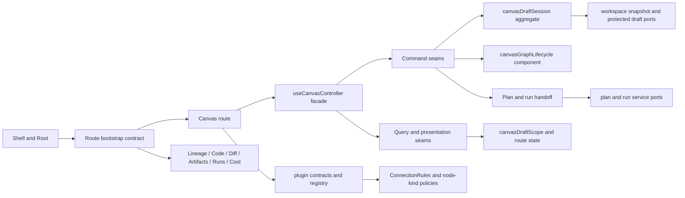

Current posture:

- shell startup is contract-driven, not pathname-driven
- Canvas owns authoring truth, not execution truth
- command and query seams are becoming explicit instead of widget-driven
- plugin declarations are separated from runtime composition and policy

## Current Architecture Point

As of release `0.5.3` on 2026-08-02:

- route startup is generalized by `route.id` plus explicit bootstrap metadata
- Canvas graph mutation now flows through one local lifecycle component
- edge admission lives behind a narrow pure policy seam; node drop, duplicate,
  and first-node creation use canonical admission before any viewport
  projection, while plugin graph strategies only parse or project
  plugin-owned payloads
- connection admission separates topology invariants from plugin policy:
  `proposeConnection` owns endpoint, duplicate, direction, and cycle checks,
  then delegates to `evaluateConnectionPolicy`; passive compatibility hints
  precompute graph topology once and reuse that same policy object instead of
  rebuilding the command aggregate for every possible node pair
- node create/drop handlers delegate node admission to
  `useCanvasNodeAdmissionCommandRunner`, and edge creation/reconnect
  delegates to `useCanvasEdgeCommandRunner`; both runners serialize local
  command effects over the latest viewport graph and draft session before a
  React rerender can refresh hook inputs
- the `Insert` surface exposes the active canvas kind's node-kind creation
  catalog while a canvas is ready, not only during the typed empty state; those
  buttons call the same governed node admission command as empty-state
  first-node creation and drag/drop
- connection and transformation validation stay typed until presentation
- route-visible operator copy is centralized instead of repeated across handlers
- protected draft reads now project a semantic canonical graph,
  `canvasAuthoringGraphProjection.ts` derives active authoring semantics from
  that protected graph plus scoped local working-set additions only, and
  `useCanvasViewportGraphModel.ts` projects those semantics into React Flow
  state
- API-mode `WorkspaceGraphSnapshot` consumers now receive a read-model
  projection from `GET /workspace/graph/draft` instead of calling a retired
  `/workspace/graph` endpoint; the snapshot remains projection-only and does
  not regain aggregate authority
- Canvas source-import affordances are capability-gated instead of being
  implied by mock-era empty states; the active `api` path uses the implemented
  protected connection list/create/test, source-object discovery, and import
  rails, while `mock` is not a substitute active-authoring runtime
- DVT+ treats the graph as a heterogeneous plugin-qualified topology. The
  `dvt:source -> dvt:sql_transform -> dvt:sink` sequence remains one supported
  transformation example, not the whole product ontology or a fixed graph
  shape
- Canvas is the single primary Process Map. Code, source import, project
  exploration, and node work open contextually; Log, Problems, Runs, and
  Preview retain their existing bottom-drawer owners rather than becoming peer
  graph routes or fixed side rails
- active Canvas runtime composition is now registered once per canvas kind:
  `CanvasRuntimeRegistration` binds product kind, graph strategy, execution
  posture, and first-node catalog
- plugin projections are capability-aware: disabled runtime plugins no longer
  contribute port maps, overlays, badges, renderers, or run adapters to Canvas
  consumers
- `CanvasRuntimePolicy` is the route-level application policy. It resolves the
  active document state, command availability, execution posture, and
  node-kind admission from the same runtime snapshot before any shell,
  inspector, execution, or graph command consumes those decisions
- unsupported persisted canvas kinds fail closed as invalid documents;
  registered canvas kinds whose plugin is disabled fail closed as
  `disabled_plugin` with separate operator copy; only a missing document may
  use the default transformation creation posture
- `transformation` retains its canonical authoring catalog but registers a
  `not_executable` posture: selection-for-execution, Preview, and Run are not
  exposed while the retired SQL-first path has no replacement. `dbt` keeps the
  TF-C3-backed `planner-generic-v1` posture. DBT preview/run is available only
  through generated workspace artifacts, a dbt `GenericGraphSourceV1`, and a
  persisted `PlanRef`; API-mode warehouse source import is available only when
  the workspace port advertises the implemented protected-runtime source-import
  rails.
- Preview publishes exactly one of `accepted`, `selection-rejected`, or
  `plan-invalid`. An accepted or invalid built plan keeps its exact persisted
  `PlanRef`; later project or graph changes may require a new Preview but do not
  mutate or invalidate that stored execution identity. `StartRun(planRef)`
  executes the referenced stored artifact.
- route shell composition applies the effective fail-closed route posture to
  Inspector authoring, so an unsupported or blocked canvas cannot reopen
  side-panel mutation even if a lower-level controller value drifts
- canonical graph vocabularies are exported as runtime arrays and TypeScript
  unions derive from those arrays, so runtime guards cannot drift from types
- persisted draft recovery now has an explicit replacement command from the
  host tab strip: the action creates a blank canvas through the protected draft
  save boundary with the current revision as the compare-and-swap guard, so
  stale local demo data does not require manual database cleanup
- React Flow node drag uses the whole node card when effective mutation
  permission allows it, keeping the expected operator gesture simple while
  preserving the same fail-closed permission gate
- Canvas viewport preferences now have a named route-local command rail:
  `ConfigureCanvasViewportPreferences` owns grid visibility, grid color, and
  snap-to-grid state in `uiLayoutStore`, while `PersistCanvasLayout` continues
  to own renderer coordinates and protected draft rails remain graph-authority
  only
- newly authored catalog nodes start from a visible first authoring slot instead
  of the React Flow origin, and auto-layout preserves node drag capability while
  optionally snapping computed coordinates to the configured grid

## Protected Draft Semantic Projection

The current single-authority projection point is explicit:

- `canvasDraftReadModel.ts` is the route-facing read-model seam for protected
  draft outcomes
- `workspaceGraphDraftProjection.ts` projects both the lossy persisted draft
  record and the semantic canonical graph used by Canvas authoring
- `canvasAuthoringGraphProjection.ts` treats protected semantic graph as first
  authority and supplements it only with route-local explicit additions that
  are not yet persisted remotely
- `useCanvasAuthoringProjection.ts` composes semantic authoring projection and
  viewport projection without turning React Flow into semantic authority
- `useCanvasViewportGraphModel.ts` owns viewport-ready node and edge state only

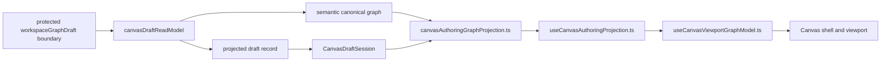

Interpretation rule:

- semantic graph owns visible authoring semantics when a protected draft is
  present
- route-local canonical-node supplementation may cover only pending or
  locally-added working-set members that are not yet persisted in the
  protected draft
- viewport node and edge state is a downstream projection of that semantic
  authoring graph, never a second semantic merge point
- projected record still owns persisted working-set membership and positions
- the retired workspace-snapshot path is no longer allowed to override or
  supplement active route semantics
- capability-gated authoring actions such as source import must be derived from
  explicit service seams plus route posture, never from fallback copy

## Plugin Contract Boundary

`PluginManifest.ts` is the canonical declaration contract for graph-facing
plugins.

| Module               | Owns                                                                 | Must not own                                |
| -------------------- | -------------------------------------------------------------------- | ------------------------------------------- |
| `PluginManifest.ts`  | vocabulary, contribution DTOs, node-kind and connection declarations | runtime composition, graph-policy execution |
| `registry.ts`        | static plugin composition, availability filtering, port maps         | declaration semantics                       |
| `ConnectionRules.ts` | graph-policy evaluation over manifest declarations                   | plugin registration and route copy          |
| `copy.ts`            | locale-resolved operator copy                                        | plugin declaration semantics                |

Runtime projection rule:

- every registry helper that contributes route-visible behavior must accept
  `RuntimeCapabilities`;

## Shared Source And Model Presentation

Canvas presents Source and Model through one product card projection and one
React Flow node shell. The only product kinds are:

- `dvt:source` for a stable physical source declaration;
- `dvt:transform` for a Model.

An external dbt project maps its sources and models to those kinds and
retains file identity, revision, configuration, and supported write-back rules
as explicit authority and compatibility metadata. dbt-qualified kinds remain
only for independently meaningful resources such as tests and snapshots. The
shared card read model derives product role from `input` or `transform`
and adds authority-specific evidence as metadata, metrics, badges, or
inspector capabilities rather than selecting a second card species.

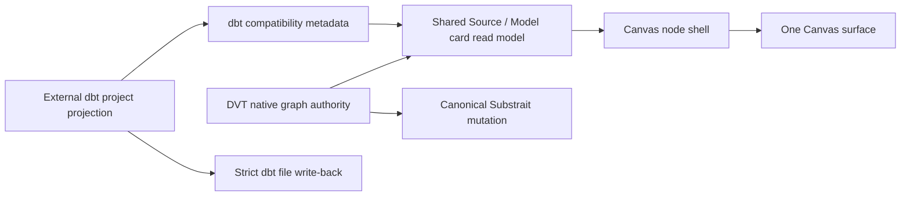

The authority profile may change which edits are valid. External dbt metadata
uses the existing dbt file-authority commands; native Model semantics use
`ConfigureCanvasDvtNode`. A request that external dbt authority cannot
round-trip fails closed until a separate, explicit authority transition is
accepted. Canvas must never strip dbt metadata or change node identity as a
side effect of a column gesture.

A Source is a declaration of physical input. Reordering, filtering, casting,
calculated columns, and scalar functions change a relation and therefore belong
to a connected Model / Transform. Canvas does not expose those operations on
either dbt or DVT Source authority.

- unavailable plugins must not contribute canvas kinds, node kinds, renderers,
  badges, overlays, run adapters, or connection port maps;
- route bootstrap handles for plugin-contributed views are plugin-owned
  contribution data, not route-view implementation details consumed by
  `registry.ts`;
- plugin node-kind parsing must use
  `parsePluginNodeKind` from `types/canonicalGuards.ts`; inline
  `split(':')` or `slice(0, indexOf(':'))` extraction is drift;
- Canvas consumers may forward capability-filtered projections, but must not
  read port maps, badges, or overlays from `PLUGIN_REGISTRY` directly.

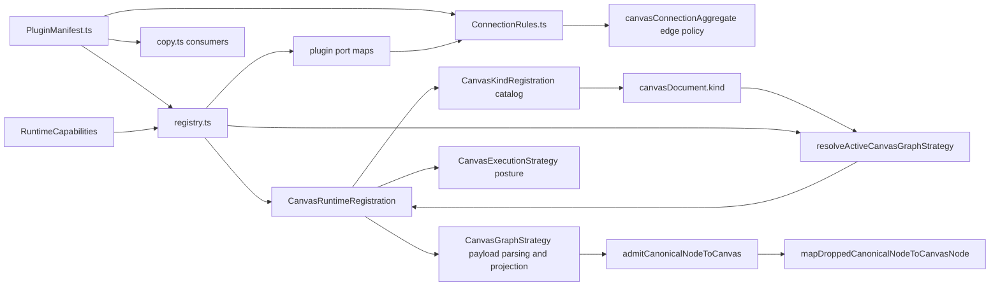

Reading rule:

- ask `PluginManifest.ts` what a plugin may declare
- ask `registry.ts` which plugins are active
- ask `ConnectionRules.ts` how those declarations affect graph semantics
- ask the active canvas document which graph strategy and authoring catalog are
  in force; do not ask the graph strategy for canvas-kind posture

## Canvas Runtime Registration

Canvas kind, graph strategy, execution posture, and first-node catalog are one
runtime registration. This prevents the mature-system failure mode where a new
document kind becomes visible in the UX before its parser, catalog, or
execution posture is explicitly declared.

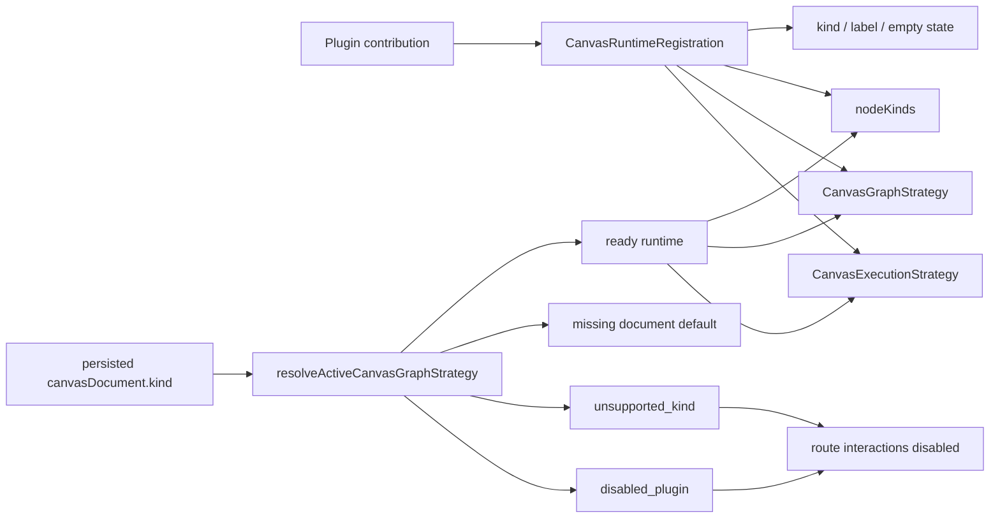

Runtime invariants:

- every visible canvas kind must have one graph strategy;
- every graph strategy used by Canvas must be reachable through a runtime
  registration;
- every runtime must declare whether it is executable;
- unsupported persisted kinds disable mutation, plan, and run instead of
  falling back to transformation semantics.
- a persisted kind that is statically registered but filtered out by runtime
  capabilities is `disabled_plugin`, not `unsupported_kind`; this preserves the
  distinction between operator-disabled plugins and corrupt or unknown stored
  canvas documents.
- `unsupported_kind` and `disabled_plugin` do not have an active
  `CanvasGraphStrategy` or `CanvasExecutionStrategy`; selectors must return
  absence instead of defaulting to `transformation`.

## Persisted Draft Replacement Recovery

Canvas has a singular workspace draft canvas document. It does not model
multiple canvases in one workspace draft yet. When a persisted local or remote
draft already exists, the first-canvas empty state is therefore intentionally
hidden.

The mature recovery path is an explicit replacement transition from the
host-owned graph-first Canvas shell. This is not a local reset and not a
frontend mock escape hatch: it writes a new blank draft through the same
protected draft repository used by normal authoring saves.

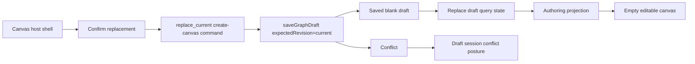

Invariants:

- first-canvas creation remains fail-closed when a draft record already exists;
- replacement is allowed only when the command carries `replace_current`;
- replacement uses the existing draft revision as the CAS guard;
- the replacement payload clears node ids, positions, and edges in one
  authoritative save;
- read-only, backend-blocked, runtime-blocked, or recovery-blocked postures keep
  the replacement action disabled through effective route permissions.

## Node Drag Surface

Graph mutation remains governed by `CanvasRuntimePolicy` and the effective route
permissions. When mutation is allowed, the viewport passes
`nodesDraggable=true`; projected React Flow nodes do not declare a `dragHandle`
selector, so the whole node card is draggable except for React Flow connection
handles and other controls that own their own gesture.

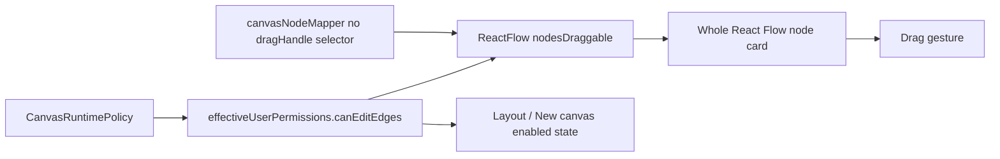

This keeps drag behavior explicit while preserving the fail-closed rule: if the
route is read-only or blocked, React Flow receives no node-change handler and
nodes are not draggable.

## Canvas Runtime Policy

`CanvasRuntimePolicy` is the route-level application boundary for active Canvas
posture. It is intentionally separate from plugin declarations and UI panels:
plugins declare runtime facts; the policy decides what the active route may do
with those facts.

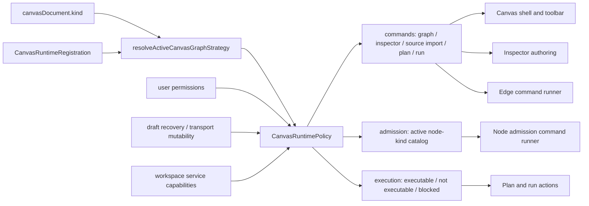

Policy invariants:

- unsupported persisted canvas kinds deny graph mutation, Inspector authoring,
  source import, plan, and run from one policy object;
- disabled registered canvas plugins deny the same mutation and execution
  commands as unsupported kinds, but retain their own `disabled_plugin`
  document state and route copy;
- DBT authoring remains mutable when permissions and draft posture allow it;
  DBT plan/run availability comes from the registered
  `planner_generic_preview` execution posture and still fails closed when the
  graph has no executable dbt model, test, or snapshot node;
- node create/drop commands must call
  `CanvasRuntimePolicy.admission.allowsCanonicalNode` before a viewport node or
  draft-session mutation is produced;
- runtime admission validates `kind`, `pluginId`, and catalog-owned `role`
  together; matching a node-kind string alone is not semantic admission;
- controller and viewmodel surfaces may forward policy decisions, but must not
  recompute Inspector, source-import, plan, or run availability from lower-level
  booleans.
- route shell composition must additionally intersect forwarded Inspector
  editability with effective route permissions before rendering panels; this
  protects the shell boundary from stale or bypassed controller posture.

### Policy Sequence

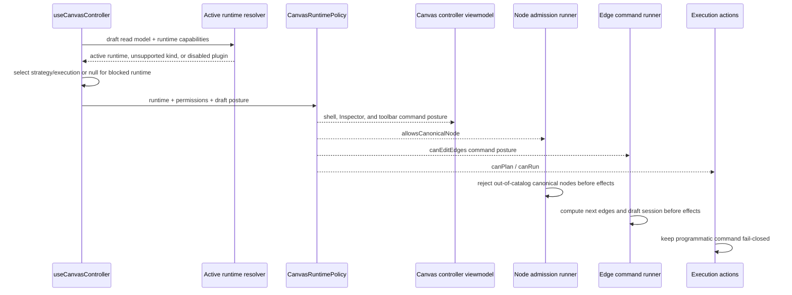

## Active Strategy And Canonical Admission

The active Canvas document owns the authoring kind. Graph strategies are now
payload/projection adapters only. The active runtime policy owns whether the
parsed canonical node may be admitted for the active canvas kind.

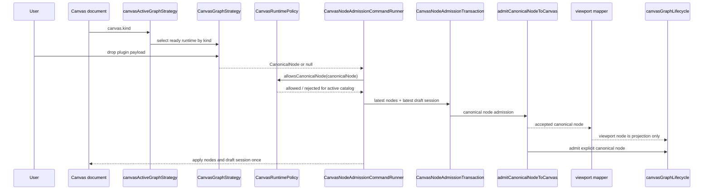

Invariant:

- `admitCanonicalNodeToCanvas` must not import React Flow or produce viewport
  nodes.
- `CanvasGraphStrategy` must not expose canvas-kind policy.
- node create/drop handlers apply a pure `CanvasNodeAdmissionTransaction`
  result once; semantic draft mutation and viewport projection are computed
  before React effects are applied.
- node create/drop handlers must reject canonical nodes that are outside the
  active runtime catalog or whose `pluginId` does not match the catalog-owned
  node-kind prefix or role.
- the command runner must advance its local `nodes` and `draftSession`
  snapshots after every accepted command, so two create/drop commands in the
  same event turn cannot lose the first semantic admission.

## Edge Command Admission

Edge creation and reconnect use the same command-runner discipline as node
admission. The completed compatible gesture is the `CreateCanvasEdge` command
intent; the handler owns gesture routing and rejection presentation, the
transaction owns graph admission semantics, and the runner owns effect
serialization. No intermediate confirmation state or modal is created.

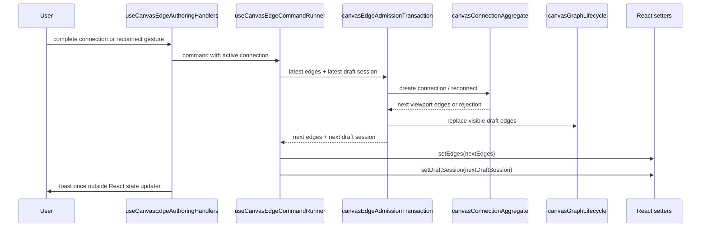

Invariants:

- edge creation and reconnect must compute next viewport edges and next
  draft-session visible edges before React effects are applied;
- `setEdges` must receive concrete edge arrays, not updater callbacks that
  also mutate draft state;
- `setDraftSession` and user notifications must not run inside a `setEdges`
  updater callback;
- the runner must advance local `edges` and `draftSession` snapshots after an
  accepted command, so consecutive edge commands cannot replay stale semantic
  state before rerender.

## Architecture Fitness Tests

The architecture tests now prefer behavior-level fitness functions over broad
string checks. Current semantic coverage includes:

- runtime registration parity between canvas kind, strategy, execution posture,
  and authoring catalog;
- `CanvasRuntimePolicy` command posture over real DBT and transformation
  runtime registrations;
- controller, viewmodel, and node command handlers consuming the policy
  boundary instead of recomputing active route posture locally;
- unsupported persisted canvas kinds blocking mutation and execution posture;
- disabled registered plugin posture remaining distinct from unsupported kind
  across active runtime resolution, route interaction state, and route-visible
  copy;
- plugin-owned route bootstrap handle ownership for Cost route composition;
- canonical `PluginNodeKind` parsing through one helper instead of duplicated
  string extraction;
- active graph and execution selectors returning `null` instead of
  transformation fallback for unsupported or disabled runtime states;
- pure node-admission transaction results for add and duplicate-noop paths;
- pure edge-admission transaction results for creation and reconnect paths;
- edge admission rejection for missing endpoints, self-loops, invalid
  transformation direction, and idempotent same-target reconnect;
- node admission projection of column-level lineage posture into viewport node
  data;
- capability-filtered graph strategy registration, including fail-closed
  default strategy resolution when the owning plugin is disabled;
- transformation connection guard behavior for empty, partial, and
  non-transformation three-node graphs;
- active runtime catalog rejection before node create/drop side effects;
- consecutive node create/drop commands preserving both viewport nodes and
  draft-session membership before rerender;
- edge creation and reconnect applying direct `edges` and `draftSession`
  values instead of updater callbacks with nested side effects;
- plugin runtime projections filtering port maps, overlays, badges, and node
  renderers through `RuntimeCapabilities`;
- route shell composition closing graph, Inspector authoring, Plan, and Run for
  unsupported persisted canvas kinds;
- route coverage proving dbt export authoring stays available, shared card
  config can be applied through Inspector, generated dbt workspace files are
  written before preview, and run start uses only a persisted `PlanRef`;
- Cypress preview/run status assertions consuming resolved Canvas copy instead
  of hardcoded fallback text, so locale does not hide policy regressions;
- typed empty-state catalog and copy derivation from the active runtime;
- first-node authoring remains available even when source import capability is
  unavailable.
- ready-canvas authoring exposes active node-kind creation through `Insert`, so
  users can add more nodes after the first graph already exists without turning
  the Workspace Explorer into a second creation palette;
- explicit persisted-draft replacement through CAS saves, including the
  negative path that existing drafts are not overwritten without
  `replace_current`;
- explicit whole node drag surface wiring between React Flow and the rendered
  node shell.

Source-text assertions are retained only as narrow import-boundary tripwires
where runtime behavior cannot observe ownership directly.

## Architecture Pack

Recommended reading order:

1. [Graph Route Bootstrap Architecture](graph-frontend-architecture.md#section-graph-route-bootstrap-architecture)
2. [Canvas Controller Current To Target Architecture](./canvas-controller-current-to-target-architecture.md)
3. [Canvas Component Map And Modernization Review](./canvas-component-map-and-modernization-review.md)
4. [Canvas Route Composition Component](graph-frontend-architecture.md#section-canvas-route-composition-component)
5. [Canvas Authoring Runtime Component](./canvas-authoring-runtime-component.md)
6. [Canvas Authoring Projection Component](canvas-authoring-runtime-component.md#section-canvas-authoring-projection-component)
7. [Canvas Draft Session Component](canvas-authoring-draft-boundary-component.md#section-canvas-draft-session-component)
8. [Canvas Graph Lifecycle Component](canvas-authoring-runtime-component.md#section-canvas-graph-lifecycle-component)
9. [Graph Sequences And State Machines](graph-frontend-architecture.md#section-graph-sequences-and-state-machines)
10. [Graph Canvas Runtime Model](graph-frontend-architecture.md#section-graph-canvas-runtime-model)
11. [Graph Decision Rationale And Patterns](graph-frontend-architecture.md#section-graph-decision-rationale-and-patterns)

## Evolution Direction

Near-term:

- finish the TF-E2 authoring lifecycle under one draft authority
- keep shared write semantics inside command seams, not adapter hooks
- keep route startup explicit for every graph-adjacent route
- close proof and operability coverage for the graph pack

Long-term:

- Graph remains one bounded frontend authoring context
- the authoring core follows DDD plus tactical CQRS plus hexagonal layering
- the route edge remains Fowler-aligned through explicit facades and
  presentation models
- the shell consumes graph route contracts but does not own graph domain rules

## Related Pages

- [Graph Architecture Docs](./index.md)
- [web component](../index.md)
- [UX Implementation Guide](../style-guide.md#section-ux-implementation-guide)
- [System Delivery Status](../../../../system-delivery-status.md)

<a id="section-canvas-route-presentation-component"></a>

## Canvas Route Presentation Component

### Purpose

Define the local component model for route-visible Canvas posture.

This component owns the semantic projection that aligns:

- shell-facing bootstrap publication
- Canvas center-surface state
- recovery banner visibility and content
- toolbar workflow posture

It exists to remove parallel route-state interpretation and to keep one
canonical presentation truth for the Canvas route.

### Governing sources

- [Graph Route Bootstrap Architecture](graph-frontend-architecture.md#section-graph-route-bootstrap-architecture)
- [Canvas Component Map And Modernization Review](canvas-component-map-and-modernization-review.md)
- [Canvas Controller Current To Target Architecture](canvas-controller-current-to-target-architecture.md)
- [Graph Frontend Architecture](graph-frontend-architecture.md)

### Reading rule

Read the component in this order:

1. `canvasDraftPresentationModel.ts`
   canonical route posture and bootstrap projection
2. `canvasRouteViewState.ts`
   route-facing aggregation for visible Canvas posture
3. `CanvasCenterSurface.tsx`
   center-surface rendering over canonical posture
4. `canvas-empty-authoring-entrypoint-component.md`
   empty Canvas authoring command, governed catalog, and lifecycle invariants
5. `CanvasRecoveryBanner.tsx`
   recovery-banner rendering over canonical posture
6. `canvasToolbarViewModel.ts`
   toolbar workflow posture over canonical route truth
7. `CanvasToolbarDraftStatus.tsx`
8. `CanvasDraftSaveStatus.tsx`
   draft-status rendering over route-approved affordances

If a change does not fit one of those concerns, it probably belongs in the
controller read model, the draft aggregate, or the route bootstrap stack
instead.

### Why this component exists

The Canvas route already had a route presentation model, but the visible
surfaces drifted in three ways before `TF-E2-F`:

- `CanvasRecoveryBanner.tsx` read raw controller recovery reason directly
- `CanvasCenterSurface.tsx` reinterpreted route posture locally
- `canvasToolbarViewModel.ts` inferred recovery from `showReloadAction`, which
  is an affordance flag rather than canonical route posture

`TF-E2-F` closed that semantic drift by making route presentation one explicit
local component with one authority model.

### Public API

The public component API is:

- `deriveCanvasDraftPresentationState(...)`
- `toRouteBootstrapPresentation(...)`
- `deriveCanvasRouteViewState(...)`

The public state vocabulary is:

- `CanvasRouteState`
- `CanvasDraftPresentationState`
- `CanvasRouteViewState`

Rendering adapters consume the component, but they do not own the semantic API.

### File responsibilities

<!-- markdownlint-disable MD060 -->

| File                               | Owned concern                                                | Public to other modules |
| ---------------------------------- | ------------------------------------------------------------ | ----------------------- |
| `canvasDraftPresentationModel.ts`  | canonical route posture and bootstrap semantics              | yes                     |
| `canvasRouteViewState.ts`          | route-facing aggregation over presentation and interaction   | yes                     |
| `CanvasCenterSurface.tsx`          | center-surface rendering from canonical route posture        | consumer only           |
| `canvasCenterSurfaceWorkbench.tsx` | workbench and empty-authoring rendering from route posture   | consumer only           |
| `canvasCenterSurfaceTransport.tsx` | draft transport failure rendering before workbench states    | consumer only           |
| `CanvasRecoveryBanner.tsx`         | recovery-banner rendering from canonical route posture       | consumer only           |
| `canvasToolbarViewModel.ts`        | toolbar workflow-status projection from route posture        | consumer only           |
| `CanvasToolbarDraftStatus.tsx`     | draft-status wrapper from route-approved affordance policy   | consumer only           |
| `CanvasDraftSaveStatus.tsx`        | draft-status rendering from route-approved affordance policy | token consumer          |

<!-- markdownlint-enable MD060 -->

### Current topology after hard cut

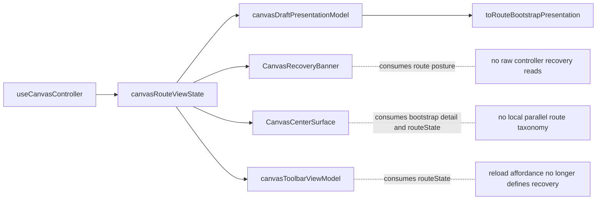

### Transitions

This component does not own persistence or graph mutation transitions.

It owns visible route-presentation transitions only:

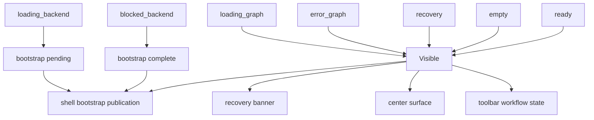

### Invariants

- Route-visible posture is decided once per render cycle.
- Banner, center surface, toolbar, and bootstrap publication must consume the
  same canonical route posture.
- `blocked_backend` disables unsafe Canvas interactions and publishes a
  completable shell bootstrap posture. Revealing the route is allowed because
  the first useful Canvas surface is the governed backend-blocked state, not an
  editable workbench.
- Affordances such as reload buttons are consequences of route posture, not
  authorities that define it.
- `CanvasRecoveryBanner.tsx` must not read raw controller recovery reason once
  the component hard cut is complete.
- `canvasToolbarViewModel.ts` must not infer recovery from
  `draftToolbarState.showReloadAction`.
- `CanvasCenterSurface.tsx` must not recreate a parallel route-state taxonomy.
- Transport-error rendering may stay as a higher-priority rendering concern,
  but it must still compose through the route-presentation component rather
  than through controller-local branching.

### Consumers

- `Canvas.tsx`
- `CanvasShell.tsx` through toolbar props and center-surface composition
- `usePublishedRouteBootstrap.ts` through `toRouteBootstrapPresentation(...)`
- `canvasDraftPresentationStore.ts`

### Fitness functions

The canonical fitness checks for this component are:

- `canvasDraftPresentationModel.test.ts`
- `canvasRouteViewState.architecture.test.ts`
- `CanvasRecoveryBanner.architecture.test.tsx`
- `CanvasCenterSurface.architecture.test.ts`
- `CanvasToolbar.test.tsx`
- `Canvas.routeStates.smoke.test.tsx`
- `Canvas.routeStates.first-canvas-policy.test.tsx`
- `Canvas.routeStates.host-cycle-persistence.test.tsx`
- `Canvas.routeStates.backend-recovery-priority.test.tsx`
- `Canvas.draftRecovery.test.tsx`

### Drift to watch

- if toolbar workflow posture starts using draft-affordance flags as semantic
  authority, the hard cut has regressed
- if banner or center-surface components read raw controller recovery state,
  route presentation has leaked backwards into adapters
- if route bootstrap detail is published from any source other than canonical
  route presentation, shell startup drift has returned
- if a future Cypress spec is added for route posture, it must exercise blocked,
  recovery, and ready transitions rather than only the preview-run happy path

> Section status: Active. Owner: Frontend / Architecture. Colocation does not merge component responsibilities.

<a id="section-canvas-route-composition-component"></a>

## Canvas Route Composition Component

### Purpose

Define the local component model for route-owned Canvas composition.

This component owns:

- controller-to-view adaptation at the route boundary
- shell contract assembly
- modal-host contract assembly
- route-publication synchronization

It does not own draft truth, graph mutation semantics, or route-visible
presentation semantics themselves.

### Governing Sources

- [Graph Frontend Architecture](graph-frontend-architecture.md)
- [Canvas Component Map And Modernization Review](canvas-component-map-and-modernization-review.md)
- [Canvas Controller Current To Target Architecture](canvas-controller-current-to-target-architecture.md)
- [Canvas Route Presentation Component](graph-frontend-architecture.md#section-canvas-route-presentation-component)
- [Canvas Shell Component](canvas-shell-component.md)
- [Graph Route Bootstrap Architecture](graph-frontend-architecture.md#section-graph-route-bootstrap-architecture)

### Reading Rule

Read the component in this order:

1. `Canvas.tsx`
   route composition and provider boundary
2. `useCanvasRoutePresentationSync.ts`
   route publication and draft-presentation synchronization
3. `canvasShellBuilder.types.ts`
   concern-scoped shell builder input vocabulary
4. `canvasShellPropsBuilder.tsx`
   route-owned orchestration into shell concern contracts
5. `canvasModalHost.types.ts`
   semantic modal-host contract
6. `canvasModalHostPropsBuilder.ts`
   route-owned modal adaptation seam
7. `CanvasModalHost.tsx`
   passive modal-host rendering over semantic props
8. `Canvas.architecture.test.tsx`,
   `CanvasModalHost.architecture.test.tsx`, and
   `canvasShellPropsBuilder.architecture.test.ts`
   semantic fitness functions for the route seam

If code in this area starts owning aggregate semantics or widget-local
heuristics, the component has regressed.

### Public API

The public route-composition API is:

- `buildCanvasShellProps(...)`
- `buildCanvasModalHostProps(...)`
- `useCanvasRoutePresentationSync(...)`
- `CanvasModalHost`
- `CanvasModalHostProps`
- `CanvasShellRouteComposerArgs`

The route component itself remains `Canvas.tsx`.

### File Responsibilities

<!-- markdownlint-disable MD060 -->

| File                                | Owned concern                                      | Public to other modules |
| ----------------------------------- | -------------------------------------------------- | ----------------------- |
| `Canvas.tsx`                        | route composition over the controller facade       | yes                     |
| `useCanvasRoutePresentationSync.ts` | route publication and presentation synchronization | adjacent route seam     |
| `canvasShellBuilder.types.ts`       | concern-scoped shell-builder input vocabulary      | local builder API       |
| `canvasShellPropsBuilder.tsx`       | route-owned shell contract orchestration           | yes                     |
| `canvasModalHost.types.ts`          | semantic modal-host vocabulary                     | yes                     |
| `canvasModalHostPropsBuilder.ts`    | route-owned modal-host contract adaptation         | adjacent route seam     |
| `CanvasModalHost.tsx`               | passive modal-host rendering                       | yes                     |

<!-- markdownlint-enable MD060 -->

### Current Topology After Hard Cut

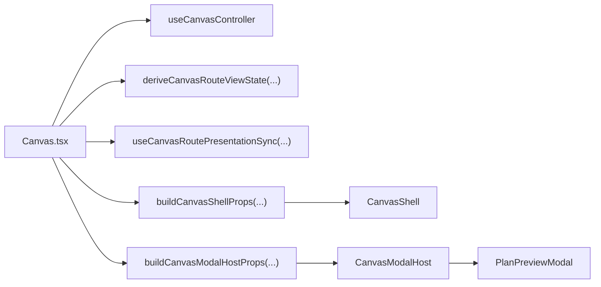

### Transitions

The component owns route-composition transitions only:

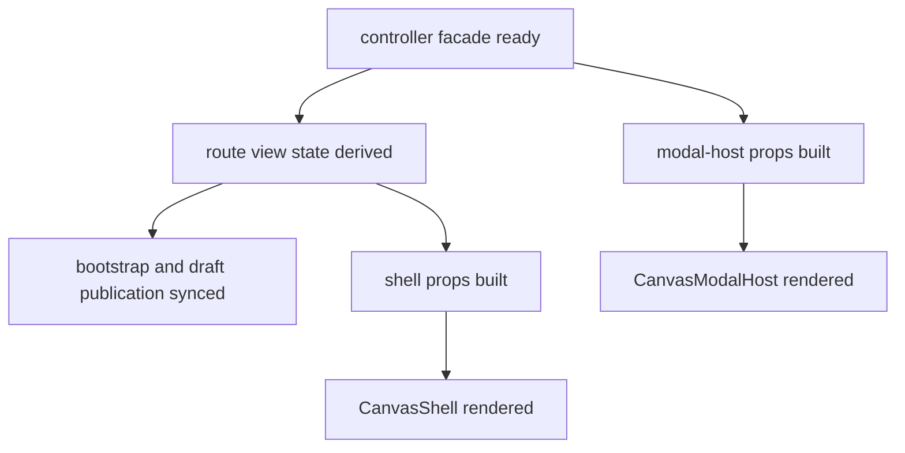

### Invariants

- `Canvas.tsx` is the only route-level composition site for the Canvas route.
- `Canvas.tsx` may own orchestration, but it must not own inline shell or modal
  contract assembly once dedicated builders exist.
- `CanvasModalHost.tsx` must not import `useCanvasController` or consume
  controller-shaped props.
- The route composer may see the full controller facade and route view state;
  shell subbuilders must not.
- `canvasShellPropsBuilder.tsx` is allowed to adapt route-owned inputs into
  smaller concern contracts; the concern subbuilders are not allowed to widen
  those contracts again.
- Route publication remains an adjacent seam through
  `useCanvasRoutePresentationSync.ts`; it must not fold back into `Canvas.tsx`
  inline effects.

### Consumers

- `Canvas.tsx`
- `Canvas.architecture.test.tsx`
- `CanvasModalHost.architecture.test.tsx`
- `canvasShellPropsBuilder.architecture.test.ts`

### Fitness Functions

The canonical fitness checks for this component are:

- `Canvas.architecture.test.tsx`
- `CanvasModalHost.architecture.test.tsx`
- `canvasShellBuilder.types.architecture.test.ts`
- `canvasShellPropsBuilder.architecture.test.ts`
- `Canvas.routeStates.smoke.test.tsx`
- `Canvas.routeStates.first-canvas-policy.test.tsx`
- `Canvas.routeStates.host-cycle-persistence.test.tsx`
- `Canvas.routeStates.backend-recovery-priority.test.tsx`
- `Canvas.readOnlyStates.test.tsx`
- `@dvt/web` typecheck

### Drift To Watch

- if `CanvasModalHost.tsx` starts importing `useCanvasController`, the passive
  view boundary has regressed
- if shell subbuilders accept the full route-composer args bag again, semantic
  ownership has regressed
- if `Canvas.tsx` starts rebuilding modal or shell props inline, route
  composition has regressed
- if route publication moves back into inline `useEffect` logic inside
  `Canvas.tsx`, route composition and publication have drifted together again

> Section status: Active. Owner: Frontend / Architecture. Colocation does not merge component responsibilities.

<a id="section-graph-sequences-and-state-machines"></a>

## Graph Sequences And State Machines

### Sequence 1: Published Route Startup

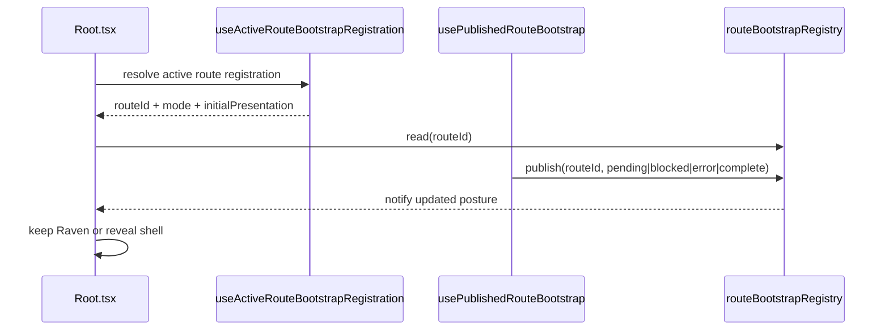

### Sequence 2: Save With CAS Conflict

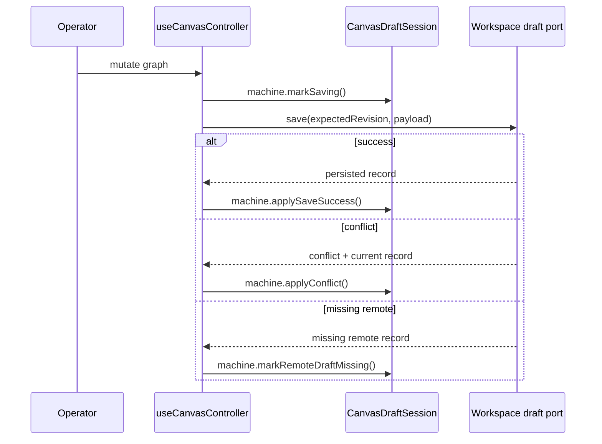

### State Machine: Route Startup

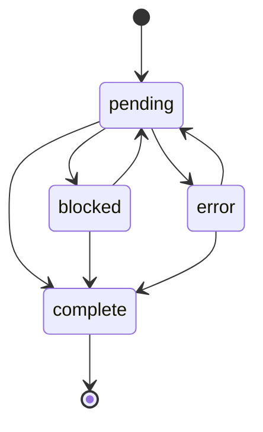

Rule:

- reset to initial posture only on unmount or route identity change.

### State Machine: Canvas Draft Session

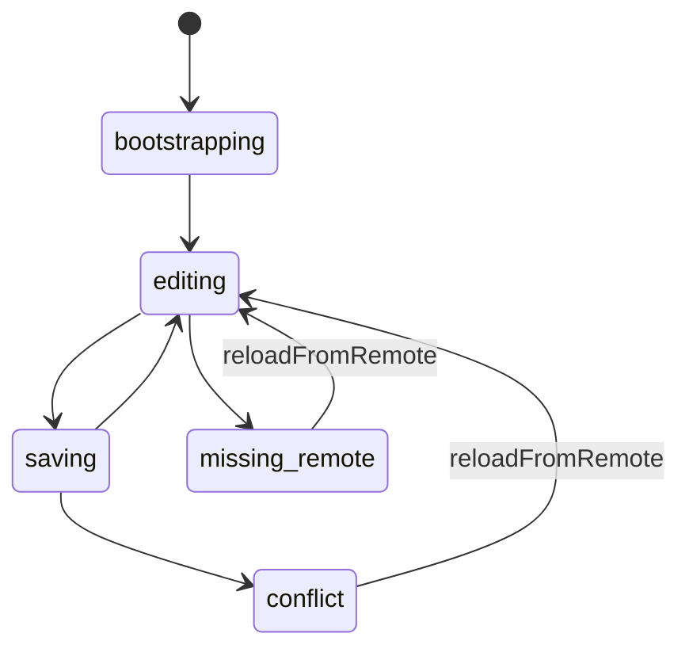

Rule:

- conflict and missing-remote are fail-closed mutation states until an
  authoritative remote reload succeeds.

> Section status: Active. Owner: Frontend / Architecture. Colocation does not merge component responsibilities.

<a id="section-graph-route-bootstrap-architecture"></a>

## Graph Route Bootstrap Architecture

### Intent

Define one shell-facing route startup contract that is explicit, typed, and
route-identity based.

### Governing Sources

- [Graph Frontend Architecture](graph-frontend-architecture.md)
- [Canvas Component Map And Modernization Review](canvas-component-map-and-modernization-review.md)
- [Canvas Controller Current To Target Architecture](canvas-controller-current-to-target-architecture.md)

### Module Ownership

| Module                                   | Responsibility                                             |
| ---------------------------------------- | ---------------------------------------------------------- |
| `routeBootstrapContract.ts`              | Contract types and helpers                                 |
| `routeBootstrapRegistration.ts`          | Parse route handle into typed registration                 |
| `routeBootstrapRegistry.ts`              | Passive publication and read lifecycle keyed by `route.id` |
| `routeBootstrapDataRouterContext.ts`     | Isolate Data Router context presence detection             |
| `useActiveRouteBootstrapRegistration.ts` | Resolve active registration from router matches            |
| `usePublishedRouteBootstrap.ts`          | Publish route read-model posture                           |
| `routeBootstrapErrors.ts`                | Typed bootstrap error taxonomy                             |
| `routeBootstrapErrorCopy.ts`             | Locale-resolved bootstrap copy                             |
| `StaticRouteBootstrapBoundary.tsx`       | Settle truly static routes on mount                        |

### Startup Modes

| Mode        | Meaning                                                        | Rule                                              |
| ----------- | -------------------------------------------------------------- | ------------------------------------------------- |
| `published` | Route has startup loading, recovery, missing, or error posture | It must publish posture from its route read model |
| `static`    | Route is already useful at mount time                          | It may settle once through the static boundary    |

Classification rule:

- if a route owns startup loading, error, or recovery semantics, it is
  `published`
- `mount != settled`
- missing classification is design drift, not an implicit default

### Contract Topology

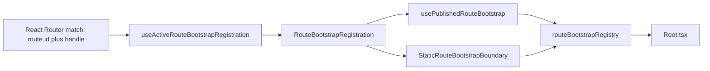

### Published Route Lifecycle

```mermaid
flowchart LR
  RouteReadModel["Route read model"] --> Pending["pending"]
  RouteReadModel --> Blocked["blocked"]
  RouteReadModel --> Error["error"]
  RouteReadModel --> Complete["complete"]

  Pending --> Publisher["usePublishedRouteBootstrap"]
  Blocked --> Publisher
  Error --> Publisher
  Complete --> Publisher

  Publisher --> Registry["routeBootstrapRegistry"]
  Registry --> Root["shell reveal and active-route posture"]
```

Reading rule:

- the registry stores posture; it does not invent it
- `Root.tsx` consumes the active route contract; it does not infer readiness
  from pathname or widget state
- a published route may complete shell bootstrap only when the route is safe and
  useful as the first visible workbench surface
- `blocked` is reserved for startup blockers that must keep the pre-React gate
  visible because revealing the workbench would be misleading
- `failed` is reserved for controlled route-local failures that can render a
  governed error or recovery surface; it records startup evidence but must not
  keep the shell hidden behind the pre-React gate
- normal updates replace posture in place; reset only happens on teardown or
  route identity change

### Failure Policy

- production-like runtime is fail-fast for bootstrap contract violations
- missing Data Router context throws typed bootstrap failure
- missing active registration throws typed bootstrap failure at shell
  consumption time
- missing explicit registration for a published route throws typed bootstrap
  failure
- API backend readiness failures for Canvas are route-visible blockers, not
  pre-React startup blockers. The shell may reveal Canvas once the route can
  render a governed backend-blocked surface with unsafe interactions disabled.
- Missing or failing route-local data that already has a governed route error
  state must publish `failed` rather than `error`; `error` remains for bootstrap
  contract failures where the route cannot safely render.
- fallback to empty matches or no-op publication is allowed only in test
  runtime for isolated non-router tests

### Invariants

- the registry is passive state storage
- startup for a mounted published route updates in place
- static settlement happens only through `StaticRouteBootstrapBoundary.tsx`
- locale resolution for bootstrap errors is centralized in
  `routeBootstrapErrorCopy.ts`
- Data Router context probing is isolated in
  `routeBootstrapDataRouterContext.ts`
- publisher ownership is strict by route identity

### Route Matrix

| Route id                      | Path           | Mode        | Owner family                    |
| ----------------------------- | -------------- | ----------- | ------------------------------- |
| `dbt.canvas`                  | `/canvas`      | `published` | Canvas draft presentation state |
| `dvt.templates`               | `/templates`   | `published` | Governed source generation      |
| `monitoring.runs`             | `/runs`        | `published` | Runs route bootstrap            |
| `monitoring.run-detail`       | `/runs/:runId` | `published` | Runs route bootstrap            |
| `cost.dashboard`              | `/cost`        | `published` | Cost route bootstrap            |
| `shell.default-core-redirect` | `/`            | `published` | Redirect posture handoff        |
| `shell.plugins`               | `/plugins`     | `static`    | Static shell route              |
| `shell.admin`                 | `/admin`       | `static`    | Static shell route              |

Special case:

- `shell.default-core-redirect` is transiently `published` while it hands
  startup ownership to the destination route

### Acceptance Evidence

| Rule                                                               | Evidence anchors                                                                                                                                                                                                                                                   |
| ------------------------------------------------------------------ | ------------------------------------------------------------------------------------------------------------------------------------------------------------------------------------------------------------------------------------------------------------------ |
| Every active route declares explicit bootstrap metadata            | [routes.ts](../../../../../apps/web/src/app/routes.ts), [routes.test.tsx](../../../../../apps/web/src/app/routes.test.tsx)                                                                                                                                         |
| Published routes publish typed posture by explicit route identity  | [usePublishedRouteBootstrap.ts](../../../../../apps/web/src/app/bootstrap/usePublishedRouteBootstrap.ts), route bootstrap tests under `apps/web/src/app/views/*/*RouteBootstrap.test.ts`                                                                           |
| Publication is monotonic while mounted                             | [usePublishedRouteBootstrap.test.tsx](../../../../../apps/web/src/app/bootstrap/usePublishedRouteBootstrap.test.tsx)                                                                                                                                               |
| Missing Data Router context is typed and fail-fast                 | [useActiveRouteBootstrapRegistration.ts](../../../../../apps/web/src/app/bootstrap/useActiveRouteBootstrapRegistration.ts), [useActiveRouteBootstrapRegistration.test.tsx](../../../../../apps/web/src/app/bootstrap/useActiveRouteBootstrapRegistration.test.tsx) |
| Missing active registration fails closed at shell consumption time | [Root.tsx](../../../../../apps/web/src/app/Root.tsx), [Root.test.tsx](../../../../../apps/web/src/app/Root.test.tsx), [routeBootstrapErrors.ts](../../../../../apps/web/src/app/bootstrap/routeBootstrapErrors.ts)                                                 |
| Static routes settle only through the static boundary              | [StaticRouteBootstrapBoundary.tsx](../../../../../apps/web/src/app/bootstrap/StaticRouteBootstrapBoundary.tsx), [Root.bootstrapFlow.test.tsx](../../../../../apps/web/src/app/Root.bootstrapFlow.test.tsx)                                                         |

### Current State

As of 2026-08-02:

- SRP split is implemented and validated
- Canvas, Templates, Runs, Run Detail, and Cost use explicit startup handles
- Code and Lineage are contextual Canvas surfaces, not peer routes
- `/canvas` is the only Canvas route authority; exhausted workbench URL
  translation and its one-shot query transport are absent
- static settlement exists only through the explicit static boundary
- bootstrap errors are typed and locale-resolved
- fallback behavior remains restricted to test runtime

### Evolution Rules

- every new top-level route must declare explicit startup classification
- new published routes must ship route-specific posture tests
- shell logic must continue consuming the contract instead of route-local
  heuristics

> Section status: Active. Owner: Frontend / Architecture. Colocation does not merge component responsibilities.

<a id="section-graph-decision-rationale-and-patterns"></a>

## Graph Decision Rationale And Patterns

### Why This Split Exists

The previous architecture page accumulated too many concerns in one place.
Splitting into focused documents makes ownership and review boundaries explicit:

- overview (`graph-frontend-architecture.md`)
- startup contract details (`docs/architecture/components/web/graph/graph-frontend-architecture.md`)
- runtime model details (`docs/architecture/components/web/graph/graph-frontend-architecture.md`)
- behavior dynamics (`docs/architecture/components/web/graph/graph-frontend-architecture.md`)

### Decision Rationale

#### Decision 1: Startup must be route-contract driven

Rationale:

- avoids shell heuristics coupled to route internals
- enforces explicit route operability semantics
- allows static and published modes without hidden fallback behavior

#### Decision 2: Bootstrap module must be SRP-split

Rationale:

- contract changes, parser changes, and registry behavior evolve at different
  rates
- isolates correctness tests by concern
- lowers regression risk when adding new routes

#### Decision 3: Canvas runtime uses explicit aggregate/read-model seams

Rationale:

- route behavior remains deterministic under conflict and recovery
- React Flow remains projection-only
- plan/run handoff stays aligned with canonical route scope

### Patterns Applied

- Fowler:
  separate aggregate-like session model, read model, and publication adapter.
- DDD:
  explicit bounded contexts: shell startup, route startup contract, route
  authoring runtime.
- Hexagonal:
  ports isolate external draft/plan/run dependencies from route policy.
- SOLID:
  SRP in bootstrap modules; DIP where shell consumes contract, not route internals.

### Point-In-Time Posture (2026-04-17)

- startup contract generalized and SRP-split in implementation
- graph architecture docs restructured by concern
- TF-E2 execution companion remains the canonical backlog and phase sequence

### Evolution Plan

Near term:

- complete TF-E2-A..E execution chain with proof-oriented closure
- lock startup classification governance for every new route
- extend route-level negative-path tests for startup and recovery

Medium term:

- align graph and non-graph routes on the same startup contract quality bar
- strengthen operability runbooks for conflict storms and degraded persistence
- preserve backwards-compatible draft evolution posture across releases

### Canonical References

- [Canvas Controller Current To Target Architecture](canvas-controller-current-to-target-architecture.md)
- [Canvas Component Map And Modernization Review](canvas-component-map-and-modernization-review.md)

> Section status: Active. Owner: Frontend / Architecture. Colocation does not merge component responsibilities.

<a id="section-graph-canvas-runtime-model"></a>

## Graph Canvas Runtime Model

### Intent

Define the route-local runtime model for Canvas authoring so rendering remains
projection-only and product truth stays explicit.

For the local authoring-runtime component contract, API, invariants, and
consumers, use
[Canvas Authoring Runtime Component](canvas-authoring-runtime-component.md).

### Runtime Seams

| Seam                           | Responsibility                                                             |
| ------------------------------ | -------------------------------------------------------------------------- |
| `CanvasDraftSession`           | Authoritative route-local draft aggregate component API.                   |
| `CanvasDraftScope`             | Project visible working set and projection-gap posture.                    |
| `CanvasDraftPresentationState` | Route read model for startup/recovery/workbench posture.                   |
| `useCanvasController`          | Application composition seam; orchestrates queries, commands, and handoff. |

### Domain Model

```mermaid
classDiagram
  class CanvasDraftSession {
    +syncState
    +baseline
    +draftRevision
    +workingSet
    +baseline.serialize()
    +machine.markSaving()
    +machine.applySaveSuccess()
    +machine.applyConflict()
    +machine.markRemoteDraftMissing()
    +workingSet.reconcileSnapshot()
  }

  class CanvasDraftScope {
    +visibleNodeIds
    +visibleEdges
    +projectionGap
  }

  class CanvasDraftPresentationState {
    +routeStartupStatus
    +workflowBadge
    +operatorMessage
  }

  class CanvasController {
    +load()
    +save()
    +plan()
    +run()
  }

  CanvasController --> CanvasDraftSession
  CanvasController --> CanvasDraftScope
  CanvasController --> CanvasDraftPresentationState
```

### Runtime Rules

- React Flow state is a projection, never the semantic source of truth.
- conflict and `missing_remote` are first-class route states, not incidental
  exceptions.
- recovery from conflict, `missing_remote`, or projection-gap posture must come
  from authoritative remote reload, not route-local adoption of projected
  state.
- plan/run actions must consume canonical route scope, not visual-only state.
- read-only and forbidden posture must be explicit in route behavior.

### Current State

- Session/scope/presentation seams are active.
- hardening for conflict, missing-remote, and projection-gap posture exists.
- route-owned Inspector authoring now exists for governed node details, backed
  by local node overrides in the same draft aggregate used by preview and run.
- duplicate-node and reconnect-edge now route through adjacent command seams
  that preserve the draft aggregate as semantic truth instead of pushing policy
  down into passive React Flow adapters.
- TF-E2 parent closure is complete. Residual persisted-version compatibility
  expansion is a future explicit follow-up, not hidden parent scope.

### Future Evolution

- expand end-to-end deterministic reload coverage across additional supported
  draft versions through separate governed follow-up tasks.

> Section status: Active. Owner: Frontend / Architecture. Colocation does not merge component responsibilities.
