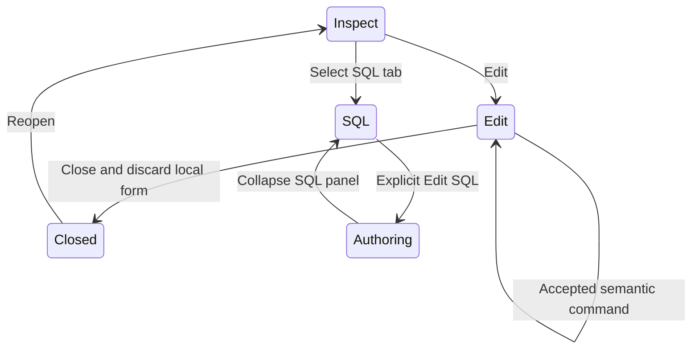

# Relational Workbench Inspection Component

## Identity and responsibility

Planning DB component `SYS-CANVAS-RELATIONAL-TREE-WORKBENCH` owns relational
inspection presentation. Its parent is `SYS-WEB-ROOT`; the existing
`SYS-WEB-CANVAS-MODEL-SQL-AUTHORING` child owns logical SQL authoring. The
protected Workspace graph and canonical Substrait document retain semantic
authority. Inspector presentation has a Model-scoped relation identity, tab,
edit flag and selected-only flag.

The reason to change this component is a change to relational inspection,
local edit presentation or its handoff to the existing Model transaction.

## Physical responsibilities

| Surface                             | Owned concern                                              |
| ----------------------------------- | ---------------------------------------------------------- |
| `CanvasRelationalTreeSideInspector` | Select the one visible relational inspector                |
| `CanvasOperationInspectorTabs`      | Retain Model-scoped relation and tab presentation          |
| `CanvasRelationalTreeEditorFrame`   | Present tabs, edit state and close control                 |
| `CanvasTransformInspector`          | Inspect Transform properties and calculated outputs        |
| `CanvasModelOutputInspector`        | Inspect final Model composition and fields                 |
| `CanvasModelSqlOutput`              | Explicit protected SQL projection and logical-editor entry |

These existing functions and components live under
`apps/web/src/app/views/canvas/`. Domain analysis, command acceptance, persistence
and query authorization stay in their existing owners and ports.

## Close and local editing

Closing ends the inspector's local edit mode, clears selected-only presentation
and discards its uncommitted form inputs. Reopening returns to inspection with
SQL navigation available. A pointer close must not move focus first and thereby
commit a focused input through blur.

Closing issues no semantic save, SQL request or Model Apply. Previously
acknowledged edits remain acknowledged. The Workbench's separate staged
transaction keeps its explicit Apply/Cancel and navigation lifecycle; hiding an
inspector does not implicitly apply or replace that transaction.

## SQL handoff and existing rails

`RenderCanvasContextualGraphSurface` governs this local presentation.
`ProjectCanvasTransformSql` projects saved physical SQL through the protected
query port, retaining scope, semantic digest, optional relation identity and
original/readable simplification evidence.

One explicit SQL action also opens the Model's logical editor through its
existing scoped presentation context. `ProjectCanvasModelSqlContext` prepares
logical input names. Physical SQL is never copied into that buffer; projection
failure cannot prevent the independent authoring entry. Typing remains local.
The existing Model Apply chain and `SaveWorkspaceGraphDraft` retain command
acceptance and persistence.

## Corners and proof

- A valid focused alias followed by pointer Close causes no PUT. Reopening is
  passive and SQL is enabled.
- Closing after an acknowledged alias preserves that accepted change.
- Closing an inspector during a separate staged Model transaction retains the
  central Apply/Cancel contract.
- SQL projection starts only on its explicit action. Late results remain bound
  to their original relation, Model, scope and semantic digest.
- Generated SQL retains original/readable presentation, simplification evidence,
  exactly the requested GET calls and no implicit writes or runs.

Behavioral proof belongs to `CanvasRelationalTreeWorkbench.model-composition.test.tsx`,
`CanvasRelationalTreeWorkbench.apply.test.tsx`, `CanvasModelSqlOutput.test.tsx`,
`canvas-model-sql-authoring.cy.ts` and `canvas-relational-tree-workbench.cy.ts`.
The [executed evidence](../../../../evidence/ED-20261117-model-sql-authoring.md)
records commands, failures, successful cases and the integration boundary.

## Governing sources

- [Workbench command/query catalog](canvas-workbench-command-query-catalog.md)
- [Workspace graph draft persistence](../../../../contracts/planner/workspace-graph-draft-persistence-v1.md)
- [Model SQL source and presentation](../../adapters/postgres-model-sql-source.md)
- [Command/query governance](../../../command-query-rail-governance.md)
