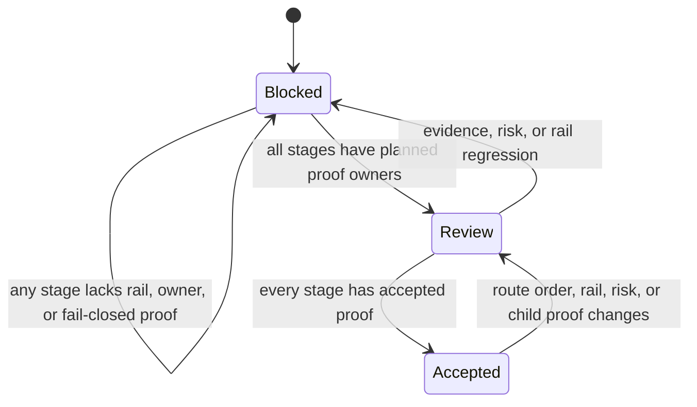
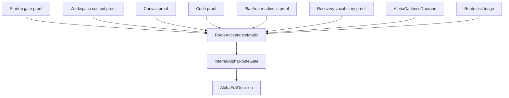

# Internal Alpha Route Gate Component

## Purpose

`InternalAlphaRouteGate` owns the internal alpha product-route decision. It
does not implement child-stage behavior. It decides whether the route can be
called alpha-full by consuming stage proof from startup, workspace context,
Canvas, Code, plan/run readiness, recovery, cadence, and risk triage.

The component prevents the anti-pattern where one closed child slice implies
route-level readiness. Child slices publish evidence; the route gate decides
whether the full route is accepted.

## Public API

| API                                 | Kind         | Owned concern                                                                                              |
| ----------------------------------- | ------------ | ---------------------------------------------------------------------------------------------------------- |
| `InternalAlphaRouteGate`            | route        | Owns alpha route sequencing, gate posture, and alpha-full decision semantics.                              |
| `RouteStageProof`                   | record       | Captures one stage rail, owner, happy proof, fail-closed proof, and risk.                                  |
| `AlphaFullDecision`                 | decision     | Returns `blocked`, `review`, or `accepted` from the full proof set.                                        |
| `AlphaCadenceDecision`              | decision     | Names tester audience, entry date, duration, exit owner, and extension rule.                               |
| `RouteRecoveryVocabulary`           | model        | Maps failures to source-owned recovery states and blocks incomplete vocabulary.                            |
| `RouteAcceptanceMatrix`             | review       | Records the current stage acceptance table and alpha exit impact.                                          |
| `InternalAlphaCombinedRouteFixture` | test fixture | Exercises one ordered route proof across startup, context, Canvas, Code, plan/run readiness, and recovery. |

The API is documentary today. Executable child behavior must bind to the
command/query rail catalog before UI, adapter, or route-handler work starts.

## Invariants

- `F-27` is the only route-level alpha authority.
- Child slices cannot declare alpha full.
- Every user-visible stage must name a command/query rail or component owner.
- Every stage must have both happy-path and fail-closed proof before alpha full.
- Every stage in the combined route fixture must carry at least one traceable
  and resolvable `evidenceRefs` entry pointing at the governing doc or
  executable proof.
- Every combined fixture stage must name whether its evidence is `planned` or
  `accepted`.
- The combined route fixture must traverse startup, workspace context, Canvas,
  Code, plan/run readiness, and recovery in that order.
- Canvas and Code fixture stages must preserve all owned rails instead of
  collapsing command/query authority into one local flag.
- Recovery and readiness copy must be source-owned, not duplicated free text.
- Every combined fixture stage must name at least one non-ready recovery state.
- The combined route fixture must include `blocked`, `unauthorized`,
  `unavailable`, `stale`, and `not-found` recovery states before review.
- Risk triage and cadence are product inputs, not after-the-fact closeout notes.
- Local fixture state, localStorage, and mock-only flows are not product truth.

## State Transitions

- `blocked` stays `blocked` when a stage lacks owner, rail, or negative proof.
- `blocked` stays `blocked` when a combined fixture stage lacks traceable and
  resolvable evidence references.
- `blocked` stays `blocked` when the combined route fixture omits a required
  route stage or owned rail.
- `blocked` stays `blocked` when any combined fixture stage lacks negative
  recovery vocabulary or the route omits a required recovery state.
- `blocked` moves to `review` when all stages have owners and planned proofs.
- `review` returns to `blocked` when stage evidence or risk triage regresses.
- `review` moves to `accepted` only when every combined fixture stage has
  accepted evidence and cadence/risk closure has resolvable evidence.
- `accepted` returns to `review` when route order, rail, risk, or child proof
  changes.

As of the current F-27 route-gate evidence slice, `Startup gate`,
`Workspace context`, `Canvas workbench`, `Code workbench`,
`Plan/run readiness`, `Recovery states`, `Alpha cadence`, and `Risk triage`
are accepted. The full route decision is `accepted` only while the combined
fixture also carries resolvable alpha-full closure evidence.

## Consumers

| Consumer                     | Uses the gate for                                      |
| ---------------------------- | ------------------------------------------------------ |
| Product and Architecture     | Alpha entry, exit, cadence, and acceptance decisions.  |
| GitHub MVP issues            | Route-level ownership and child-slice sequencing.      |
| Runtime safety components    | Protected runtime, admission, degraded-mode inputs.    |
| Frontend child slices        | Stage-specific UI proof without route-level authority. |
| PR reviewers and CI evidence | Checking that alpha-full is not declared prematurely.  |

## Command/Query Rails

| Rail                                | Type    | Route stage        |
| ----------------------------------- | ------- | ------------------ |
| `ObserveAppBootstrapRouteReadiness` | query   | Startup gate       |
| `GetEffectiveWorkspaceContext`      | query   | Workspace context  |
| `GetWorkspaceGraphDraft`            | query   | Canvas workbench   |
| `SaveWorkspaceGraphDraft`           | command | Canvas workbench   |
| `ListWorkspaceFiles`                | query   | Code workbench     |
| `GetWorkspaceFileContent`           | query   | Code workbench     |
| `ObservePlanRunReadiness`           | query   | Plan/run readiness |
| `MapRouteRecoveryState`             | query   | Recovery states    |

## Accepted Evidence Semantics

Accepted stage evidence is semantic, not a path allowlist. A stage can move
from `planned` to `accepted` only when all of these are true:

- the stage uses the real command/query rail for product behavior, not a
  planning-only or legacy rail name;
- the stage has at least one local component or governing documentation
  reference that names API, invariants, transitions, and consumers;
- the stage has executable web evidence for happy path and fail-closed posture;
- browser evidence exercises the same protected runtime route posture that
  users see, not a reduced local-only fixture;
- accepting the stage does not accept `alpha-full` while any other stage remains
  `planned`.

For the current route gate, `Startup gate` is accepted through
`ObserveAppBootstrapRouteReadiness`, `Workspace context` is accepted through
`GetEffectiveWorkspaceContext`, and `Canvas workbench` is accepted through
`GetWorkspaceGraphDraft` plus `SaveWorkspaceGraphDraft`. `Code workbench` is
accepted through `ListWorkspaceFiles` plus `GetWorkspaceFileContent`, including
scoped API tests, read-only UI proof, browser proof, and filesystem safety
negative coverage. `Plan/run readiness` is accepted through
`ObservePlanRunReadiness`, the `PlanRunReadinessReadModel`, unit proof for
`plan_integrity`, `backpressure`, `capability_mismatch`, `adapter_degraded`,
and `authorization_denied`, run-start fail-closed proof, and persisted preview
browser proof. `Recovery states` are accepted through
`MapRouteRecoveryState`, the route-owned vocabulary guide, stage coverage in
the architecture guard, and browser fail-closed evidence across startup, Canvas,
and Code. `Alpha cadence` and `Risk triage` are accepted through the F-27 route
acceptance matrix and closeout evidence. The combined fixture blocks alpha-full
if those closure evidence references are removed.

## Cadence Contract

`AlphaCadenceDecision` is valid only when these fields are present and owned:

| Field           | Meaning                                           | Owner                  |
| --------------- | ------------------------------------------------- | ---------------------- |
| `audience`      | internal tester scope allowed for the route stage | Product                |
| `entryDate`     | date when stage enters alpha candidate posture    | Product + Frontend     |
| `duration`      | expected evaluation window before exit/review     | Product                |
| `exitOwner`     | accountable owner for alpha exit decision         | Product / Architecture |
| `extensionRule` | explicit condition that allows extending cadence  | Product / Architecture |

Cadence without `exitOwner` or `extensionRule` is automatically `blocked`.

For accepted F-27, the cadence contract is:

- `audience`: Internal product, architecture, frontend, and runtime-safety
  testers.
- `entryDate`: First business day after all route-stage proofs in the matrix
  are accepted.
- `duration`: 10 business days.
- `exitOwner`: Product / Architecture.
- `extensionRule`: Product / Architecture may approve one extension of up to 5
  business days for named blockers.

## Risk Triage Contract

Route risk triage is accepted only when every route stage has an included risk,
an exclusion rationale for adjacent risks, and executable evidence for the
included risk class. Triage without exclusion rationale is automatically
`blocked` because it hides route boundary decisions inside an open-ended risk
list.

## Architecture Diagram

## Architecture Guard

The guard lives in
`apps/web/src/app/routes/internalAlphaRouteGate.architecture.test.ts`. It proves
that the component guide, user stories, route plan, and route acceptance matrix
stay aligned around F-27 authority and rail-backed stage proof.

The combined fixture lives in
`apps/web/src/app/routes/internalAlphaRouteGate.test.fixtures.ts`. It is
test-only route proof: it does not create product authority, does not persist
route state, and must stay behind the F-27 gate.

## Internal Alpha Route Gate User Stories

### Scope

These stories preserve the accepted route-level F-27 proof that supported the
internal-alpha decision. F-27 is closed; these stories are evidence and semantic
coverage, not a current task queue. Child slices still own their implementation
details and tests. Any new executable follow-up starts in GitHub Issues.

- `US-F27-001`: as an internal tester, I need startup posture through
  `ObserveAppBootstrapRouteReadiness` with happy and fail-closed evidence.
- `US-F27-002`: as an internal tester, I need tenant, project, and environment
  context through `GetEffectiveWorkspaceContext`.
- `US-F27-003`: as an internal tester, I need Canvas graph truth through
  `GetWorkspaceGraphDraft` and `SaveWorkspaceGraphDraft`.
- `US-F27-004`: as an internal tester, I need contextual Code inspection and
  revision-guarded working-tree editing through `ListWorkspaceFiles`,
  `GetWorkspaceFileContent`, and `SaveWorkspaceFileContent`.
- `US-F27-005`: as an internal tester, I need plan/run controls to explain
  enabled or blocked posture through `ObservePlanRunReadiness`.
- `US-F27-006`: as an internal tester, I need consistent recovery language
  through `MapRouteRecoveryState`.
- `US-F27-007`: as a product owner, I need alpha cadence with audience, entry
  date, duration, exit owner, and extension rule.
- `US-F27-008`: as an architecture reviewer, I need included and excluded route
  risks per route stage.
- `US-F27-009`: as a PR reviewer, I need child-only evidence to be rejected for
  alpha-full claims.
- `US-F27-010`: as an architecture reviewer, I need `F-27` to remain the closed
  route-proof identifier while GitHub Issues owns any new executable task
  lifecycle and child proposals remain stage-specific architecture/evidence
  owners.
- `US-F27-011`: as a reviewer, I need one combined route fixture to traverse
  startup, workspace context, Canvas, Code, plan/run readiness, and recovery
  before any alpha-full candidate can move past review.

### Negative Stories

These negative stories remain regression semantics for the accepted route gate;
they do not imply that F-27 is still open.

- `US-F27-N-001`: Code workbench proof exists but Canvas lacks proof. Alpha full
  remains blocked.
- `US-F27-N-002`: a stage has happy proof but no fail-closed proof. Alpha full
  remains blocked.
- `US-F27-N-003`: recovery copy differs for equivalent failures. The route
  returns to review until vocabulary is source-owned.
- `US-F27-N-004`: cadence lacks exit owner or extension rule. Alpha full remains
  blocked.
- `US-F27-N-005`: risk triage lists included risks only. Alpha full remains
  blocked until exclusion rationale exists.
- `US-F27-N-006`: the combined route fixture omits a stage fail-closed proof.
  Alpha full remains blocked and the missing stage is reported by name.
- `US-F27-N-007`: the combined route fixture omits a route stage or an owned
  command/query rail. Alpha full remains blocked and the missing stage or rail
  is reported by name.
- `US-F27-N-008`: the combined route fixture keeps a stage at `ready` only or
  omits `blocked`, `unauthorized`, `unavailable`, `stale`, or `not-found`.
  Alpha full remains blocked and the missing vocabulary is reported by name.

### Scenario Coverage Matrix

| Stage              | Happy-path story | Fail-closed story | Current acceptance |
| ------------------ | ---------------- | ----------------- | ------------------ |
| Startup gate       | `US-F27-001`     | `US-F27-N-002`    | accepted           |
| Workspace context  | `US-F27-002`     | `US-F27-N-007`    | accepted           |
| Canvas workbench   | `US-F27-003`     | `US-F27-N-001`    | accepted           |
| Code workbench     | `US-F27-004`     | `US-F27-N-001`    | accepted           |
| Plan/run readiness | `US-F27-005`     | `US-F27-N-002`    | accepted           |
| Recovery states    | `US-F27-006`     | `US-F27-N-003`    | accepted           |
| Alpha cadence      | `US-F27-007`     | `US-F27-N-004`    | accepted           |
| Risk triage        | `US-F27-008`     | `US-F27-N-005`    | accepted           |
| Route proof        | `US-F27-010`     | `US-F27-N-006`    | accepted / closed  |

### Traceability

- Closed route-proof identifier: `F-27`.
- Closure evidence:
  `docs/planning/closeouts/20260514-f27-alpha-route-acceptance-matrix-closeout.md`.
- New executable task lifecycle: GitHub Issues.
- Component guide:
  `docs/architecture/components/web/internal-alpha-route-gate-component.md`.
- Acceptance matrix:
  `docs/planning/reviews/architecture-and-governance/20260514-internal-alpha-route-acceptance-matrix.md`.
- Architecture guard:
  `apps/web/src/app/routes/internalAlphaRouteGate.architecture.test.ts`.
- Combined fixture:
  `apps/web/src/app/routes/internalAlphaRouteGate.test.fixtures.ts`.

> Acceptance scope status: Review. Owner: Product / Architecture / Frontend.
