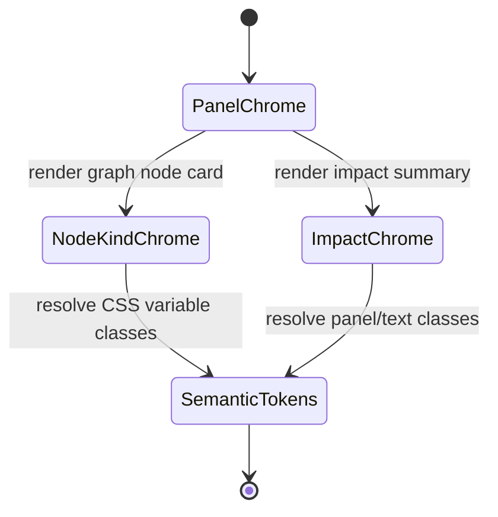

# Frontend Lineage

## Purpose

The Lineage route is the read-only dependency and impact-analysis view of the
DVT frontend.

It should help operators and authors answer:

- what this node depends on;
- what this node affects downstream;
- how wide the impact radius is.

Field/column lineage is not independently inferred by this route. The single
Canvas may project field lineage only from authoritative stable field references
and canonical semantic/provenance evidence.

## Current Implementation

Primary route anchors:

- [LineageView.tsx](../../../../../apps/web/src/app/views/LineageView.tsx)
- [useLineageViewData.ts](../../../../../apps/web/src/app/views/lineage/useLineageViewData.ts)
- [lineageModel.ts](../../../../../apps/web/src/app/views/lineage/lineageModel.ts)
- [graphStrategyRegistry.ts](../../../../../apps/web/src/app/plugins/graphStrategyRegistry.ts)

Current route: `/lineage`

Current behavior:

- loads the workspace graph snapshot;
- maps raw graph nodes and edges into canonical graph entities;
- derives upstream and downstream reachability from a focus node;
- uses an explicit route state model for `loading`, `error`, `empty`, and `ready`;
- renders graph-level lineage as layered cards;
- renders impact counts and breadcrumb context;
- does **not** synthesize field lineage from matching column names, compatible
  types, ordinals, or other presentation metadata.

The former route-local column-lineage mode and `{from,to}` matched-column read
model were retired by #2953 because they could manufacture false lineage.

## Field-Lineage Authority

The surviving field-lineage presentation belongs to the single Canvas projection:

- [canvasColumnLineageProjection.ts](../../../../../apps/web/src/app/views/canvas/canvasColumnLineageProjection.ts)

A field-lineage claim requires stable source/target field identity and, where
necessary, canonical semantic/provenance evidence. Names are display/validation
facts, not lineage join keys.

Conceptually:

```text
stable FieldId/reference
+ canonical Substrait/provenance
        ↓
field-lineage projection
        ↓
presentation names
```

If the required references are unavailable, the projection fails closed and
emits no field-lineage edge. It does not fall back to name/type matching.

## Relationship To The Canvas

- the Lineage route and the Canvas may consume graph context, but they do not own
  parallel field-lineage engines;
- the route remains the focused graph-level impact surface;
- the Canvas owns contextual field-lineage presentation from authoritative
  semantic/reference facts;
- dbt/external authority may provide evidence/profile facts but does not create a
  second Canvas or a second field-lineage authority;
- a future focus handoff may link the route and Canvas without duplicating state.

## UX Rules

- the route must start from a bounded focus, not the full graph universe;
- search should be the fastest way to recover context;
- route-level loading must preserve the lineage frame;
- route-level empty state must explain that no lineage focus is available;
- route-level graph-load failures must stay distinct from empty focus;
- the view should explain impact through counts and breadcrumbs before asking
  the user to read raw detail;
- unavailable field evidence must never be presented as inferred or empty field
  lineage.

## Mature Libraries And References

- bounded graph and dependency interactions:
  [React Flow](https://reactflow.dev/)
- analytical dependency and plugin patterns:
  [Backstage](https://github.com/backstage/backstage)

## Current Constraints

- the route remains graph-level and intentionally does not reverse-engineer field
  semantics from imported/provider metadata;
- some Canvas field-lineage shapes fail closed today where the current canonical
  inspection does not expose authoritative source FieldIds, for example the
  current UNION ALL projection;
- pin-to-canvas is signaled in the UI but not yet fully realized as a governed
  flow;
- richer transformation-aware field-lineage explanation remains follow-up work
  under #2945 after authoritative evidence exists.

## Related Pages

- [Lineage Panel Token Component](dvt-frontend-lineage.md#section-lineage-panel-token-component)
- [Graph Frontend Architecture](../graph/graph-frontend-architecture.md)
- [UX Implementation Guide](../style-guide.md#section-ux-implementation-guide)
- [Library And Open-Source Reference Stack](../style-guide.md#section-library-and-open-source-reference-stack)

<a id="section-lineage-panel-token-component"></a>

## Lineage Panel Token Component

### Purpose

This component owns chrome classes for the current graph-level Lineage route. It keeps graph panels, impact summaries, node-kind cards, muted text and focus treatment behind one Lineage-local token API so the route does not reintroduce route-level Tailwind color families.

Column-level lineage is **not** owned by this route. Field-lineage presentation belongs to the single Canvas projection and may render only from authoritative stable field references/semantic evidence. The former route-local matched-column panel was retired by #2953.

### Public API

| API                               | Owner         | Purpose                                       |
| --------------------------------- | ------------- | --------------------------------------------- |
| `lineageChromeClasses`            | Lineage route | Stable classes for graph/impact panel chrome  |
| `resolveLineageNodeKindClassName` | Lineage route | Maps a node kind to semantic node-card chrome |

### Invariants

- Lineage route graph/impact panels consume `lineageChromeClasses` instead of route-local color utility strings.
- Node-kind card chrome resolves through `resolveLineageNodeKindClassName`.
- `lineageModel.ts` owns graph traversal/labels only; it does not infer field lineage or own presentation color classes.
- The route does not recreate column lineage from names, types, ordinals or positions.
- Field-lineage identity is owned by the single Canvas semantic projection using stable references; names are presentation only.
- The token component owns presentation chrome only; it does not own graph traversal, route loading, Canvas semantic projection or React Flow field-lineage identity.

### Transitions



### Consumers

| Consumer               | Usage                                            |
| ---------------------- | ------------------------------------------------ |
| `LineageGraphPanel`    | panel chrome, node-kind card chrome, focus badge |
| `LineageImpactSummary` | panel chrome and muted labels                    |
| Architecture guard     | prevents local color-family/topology regression  |

### Explicit Non-owner

`apps/web/src/app/views/canvas/canvasColumnLineageProjection.ts` owns the surviving field-lineage projection used by the single Canvas. It is intentionally outside this route-token component and must not depend on route-local matched-column DTOs.

### Drift Signals

- A current Lineage route panel contains `border-slate-*`, `bg-slate-*`, `text-slate-*`, `text-blue-*`, or `text-green-*`.
- `lineageModel.ts` starts deriving field lineage from graph/column display metadata.
- A route-local column-lineage panel or `{from,to}` matched-column DTO is reintroduced.
- Current documentation names the retired `LineageColumnPanel` as a live consumer.

<a id="section-lineage-panel-token-user-stories"></a>

### Lineage Panel Token User Stories

#### US-F24-LINEAGE-TOKEN-01: Scan Lineage Panels With Shared Workbench Tokens

As an operator, I want the current Lineage graph and impact panels to use the same workbench surface language as the rest of the product, so that the route feels like one workbench instead of a legacy dashboard.

Acceptance:

- graph and impact panels consume `lineageChromeClasses`;
- local `slate-*` panel chrome does not appear in current Lineage route panel components;
- graph-level lineage/impact content remains unchanged;
- the route does not reintroduce a matched-column panel as a second field-lineage authority.

#### US-F24-LINEAGE-TOKEN-02: Preserve Node Semantics While Moving Color Ownership

As an analyst, I want node kinds to keep distinct visual treatments, so that I can still scan source, model, snapshot, exposure, metric, and macro nodes.

Acceptance:

- `resolveLineageNodeKindClassName` maps node kind to semantic token classes;
- `lineageModel.ts` keeps graph traversal and label semantics instead of owning visual color classes;
- unknown node kinds still render with a neutral fallback;
- field lineage, when available, is projected by the single Canvas from stable references rather than inferred in this route.

#### Traceability

| Story                   | Primary component     | Guard                                               |
| ----------------------- | --------------------- | --------------------------------------------------- |
| US-F24-LINEAGE-TOKEN-01 | `LineageGraphPanel`   | `lineagePanelTokenConvergence.architecture.test.ts` |
| US-F24-LINEAGE-TOKEN-02 | `lineageChromeTokens` | `lineagePanelTokenConvergence.architecture.test.ts` |

> Acceptance scope status: Active. Owner: Frontend / Lineage.
>
> Section status: Active. Owner: Frontend / Lineage. Colocation does not merge component responsibilities.
