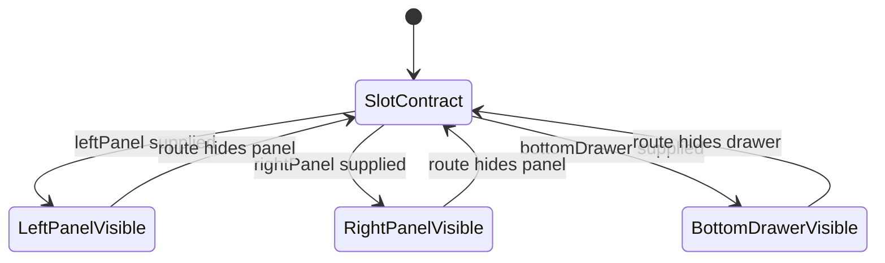
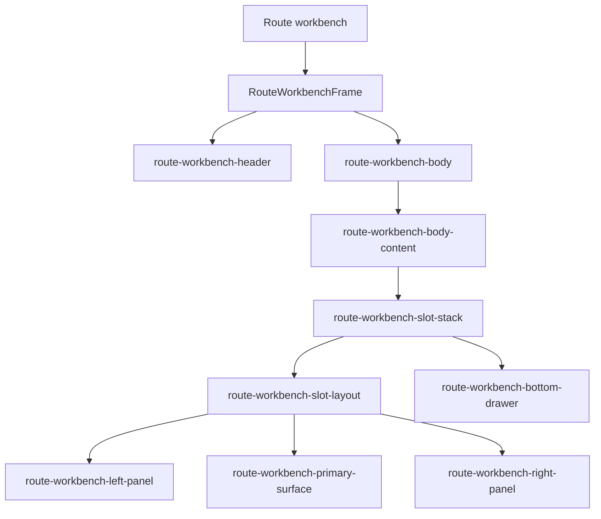
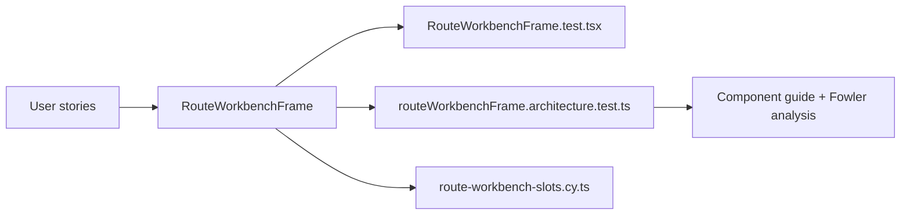

# Route Workbench Frame Component

## Purpose

`RouteWorkbenchFrame` is the shared presentation primitive for route-level
workbenches in `apps/web`. It keeps the shell contract explicit without making
the shell own route domain behavior.

## Public API

```ts
export type RouteWorkbenchFrameSlots = Readonly<{
  leftPanel?: ReactNode;
  primarySurface: ReactNode;
  rightPanel?: ReactNode;
  bottomDrawer?: ReactNode;
}>;
```

`RouteWorkbenchFrame` accepts:

- `header`: route-owned header stack rendered outside the route body scroll.
- `slots`: semantic route body contract for left context, primary surface,
  right context, and route supporting drawer.
- `scroll`: whether the frame owns body scrolling.
- `bodyClassName` and `bodyContainerClassName`: route-level layout overrides.

## Invariants

- The top application shell remains outside this component.
- `header` is never nested inside the scroll body.
- `primarySurface` is required when `slots` are used.
- `leftPanel`, `rightPanel`, and `bottomDrawer` are optional contextual support
  surfaces.
- Anonymous route body `children` are not supported; every direct consumer must
  name its body through `RouteWorkbenchFrameSlots`.
- The frame owns presentation layout only; it does not own route commands,
  queries, loaders, API calls, or domain state.

## Transitions



## Consumers

Current and expected consumers:

- `CodeView`, the first adopter of `RouteWorkbenchFrameSlots`
- `DiffView`
- `ArtifactsView`
- `LineageView`
- `PluginsView`
- `AdminView`
- future route workbenches such as `Templates`

`CodeView` maps its file explorer to `leftPanel` and its local-buffer banner
plus Monaco file preview to `primarySurface`. It does not provide `rightPanel`
or `bottomDrawer` yet.

Canvas can continue using its specialized shell while adopting the same slot
vocabulary through future component extraction.

## Component Diagram



## Command And Query Rail Posture

No new command or query rail is introduced. This component is an internal
presentation primitive. Route commands and queries remain owned by their
bounded contexts.

## Local Traceability

- Task: `F-15`
- Analysis:
  [Historical record](https://github.com/dunay2/dvt/blob/2df68680de46b9104282a58fd203a7eef551ca38/buzon/20260521-codex-fowler-route-workbench-frame-analysis-and-remediation.md)
- Stories:
  `docs/architecture/components/web/route-workbench-frame-component.md`
- Source:
  `apps/web/src/app/components/workbench/RouteWorkbenchFrame.tsx`
- Tests:
  `apps/web/src/app/components/workbench/RouteWorkbenchFrame.test.tsx`
  `apps/web/src/app/components/workbench/routeWorkbenchFrame.architecture.test.ts`

<a id="section-route-workbench-frame-user-stories"></a>

## Route Workbench Frame User Stories

### User Stories

#### US-ROUTE-WORKBENCH-FRAME-001

As an operator using a route workbench, I need the primary surface to remain the
center of attention so that supporting panels do not become hidden applications.

Acceptance:

- the route can provide `primarySurface`;
- the primary surface renders in `route-workbench-primary-surface`;
- contextual panels render beside it only when supplied.

#### US-ROUTE-WORKBENCH-FRAME-002

As an operator inspecting context, I need left and right panels to have stable
placement so that explorer and inspector behavior is predictable across routes.

Acceptance:

- `leftPanel` renders in `route-workbench-left-panel`;
- `rightPanel` renders in `route-workbench-right-panel`;
- omitting a panel does not create empty chrome.

#### US-ROUTE-WORKBENCH-FRAME-003

As an operator reviewing supporting detail, I need a route-level bottom drawer
that stays subordinate to the active route surface.

Acceptance:

- `bottomDrawer` renders in `route-workbench-bottom-drawer`;
- the shell console drawer remains owned by `AppShellFrame`;
- the route drawer does not replace route navigation.

#### US-ROUTE-WORKBENCH-FRAME-004

As a maintainer finishing F-15, I need direct route workbench consumers to use
semantic slots only.

Acceptance:

- direct `RouteWorkbenchFrame` route consumers pass `slots`;
- anonymous route body `children` are not part of the public frame API;
- architecture tests fail when a direct route consumer drifts back to anonymous
  body content.

### Scenario Matrix

| Scenario                                         | Expected result                                                             | Coverage                                   |
| ------------------------------------------------ | --------------------------------------------------------------------------- | ------------------------------------------ |
| Direct route passes anonymous body content       | Architecture guard fails until the route uses `slots.primarySurface`        | `routeWorkbenchFrame.architecture.test.ts` |
| Route passes all slots                           | left, primary, right, and bottom drawer slots render with stable data slots | `RouteWorkbenchFrame.test.tsx`             |
| Route omits side panels                          | no empty left or right panel chrome appears                                 | future route adoption tests                |
| Architecture drift removes docs or owned concern | architecture test fails                                                     | `routeWorkbenchFrame.architecture.test.ts` |

### Acceptance Coverage



### Out Of Scope

- Implementing resizable `ContextPanel`.
- Changing shell-level `AppShellFrame` bottom console behavior.
- Adding a new route command or query rail.

> Acceptance scope status: Active. Owner: Frontend / Architecture.
