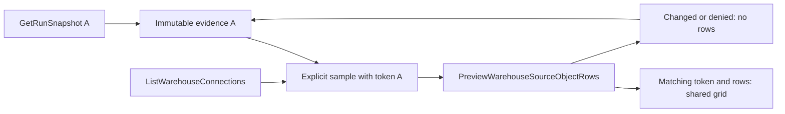
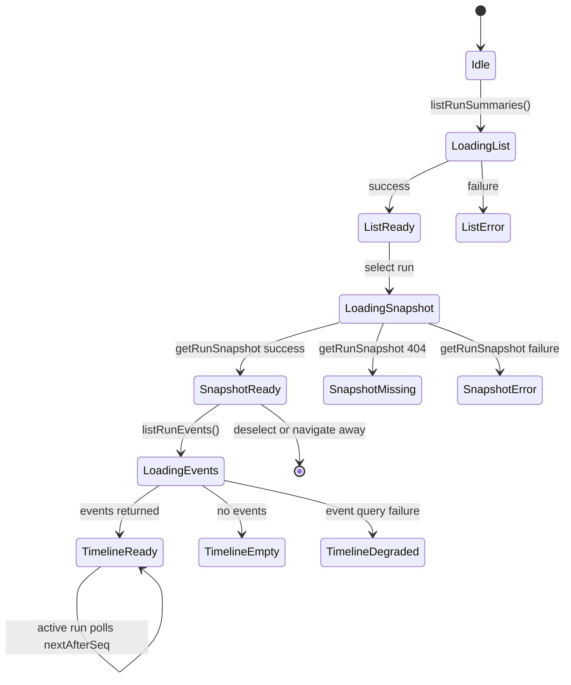
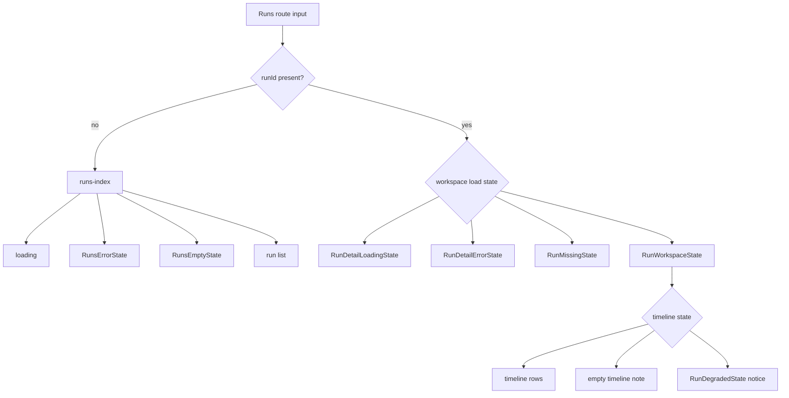
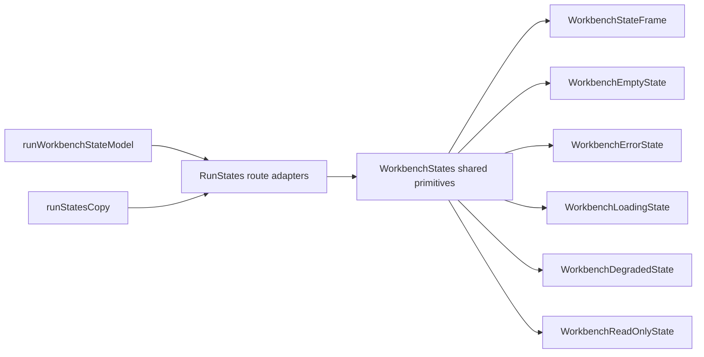
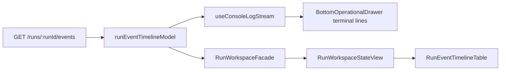
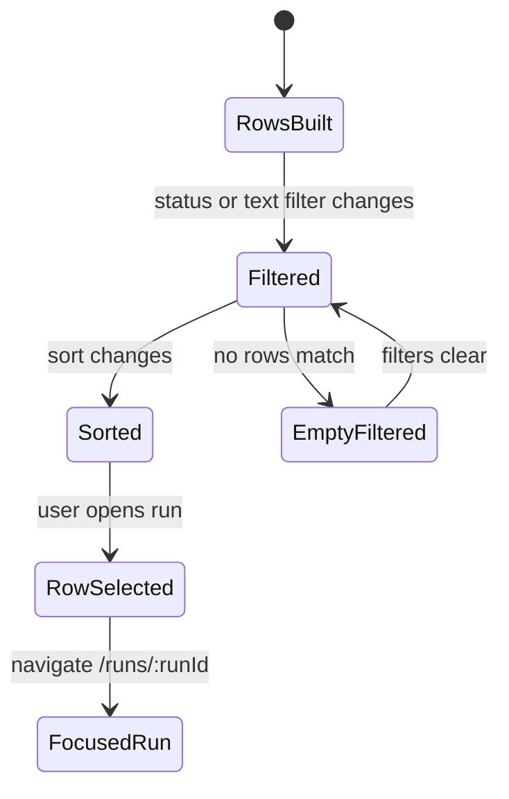
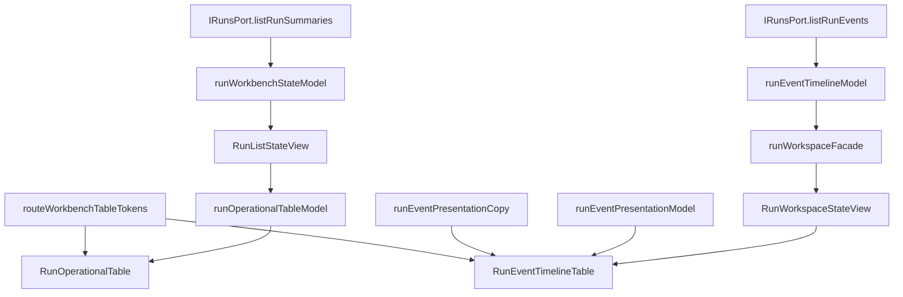
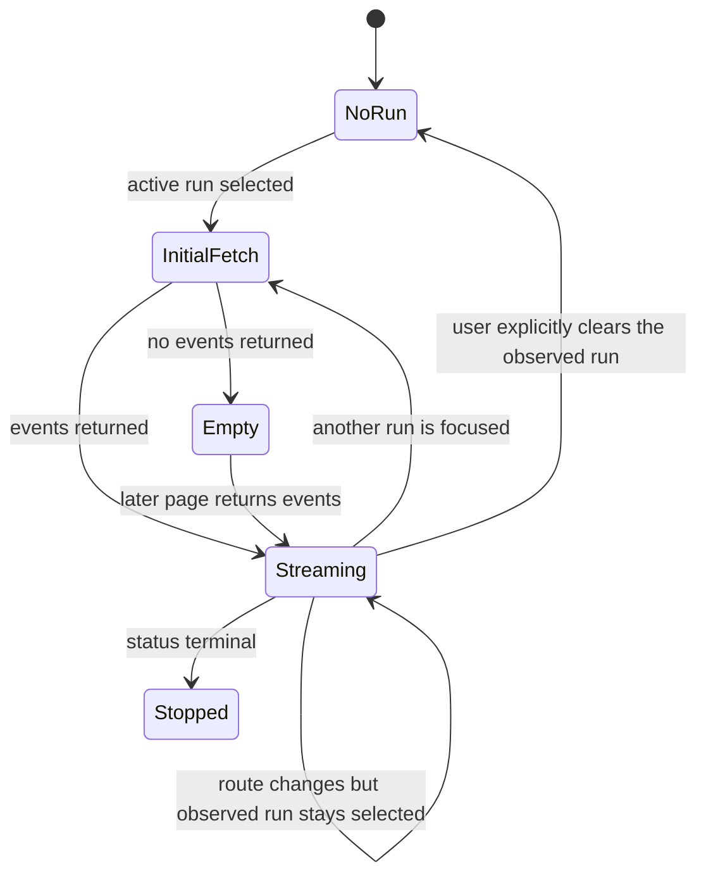
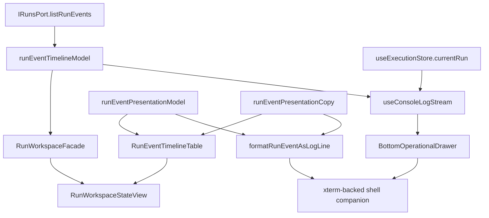

# Runs Component - Local Guide

This page is the local component guide for the Runs domain in `apps/web`. It
describes the public `IRunsPort` API, invariants, state transitions, consumers,
and adapter boundaries.

Use this guide with:

- [Runs Frontend Architecture](component-runs.md#section-dvt-runs-frontend-architecture)
- [Frontend Runtime Contract Technical Manual](./frontend-runtime-contract-technical-manual.md)
- [Web DDD Structure](../../../domain-ui.md#section-web-ddd)
- [Web Functionalities](../../../domain-ui.md#section-web-functional)
- [Command Query Rail Governance](../../../command-query-rail-governance.md)

Canonical local paths:

## Port

- [ports/runs.ts](../../../../../apps/web/src/app/ports/runs.ts)

## Services

- [runsService.ts](../../../../../apps/web/src/app/services/runs/runsService.ts)
- [runsService.api.ts](../../../../../apps/web/src/app/services/runs/runsService.api.ts)
- [runsService.mock.ts](../../../../../apps/web/src/app/services/runs/runsService.mock.ts)
- [runsApiPayloads.ts](../../../../../apps/web/src/app/services/runs/runsApiPayloads.ts)
- [runsApiDecoders.ts](../../../../../apps/web/src/app/services/runs/runsApiDecoders.ts)
- [runsApiSnapshotMapper.ts](../../../../../apps/web/src/app/services/runs/runsApiSnapshotMapper.ts)
- [runWorkspaceFacade.ts](../../../../../apps/web/src/app/services/runs/runWorkspaceFacade.ts)
- [runEventPresentationModel.ts](../../../../../apps/web/src/app/services/runs/runEventPresentationModel.ts)
- [runEventPresentationCopy.ts](../../../../../apps/web/src/app/services/runs/runEventPresentationCopy.ts)
- [runEventTimelineModel.ts](../../../../../apps/web/src/app/services/runs/runEventTimelineModel.ts)

## Shared Utilities

- [classifyHttpError.ts](../../../../../apps/web/src/app/services/api/classifyHttpError.ts)

## Views

- [runWorkbenchStateModel.ts](../../../../../apps/web/src/app/views/runs/runWorkbenchStateModel.ts)
- [runStatesModel.ts](../../../../../apps/web/src/app/views/runs/runStatesModel.ts)
- [runStatesCopy.ts](../../../../../apps/web/src/app/views/runs/runStatesCopy.ts)
- [runsRouteBootstrap.ts](../../../../../apps/web/src/app/views/runs/runsRouteBootstrap.ts)
- [useRunWorkspace.ts](../../../../../apps/web/src/app/views/runs/useRunWorkspace.ts)
- [CanvasRunsTabView.tsx](../../../../../apps/web/src/app/views/runs/CanvasRunsTabView.tsx)
- [RunListStateView.tsx](../../../../../apps/web/src/app/views/runs/RunListStateView.tsx)
- [RunDetailStateViews.tsx](../../../../../apps/web/src/app/views/runs/RunDetailStateViews.tsx)
- [RunStates.tsx](../../../../../apps/web/src/app/views/runs/RunStates.tsx)
- [RunWorkspaceStateView.tsx](../../../../../apps/web/src/app/views/runs/RunWorkspaceStateView.tsx)
- [RunEventTimelineTable.tsx](../../../../../apps/web/src/app/views/runs/RunEventTimelineTable.tsx)

## Tests

- [runsService.test.ts](../../../../../apps/web/src/app/services/runs/runsService.test.ts)
- [runsDomainBoundary.architecture.test.ts](../../../../../apps/web/src/app/views/runs/runsDomainBoundary.architecture.test.ts)
- [runWorkspaceFacade.test.ts](../../../../../apps/web/src/app/services/runs/runWorkspaceFacade.test.ts)
- [runEventPresentationModel.test.ts](../../../../../apps/web/src/app/services/runs/runEventPresentationModel.test.ts)
- [runEventPresentationCopy.test.ts](../../../../../apps/web/src/app/services/runs/runEventPresentationCopy.test.ts)
- [runEventTimelineModel.test.ts](../../../../../apps/web/src/app/services/runs/runEventTimelineModel.test.ts)
- [runWorkbenchStateModel.test.ts](../../../../../apps/web/src/app/views/runs/runWorkbenchStateModel.test.ts)
- [runStatesModel.test.ts](../../../../../apps/web/src/app/views/runs/runStatesModel.test.ts)
- [useRunWorkspace.test.tsx](../../../../../apps/web/src/app/views/runs/useRunWorkspace.test.tsx)
- [RunStates.test.tsx](../../../../../apps/web/src/app/views/runs/RunStates.test.tsx)
- [runsRouteBootstrap.test.ts](../../../../../apps/web/src/app/views/runs/runsRouteBootstrap.test.ts)
- [runsApiPayloads.test.ts](../../../../../apps/web/src/app/services/runs/runsApiPayloads.test.ts)
- [classifyHttpError.test.ts](../../../../../apps/web/src/app/services/api/classifyHttpError.test.ts)

## Public API

`IRunsPort` is defined in [ports/runs.ts](../../../../../apps/web/src/app/ports/runs.ts).

```typescript
export interface IRunsPort {
  listRunSummaries: () => Promise<RunSummaryItem[]>;
  getRunSnapshot: (runId: string) => Promise<RunSnapshot | null>;
  startRun: (input: StartRunInput) => Promise<RunStartReceipt>;
  listRunEvents: (runId: string, afterSeq?: number) => Promise<RunEventTimelinePage>;
}
```

### Method Semantics

| Method             | Rail type | Idempotent | Runtime surface           | Description                                                              |
| ------------------ | --------- | ---------- | ------------------------- | ------------------------------------------------------------------------ |
| `listRunSummaries` | Query     | Yes        | `GET /runs`               | Returns runs visible to the current tenant/project/environment scope.    |
| `getRunSnapshot`   | Query     | Yes        | `GET /runs/:runId`        | Returns one run snapshot by ID, or `null` when the API returns HTTP 404. |
| `startRun`         | Command   | No         | `POST /runs/start`        | Submits a run request; the API owns admission and run identity.          |
| `listRunEvents`    | Query     | Yes        | `GET /runs/:runId/events` | Returns an ordered page of run events, optionally after a sequence.      |

### DTO Vocabulary

All presentation DTOs are defined locally in
[ports/runs.ts](../../../../../apps/web/src/app/ports/runs.ts). They are not
wire contracts and are not re-exported from `@dvt/contracts`.

| DTO                    | Purpose                                               |
| ---------------------- | ----------------------------------------------------- |
| `StartRunInput`        | Command input: `PlanRef`, `WorkspaceScope`, selection |
| `RunStartReceipt`      | Command result: server-owned run ID and admission     |
| `UiRunStatus`          | Presentation-level run status union                   |
| `RunSummaryItem`       | List item projection with `startedAt` authority       |
| `RunSnapshot`          | Run lifecycle snapshot and optional evidence fields   |
| `RunDiagnostics`       | Run trace/log pointer projection                      |
| `RunEventTimelinePage` | Paginated event feed                                  |

## Invariants

1. `IRunsPort` has four public methods. Views, hooks, and facades consume the
   interface instead of importing adapter implementations directly.
2. `startRun` sends `planRef`, `workspaceScope`, and `selection`. The web client
   does not send a canonical `runId`; the API returns the run identity.
3. `getRunSnapshot` maps HTTP 404 to `null`. Other API failures propagate to
   the caller.
4. `listRunSummaries` includes tenant, project, and environment scope query
   parameters through the API adapter.
5. `getRunSnapshot` and `listRunEvents` include tenant scope query parameters
   through the API adapter.
6. Mock and API implementations satisfy the same `IRunsPort` interface, so route
   code does not select a product data transport.
7. Architecture tests in
   [`runsDomainBoundary.architecture.test.ts`](../../../../../apps/web/src/app/views/runs/runsDomainBoundary.architecture.test.ts)
   validate docblock presence, port boundary isolation, CQRS rail separation,
   discriminated-union state modelling, and adapter security properties.
8. Event chronology is normalized through the local
   [Run Event Timeline Component](component-runs.md#section-run-event-timeline-component) before
   either the shell console or the Runs workspace renders it.
9. `RunSnapshot.diagnostics` is the only frontend source for Run Detail trace
   and log pointers. Views must not derive `runId`, `planSha`, attempt, adapter,
   error code, or duration from timeline rows when the snapshot omits them.

## Publication-Bound Result Sample

The #3021 slice reuses `GetRunSnapshot`, `ListWarehouseConnections`, and
`PreviewWarehouseSourceObjectRows`; it does not restore the retired
`PreviewRunMaterializationRows` rail. The planning rationale, current-state
diagram, Fowler matrix, negative tests, and acceptance boundary are recorded in
[the governing issue](https://github.com/dunay2/dvt/issues/3021#issuecomment-6015596921).

The immutable publication evidence belongs to the selected Run. The mutable
warehouse table is not historical storage. Result sampling is an explicit,
bounded read using the evidence's exact connection, schema, relation and expected
publication token. The existing authorized connection catalog supplies the
database; the current Canvas graph supplies none of this identity.

The application checks that the Run and active tenant/project/environment agree.
The backend retains authorization and checks the token and rows within its
existing consistent-read transaction. A replaced publication is a typed
`publication_changed` failure, not a request to show the newer rows. The evidence
remains visible when the sample is replaced, inaccessible or unavailable.

The presentation lifecycle is ephemeral: loading clears any prior rows, navigation
or scope changes invalidate pending responses, and reopening requires a new read.
No historical row cache, result store, contract version, SQL endpoint or automatic
retry is introduced. The existing compact grid renders successful samples with
their query time and bounded-first-page limitations. Messages are localized in
English and Spanish.



## State Transitions

The Runs domain has no durable frontend-owned run state. Route state is derived
from backend reads and service facades. The route workbench state model is
documented in [component-runs.md](component-runs.md#section-dvt-runs-frontend-architecture).



## Consumers

| Consumer                             | File                                                                                                                          | How it uses the port                                        |
| ------------------------------------ | ----------------------------------------------------------------------------------------------------------------------------- | ----------------------------------------------------------- |
| `runWorkspaceFacade`                 | [runWorkspaceFacade.ts](../../../../../apps/web/src/app/services/runs/runWorkspaceFacade.ts)                                  | Composes snapshot and timeline into view model              |
| `useRunWorkspace`                    | [useRunWorkspace.ts](../../../../../apps/web/src/app/views/runs/useRunWorkspace.ts)                                           | Subscribes to scope and reloads run workspace               |
| `RunsView` (via `CanvasRunsTabView`) | [CanvasRunsTabView.tsx](../../../../../apps/web/src/app/views/runs/CanvasRunsTabView.tsx)                                     | Entry point for Canvas-scoped Runs tab                      |
| `RunWorkspaceStateView`              | [RunWorkspaceStateView.tsx](../../../../../apps/web/src/app/views/runs/RunWorkspaceStateView.tsx)                             | Renders full workspace (detail + timeline) from view model  |
| `RunEventTimelineTable`              | [RunEventTimelineTable.tsx](../../../../../apps/web/src/app/views/runs/RunEventTimelineTable.tsx)                             | Renders dense timeline rows from shared event semantics     |
| `RunListStateView`                   | [RunListStateView.tsx](../../../../../apps/web/src/app/views/runs/RunListStateView.tsx)                                       | Renders runs summary list with status badges and navigation |
| `RunDetailStateViews`                | [RunDetailStateViews.tsx](../../../../../apps/web/src/app/views/runs/RunDetailStateViews.tsx)                                 | Owns empty, error, degraded, loading, missing state views   |
| `RunStates`                          | [RunStates.tsx](../../../../../apps/web/src/app/views/runs/RunStates.tsx)                                                     | Barrel re-export of named state views for route renderer    |
| `runsRouteBootstrap`                 | [runsRouteBootstrap.ts](../../../../../apps/web/src/app/views/runs/runsRouteBootstrap.ts)                                     | Derives bootstrap presentation from workbench state         |
| service tests                        | [runsService.test.ts](../../../../../apps/web/src/app/services/runs/runsService.test.ts)                                      | Verifies route calls, parsing, and rejections               |
| architecture tests                   | [runsDomainBoundary.architecture.test.ts](../../../../../apps/web/src/app/views/runs/runsDomainBoundary.architecture.test.ts) | Validates docblocks, boundary isolation, CQRS rails         |

## Architecture Diagram

```mermaid
flowchart TB
  subgraph Views["Views (runs/)"]
    CanvasTab["CanvasRunsTabView.tsx"]
    ListView["RunListStateView.tsx"]
    DetailViews["RunDetailStateViews.tsx"]
    WorkspaceView["RunWorkspaceStateView.tsx"]
    RunStates["RunStates.tsx"]
    RouteBootstrap["runsRouteBootstrap.ts"]
  end

  subgraph Models["View Models (runs/)"]
    WorkbenchState["runWorkbenchStateModel.ts"]
    StatesModel["runStatesModel.ts"]
    StatesCopy["runStatesCopy.ts"]
  end

  subgraph Hooks["Hooks (runs/)"]
    Hook["useRunWorkspace.ts"]
  end

  subgraph Facades["Facades (services/runs/)"]
    Facade["runWorkspaceFacade.ts"]
    TimelineModel["runEventTimelineModel.ts"]
    EventsModel["runEventPresentationModel.ts"]
    EventsCopy["runEventPresentationCopy.ts"]
  end

  subgraph Shared["Shared Utilities"]
    ClassifyHttp["classifyHttpError.ts"]
  end

  subgraph Port["Port Layer"]
    IRunsPort["IRunsPort (ports/runs.ts)"]
  end

  subgraph Adapters["Adapter Layer (services/runs/)"]
    Factory["runsService.ts"]
    API["runsService.api.ts"]
    Mock["runsService.mock.ts"]
  end

  subgraph Support["Support Modules (services/runs/)"]
    Payloads["runsApiPayloads.ts"]
    Decoders["runsApiDecoders.ts"]
    Mapper["runsApiSnapshotMapper.ts"]
  end

  CanvasTab --> Hook
  Hook --> Facade
  Hook --> TimelineModel
  Hook ---> ClassifyHttp
  Facade --> IRunsPort
  Facade --> TimelineModel
  Facade --> EventsModel
  Facade --> EventsCopy
  Facade ---> ClassifyHttp
  WorkspaceView --> EventsModel
  WorkspaceView --> EventsCopy
  WorkspaceView --> StatesModel
  WorkspaceView --> StatesCopy
  ListView --> StatesModel
  ListView --> StatesCopy
  DetailViews --> StatesCopy
  RunStates --> WorkbenchState
  RouteBootstrap --> WorkbenchState
  WorkbenchState --> IRunsPort
  Factory --> API
  Factory --> Mock
  API --> Payloads
  API --> Decoders
  API --> Mapper

  style Port fill:#1a1a2e,stroke:#e94560,stroke-width:2px
  style Adapters fill:#16213e,stroke:#0f3460,stroke-width:1px
```



Dependency direction:

```text
views -> view models -> hooks/facades -> ports <- adapters <- support modules
```

Ports never import adapters. Adapters implement ports. Views do not import
`createApiClient` or `runsService.api.ts` directly.

`classifyHttpError.ts` lives in `services/api/` because it wraps `ApiError` from
`createApiClient.ts` and is shared by the run workspace facade and hook. Run
status presentation helpers remain in `runStatesModel.ts`, which keeps their
owner in the runs view-model layer instead of creating a generic app-root
module.

## Related Pages

- [Runs Frontend Architecture](component-runs.md#section-dvt-runs-frontend-architecture)
- [Frontend Runtime Contract Technical Manual](./frontend-runtime-contract-technical-manual.md)
- [Frontend Runtime Contract User Manual](frontend-runtime-contract-technical-manual.md#section-frontend-runtime-contract-user-manual)
- [Start Run Client Identity Boundary](./start-run-client-identity-boundary.md)
- [Runs User Stories](component-runs.md#section-user-stories-runs)
- [Run Event Timeline Component](component-runs.md#section-run-event-timeline-component)
- [Run Event Timeline User Stories](component-runs.md#section-run-event-timeline-user-stories)
- [Runs Domain Architecture Test](../../../../../apps/web/src/app/views/runs/runsDomainBoundary.architecture.test.ts)
- [Web DDD Structure](../../../domain-ui.md#section-web-ddd)
- [Web Functionalities](../../../domain-ui.md#section-web-functional)
- [Web Store Domain Ownership Component](../web-store-domain-ownership-component.md)

<a id="section-user-stories-runs"></a>

## User Stories - Runs Domain Frontend

### Governing Sources

- [Runs Component Local Guide](component-runs.md)
- [IRunsPort](../../../../../apps/web/src/app/ports/runs.ts)
- [Runs Frontend Architecture](component-runs.md#section-dvt-runs-frontend-architecture)
- [Command Query Rail Governance](../../../command-query-rail-governance.md)
- [Run Event Timeline User Stories](component-runs.md#section-run-event-timeline-user-stories)

These stories describe current `apps/web` behavior. They do not claim extra
client-side validation, synthetic run identity, or fields that are not present
in the `IRunsPort` DTOs.

### 1. List Runs

#### US-01: List Runs - Empty List

**As** a workspace user,
**I want** an empty run list when no runs are visible in the current scope,
**So that** the Runs view can render an empty state without treating absence as
an error.

**C&Q rail:** Query - `listRunSummaries`

**Scenario:**

- Given the current workspace has no visible runs
- When `listRunSummaries()` resolves
- Then the caller receives `[]`
- And no exception is thrown

**Current evidence:**

- `runsService.mock.ts` can return an empty list from local fixture state.
- `runsService.api.ts` maps the API list payload into `RunSummaryItem[]`.
- Runs route state can render list-ready and empty states from the returned
  array.

#### US-02: List Runs - Summary Items

**As** a workspace user,
**I want** each listed run to expose the presentation summary fields,
**So that** I can choose a run without loading every detail payload upfront.

**C&Q rail:** Query - `listRunSummaries`

**Scenario:**

- Given the current workspace has visible runs
- When `listRunSummaries()` resolves
- Then each `RunSummaryItem` has `runId`, `status`, and `startedAt`
- And optional summary fields such as `planId`, `environment`, `completedAt`,
  `substatus`, `message`, `hash`, `snapshotStaleness`, and `execution` are
  present only when the adapter can derive them

**Current evidence:**

- `RunSummaryItem` is declared in `apps/web/src/app/ports/runs.ts`.
- `runsApiSnapshotMapper.ts` maps backend snapshot records into summaries.
- `runsService.test.ts` covers API list mapping and scope query construction.

#### US-03: List Runs - API Failure

**As** a workspace user,
**I want** list failures to surface as failures,
**So that** the route can show an error state instead of stale or fabricated
data.

**C&Q rail:** Query - `listRunSummaries`

**Scenario:**

- Given the API rejects the list request
- When `listRunSummaries()` is called through the API adapter
- Then the promise rejects
- And the route layer decides how to classify or render the failure

**Current evidence:**

- `runsService.api.ts` does not synthesize fallback list data after API errors.
- Route/facade tests own user-visible error posture.

### 2. View Run Detail

#### US-04: View Run Detail - Existing Run

**As** a workspace user,
**I want** to load the current snapshot for one run,
**So that** I can inspect status, timing, provenance, and execution evidence
when the backend provides it.

**C&Q rail:** Query - `getRunSnapshot`

**Scenario:**

- Given a run with ID `run-123` exists
- When `getRunSnapshot('run-123')` resolves
- Then the caller receives a non-null `RunSnapshot`
- And the snapshot includes `runId`, `status`, and `startedAt`
- And optional fields such as `provenance`, `execution`, `materialization`, or
  failure details are present only when supplied by the adapter mapping

**Current evidence:**

- `RunSnapshot` is declared in `apps/web/src/app/ports/runs.ts`.
- `runsService.api.ts` calls `GET /runs/:runId` with tenant scope.
- `runsService.test.ts` covers snapshot mapping and removal of the old
  `/status` route dependency.

#### US-05: View Run Detail - Run Not Found

**As** a workspace user,
**I want** a missing run to return `null`,
**So that** the route can distinguish not-found from transport failure.

**C&Q rail:** Query - `getRunSnapshot`

**Scenario:**

- Given the API returns HTTP 404 for a run ID
- When `getRunSnapshot(runId)` is called
- Then the API adapter resolves `null`
- And other HTTP failures still reject

**Current evidence:**

- `runsService.api.ts` catches `ApiError` with `statusCode === 404`.
- `runsService.test.ts` covers HTTP 404 translation to `null`.

#### US-06: View Run Detail - API Failure

**As** a workspace user,
**I want** non-404 snapshot failures to remain visible,
**So that** the UI does not hide authorization, availability, or unexpected
runtime failures.

**C&Q rail:** Query - `getRunSnapshot`

**Scenario:**

- Given the API returns an error other than HTTP 404
- When `getRunSnapshot(runId)` is called
- Then the promise rejects with the original error
- And caller-level state decides whether to render forbidden, unavailable, or
  unexpected posture

**Current evidence:**

- `runsService.api.ts` only translates 404 to `null`.
- `runWorkspaceFacade.ts` classifies load failures for route consumption.

### 3. Start Run

#### US-07: Start Run - Accepted

**As** a workspace user,
**I want** to start a run from a persisted plan and execution selection,
**So that** the runtime can execute the selected work.

**C&Q rail:** Command - `startRun`

**Scenario:**

- Given I have a valid `StartRunInput` with `planRef`, `workspaceScope`, and
  `selection`
- When `startRun(input)` resolves
- Then the caller receives `RunStartReceipt`
- And `RunStartReceipt.runId` is assigned by the API
- And `accepted` reflects the runtime admission result

**Current evidence:**

- `runsService.api.ts` posts to `POST /runs/start`.
- `runsService.test.ts` covers receipt parsing and malformed receipt rejection.

#### US-08: Start Run - Client Does Not Own Run Identity

**As** a workspace user,
**I want** the web client to avoid sending a canonical run ID,
**So that** the protected runtime remains the authority for run identity.

**C&Q rail:** Command - `startRun`

**Scenario:**

- Given `startRun(input)` is called
- When the API adapter builds the request body
- Then the payload includes `tenantId`, `projectId`, `environmentId`,
  `targetAdapter`, `selection`, and `planRef`
- And the payload does not include a client-authored `runId`

**Current evidence:**

- `runsService.test.ts` covers that `startRun` does not send client-authored run
  identity.
- [Start Run Client Identity Boundary](start-run-client-identity-boundary.md)
  records the same invariant.

#### US-09: Start Run - Runtime Rejection

**As** a workspace user,
**I want** runtime start rejections to remain typed or explicit,
**So that** the UI can explain admission, authorization, or availability
failure.

**C&Q rail:** Command - `startRun`

**Scenario:**

- Given the protected runtime rejects `POST /runs/start`
- When `startRun(input)` is called
- Then `normalizeProtectedRuntimeRejection` may map the `ApiError`
- And otherwise the original error propagates

**Current evidence:**

- `runsService.api.ts` wraps `postJson` with
  `normalizeProtectedRuntimeRejection(error) ?? error`.
- `runsService.test.ts` covers protected runtime rejection normalization.

### 4. View Run Events

#### US-10: View Run Events - Events Returned

**As** a workspace user,
**I want** to load event timeline pages for a run,
**So that** I can inspect runtime progress and emitted evidence.

**C&Q rail:** Query - `listRunEvents`

**Scenario:**

- Given run `run-123` has events
- When `listRunEvents('run-123')` resolves
- Then the caller receives `RunEventTimelinePage`
- And `events` contains parsed `RunEvent` records
- And `nextAfterSeq` is present only when the adapter receives it

**Current evidence:**

- `runsService.api.ts` calls `GET /runs/:runId/events`.
- `parseRunEventRecord` validates records before presentation use.
- `runsService.test.ts` covers events payload extraction.

#### US-11: View Run Events - After Sequence

**As** a workspace user,
**I want** to request events after a known sequence,
**So that** polling can resume without re-reading the whole timeline.

**C&Q rail:** Query - `listRunEvents`

**Scenario:**

- Given the caller has already read sequence `5`
- When `listRunEvents(runId, 5)` is called
- Then the adapter appends `afterSeq=5` to the query string
- And tenant scope remains present

**Current evidence:**

- `runsService.api.ts` builds query parameters with `URLSearchParams`.
- `runsService.test.ts` covers `afterSeq` query construction.

#### US-12: View Run Events - Timeline Degraded

**As** a workspace user,
**I want** snapshot loading and event loading failures to be distinguishable,
**So that** a route can show available snapshot data even when the timeline
query fails.

**C&Q rail:** Query - `listRunEvents`

**Scenario:**

- Given `getRunSnapshot(runId)` succeeds
- And `listRunEvents(runId)` rejects
- When `runWorkspaceFacade` composes the workspace view
- Then the route can render a degraded timeline posture without fabricating
  event data

**Current evidence:**

- `runWorkspaceFacade.ts` composes snapshot and timeline state.
- `runWorkspaceFacade.test.ts` covers facade error classification.

### 5. Explicit Test Doubles

#### US-13: Test Double - Same Port Shape

**As** a developer,
**I want** explicit test doubles and the API adapter to satisfy `IRunsPort`,
**So that** route code has one product boundary without a runtime mode.

**C&Q rail:** Not applicable - local adapter parity

**Scenario:**

- Given product composition creates `createRunsService(apiClient)`
- And a test injects `createMockRunsService()` through an override
- Then both objects satisfy `IRunsPort`
- And route code cannot select a product data transport

**Current evidence:**

- `createRunsService` returns the API-backed `IRunsPort`.
- `createMockRunsService` exists only under `src/testing` for explicit injection.

### 6. Tenant Scoping

#### US-14: Tenant Scope - Query Construction

**As** a workspace user,
**I want** runtime reads and commands scoped to the active workspace context,
**So that** run data does not cross tenant or environment boundaries.

**C&Q rail:** Cross-cutting scope rule for Runs commands and queries

**Scenario:**

- Given the active `SessionContextPort` returns tenant, project, and environment
  values
- When `listRunSummaries()` is called
- Then the API query includes tenant, project, and environment scope
- When `getRunSnapshot()` or `listRunEvents()` is called
- Then the API query includes tenant scope
- When `startRun()` is called
- Then the request body includes tenant, project, environment, and target
  adapter

**Current evidence:**

- `runsApiPayloads.ts` builds tenant-scope query strings.
- `runsService.api.ts` sends workspace scope in `startRun`.
- `runsService.test.ts` covers list, snapshot, events, and start request scope.

### 7. Event Timeline Convergence

Detailed event stream scenarios live in
[Run Event Timeline User Stories](component-runs.md#section-run-event-timeline-user-stories). The
summary scenarios below keep the Runs domain index complete.

#### US-15: Event Timeline - Ordered And Deduped

**As** a workspace user,
**I want** event pages ordered and deduplicated before display,
**So that** overlapping polling and reconnects do not create confusing
timeline output.

**C&Q rail:** Query - `listRunEvents`

**Scenario:**

- Given event pages contain duplicate `eventId` values or out-of-order
  `runSeq` values
- When the frontend normalizes the timeline
- Then each event appears once
- And visible chronology follows `runSeq`, then `emittedAt`, then `eventId`

#### US-16: Event Timeline - Shared Console And Runs Semantics

**As** a maintainer,
**I want** the shell console and Runs workspace to consume the same timeline
model,
**So that** terminal lines and structured timeline rows do not drift in event
meaning.

**C&Q rail:** Query - `listRunEvents`

**Scenario:**

- Given a run event page is returned
- When the console renders terminal lines
- And the Runs workspace renders timeline rows
- Then both surfaces use the same ordering, dedupe, severity, headline, detail,
  and step identity semantics

#### US-17: Event Timeline - Active Polling Stops At Terminal Status

**As** a workspace user,
**I want** live event polling to stop when a run reaches a terminal state,
**So that** completed, failed, and cancelled runs do not keep background polling
alive.

**C&Q rail:** Query - `listRunEvents`

**Scenario:**

- Given the active run status is `pending` or `running`
- Then live event polling is enabled
- Given the active run status is `completed`, `failed`, or `cancelled`
- Then live event polling is disabled

### Coverage Matrix

| Story | IRunsPort method   | Rail type | Current evidence surface           |
| ----- | ------------------ | --------- | ---------------------------------- |
| US-01 | `listRunSummaries` | Query     | Mock/API list mapping              |
| US-02 | `listRunSummaries` | Query     | `RunSummaryItem` DTO and mapper    |
| US-03 | `listRunSummaries` | Query     | API error propagation              |
| US-04 | `getRunSnapshot`   | Query     | Snapshot DTO and API mapping       |
| US-05 | `getRunSnapshot`   | Query     | HTTP 404 to `null` mapping         |
| US-06 | `getRunSnapshot`   | Query     | Non-404 error propagation          |
| US-07 | `startRun`         | Command   | `POST /runs/start` receipt parse   |
| US-08 | `startRun`         | Command   | No client-authored `runId`         |
| US-09 | `startRun`         | Command   | Runtime rejection normalization    |
| US-10 | `listRunEvents`    | Query     | Events payload parsing             |
| US-11 | `listRunEvents`    | Query     | `afterSeq` query construction      |
| US-12 | `listRunEvents`    | Query     | Facade degraded timeline posture   |
| US-13 | factory/adapters   | N/A       | API port plus explicit test double |
| US-14 | all methods        | Scope     | Session-derived workspace scoping  |
| US-15 | `listRunEvents`    | Query     | Event ordering and dedupe model    |
| US-16 | `listRunEvents`    | Query     | Shared Console/Runs event model    |
| US-17 | `listRunEvents`    | Query     | Active-status polling policy       |

### Related

- [Runs Component Local Guide](component-runs.md)
- [Runs Frontend Architecture](component-runs.md#section-dvt-runs-frontend-architecture)
- [Frontend Runtime Contract Technical Manual](frontend-runtime-contract-technical-manual.md)
- [Start Run Client Identity Boundary](start-run-client-identity-boundary.md)
- [Runs Domain Architecture Test](../../../../../apps/web/src/app/views/runs/runsDomainBoundary.architecture.test.ts)
- [Run Event Timeline Component](component-runs.md#section-run-event-timeline-component)
- [Run Event Timeline User Stories](component-runs.md#section-run-event-timeline-user-stories)
- [Command Query Rail Governance](../../../command-query-rail-governance.md)

> Section status: Active. Owner: Web / Architecture. Colocation does not merge component responsibilities.

<a id="section-dvt-runs-frontend-architecture"></a>

## Runs

### Purpose

The Runs surface is the operational execution workbench of the DVT frontend.

It exists to let operators and authors move from graph intent to execution
evidence without mixing execution truth into the Canvas.

### Current Implementation

Primary code anchors:

- [RunsView.tsx](../../../../../apps/web/src/app/views/RunsView.tsx)
- [RunStates.tsx](../../../../../apps/web/src/app/views/runs/RunStates.tsx)
- [WorkbenchStates.tsx](../../../../../apps/web/src/app/components/workbench/state/WorkbenchStates.tsx)
- [runWorkbenchStateModel.ts](../../../../../apps/web/src/app/views/runs/runWorkbenchStateModel.ts)
- [runWorkspaceFacade.ts](../../../../../apps/web/src/app/services/runs/runWorkspaceFacade.ts)
- [runsService.ts](../../../../../apps/web/src/app/services/runs/runsService.ts)
- [runEventTimelineModel.ts](../../../../../apps/web/src/app/services/runs/runEventTimelineModel.ts)

Current routes:

- `/runs`
- `/runs/:runId`

Current composition:

- list state when no `runId` is selected;
- workspace detail state when a run is selected;
- snapshot card is always present;
- timeline table is available, empty, or degraded based on runtime events.

### Runs Workbench State Contract

The current workbench state model now formalizes one explicit state contract for
`/runs` and `/runs/:runId` so route composition does not keep deciding state ad
hoc inside multiple components.

Current state split:

- `runs-index` owns loading, error, empty, and populated list behavior for `/runs`;
- `run-loading` owns focused-route loading treatment for `/runs/:runId`;
- `run-missing` owns the governed run-not-found treatment;
- `run-error` owns snapshot load failure treatment;
- `run-workspace` owns the focused snapshot-plus-timeline workspace;
- `run-degraded` remains a workspace-level state inside the focused run, not a
  second route root, because snapshot truth is still available even when the
  timeline feed is stale or partially unavailable.



Rationale:

- the list route and focused run route are different workbench states, not one
  oversized component with inline conditions;
- missing and degraded are different product truths:
  - missing means the route cannot identify a run workspace at all;
  - degraded means snapshot truth exists, but event chronology is partial or
    temporarily unavailable;
- empty list state must keep guiding the operator back to Canvas instead of
  presenting `/runs` as a dead end.

### Shared Workbench State Primitives

`Runs` no longer owns all of its state chrome directly.

The route now seeds shared workbench state primitives while keeping
route-specific copy, actions, and state selection local.



Rules:

1. shared primitives own layout and state chrome only;
2. `Runs` still owns state selection and route-specific copy;
3. cross-route reuse should adopt these primitives before inventing more
   route-local empty or error cards;
4. `ReadOnlyState` is now a shared primitive with `Code` as the first governed
   non-`Runs` consumer.

### UX Rules

- `/runs` is the operational landing state;
- `/runs/:runId` is the focused execution workspace;
- empty state must send the user back to Canvas to create meaningful work;
- the route must never fabricate step/artifact detail from snapshot-only data.

### Mature Libraries And References

- operational grids and dense event tables:
  [TanStack Table](https://tanstack.com/table/latest)
- state and polling:
  TanStack Query
- metrics and dashboard patterns:
  [Grafana](https://github.com/grafana/grafana)

### Current Constraints

- the Runs route is useful but still lighter than a full operational table and
  diagnostics workbench;
- the frontend contract around run start and richer diagnostics still needs
  tightening with the protected API route map;
- the shell drawer may mirror active run events, but the Runs route remains the
  durable authority for snapshot plus timeline monitoring.

### Runtime Contract Baseline (F-07)

The route-level runtime drift addressed by `F-07` is now fixed in the service
layer:

- frontend runtime routes now align to protected route truth:
  - `POST /runs/start`
  - `GET /runs`
  - `GET /runs/:runId`
  - `GET /runs/:runId/events`

Current residual constraint after that fix:

- `/runs/:runId` is backed by runtime snapshot authority, not by a full
  event-enriched and step-enriched run aggregate;
- timeline is route-composed when available, but step/artifact/node detail
  still need the later `F-09` through `F-11` convergence work.

### F-10 Event Timeline Convergence

F-10 closes the live event chronology gap between the shell operational drawer and the
durable Runs workspace. The local event stream model owns ordering, duplicate
collapse, active-status polling posture, and cursor preservation before either
surface renders events.



Rules:

1. The operational drawer log and Runs must consume the same timeline ordering and dedupe model.
2. The operational drawer log remains a shell companion stream.
3. Runs remains durable snapshot-plus-timeline authority.
4. Timeline events remain chronology-only and must not infer snapshot evidence.

Canonical runtime contract baseline docs:

- [Frontend Runtime Contract Technical Manual](frontend-runtime-contract-technical-manual.md)
- [Frontend Runtime Contract User Manual](frontend-runtime-contract-technical-manual.md#section-frontend-runtime-contract-user-manual)
- [Frontend Fowler Implementation Pattern](../frontend-data-boundary-architecture.md#section-frontend-fowler-implementation-pattern)
- [Run Event Timeline Component](component-runs.md#section-run-event-timeline-component)
- [Run Event Timeline User Stories](component-runs.md#section-run-event-timeline-user-stories)

### Related Pages

- [Frontend Observability Architecture](../observability/front-observability-architecture-dvt.md)
- [UX Implementation Guide](../style-guide.md#section-ux-implementation-guide)
- [Library And Open-Source Reference Stack](../style-guide.md#section-library-and-open-source-reference-stack)

> Section status: Active. Owner: Frontend / Architecture. Colocation does not merge component responsibilities.

<a id="section-dense-operational-tables-component"></a>

## Runs Dense Operational Tables Component

This local component owns table-oriented presentation semantics for Runs and
run event chronology. It does not own runtime authority, event fetching, run
start admission, or shell console streaming.

### Public API

| API                         | Kind         | Owner                   | Contract                                                           |
| --------------------------- | ------------ | ----------------------- | ------------------------------------------------------------------ |
| `buildRunOperationalRows`   | query helper | Run table model         | Maps `RunSummaryItem[]` into dense table rows                      |
| `filterRunOperationalRows`  | query helper | Run table model         | Applies status and text filters without mutating source rows       |
| `sortRunOperationalRows`    | query helper | Run table model         | Applies stable route-owned sort semantics                          |
| `buildRunEventTableRows`    | query helper | Event table model       | Maps shared event presentation models into dense timeline rows     |
| `RunOperationalTable`       | view         | Runs list               | Renders sortable/filterable run rows and route navigation          |
| `RunEventTimelineTable`     | view         | Runs detail             | Renders event chronology as dense rows from shared event semantics |
| `routeWorkbenchTableTokens` | token object | Workbench visual system | Provides semantic dense table field, text, and status tone classes |

### Invariants

1. Dense tables consume `IRunsPort` read models; they do not call adapters.
2. Table row IDs remain backend-owned run IDs or event IDs.
3. Sort and filter state is presentation state; it does not mutate runtime
   snapshots or event chronology.
4. Run status filtering is explicit and URL-stable on `/runs`.
5. Event table rows use `runEventPresentationModel` and
   `runEventPresentationCopy`, so console and detail route semantics do not
   drift.
6. TanStack Table is a rendering primitive only; DVT owns column names,
   filters, routes, and row semantics.
7. Dense table visual states use the local visual-token component instead of
   route-level Tailwind color families.

### State Transitions



### Consumer Diagram



### Consumers

| Consumer               | File                                                                  | Responsibility                                           |
| ---------------------- | --------------------------------------------------------------------- | -------------------------------------------------------- |
| Runs list route        | `apps/web/src/app/views/runs/RunListStateView.tsx`                    | Hosts filter state and route navigation                  |
| Run table model        | `apps/web/src/app/views/runs/runOperationalTableModel.ts`             | Owns row, filter, and sort semantics                     |
| Event table model      | `apps/web/src/app/views/runs/runEventTableModel.ts`                   | Owns event row mapping from shared timeline presentation |
| Run table view         | `apps/web/src/app/views/runs/RunOperationalTable.tsx`                 | Renders dense rows via TanStack Table                    |
| Timeline table view    | `apps/web/src/app/views/runs/RunEventTimelineTable.tsx`               | Renders event rows from shared event presentation        |
| Visual token component | `apps/web/src/app/components/workbench/routeWorkbenchTableTokens.ts`  | Owns dense table visual token classes                    |
| Architecture guard     | `apps/web/src/app/views/runs/runsDomainBoundary.architecture.test.ts` | Prevents non-table dense timeline regressions            |

Local visual-token guide:
[Runs Dense Table Visual Tokens Component](../style-guide.md#section-runs-dense-table-visual-tokens-component).

### Mature-System Comparison

Temporal UI and GitHub Actions use tables for run selection and history.
Grafana and Datadog use dense log/event tables with filters and sortable
columns. F-16 follows that model while keeping DVT-specific authority in
`IRunsPort` and DVT-specific row semantics in local view models.

<a id="section-dense-operational-tables-user-stories"></a>

### Runs Dense Operational Tables User Stories

#### US-F16-01: Scan Runs As Rows

**As** an operator, **I want** `/runs` to show one row per run, **so that** I
can scan many executions without opening each run.

Acceptance:

- Rows show run ID, status, started time, environment, git SHA, and action.
- Unknown optional fields do not render as authoritative values.
- Row identity uses `RunSummaryItem.runId`.

#### US-F16-02: Filter Runs By Status

**As** an operator, **I want** to filter runs by status, **so that** I can focus
on failed, running, completed, pending, or cancelled executions.

Acceptance:

- Status filter accepts only `all`, `pending`, `running`, `completed`,
  `failed`, and `cancelled`.
- Invalid URL status filters fall back to `all`.
- Filter state is reflected in `/runs?status=...`.

#### US-F16-03: Search Runs By Operational Text

**As** an operator, **I want** to search run IDs, environment, and git SHA,
**so that** I can locate a run without knowing its exact route.

Acceptance:

- Search is case-insensitive.
- Search never mutates source rows.
- Empty search returns all rows allowed by status filter.

#### US-F16-04: Sort Runs

**As** an operator, **I want** sortable run columns, **so that** newest or most
relevant runs can be inspected first.

Acceptance:

- Started time defaults to newest-first.
- Status, environment, run ID, and git SHA have deterministic ordering.
- Sort state is presentation-only and does not call the backend.

#### US-F16-05: Open Run From Row

**As** an operator, **I want** a row action to open a run workspace, **so that**
I can move from list scanning to detail inspection.

Acceptance:

- The action navigates to `/runs/:runId`.
- Keyboard and button activation work independently of row hover.

#### US-F16-06: Dense Timeline Events

**As** an operator, **I want** run events shown as dense rows, **so that** event
chronology can be scanned without card noise.

Acceptance:

- Rows show sequence, type, level, emitted time, headline, and step.
- Rows reuse `runEventPresentationModel` and copy resolution.
- Timeline tables do not fetch events or infer snapshot evidence.

#### US-F16-07: Empty Filter Result

**As** an operator, **I want** a clear empty-filter state, **so that** I know the
run list loaded but the current filters hide all rows.

Acceptance:

- Empty filtered results render a message distinct from no runs available.
- Clearing filters restores the loaded rows.

#### Coverage Matrix

| Story     | Rail                     | Test surface                               |
| --------- | ------------------------ | ------------------------------------------ |
| US-F16-01 | `listRunSummaries` query | `RunListStateView.test.tsx`                |
| US-F16-02 | `listRunSummaries` query | `runOperationalTableModel.test.ts`         |
| US-F16-03 | `listRunSummaries` query | `runOperationalTableModel.test.ts`         |
| US-F16-04 | `listRunSummaries` query | `runOperationalTableModel.test.ts`         |
| US-F16-05 | route navigation         | `RunListStateView.test.tsx`                |
| US-F16-06 | `listRunEvents` query    | `RunsView.test.tsx` and architecture guard |
| US-F16-07 | presentation state       | `RunListStateView.test.tsx`                |

> Acceptance scope status: Active. Owner: Web / Runs.

> Section status: Active. Owner: Web / Runs. Colocation does not merge component responsibilities.

<a id="section-run-event-timeline-component"></a>

## Run Event Timeline Component

This local component owns frontend semantics for run event chronology across
the durable Runs workspace and the shell console companion.

It does not own runtime snapshot truth, result evidence, failure diagnostics,
or artifact authority. Those remain snapshot and workspace concerns.

### Public API

| API                               | Kind               | Owner                        | Contract                                                               |
| --------------------------------- | ------------------ | ---------------------------- | ---------------------------------------------------------------------- |
| `RUN_EVENT_LIVE_POLL_INTERVAL_MS` | constant           | Run event timeline model     | Shared polling interval for active event streams                       |
| `isRunEventStreamLiveStatus`      | query helper       | Run event timeline model     | Returns `true` for `pending` and `running` run statuses only           |
| `normalizeRunEventTimelinePage`   | query helper       | Run event timeline model     | Orders and deduplicates one event page while preserving `nextAfterSeq` |
| `mergeRunEventTimelinePage`       | query helper       | Run event timeline model     | Merges a new page into existing timeline state by event identity       |
| `buildRunEventPresentationModel`  | presentation model | Run event presentation model | Maps a raw event into level, headline key, detail, and step identity   |
| `resolveRunEventHeadline`         | copy resolver      | Run event presentation copy  | Resolves human-readable event headline copy                            |
| `formatRunEventAsLogLine`         | terminal renderer  | Shell log event rendering    | Formats shared event semantics as one terminal-style line              |
| `XtermConsole`                    | terminal view      | Shell log event rendering    | Renders formatted event lines as the xterm-backed shell companion      |
| `RunEventTimelineTable`           | structured view    | Runs workspace timeline      | Renders shared event semantics as durable dense timeline rows          |

### Invariants

1. `IRunsPort.listRunEvents` is the only frontend event chronology query rail.
2. Event stream order is by `runSeq`, then `emittedAt`, then `eventId`.
3. Duplicate `eventId` values collapse to one visible event.
4. `nextAfterSeq` is preserved when supplied by the adapter.
5. Active event streams poll only while the run status is `pending` or
   `running`.
6. The shell operational drawer keeps the last focused run as an observation cursor across
   Canvas and Runs list route navigation.
7. Operational log lines and Runs timeline rows share event severity and headline
   semantics.
8. Timeline events must not infer snapshot status, materialization evidence,
   failed step diagnostics, or authoring provenance.
9. A detail route for a different `runId` clears the previous observed run
   while its workspace is loading, missing, or errored, so the shell operational drawer does
   not poll stale run evidence for the active route.

### Transitions



### Consumer Diagram



### Consumers

| Consumer                  | File                                                                                                                          | Responsibility                                           |
| ------------------------- | ----------------------------------------------------------------------------------------------------------------------------- | -------------------------------------------------------- |
| `RunWorkspaceFacade`      | [runWorkspaceFacade.ts](../../../../../apps/web/src/app/services/runs/runWorkspaceFacade.ts)                                  | Builds durable snapshot-plus-timeline workspace state    |
| `useConsoleLogStream`     | [useConsoleLogStream.ts](../../../../../apps/web/src/app/components/console/useConsoleLogStream.ts)                           | Mirrors the shell-observed run into the operational log  |
| `XtermConsole`            | [XtermConsole.tsx](../../../../../apps/web/src/app/components/console/XtermConsole.tsx)                                       | Renders terminal-grade live companion lines              |
| `RunEventTimelineTable`   | [RunEventTimelineTable.tsx](../../../../../apps/web/src/app/views/runs/RunEventTimelineTable.tsx)                             | Renders dense event rows from shared event semantics     |
| `BottomOperationalDrawer` | [BottomOperationalDrawer.tsx](../../../../../apps/web/src/app/components/shell/BottomOperationalDrawer.tsx)                   | Renders operational drawer log state                     |
| `RunWorkspaceStateView`   | [RunWorkspaceStateView.tsx](../../../../../apps/web/src/app/views/runs/RunWorkspaceStateView.tsx)                             | Renders durable run workspace using dense event rows     |
| Architecture guard        | [runsDomainBoundary.architecture.test.ts](../../../../../apps/web/src/app/views/runs/runsDomainBoundary.architecture.test.ts) | Validates semantic convergence, docs, and owned concerns |

### Mature-System Comparison

Mature log and workflow systems separate transport, stream state, and rendering:

- Temporal UI keeps workflow history ordering separate from detail panels.
- Grafana Explore separates log query, cursor, labels, and row rendering.
- Datadog Logs separates ingestion identity from display rows and facets.
- VS Code keeps terminal lines separate from problem diagnostics.

This component follows the same split: one stream model owns chronology; the
shell store owns the observation cursor; each surface renders the chronology in
its own visual language.

<a id="section-run-event-timeline-user-stories"></a>

### Run Event Timeline User Stories

#### Governing Sources

- [Run Event Timeline Component](component-runs.md#section-run-event-timeline-component)
- [Runs Component Local Guide](component-runs.md)
- [Frontend Runtime Contract Technical Manual](frontend-runtime-contract-technical-manual.md)
- [App Shell](../appshell/app-shell.md)
- [Command Query Rail Governance](../../../command-query-rail-governance.md)

#### Stories

##### US-F10-01: Ordered Timeline

**As** an operator,
**I want** run events displayed in runtime sequence order,
**So that** progress is readable even when transport pages arrive out of order.

Acceptance:

- Given events with `runSeq` values out of order
- When the frontend normalizes the event page
- Then events render by ascending `runSeq`

##### US-F10-02: Duplicate Event Collapse

**As** an operator,
**I want** repeated event pages to avoid duplicate visible rows,
**So that** reconnect or overlapping polling does not make the run look noisy.

Acceptance:

- Given an existing event with `eventId = evt_1`
- And a later page includes `evt_1` again
- When the page is merged
- Then the visible timeline still contains one `evt_1`

##### US-F10-03: Cursor Preservation

**As** the shell console,
**I want** to preserve `nextAfterSeq`,
**So that** the next poll resumes after the backend-provided cursor.

Acceptance:

- Given a page returns `nextAfterSeq = 12`
- When the stream model merges the page
- Then the next stream state stores `nextAfterSeq = 12`

##### US-F10-04: Active Status Polling

**As** an operator,
**I want** the console to poll only active runs,
**So that** terminal runs do not keep background polling alive.

Acceptance:

- Given status is `pending` or `running`
- Then event stream polling is enabled
- Given status is `completed`, `failed`, or `cancelled`
- Then event stream polling is disabled

##### US-F10-05: Shared Event Semantics

**As** a maintainer,
**I want** console lines and timeline rows to share severity and headline
semantics,
**So that** the two surfaces do not drift in meaning.

Acceptance:

- Given a `StepFailed` event
- When the console formats it
- And when the Runs timeline table renders it
- Then both surfaces use `ERROR` severity and the same headline copy

##### US-F10-06: Structured Timeline Rows

**As** an operator,
**I want** the Runs route to render event rows with timestamp, severity,
headline, detail, and step ID,
**So that** durable timeline review is more scannable than terminal text.

Acceptance:

- Given an event has `emittedAt`, `eventType`, `payload.message`, and `stepId`
- When the Runs workspace renders the timeline
- Then the timeline row shows timestamp, severity, headline, detail, and step ID

##### US-F10-07: Terminal Companion Lines

**As** an operator,
**I want** the bottom console to show the same event stream as terminal lines,
**So that** I can watch progress while staying in another workbench view.

Acceptance:

- Given active run events exist
- When the bottom console is open
- Then it shows formatted lines derived from the shared event semantics

##### US-F10-08: Snapshot Authority Is Preserved

**As** a maintainer,
**I want** timeline events to stay chronology-only,
**So that** events do not fabricate materialization, failure diagnostics, or
snapshot status.

Acceptance:

- Given a timeline event payload includes result-like fields
- And the snapshot omits result evidence
- When the Runs workspace renders
- Then result evidence remains absent

##### US-F10-09: Timeline Degraded State

**As** an operator,
**I want** event fetch failure to degrade only the timeline,
**So that** the run snapshot still remains visible.

Acceptance:

- Given snapshot fetch succeeds
- And event fetch fails
- When the workspace loads
- Then snapshot content renders and the timeline shows degraded copy

##### US-F10-10: Architecture Guard

**As** a maintainer,
**I want** an architecture test to enforce shared timeline semantics,
**So that** future edits cannot split console and Runs chronology behavior.

Acceptance:

- Given console and Runs event consumers exist
- When architecture tests run
- Then they prove both consumers use the shared run event timeline model

##### US-F10-11: Console Observation Survives Route Navigation

**As** an operator,
**I want** the bottom console to keep the last focused run while I move between
Canvas and Runs,
**So that** runtime logs do not disappear just because I changed workbench view.

Acceptance:

- Given a run detail route has focused `run_123`
- And the bottom console is open
- When I navigate back to the Canvas route or the Runs list
- Then the shell console still observes `run_123`
- And event polling remains governed by that run status
- Given a run detail route has focused `run_123`
- When I navigate to `/runs/run_456`
- And `run_456` is still loading, errors, or is missing
- Then the shell console clears `run_123`
- And it does not poll stale events while the detail route points at `run_456`

#### Coverage Matrix

| Story  | Primary surface           | Test surface                                      |
| ------ | ------------------------- | ------------------------------------------------- |
| F10-01 | `runEventTimelineModel`   | `runEventTimelineModel.test.ts`                   |
| F10-02 | `runEventTimelineModel`   | `runEventTimelineModel.test.ts`                   |
| F10-03 | `runEventTimelineModel`   | `runEventTimelineModel.test.ts`                   |
| F10-04 | `runEventTimelineModel`   | `runEventTimelineModel.test.ts`                   |
| F10-05 | shared presentation model | `formatLogLine.test.ts`, `RunStates.test.tsx`     |
| F10-06 | `RunEventTimelineTable`   | `RunsView.test.tsx`, `runEventTableModel.test.ts` |
| F10-07 | `useConsoleLogStream`     | `formatLogLine.test.ts`, existing console tests   |
| F10-08 | `RunWorkspaceStateView`   | `RunStates.test.tsx`                              |
| F10-09 | `RunWorkspaceFacade`      | `runWorkspaceFacade.test.ts`                      |
| F10-10 | architecture guard        | `runsDomainBoundary.architecture.test.ts`         |
| F10-11 | `RunsWorkbenchSurface`    | `RunsView.test.tsx`                               |

> Acceptance scope status: Active. Owner: Web / Runs.

> Section status: Active. Owner: Web / Runs. Colocation does not merge component responsibilities.
