# Frontend Runtime Contract Technical Manual

## Subsystem In DVT Context

This manual defines the runtime contract boundary between `apps/web` and
`apps/api` for run orchestration and run monitoring.

Vertical impact:

- primary: UI / Frontend
- secondary: API / Entry
- tertiary: Execution Runtime
- supporting: Documentation Governance

## Historical Route Drift That F-07 Corrects

Before the current F-07 implementation, frontend runtime service behavior in
[runsService.ts](../../../../../apps/web/src/app/services/runs/runsService.ts):

- `startRun` posts to `POST /runs`
- `getRunStatus` reads `GET /runs/:runId/status`
- `getRun` reads `GET /runs/:runId`
- `listRunEvents` reads `GET /runs/:runId/events`

Protected runtime route map in
[runtimeRoutes.constants.ts](../../../../../apps/api/src/entrypoints/http/runtimeRoutes.constants.ts):

- `POST /runs/start`
- `GET /runs`
- `GET /runs/:runId`
- `GET /runs/:runId/events`

### Historical Drift Map

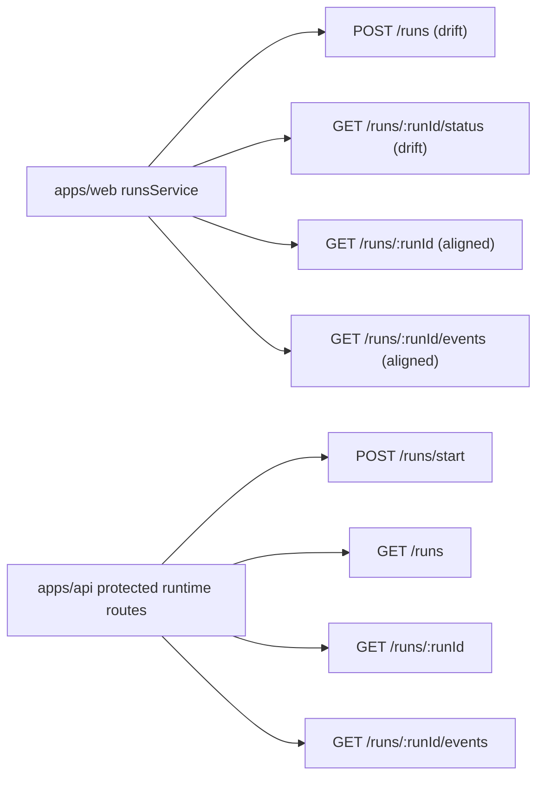

## Implemented Runtime Route Baseline

Frontend runtime contract now aligns to protected runtime route truth:

- start authority: `POST /runs/start`
- list authority: `GET /runs`
- run snapshot authority: `GET /runs/:runId`
- event timeline authority: `GET /runs/:runId/events`

`GET /runs/:runId/status` is removed from frontend runtime authority.
Status and lifecycle snapshot are read from `GET /runs/:runId`.

## Fowler Boundary Applied In F-07

Active route consumers now use explicit read models and a route-level facade:

- `listRunSummaries(): Promise<RunSummaryItem[]>`
- `getRunSnapshot(runId): Promise<RunSnapshot | null>`
- `listRunEvents(runId, afterSeq?): Promise<RunEventTimelinePage>`
- `startRun(input): Promise<RunStartReceipt>`
- `loadRunWorkspace(runId): Promise<RunWorkspaceViewModel | null>`

Retired from active route consumers:

- `listRuns(): Promise<Run[]>`
- `getRun(runId): Promise<Run | null>`
- `getRunStatus(runId): Promise<CanonicalRunStatus>`

No compatibility mapping is allowed from canonical-status payloads to a fake full
`Run` aggregate in the active Runs route.

### Implemented Route Contract Map

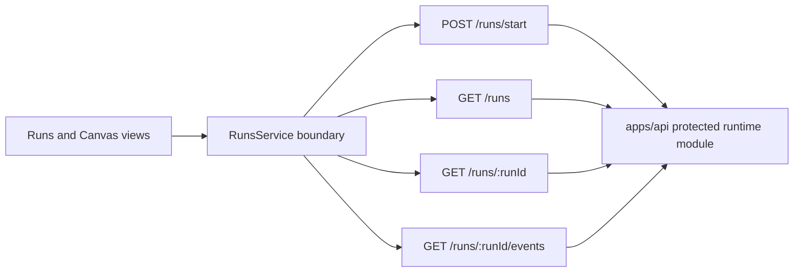

## Communication Matrix

| Frontend runtime intent | Runtime endpoint          | Authority   | Notes                                |
| ----------------------- | ------------------------- | ----------- | ------------------------------------ |
| start run               | `POST /runs/start`        | API / Entry | command route, auth and admission    |
| list runs               | `GET /runs`               | API / Entry | list/read route                      |
| fetch run snapshot      | `GET /runs/:runId`        | API / Entry | status truth and detail truth        |
| list run events         | `GET /runs/:runId/events` | API / Entry | ordered timeline feed for monitoring |

## Runs Versus Bottom Operational Drawer

`GET /runs/:runId/events` now has two governed frontend consumers, but they do
not own the same product responsibility:

- `RunWorkspaceFacade` composes snapshot plus timeline into the durable
  run-detail workbench;
- `useConsoleLogStream()` mirrors the active run as a shell-level operational log stream
  companion;
- only the Runs workspace combines timeline with snapshot authority;
- the shell drawer must not present itself as the authoritative run-detail
  surface.

Current consumer split:

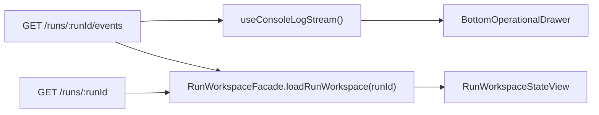

Authority rules:

1. `BottomOperationalDrawer` may show ordered live lines for the active run.
2. `BottomOperationalDrawer` must not derive snapshot truth, failure diagnostics,
   or result evidence on its own.
3. `RunWorkspaceStateView` owns snapshot truth and timeline degradation
   semantics for `/runs/:runId`.
4. Future convergence of logs, timeline, and terminal-grade streaming belongs
   to `F-10` and `F-18`, not to ad hoc shell copy drift.

## Runs Workbench State Ownership

`RunsView` is still the route compositor, but the route now has one governed
state contract that separates route-root state from workspace-inner state.

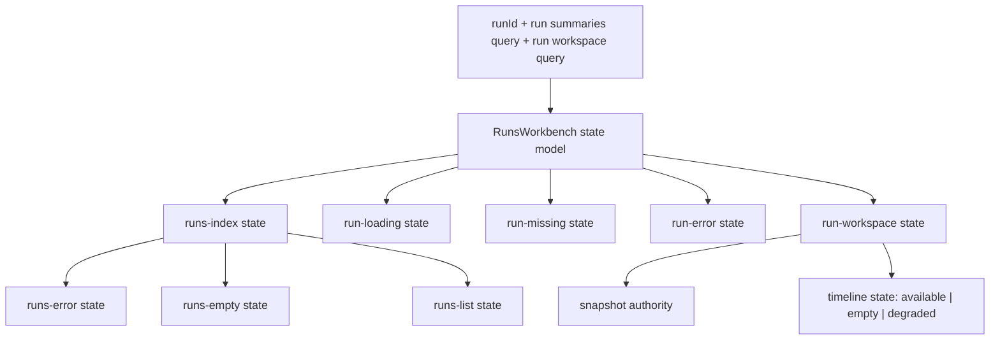

Rules:

1. Route-root state chooses between list, loading, missing, error, and focused
   workspace.
2. `/runs` must render a governed list-error state when `GET /runs` fails and
   no authoritative list data is available.
3. Degraded timeline treatment is not a route-root error state because the run
   snapshot is still authoritative and renderable.
4. The focused workspace may carry `snapshot-only` detail truth while still
   rendering a degraded or empty timeline notice honestly.
5. The route must never collapse `run-missing` and `run-degraded` into the same
   user treatment.

Primary anchors:

- [RunsView.tsx](../../../../../apps/web/src/app/views/RunsView.tsx)
- [runWorkbenchStateModel.ts](../../../../../apps/web/src/app/views/runs/runWorkbenchStateModel.ts)
- [WorkbenchStates.tsx](../../../../../apps/web/src/app/components/workbench/state/WorkbenchStates.tsx)
- [RunDetailStateViews.tsx](../../../../../apps/web/src/app/views/runs/RunDetailStateViews.tsx)
- [RunWorkspaceStateView.tsx](../../../../../apps/web/src/app/views/runs/RunWorkspaceStateView.tsx)

The runtime contract does not change because of this extraction. Shared
workbench state primitives now own the repeated route-state chrome, while
`Runs` continues to own route-specific copy and state selection.

## Shared Run Event Presentation Model

The operational drawer log and the Runs route now share one event-presentation seam
before they render their different surfaces:

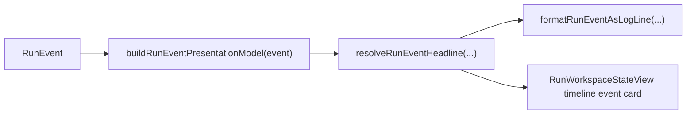

The shared model owns:

- event level (`INFO`, `WARN`, `ERROR`, `SUCCESS`);
- headline key;
- optional detail copied from runtime event payload message when present;
- step identity when the event belongs to one step.

F-10 adds a shared event timeline model before presentation:

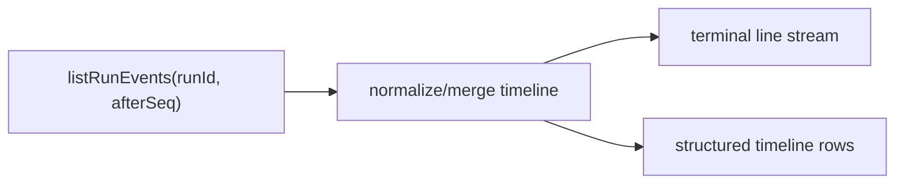

The timeline model owns ordering, duplicate collapse, cursor preservation, and
active-status polling decisions. It does not own snapshot truth.

The shared copy resolver owns:

- the governed human-readable headline text used by both drawer and timeline
  surfaces.

It does not change authority:

- `BottomOperationalDrawer` still renders a shell-level operational companion stream;
- `BottomOperationalDrawer` still owns terminal-style log-line composition for its Log tab;
- `RunWorkspaceStateView` still owns durable timeline interpretation;
- snapshot truth, failure diagnostics, and result evidence remain outside the
  shared event-presentation seam.

## PlanRef handoff prerequisite

The start-run contract is now preceded by backend-owned plan handoff routes:

- `POST /plans/preview` returns `{ plan, planRef }` when a valid preview is
  persisted.
- `POST /plans/import` returns `{ plan, planRef }` for a readable persisted
  plan inside the authorized scope.
- `apps/web/src/app/services/plans/plansService.api.ts` parses `planRef`
  directly from the payload and rejects envelopes that omit it.

This keeps the runtime boundary consistent:

1. preview or import returns a backend-authored `PlanRef`;
2. `useCanvasExecutionActions` fails closed if `currentPlan.planRef` is absent;
3. `runsService.startRun()` remains `PlanRef`-driven through `POST /runs/start`.

## Platform-Owned Start-Run Identity

The runtime contract now separates caller-owned start intent from
platform-owned execution identity.

Caller-owned input:

- `planRef`
- `workspaceScope`
- `selection`

Platform-owned output:

- `EngineRunRef.runId`

`StartRunInput` is the complete client-authored request contract for
`/runs/start`. The API route rejects any caller-authored canonical execution
identity with `client_run_id_not_allowed` and generates the internal
`StartRunCommand.runId` itself as `run_<UUIDv7>`.

Frontend consumers must treat `EngineRunRef.runId` as opaque. UUIDv7 provides
platform-side locality and collision resistance, but its timestamp bits are not
a frontend ordering, retry, or lifecycle contract.

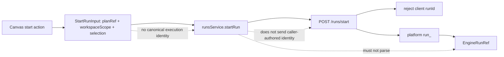

Detailed local guide:

- [Start-run client identity boundary](./start-run-client-identity-boundary.md)

## Current Consumer Gap

The route baseline is now correct. Current limitation is explicit and truthful:

- `GET /runs/:runId` returns a runtime snapshot, not a full event-enriched run
  aggregate;
- the frontend must not present snapshot-only payloads as if they already carry
  step, timeline, artifact, or node-history detail;
- that richer operational detail remains a follow-on convergence slice for
  `F-09` through `F-11`.

## Result Evidence Rendering Rule

Caller-visible materialization evidence is success-only in the active runtime
contract line.

Rules:

1. `RunWorkspaceStateView` may render materialization evidence only when
   `snapshot.status = completed`.
2. Completed snapshots may render top-level executor identity plus sink target,
   row count, and started or completed timestamps only from persisted snapshot
   fields.
3. Failed snapshots render top-level executor identity and failure diagnostics
   only from persisted snapshot fields, without materialization
   evidence, even if an older internal projector or payload still carries stale
   sink metadata.
4. Running, paused, and cancelled snapshots render snapshot truth without
   result-evidence claims.
5. Timeline events remain chronology-only support for `/runs/:runId`; they must
   not be used to infer executor, rows written, sink target, or failed-step
   outcome when the snapshot does not already carry that evidence.

## Provenance Linkage Rendering Rule

Caller-visible plan provenance now belongs to the snapshot authority, not to
timeline heuristics.

Rules:

1. `GET /runs/:runId` may carry `provenance.persistedPlan` with the persisted
   plan record id, plan version, plan source ref, and canonical plan hash.
2. When the persisted plan carries preview-time authoring provenance,
   `GET /runs/:runId` may also carry `provenance.authoring.graphArtifact` and
   `provenance.authoring.sqlArtifact`.
3. `RunWorkspaceStateView` renders that plan-and-authoring provenance only from
   snapshot fields.
4. `GET /runs/:runId/events` remains supplemental for execution-time artifact
   refs emitted by runtime steps and must not become the source of authoring
   truth.

## Plan Execution Scope Rendering Rule

Caller-visible source and sink scope belongs to `GET /runs/:runId` when the run
can be joined back to its persisted plan record.

Rules:

1. `GET /runs/:runId` may carry `planSummary` derived from the persisted
   canonical `ExecutionPlan`.
2. `planSummary.sourceTables` and `planSummary.sinkTables` are the only
   source/sink selection evidence rendered as plan scope in
   `RunWorkspaceStateView`.
3. `RunWorkspaceStateView` may use materialization evidence as result evidence,
   but it must not use timeline events or console lines to invent plan source or
   sink selection.
4. The run detail route must provide direct navigation back to Canvas and the
   runs list so a started run is not a dead end.

## Run Diagnostics Pointer Rendering Rule

Caller-visible run diagnostics belong to the `GET /runs/:runId` snapshot
authority, not to a separate dashboard route or timeline heuristic.

Rules:

1. `GET /runs/:runId` may carry `diagnostics` with `runId`, `planId`,
   `planSha`, `stepId`, `attemptId`, `adapter`, `durationMs`, `status`, optional
   `errorCode`, and trace or log pointers.
2. `RunWorkspaceStateView` renders the Diagnostics panel only from
   `RunSnapshot.diagnostics`.
3. `GET /runs/:runId/events` remains chronology support. It must not be used to
   invent diagnostic pointers, plan hashes, adapter identity, attempt identity,
   duration, or error codes when the snapshot omits them.
4. Trace and log pointers are provider-neutral query strings until a governed
   observability dashboard or OTel backend link contract exists.
5. High-cardinality diagnostic identifiers are permitted in traces and logs,
   but not as metric labels.

## Vertical Impact Map

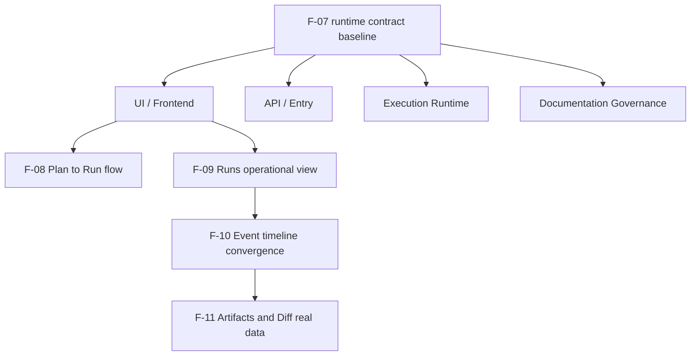

## Opportunity Register

1. Contract truth for UX state handling (loading, auth, not-found, conflict).
2. Clearer runtime error semantics at service level (`401/403/404/409/422/5xx`).
3. Lower rework risk for `F-08` through `F-11`.
4. Better service-level testability and deterministic route coverage.

## Consequences

- positive: route ownership and error posture become explicit
- positive: docs and code evolve against one runtime route baseline
- cost: strict migration work in service tests and route consumers
- cost: short-term refactor overhead while preserving explicit test-double coverage

## Handoff Chain

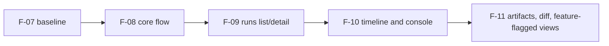

## Canonical References

- [Frontend Fowler Implementation Pattern](../frontend-data-boundary-architecture.md#section-frontend-fowler-implementation-pattern)
- [Runs Frontend Architecture](component-runs.md#section-dvt-runs-frontend-architecture)
- [Frontend Runtime Contract User Manual](frontend-runtime-contract-technical-manual.md#section-frontend-runtime-contract-user-manual)

<a id="section-frontend-runtime-contract-user-manual"></a>

## Frontend Runtime Contract User Manual

### Purpose

This manual explains what users and operators should expect from the Runs and
execution flow once frontend runtime contract alignment is applied.

### Runtime Authority Rules

- run start is executed through `POST /runs/start`
- run detail and status truth come from `GET /runs/:runId` (snapshot authority)
- event timeline comes from `GET /runs/:runId/events`
- retired `GET /runs/:runId/status` is not part of supported user behavior
- the run-detail route uses one composed workspace model, not a fake full
  aggregate

### User Journey (To-Be)

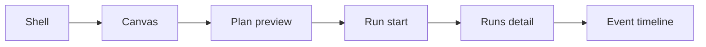

### Route-Level Behavior

#### Canvas -> Run Start

- when start succeeds, the UI transitions to the selected run detail state
- conflict responses (`409`) are shown as actionable operator feedback
- permission failures (`401/403`) are shown as authorization issues, not as
  generic runtime failures

#### Runs List (`/runs`)

- source of truth is runtime list endpoint
- empty state means no runs are available in current scope
- loading state means route is waiting for runtime list response

#### Run Detail (`/runs/:runId`)

- single snapshot authority is `GET /runs/:runId`
- the same snapshot may carry persisted plan identity and authoring provenance
  for the run
- completed snapshots show executor identity, sink table, rows written, and
  started or completed timestamps from persisted snapshot fields
- failed snapshots show executor identity, failed-step attribution, failure
  reason or message, and failed-at timestamp from persisted snapshot fields
- when only snapshot data is available, the UI shows a runtime snapshot state;
- when events are available, timeline appears in the same run workspace context;
- the route never invents step, artifact, or metrics detail from empty
  placeholders
- if not found (`404`), the UI must show run-not-found semantics
- server failures (`5xx`) are treated as runtime availability issues

#### Event Timeline

- source of truth is `GET /runs/:runId/events`
- timeline is treated as supplemental run evidence, not as run-status authority
- the dedicated timeline workbench remains a later convergence slice beyond the
  snapshot baseline

#### Shell Drawer Versus Runs Detail

- the shell drawer is a quick live companion for the currently active run
  stream;
- the Runs detail route is the durable monitoring workspace for one run;
- the shell drawer does not replace runtime snapshot, degraded timeline, or
  failure-diagnostics treatment from `/runs/:runId`;
- if an operator needs authoritative run explanation, they should use the Runs
  workspace rather than the shell drawer.

### Failure Semantics For Operators

| Status class | User meaning                            | UX posture                                |
| ------------ | --------------------------------------- | ----------------------------------------- |
| `401`        | session is not authenticated            | sign-in or session recovery path          |
| `403`        | authenticated but not authorized        | permission denial message                 |
| `404`        | run or route target not found           | not-found state, offer return to list     |
| `409`        | command conflict or invalid transition  | conflict guidance and retry constraints   |
| `422`        | invalid payload or request constraints  | validation feedback and correction action |
| `5xx`        | runtime service unavailable or degraded | service degradation message and retry     |

### Runtime And Test Boundaries

- Product runtime uses governed API contract routes.
- Local and automated tests inject explicit port doubles.
- Users interact with one run flow model and one route grammar; no runtime
  transport selector is exposed.

### What Users Gain

1. predictable run-start behavior
2. one consistent run detail authority
3. caller-visible linkage from authoring artifacts to persisted plan to outcome
4. explicit separation between run snapshot and event timeline
5. fewer ambiguous error messages during execution monitoring
6. no fake detail panels that imply data the backend has not provided

### Related Pages

- [Frontend Fowler Implementation Pattern](../frontend-data-boundary-architecture.md#section-frontend-fowler-implementation-pattern)
- [Runs Frontend Architecture](component-runs.md#section-dvt-runs-frontend-architecture)
- [Frontend Runtime Contract Technical Manual](frontend-runtime-contract-technical-manual.md)
- [Frontend Data-Boundary Architecture](../frontend-data-boundary-architecture.md)

> Section status: Review. Owner: Frontend / Product. Colocation does not merge component responsibilities.

---

title: Frontend-Facing Backend MVP Contract (MVP-E1)
status: Review
owner: Frontend / API / Architecture
last_reviewed: 2026-04-23
domain: frontend
task_id: MVP-E1
---

<a id="section-frontend-backend-mvp-contract"></a>

## Frontend-Facing Backend MVP Contract (MVP-E1)

### Purpose

Define the backend surface that `apps/web` is allowed to rely on today.
This contract is route-truth only. It does not introduce new backend behavior.

### Governing Sources

- `docs/planning/status/governance-document-rule-inventory.md`
- `docs/guides/ai-work-protocol.md`
- `docs/planning/state/github-mvp-issue-workflow.md`
- `docs/architecture/components/web/runs/frontend-runtime-contract-technical-manual.md`
- `docs/architecture/components/web/runs/start-run-client-identity-boundary.md`
- `docs/adr/adr-0050-platform-owned-start-run-identity.md`
- `apps/api/src/app.ts`
- `apps/api/src/entrypoints/http/runtimeRoutes.constants.ts`
- `apps/api/src/routes/health.ts`
- `apps/api/src/entrypoints/http/httpErrorContract.ts`
- `apps/web/src/app/services/runs/runsService.ts`
- `apps/web/src/capabilities/platform-health/domain/platformHealthTypes.ts`
- `apps/web/src/capabilities/platform-health/domain/platformHealthSelectors.ts`
- `apps/web/src/capabilities/platform-health/presentation/usePlatformHealthSnapshotQuery.ts`
- `apps/web/src/app/components/ShellHealthBanner.tsx`

### Contractual Route Inventory

#### Protected runtime routes (OIDC-gated)

| Method | Path                  | Frontend intent          | Auth posture                                                         | Request shape (frontend-consumed)                                                    | Success shape (frontend-consumed)                                                    | Error envelope                                                             |
| ------ | --------------------- | ------------------------ | -------------------------------------------------------------------- | ------------------------------------------------------------------------------------ | ------------------------------------------------------------------------------------ | -------------------------------------------------------------------------- |
| `POST` | `/plans/preview`      | preview and persist plan | authenticated + action `run:start`                                   | `PlanPreviewInput` via `plansService.previewPlan`                                    | `{ plan, planRef, planSummary?, persisted?, provenance? }` mapped to `ExecutionPlan` | `HttpErrorEnvelope` (`error.type`, `reason`, optional `target`, `details`) |
| `POST` | `/plans/import`       | import persisted plan    | authenticated + action `run:start`                                   | `{ planRef, context }` via `plansService.importPlan`                                 | `{ plan, planRef }` mapped to `ExecutionPlan`                                        | `HttpErrorEnvelope`                                                        |
| `POST` | `/runs/start`         | start run                | authenticated + action `run:start`                                   | `StartRunInput` via `runsService.startRun`                                           | `EngineRunRef` (`runId`)                                                             | `HttpErrorEnvelope`                                                        |
| `GET`  | `/runs`               | list run summaries       | authenticated + action `run:list`                                    | query: `tenantId` required; `projectId`, `environmentId`, `limit`, `cursor` optional | list payload mapped to `RunSummaryItem[]`                                            | `HttpErrorEnvelope`                                                        |
| `GET`  | `/runs/:runId`        | fetch run snapshot       | authenticated + action `run:view`                                    | query: `tenantId` required; `enriched` optional                                      | snapshot payload mapped to `RunSnapshot` \| `null`                                   | `HttpErrorEnvelope`                                                        |
| `GET`  | `/runs/:runId/events` | fetch run timeline page  | authenticated + action `run:logs:view`                               | query: `tenantId` required; `afterSeq`, `limit` optional                             | payload mapped to `RunEventTimelinePage` (`events`, `nextAfterSeq`)                  | `HttpErrorEnvelope`                                                        |
| `POST` | `/runs/:runId/signal` | send run signal          | authenticated + action by signal type (`run:signal` or `run:cancel`) | body: `tenantId`, `signalType`, optional `reason`                                    | command acceptance or runtime command outcome                                        | `HttpErrorEnvelope`                                                        |
| `POST` | `/runs/:runId/cancel` | cancel run               | authenticated + action `run:cancel`                                  | body: `tenantId`; non-empty `reason` is rejected on the native cancel route          | command acceptance or runtime command outcome                                        | `HttpErrorEnvelope`                                                        |

Preview-route rule:

- `/plans/preview` accepts only the shared `planner-generic-v1` profile
- DVT authoring is projected through the canonical Substrait boundary and does
  not publish a SQL-shaped preview profile
- frontend callers must fail closed when the active runtime has no registered
  executable strategy

#### Public operational routes (shell health contract)

| Method | Path        | Frontend intent                           | Auth posture        | Request shape | Success shape (frontend-consumed) | Degraded or unavailable semantics                                            |
| ------ | ----------- | ----------------------------------------- | ------------------- | ------------- | --------------------------------- | ---------------------------------------------------------------------------- |
| `GET`  | `/healthz`  | required liveness + component state probe | public              | none          | `PlatformHealthInfo`              | required endpoint; transport/protocol failure means `offline` in shell       |
| `GET`  | `/readyz`   | optional readiness probe                  | public when enabled | none          | `PlatformReadinessInfo`           | `403/404/405` treated as `not_enabled`; `ok:false` contributes `degraded`    |
| `GET`  | `/version`  | optional version metadata probe           | public when enabled | none          | `PlatformVersionInfo`             | `403/404/405` treated as `not_enabled`; probe failure contributes `degraded` |
| `GET`  | `/db/ready` | optional database readiness probe         | public when enabled | none          | `PlatformDatabaseReadiness`       | `403/404/405` treated as `not_enabled`; `ok:false` contributes `degraded`    |

### Authentication and Authorization Matrix

| Route                      | Access class                      | Required token | Required authorization action                              |
| -------------------------- | --------------------------------- | -------------- | ---------------------------------------------------------- |
| `POST /plans/preview`      | role-scoped protected runtime     | yes            | `run:start`                                                |
| `POST /plans/import`       | role-scoped protected runtime     | yes            | `run:start`                                                |
| `POST /runs/start`         | role-scoped protected runtime     | yes            | `run:start`                                                |
| `GET /runs`                | role-scoped protected runtime     | yes            | `run:list`                                                 |
| `GET /runs/:runId`         | role-scoped protected runtime     | yes            | `run:view`                                                 |
| `GET /runs/:runId/events`  | role-scoped protected runtime     | yes            | `run:logs:view`                                            |
| `POST /runs/:runId/signal` | role-scoped protected runtime     | yes            | `run:signal` (`PAUSE`/`RESUME`) or `run:cancel` (`CANCEL`) |
| `POST /runs/:runId/cancel` | role-scoped protected runtime     | yes            | `run:cancel`                                               |
| `GET /healthz`             | public                            | no             | none                                                       |
| `GET /readyz`              | public endpoint, deployment-gated | no             | none                                                       |
| `GET /version`             | public endpoint, deployment-gated | no             | none                                                       |
| `GET /db/ready`            | public endpoint, deployment-gated | no             | none                                                       |

Forbidden or failure expectations for protected routes:

- missing or invalid token -> `401`
- authenticated but missing scope -> `403`
- invalid route/body/query parsing -> `400` or `422`
- command conflict or invalid transition -> `409`
- backend/runtime unavailability -> `503` or `5xx`

### PlanRef handoff contract

In `api` mode, `ExecutionPlan.planRef` is backend-owned.

- `POST /plans/preview` must return `{ plan, planRef }` when preview and
  persistence succeed.
- `POST /plans/import` must return `{ plan, planRef }` when the referenced plan
  is readable inside the authorized scope.
- `apps/web` maps `planRef` directly from those payloads and must fail closed
  if the envelope omits it.
- `POST /runs/start` remains the only start authority and consumes that same
  immutable `PlanRef`.
- frontend callers send scope and selection, but the API owns canonical
  execution `run_<UUIDv7>` generation and rejects client-supplied `runId`.
- frontend callers must treat returned `EngineRunRef.runId` as opaque. The
  UUIDv7 timestamp bits are not a frontend ordering, retry, or lifecycle
  contract.

Use the local component guide for API/Web ownership, invariants, transitions,
and semantic fitness tests:

- [Start-run client identity boundary](start-run-client-identity-boundary.md)

#### Start-run identity transition

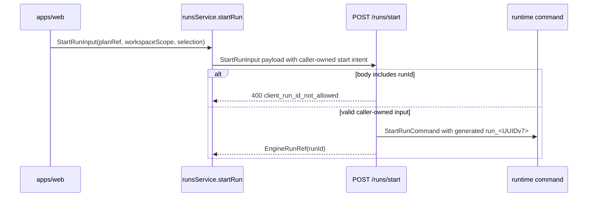

### Run provenance linkage contract

`GET /runs/:runId` may expose one caller-visible provenance object in addition
to snapshot outcome fields:

- `provenance.persistedPlan.planRecordId`
- `provenance.persistedPlan.planVersion`
- `provenance.persistedPlan.sourceRef`
- `provenance.persistedPlan.canonicalPlanSha256`
- `provenance.authoring.graphArtifact`
- `provenance.authoring.sqlArtifact`

Rules:

- persisted-plan provenance comes from the stored immutable plan record
- authoring provenance is optional and only present when preview-time SQL-first
  capture wrote it into the persisted canonical plan
- timeline artifact refs from `GET /runs/:runId/events` remain execution-time
  evidence, not authoring truth

### Run diagnostics contract

`GET /runs/:runId` may expose a `diagnostics` object for the caller-visible run
detail page:

- `diagnostics.runId`
- `diagnostics.planId`
- `diagnostics.planSha`
- `diagnostics.stepId`
- `diagnostics.attemptId`
- `diagnostics.adapter`
- `diagnostics.durationMs`
- `diagnostics.status`
- `diagnostics.errorCode`
- `diagnostics.pointers[]` with `kind = trace | log`, `label`, and `value`

Rules:

- diagnostics come from the runtime read model, persisted plan metadata, and
  latest logical attempt evidence
- trace and log pointers are provider-neutral query strings, not proof that a
  dashboard route exists
- `planSha`, `runId`, `stepId`, `attemptId`, and similar high-cardinality
  identifiers must remain trace/log context and must not become metric labels

### Canonical Envelope Examples

Success example (`POST /runs/start`):

```json
{
  "runId": "run_0196454a-f0c8-7d37-a8e8-8a7f9afac0f1"
}
```

Error example (`HttpErrorEnvelope`):

```json
{
  "error": {
    "type": "forbidden",
    "reason": "missing_required_scope",
    "target": "tenantId",
    "details": {
      "action": "run:view"
    }
  }
}
```

### Explicit Non-Promises

The frontend must not promise any of the following as current behavior:

- `POST /runs` as start-run authority (replaced by `POST /runs/start`)
- `GET /runs/:runId/status` as a supported route
- mandatory availability of `/readyz`, `/version`, or `/db/ready`
- a full step/artifact-rich run aggregate from `GET /runs/:runId`
- admin routes as part of frontend runtime authority (`/admin/runs/:runId/rebuild-snapshot`)
- frontend-owned retries that bypass platform-health capability policy

### Health State Semantics Consumed By F-03

Shell health state is derived from platform-health capability selectors:

- `ok`: `/healthz` healthy and no degrading readiness/db/probe failures.
- `degraded`: `/healthz` degraded, or `/readyz`/`/db/ready` report not-ready,
  or optional probe failures are present.
- `offline`: no snapshot or query-level failure against required `/healthz`.

#### Canonical state machine (F-03-A)

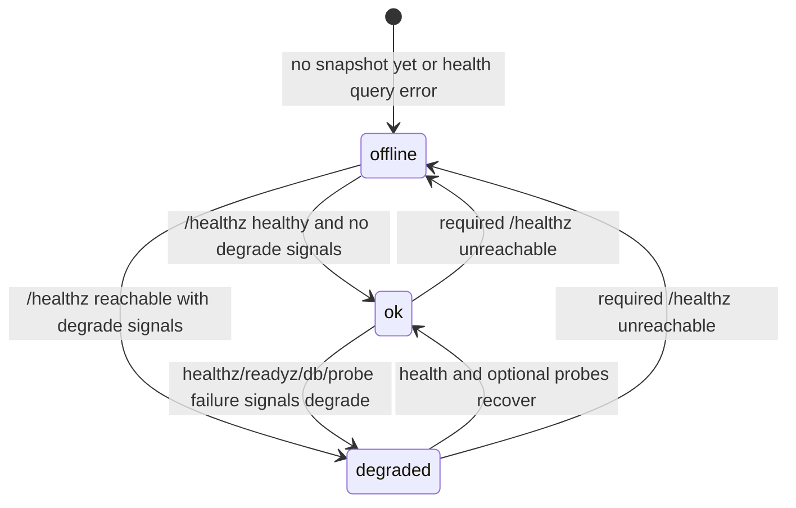

Deterministic transition rules:

| Current    | Condition                                      | Next       |
| ---------- | ---------------------------------------------- | ---------- |
| `offline`  | query error is true OR snapshot missing        | `offline`  |
| `offline`  | snapshot exists and any degrade signal is true | `degraded` |
| `offline`  | snapshot exists and no degrade signal is true  | `ok`       |
| `ok`       | required `/healthz` request fails              | `offline`  |
| `ok`       | any degrade signal becomes true                | `degraded` |
| `degraded` | required `/healthz` request fails              | `offline`  |
| `degraded` | all degrade signals clear                      | `ok`       |

Degrade signals are exactly:

- `/healthz` reports `status: degraded`
- `/readyz` is available and reports `ok: false`
- `/db/ready` is available and reports `ok: false`
- optional probe error present on `/readyz`, `/version`, or `/db/ready`

Banner behavior contract in shell:

- show persistent banner for `degraded` and `offline`
- show retry action (`Retry now`) wired to query `refetch`
- show auto-refresh countdown tied to query interval

#### Single presenter seam contract (F-03-C)

Top bar and banner must consume the same derived shell-health model from one
composition seam:

- `RootShell` is the composition owner for shell-health presentation.
- `buildShellHealthPresentationModel(...)` is the only presenter-level mapper
  used to project query state into shell UX state.
- `TopAppBar` receives `connectionStateOverride`, `connectionDetail`, and
  `isConnectionChecking` from that presenter model.
- `ShellHealthBanner` receives `connectionState`, `detailMessage`, polling
  cadence, and retry action from that same presenter model.
- `TopAppBar` and `ShellHealthBanner` must not call platform-health query hooks
  or selectors directly.

Implementation anchors:

- `apps/web/src/app/Root.tsx`
- `apps/web/src/capabilities/platform-health/presentation/platformHealthStatus.ts`
- `apps/web/src/app/components/TopAppBar.tsx`
- `apps/web/src/app/components/ShellHealthBanner.tsx`

Retry/backoff contract:

- base polling:
  - `ok`: `15_000ms`
  - `degraded`: exponential from `15_000ms`
  - `offline`: exponential from `5_000ms`
- retry envelope:
  - query retries per failed fetch cycle: `1`
  - max backoff cap: `60_000ms`
  - formula: `min(base * 2^(attempt-1), 60_000)`
- deterministic reset rules:
  - manual retry (`Retry now`) always triggers immediate `refetch`
  - successful settled fetch returns polling to `15_000ms`
  - pending first check keeps shell in checking posture (no false offline)
- cancellation rules:
  - banner countdown timer runs only in `degraded` or `offline`
  - timer is cleared when connection returns to `ok` or shell is unmounted
  - no additional route-local retry loop is allowed outside the health capability/query seam

### Out Of Scope For MVP-E1

- adding new backend routes
- changing OIDC model, token model, or authorization policy model
- redefining backend status semantics beyond current route contracts
- claiming route-level frontend capabilities that do not exist in `apps/api`

### Traceability

- delivery tracking: governing GitHub MVP issue and linked pull request
- runtime route source: `apps/api/src/entrypoints/http/runtimeRoutes.constants.ts`
- shell health wiring source: `apps/web/src/app/Root.tsx`,
  `apps/web/src/app/components/ShellHealthBanner.tsx`

> Section status: Unspecified. Owner: See named component boundary. Colocation does not merge component responsibilities.
