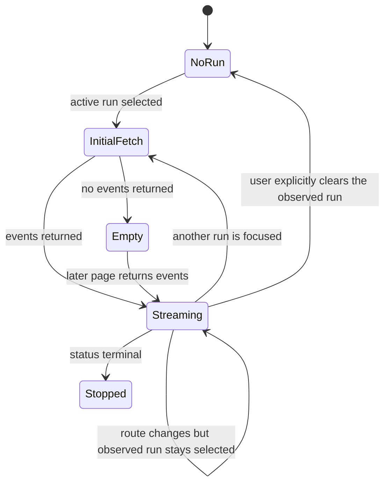
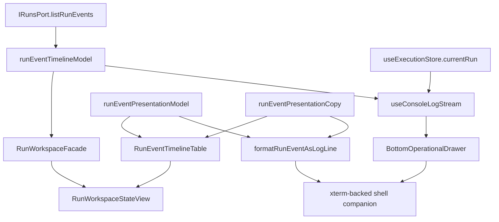

# Run Event Timeline Component

This local component owns frontend semantics for run event chronology across
the durable Runs workspace and the shell console companion.

It does not own runtime snapshot truth, result evidence, failure diagnostics,
or artifact authority. Those remain snapshot and workspace concerns.

## Public API

| API                               | Kind               | Owner                        | Contract                                                               |
| --------------------------------- | ------------------ | ---------------------------- | ---------------------------------------------------------------------- |
| `RUN_EVENT_LIVE_POLL_INTERVAL_MS` | constant           | Run event timeline model     | Shared polling interval for active event streams                       |
| `isRunEventStreamLiveStatus`      | query helper       | Run event timeline model     | Returns `true` for `pending` and `running` run statuses only           |
| `normalizeRunEventTimelinePage`   | query helper       | Run event timeline model     | Orders and deduplicates one event page while preserving `nextAfterSeq` |
| `mergeRunEventTimelinePage`       | query helper       | Run event timeline model     | Merges a new page into existing timeline state by event identity       |
| `buildRunEventPresentationModel`  | presentation model | Run event presentation model | Maps a raw event into level, headline key, detail, and step identity   |
| `resolveRunEventHeadline`         | copy resolver      | Run event presentation copy  | Resolves human-readable event headline copy                            |
| `formatRunEventAsLogLine`         | terminal renderer  | Shell log event rendering    | Formats shared event semantics as one terminal-style line              |
| `XtermConsole`                    | terminal view      | Shell log event rendering    | Renders formatted event lines as the xterm-backed shell companion      |
| `RunEventTimelineTable`           | structured view    | Runs workspace timeline      | Renders shared event semantics as durable dense timeline rows          |

## Invariants

1. `IRunsPort.listRunEvents` is the only frontend event chronology query rail.
2. Event stream order is by `runSeq`, then `emittedAt`, then `eventId`.
3. Duplicate `eventId` values collapse to one visible event.
4. `nextAfterSeq` is preserved when supplied by the adapter.
5. Active event streams poll only while the run status is `pending` or
   `running`.
6. The shell operational drawer keeps the last focused run as an observation cursor across
   Canvas and Runs list route navigation.
7. Operational log lines and Runs timeline rows share event severity and headline
   semantics.
8. Timeline events must not infer snapshot status, materialization evidence,
   failed step diagnostics, or authoring provenance.
9. A detail route for a different `runId` clears the previous observed run
   while its workspace is loading, missing, or errored, so the shell operational drawer does
   not poll stale run evidence for the active route.

## Transitions

## Consumer Diagram

## Consumers

| Consumer                  | File                                                                                                                          | Responsibility                                           |
| ------------------------- | ----------------------------------------------------------------------------------------------------------------------------- | -------------------------------------------------------- |
| `RunWorkspaceFacade`      | [runWorkspaceFacade.ts](../../../../../apps/web/src/app/services/runs/runWorkspaceFacade.ts)                                  | Builds durable snapshot-plus-timeline workspace state    |
| `useConsoleLogStream`     | [useConsoleLogStream.ts](../../../../../apps/web/src/app/components/console/useConsoleLogStream.ts)                           | Mirrors the shell-observed run into the operational log  |
| `XtermConsole`            | [XtermConsole.tsx](../../../../../apps/web/src/app/components/console/XtermConsole.tsx)                                       | Renders terminal-grade live companion lines              |
| `RunEventTimelineTable`   | [RunEventTimelineTable.tsx](../../../../../apps/web/src/app/views/runs/RunEventTimelineTable.tsx)                             | Renders dense event rows from shared event semantics     |
| `BottomOperationalDrawer` | [BottomOperationalDrawer.tsx](../../../../../apps/web/src/app/components/shell/BottomOperationalDrawer.tsx)                   | Renders operational drawer log state                     |
| `RunWorkspaceStateView`   | [RunWorkspaceStateView.tsx](../../../../../apps/web/src/app/views/runs/RunWorkspaceStateView.tsx)                             | Renders durable run workspace using dense event rows     |
| Architecture guard        | [runsDomainBoundary.architecture.test.ts](../../../../../apps/web/src/app/views/runs/runsDomainBoundary.architecture.test.ts) | Validates semantic convergence, docs, and owned concerns |

## Mature-System Comparison

Mature log and workflow systems separate transport, stream state, and rendering:

- Temporal UI keeps workflow history ordering separate from detail panels.
- Grafana Explore separates log query, cursor, labels, and row rendering.
- Datadog Logs separates ingestion identity from display rows and facets.
- VS Code keeps terminal lines separate from problem diagnostics.

This component follows the same split: one stream model owns chronology; the
shell store owns the observation cursor; each surface renders the chronology in
its own visual language.

## Run Event Timeline User Stories

### Governing Sources

- [Run Event Timeline Component](run-event-timeline-component.md)
- [Runs Component Local Guide](component-runs.md)
- [Frontend Runtime Contract Technical Manual](frontend-runtime-contract-technical-manual.md)
- [App Shell](../appshell/app-shell.md)
- [Command Query Rail Governance](../../../command-query-rail-governance.md)

### Stories

#### US-F10-01: Ordered Timeline

**As** an operator,
**I want** run events displayed in runtime sequence order,
**So that** progress is readable even when transport pages arrive out of order.

Acceptance:

- Given events with `runSeq` values out of order
- When the frontend normalizes the event page
- Then events render by ascending `runSeq`

#### US-F10-02: Duplicate Event Collapse

**As** an operator,
**I want** repeated event pages to avoid duplicate visible rows,
**So that** reconnect or overlapping polling does not make the run look noisy.

Acceptance:

- Given an existing event with `eventId = evt_1`
- And a later page includes `evt_1` again
- When the page is merged
- Then the visible timeline still contains one `evt_1`

#### US-F10-03: Cursor Preservation

**As** the shell console,
**I want** to preserve `nextAfterSeq`,
**So that** the next poll resumes after the backend-provided cursor.

Acceptance:

- Given a page returns `nextAfterSeq = 12`
- When the stream model merges the page
- Then the next stream state stores `nextAfterSeq = 12`

#### US-F10-04: Active Status Polling

**As** an operator,
**I want** the console to poll only active runs,
**So that** terminal runs do not keep background polling alive.

Acceptance:

- Given status is `pending` or `running`
- Then event stream polling is enabled
- Given status is `completed`, `failed`, or `cancelled`
- Then event stream polling is disabled

#### US-F10-05: Shared Event Semantics

**As** a maintainer,
**I want** console lines and timeline rows to share severity and headline
semantics,
**So that** the two surfaces do not drift in meaning.

Acceptance:

- Given a `StepFailed` event
- When the console formats it
- And when the Runs timeline table renders it
- Then both surfaces use `ERROR` severity and the same headline copy

#### US-F10-06: Structured Timeline Rows

**As** an operator,
**I want** the Runs route to render event rows with timestamp, severity,
headline, detail, and step ID,
**So that** durable timeline review is more scannable than terminal text.

Acceptance:

- Given an event has `emittedAt`, `eventType`, `payload.message`, and `stepId`
- When the Runs workspace renders the timeline
- Then the timeline row shows timestamp, severity, headline, detail, and step ID

#### US-F10-07: Terminal Companion Lines

**As** an operator,
**I want** the bottom console to show the same event stream as terminal lines,
**So that** I can watch progress while staying in another workbench view.

Acceptance:

- Given active run events exist
- When the bottom console is open
- Then it shows formatted lines derived from the shared event semantics

#### US-F10-08: Snapshot Authority Is Preserved

**As** a maintainer,
**I want** timeline events to stay chronology-only,
**So that** events do not fabricate materialization, failure diagnostics, or
snapshot status.

Acceptance:

- Given a timeline event payload includes result-like fields
- And the snapshot omits result evidence
- When the Runs workspace renders
- Then result evidence remains absent

#### US-F10-09: Timeline Degraded State

**As** an operator,
**I want** event fetch failure to degrade only the timeline,
**So that** the run snapshot still remains visible.

Acceptance:

- Given snapshot fetch succeeds
- And event fetch fails
- When the workspace loads
- Then snapshot content renders and the timeline shows degraded copy

#### US-F10-10: Architecture Guard

**As** a maintainer,
**I want** an architecture test to enforce shared timeline semantics,
**So that** future edits cannot split console and Runs chronology behavior.

Acceptance:

- Given console and Runs event consumers exist
- When architecture tests run
- Then they prove both consumers use the shared run event timeline model

#### US-F10-11: Console Observation Survives Route Navigation

**As** an operator,
**I want** the bottom console to keep the last focused run while I move between
Canvas and Runs,
**So that** runtime logs do not disappear just because I changed workbench view.

Acceptance:

- Given a run detail route has focused `run_123`
- And the bottom console is open
- When I navigate back to the Canvas route or the Runs list
- Then the shell console still observes `run_123`
- And event polling remains governed by that run status
- Given a run detail route has focused `run_123`
- When I navigate to `/runs/run_456`
- And `run_456` is still loading, errors, or is missing
- Then the shell console clears `run_123`
- And it does not poll stale events while the detail route points at `run_456`

### Coverage Matrix

| Story  | Primary surface           | Test surface                                      |
| ------ | ------------------------- | ------------------------------------------------- |
| F10-01 | `runEventTimelineModel`   | `runEventTimelineModel.test.ts`                   |
| F10-02 | `runEventTimelineModel`   | `runEventTimelineModel.test.ts`                   |
| F10-03 | `runEventTimelineModel`   | `runEventTimelineModel.test.ts`                   |
| F10-04 | `runEventTimelineModel`   | `runEventTimelineModel.test.ts`                   |
| F10-05 | shared presentation model | `formatLogLine.test.ts`, `RunStates.test.tsx`     |
| F10-06 | `RunEventTimelineTable`   | `RunsView.test.tsx`, `runEventTableModel.test.ts` |
| F10-07 | `useConsoleLogStream`     | `formatLogLine.test.ts`, existing console tests   |
| F10-08 | `RunWorkspaceStateView`   | `RunStates.test.tsx`                              |
| F10-09 | `RunWorkspaceFacade`      | `runWorkspaceFacade.test.ts`                      |
| F10-10 | architecture guard        | `runsDomainBoundary.architecture.test.ts`         |
| F10-11 | `RunsWorkbenchSurface`    | `RunsView.test.tsx`                               |

> Acceptance scope status: Active. Owner: Web / Runs.
