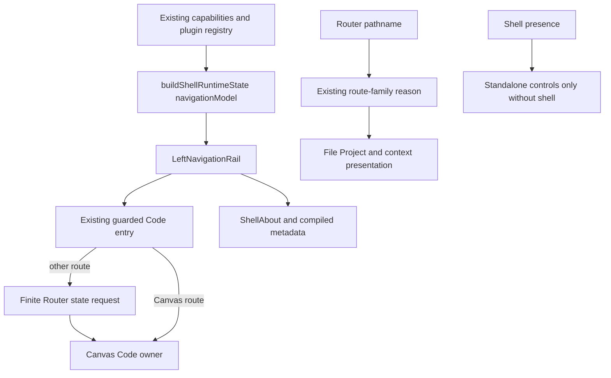

# Shell Navigation Disposition Component

## Owned Concern

The existing shell query classifies route families for context and command-menu
presentation. Global navigation occupies the same direct left rail on workbench
and global routes. The explicit direction in
[#3765](https://github.com/dunay2/dvt/issues/3765#issuecomment-6724940225)
supersedes the earlier hidden-rail/Raven-menu placement. It does not change
plugin registration, route authorization, bootstrap readiness or Canvas tabs.

## Public API

| API                                           | Kind               | Responsibility                                                       |
| --------------------------------------------- | ------------------ | -------------------------------------------------------------------- |
| `resolveShellNavigationDisposition(pathname)` | query model        | Classifies the existing route family.                                |
| `ShellNavigationDisposition.reason`           | read model         | Distinguishes `global_route` and `workbench_route`.                  |
| `LeftNavigationRail`                          | presentation       | Renders existing destinations and the capability-derived Git entry.  |
| `ShellActivityRail`                           | presentation scope | Identifies shell presence without DOM targets or route commands.     |
| `ShellAbout`                                  | presentation       | Owns the direct About trigger and existing compiled metadata dialog. |

`railMode`, `footerMode` and the frame's disposition input are retired. They
would encode constant placement or an obsolete hidden-menu alternative. The
route-family reason remains useful for File/Project and identity presentation.

## Invariants

- The rail presents one Canvas entry, then contextual Git and remaining global
  destinations, with About below. There is no duplicate Elements rail button.
- Root supplies one existing `buildShellRuntimeState` navigation projection.
  There is no route list in Explorer and no parallel permission predicate.
- Runtime capability filtering and Router/session guards remain authoritative.
  Existing Plugins/Admin contributions are not newly granted or filtered by
  interpreting presentation `level` metadata as permissions.
- Global destinations are links with `aria-current`, or an opted-in route section
  menu whose button owns menu disclosure and whose items are real Router links.
  Admin opts into the section menu by the user's explicit choice. Following the user's
  [explicit clarification](https://github.com/dunay2/dvt/issues/3765#issuecomment-6725338570),
  an unmodified primary Canvas click on the current route opens Elements with
  the existing `expand` event, never a toggle. Modified/new-tab activation keeps
  Router semantics. Other routes navigate normally without a speculative layout write.
- Code returns through the existing `codeTab.onCanvas` contribution; Model stays
  selected. No Canvas controller, new registry or mirrored state moves into shell.
  Canvas exposes current disclosure; Git retains its own guarded action and controls.
- The panel header owns collapse and returns focus to Canvas. A closed dock can
  be reopened there at its retained width. Repeated clicks remain idempotent.
- The Raven mark is identity, with no dropdown or hidden navigation fallback.
- Explicit Focus mode retains its existing chrome suppression and View escape.
- Boolean shell presence suppresses Explorer's duplicate navigation. Without
  that provider, the existing standalone inline controls remain available.
- Git belongs to the shell and remains the same control across routes and
  Canvas/Code/Model. It exists only when the navigation model includes Canvas.
  The former DOM target, portal and active-surface scope are removed.
- On Canvas, Git invokes the existing published Code callback without Router
  replacement. Elsewhere its `/canvas` link carries only the finite
  `canvasWorkbench: 'code'` state request. The Canvas-owned adapter consumes it
  at the same URL, preserves unrelated state, waits for observed Router commit
  and invokes the actual Code owner. Blocked consumption never dispatches.
  Modified/new-tab navigation uses ordinary Canvas href semantics. There is no
  last-binding cache or global pending-intent store.
- Moving controls does not remount the graph/editor or change layout preference,
  selection, pending edits, node positions or semantic persistence.
- About reads the existing browser bundle metadata; dismissal restores focus to
  its direct trigger, never to the logo.
- A navigation item can supply an optional route heading. Root derives the active
  heading from its existing model and pathname, then ShellTopBar presents it in
  the existing identity area. Admin removes its duplicate local header; other
  route headers are unaffected. No mutable title publication is introduced.
- Admin owns section IDs and URL construction in `adminRoutePosition`; both the
  passive route and generic menu consume this contract. The generic renderer
  has no Admin ID list, tab query key or selected-section state of its own.

## Transitions

```mermaid
stateDiagram-v2
  [*] --> Canvas
  Canvas --> Code: existing guarded Code activation
  Code --> Canvas: single Canvas activation and existing Code owner
  Canvas --> Model: existing guarded Model activation
  Model --> Canvas: existing guarded workspace navigation
  Canvas --> OtherRoute: existing Router guard accepts navigation
  Code --> OtherRoute: existing Router guard accepts navigation
  Model --> OtherRoute: existing Router guard accepts navigation

  Canvas: single Canvas entry opens Elements; Git in shared host
  Code: same Canvas entry returns and opens Elements; Git remains
  Model: same Canvas entry opens Model Elements without changing selection
  OtherRoute: no stale Canvas or Model controls
```

All states retain the capability-derived global links. A rejected navigation
keeps the current state and pending editor. Focus mode hides shell chrome through
the existing preference; leaving it restores the same shell navigation.

## Consumers

`AppShellFrame` owns the shared layout; `LeftNavigation` owns direct navigation
presentation; `CanvasShellWorkspaceSurfaces` retains panel visibility and inertness;
Explorer retains panel disclosure and project-file handlers. Canvas activation
reuses `ConfigureCanvasViewportPreferences` and `SelectCanvasWorkbenchTab` through
the existing layout store and workspace contribution contract. No generic contribution
registry, new state store, imperative navigation service or duplicate catalogue
is introduced.

## Visual Contract

Use the registered Lucide route icons, Workflow, GitBranch and Info with 20px
icons and the family default stroke of 2. Targets are 44px square. The rail is
52px wide with 4px inline padding and an inset divider that consumes no content
width. Derive the consumed `--control-size-navigation` and
`--icon-size-navigation` roles from existing `--spacing`; reuse A's typography,
focus and elevation. Do not create another spacing scale or status palette.

Selection uses primary/selected roles and focus uses the canonical focus ring,
width and offset. The 2px outline plus 2px offset fits the 4px padding. Tooltip
names work on hover and keyboard focus. About remains reachable at 400px height
while constrained navigation scrolls. Preserve forced-colors focus and reduced
motion. Prove computed dimensions, alignment, long ES/EN labels and 200% zoom in
the existing browser tests; source style checks alone do not prove geometry.

## Fowler Analysis

The previous route posture required a second navigation renderer in a logo
dropdown and divided the activity rail between Shell, Canvas and Model. The
direct-rail request removes that alternative rather than adding a third route
owner. One render-ready model supplies links. Shell-owned Git removes the
route-lifetime dependency instead of retaining an unmounted route callback.
The remaining context expresses shell presence only; it has no mutable DOM
target or active-surface policy. A finite Router command request reaches the
existing Code owner without becoming a second active-tab authority.

## Command And Query Rails

| Rail                                 | Type  | Owning context      | Existing responsibility                  |
| ------------------------------------ | ----- | ------------------- | ---------------------------------------- |
| `ResolveShellNavigationDisposition`  | query | Frontend shell      | Route-family context/command posture.    |
| `ListShellNavigationItems`           | query | Frontend shell      | Available navigation destinations.       |
| `GetCompiledApplicationMetadata`     | query | Web App Shell       | About's browser bundle metadata.         |
| `RenderCanvasContextualGraphSurface` | query | Canvas presentation | Retained contextual surface composition. |

Negative coverage rejects hidden global destinations on normal workbench
routes, an interactive logo, duplicate contextual controls, inactive portals in
focus order, bypassed pending-edit guards, invented permissions, and layout or
semantic writes from navigation presentation. Existing unit, presentation and
architecture consumers plus the three admitted Cypress specs cover this slice.

Retired symbol evidence is reconciled with exact native selectors and historical
source links; product query identities and unrelated contracts remain intact.
