# DVT Style Guide v0.2

## Purpose and authority

This guide connects DVT's visual identity to implementation and verification:

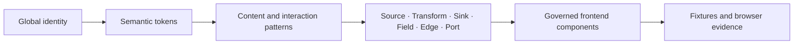

It governs presentation and composition. Domain contracts, permissions, commands,
queries, persistence and execution remain owned by their existing bounded contexts.
Figma represents this guide; it does not create another product authority.

Version 0.2 is the review baseline for [#3016](https://github.com/dunay2/dvt/issues/3016)
and [#3033](https://github.com/dunay2/dvt/issues/3033). Version 0.1 is historical review
material and is not a second active guide.

## Governing sources

- [Iconography And Design Tokens Contract](style-guide.md#section-iconography-and-design-tokens-contract)
- [UX Implementation Guide](style-guide.md#section-ux-implementation-guide)
- [Frontend Component Inventory](./frontend-component-inventory.md)
- [Workbench UX Canon Component](./workbench-ux-canon-component.md)
- [Canvas Node Identity And Naming Policy](./canvas/node-identity-and-naming-policy.md)
- `apps/web/src/styles/theme.css` for semantic color tokens
- `apps/web/src/styles/fonts.css` for IBM Plex Sans and IBM Plex Mono
- Planning DB queries `frontend-components`, `frontend-component-files` and
  `frontend-component-rails`

## Global identity

| Rule | Requirement                                                                                                             |
| ---- | ----------------------------------------------------------------------------------------------------------------------- |
| G01  | One authority per meaning. Presentation consumes existing facts and rails.                                              |
| G02  | Every active product component has a record here or an explicit family variant. Private helpers belong to their parent. |
| G03  | Variants follow task, capability, authority or host. Visual convenience is not a variant.                               |
| G04  | Reuse existing hosts and primitives. Extract only proven shared responsibility.                                         |
| G05  | A replacement migrates consumers and removes the obsolete active path in the same cut. No aliases or double state.      |
| G06  | Type, provider, authoring, validity, persistence, execution, selection and focus remain separate signals.               |
| G07  | State is never conveyed only by color. Text, icon or accessible semantics must preserve the meaning.                    |
| G08  | Long content changes representation, never type size or stored value.                                                   |

The global base is dark ink and steel surfaces with cobalt emphasis, Lucide for
functional icons, IBM Plex Sans for interface text and IBM Plex Mono for code and
technical identifiers. Provider marks are allowed only for an identified provider.

## Canvas personalisation

| Rule | Requirement                                                                                               |
| ---- | --------------------------------------------------------------------------------------------------------- |
| C01  | The product base and Canvas background are separate. Canvas and grid colors remain configurable.          |
| C02  | Forms preserve their semantic surface, text, focus and error tokens over the effective Canvas background. |
| C03  | Nodes, selection, edges and ports exposed to the Canvas must be verified against the selected color.      |
| C04  | Canvas color does not recolor the application, change state meaning or mutate data.                       |

`apps/web/src/app/views/canvas/canvasPalette.ts` owns Canvas color normalization and
derived controls. A mint Canvas is not itself an identity defect.

## Content rules

| Rule | Requirement                                                                                           |
| ---- | ----------------------------------------------------------------------------------------------------- |
| T01  | CSS never truncates persisted, imported, searched or copied data.                                     |
| T02  | There is no universal `maxlength`. Each data owner defines its unit, excess behavior and error.       |
| T03  | A new field identifies its schema, unit, visual budget and full-value access.                         |
| T04  | Prose and eligible identifiers wrap long tokens with `overflow-wrap:anywhere`; no global `break-all`. |
| T05  | Ellipsis has keyboard-accessible full-value recovery. `title` alone is insufficient.                  |
| T06  | Copy uses the complete authorized value and never exposes secrets.                                    |
| T07  | Emoji, combining marks, IME, CJK and bidirectional text preserve user intent.                         |
| T08  | Collections use a bounded summary plus access to every item while retaining order and selection.      |

| Content              | Initial presentation                  | Full access                       |
| -------------------- | ------------------------------------- | --------------------------------- |
| Node or column name  | One line; visual ellipsis when needed | Detail and copy use the original  |
| ID, path or relation | Contextual summary                    | Wrapped exact identity            |
| Description          | Up to three summary lines             | Expand in the host scroll region  |
| Comment              | Up to four summary lines              | Expand or edit the complete value |
| Tags                 | Bounded chips and `+N`                | Reachable complete collection     |
| Validation error     | Useful reason beside the field        | Sanitized detail when required    |
| Code or document     | Dedicated viewer/editor scroll        | Complete source                   |

Data limits and Unicode enforcement belong to #3019. Rejection, local application
and remote acknowledgement belong to #3020. Presentation must not imitate either
owner.

## Geometry rules

| Rule | Requirement                                                                                       |
| ---- | ------------------------------------------------------------------------------------------------- |
| L01  | The host owns outer width, useful width, header, tabs, body and scroll boundaries.                |
| L02  | Summary, list/detail and editor tasks use explicit host profiles rather than one universal width. |
| L03  | Source desktop keeps the approved simultaneous list/detail composition near 40/60.                |
| L04  | Close, validation, state and primary actions retain space before the name.                        |
| L05  | The host limits height and the task body scrolls. Nested scroll regions require a distinct task.  |
| L06  | Multiline editors show a useful bounded range before local scrolling; this is not a data limit.   |
| L07  | Overlays define anchor, viewport collision, close behavior and focus return.                      |
| L08  | Verify 1366×768, 1920×1080 and 3440×1440, plus browser zoom. Graph scale is a separate dimension. |

A flex or grid child that must yield uses `min-width: 0` or `minmax(0, …)` together
with the correct content policy. `overflow-hidden` on an ancestor does not solve
content access.

## State and interaction rules

| Rule | Requirement                                                                                                   |
| ---- | ------------------------------------------------------------------------------------------------------------- |
| S01  | No capability means omit it; no content, loading, unavailable and error are distinct states.                  |
| S02  | A relevant tab contains content or an explicit state. No unexplained empty region.                            |
| S03  | Zero, no matches and not calculated are different facts.                                                      |
| S04  | Editing, local application and persisted acknowledgement retain their rail meanings.                          |
| S05  | Validation stays with its field, query errors with their section and persistence feedback with its rail.      |
| S06  | Every visible action has a real intent, permission, input and result.                                         |
| S07  | Pointer and keyboard converge on the same existing command. New gestures require an accepted interaction map. |
| S08  | ES and EN copy are equivalent; code, identifiers and external data are not translated.                        |

`ProjectGraphNodeCardReadModel` is the governing query for database identity. It
projects the database, governed connection name, schema and database user already
authorized on the canonical Source node under `graph-draft` or `dbt-project-files` authority; opening or closing its disclosure performs no catalog,
provider or credential query. The disclosure opens only from the provider/database
icon with click, Enter or Space; Escape and outside activation close it and return
focus. Full-name recovery is a separate interaction. Inline editing uses one native
textual **Edit** action, without a duplicate pencil action.

## Object anatomy

A card composes conditional slots in this order: identity and type, name, useful
context, relevant authorship/state, facts or fields, operation and ports. An
inspector composes a shared header, capability tabs, content or explicit state,
and actions or feedback from the owning rail.

| Object    | Owns                                                                            | Must not invent                                           |
| --------- | ------------------------------------------------------------------------------- | --------------------------------------------------------- |
| Source    | Physical origin, external structure and metadata, plus separate DVT annotations | Hidden transformations or secret editing in the inspector |
| Transform | Governed semantics and outputs from #2635/#2919                                 | A second AST or SQL-first authority                       |
| Sink      | Supported destination and publication intent                                    | Fake controls or metrics copied from Source               |
| Field     | Stable identity, type, constraints and expression where supported               | Identity from display position alone                      |
| Edge/Port | Direction, relation and allowed interactions                                    | Decorative data flow or execution gates                   |

Source retains Overview, Columns and Inputs/Outputs, without empty Advanced or More
tabs. External read-only facts and DVT-editable metadata remain visibly separate.

## Pattern records

| Record | Pattern                  | Governing components                                 | Required stress                                                              |
| ------ | ------------------------ | ---------------------------------------------------- | ---------------------------------------------------------------------------- |
| F01    | Identity and header      | `GraphNodeCardView`, Source header, workbench header | Long name, provider identity, independent state, close and focus             |
| F02    | Column row and detail    | Source columns and field consumers                   | 0/1/many fields, long Unicode name, truthful constraints, keyboard selection |
| F03    | Metadata prose and value | Source overview, facts and annotations               | Long token, multiline prose, full copy, external versus DVT ownership        |
| F04    | Tag and constraint       | `GraphNodeTagList`, `Badge` consumers                | Width, count, Unicode, `+N`, complete reachable collection                   |
| F05    | Inline edit and textarea | Source overview and existing form primitives         | Read/edit/error, Enter, Escape, rejection with draft retained                |
| F06    | Context body and states  | Node workbench, properties tabs, `WorkbenchStates`   | Capability, empty, loading, unavailable, error, low height and scroll        |

A component record must name purpose, source and SHA, hosts, owner and rail,
anatomy, variants, tokens, data policy, visual budget, full-value access, states,
keyboard/focus, ES/EN copy, Figma, tests and disposition.

## Governed component census

The reproducible baseline is `main@7669649783400f73cb68a39ba94d38544120c4ec`.
Planning DB returned 15 current frontend components. The exhaustive physical paths,
rails and evidence remain canonical in the
[Frontend Component Inventory](./frontend-component-inventory.md); this table adds
the style disposition and pattern binding without copying that registry.

| Component ID                                  | Host/object                             | Patterns              | Disposition                                  | Style acceptance owner |
| --------------------------------------------- | --------------------------------------- | --------------------- | -------------------------------------------- | ---------------------- |
| `web.component.canvas.NodeWorkbench`          | Canvas inspector; Source/Transform/Sink | F01, F03, F05, F06    | REUSE and harden contextual states           | Canvas workbench       |
| `web.component.canvas.CanvasViewport`         | Canvas graph viewport                   | F06, C01–C04, L07–L08 | ADAPT contrast and reflow evidence           | Canvas workbench       |
| `web.component.canvas.CanvasContextMenu`      | Canvas contextual actions               | F06, S06–S07          | ADAPT reachability and focus                 | Canvas workbench       |
| `web.component.canvas.SourceImportDialog`     | Governed source import                  | F02–F06               | ADAPT content stress; preserve lazy catalog  | Source import          |
| `web.component.shell.LeftNavigationRail`      | Application navigation                  | F01, F06              | REUSE; standardize state cues                | App shell              |
| `web.component.shell.BottomOperationalDrawer` | Run/log operational detail              | F03, F06              | ADAPT height, scroll and long errors         | App shell / Runs       |
| `web.component.canvas.CanvasSurfaceStrategy`  | Canvas surface projection               | C01–C04, S01–S03      | REUSE; no independent visual system          | Canvas workbench       |
| `web.component.canvas.GraphNodeCardStrategy`  | Source/Transform/Sink cards             | F01–F04               | ADAPT shared anatomy and provider activation | Canvas workbench       |
| `web.component.canvas.CanvasShellChrome`      | Canvas route controls                   | F01, F06              | ADAPT action/state separation                | Canvas workbench       |
| `web.component.artifacts.ArtifactsWorkbench`  | Artifact list and preview               | F02, F03, F06         | ADAPT long identity and viewer boundaries    | Artifacts              |
| `web.component.templates.TemplatesWorkbench`  | Template list, parameters and preview   | F02, F05, F06         | ADAPT form states and code boundaries        | Templates              |
| `web.component.workbench.RouteWorkbenchFrame` | Shared route frame                      | F06, L01–L08          | REUSE as host geometry owner                 | Workbench              |
| `web.component.shell.ShellTopBar`             | Global context and session actions      | F01, F06              | ADAPT long context and protected actions     | App shell              |
| `web.component.shell.AppShellFrame`           | Global shell layout                     | L01, L04–L08          | REUSE as global host                         | App shell              |
| `web.component.workbench.WorkbenchStates`     | Loading/empty/error presentation        | F06, S01–S06          | REUSE and standardize copy                   | Workbench              |

Private helpers and strategy implementations are covered by their governing row.
A file without a consumer does not increase the denominator. New current components
must first enter the existing Planning DB/frontend inventory rail, then receive a
row or declared family variant here.

## E01: Source metadata form

The v0.2 reference applies the rules to the existing Source overview rather than
creating a second form framework. It preserves the 40/60 external/DVT split and
reuses `SourceOverviewPanel`, `Input`, `Textarea`, `Badge` and the workbench host.

| State         | Required behavior                                                               |
| ------------- | ------------------------------------------------------------------------------- |
| Read          | Complete value in detail and one textual Edit action                            |
| Edit          | Complete value in the existing field, focused, with Cancel                      |
| Enter         | Apply through the existing rail without claiming remote acknowledgement         |
| Escape/Cancel | Discard the field draft and return focus to Edit                                |
| Blank         | Show “Name is required” beside the field; keep editing and do not mutate        |
| Long          | Keep type size; ellipsis only in the header; complete detail remains accessible |

Figma review examples:

- [Read on base Canvas](https://www.figma.com/design/cwN0VotdfJNzXLZnuiujmo?node-id=71-7)
- [Read on mint Canvas](https://www.figma.com/design/cwN0VotdfJNzXLZnuiujmo?node-id=71-75)
- [Name editing](https://www.figma.com/design/cwN0VotdfJNzXLZnuiujmo?node-id=71-143)
- [Required error](https://www.figma.com/design/cwN0VotdfJNzXLZnuiujmo?node-id=71-218)
- [Long content](https://www.figma.com/design/cwN0VotdfJNzXLZnuiujmo?node-id=71-293)

These are editable specimens, not browser, persistence or accessibility evidence.

## Verification matrix

Every adopted component exercises only the dimensions it can represent, and records
exclusions explicitly.

| Dimension   | Required cases                                                                |
| ----------- | ----------------------------------------------------------------------------- |
| Content     | Empty, normal, longest accepted, unbroken token, multiline, many items        |
| Unicode     | Emoji at boundary, combining mark, IME, CJK and bidirectional text            |
| State       | Loading, empty, unavailable, denied, validation error, query error, persisted |
| Interaction | Pointer, keyboard, Escape, focus return and full-value copy                   |
| Geometry    | Three desktop viewports, browser zoom, low host height and scroll ownership   |
| Canvas      | Default, mint and one custom effective background where exposed               |
| Evidence    | Unit/presentation tests plus visible browser geometry at the exact SHA        |

JSDOM can verify semantics and state, not real geometry. Browser evidence must use a
visible supported runner and identify its commit. A screenshot proves a result, not
its root cause.

## Adoption and maintenance

1. Query the existing Planning DB component, file and rail authorities.
2. Update the component record and hostile fixtures before implementation.
3. Reuse or adapt the existing owner; do not create a parallel component family.
4. Implement and remove the superseded active path in the same cut.
5. Run package, browser and repository gates required by that component.
6. Update this same guide row and the existing component inventory evidence.

The guide changes with the component. Its existence does not complete adoption.
Open implementation remains owned by #3034–#3039 and existing functional issues;
The `#3016` epic tracks overall rollout.

## Change history

| Version | Date       | Change                                                                                                                                               |
| ------- | ---------- | ---------------------------------------------------------------------------------------------------------------------------------------------------- |
| 0.2     | 2026-09-07 | Adds Canvas personalisation, E01, PO interaction deltas, six pattern records and a Planning DB-reconciled census of 15 governed frontend components. |
| 0.1     | 2026-09-07 | Historical GitHub review nucleus: global identity, content, geometry and state rules.                                                                |

## Monaco Visual Token Component

### Owned Concern

The Monaco visual token component owns the shared presentation contract for
embedded Monaco code and diff surfaces. It does not own surface composition,
editor persistence, contextual Code editing semantics, internal comparison
semantics, artifact payload semantics, or Templates source generation.

### Public API

| API                         | Path                                                       | Role                                             |
| --------------------------- | ---------------------------------------------------------- | ------------------------------------------------ |
| `monacoVisualClasses`       | `apps/web/src/app/components/monaco/monacoVisualTokens.ts` | Shared surface and loading-shell class tokens.   |
| `monacoTheme`               | `apps/web/src/app/components/monaco/monacoVisualTokens.ts` | Single Monaco theme value for embedded surfaces. |
| `createMonacoCodeOptions()` | `apps/web/src/app/components/monaco/monacoVisualTokens.ts` | Code editor or viewer option preset.             |
| `createMonacoDiffOptions()` | `apps/web/src/app/components/monaco/monacoVisualTokens.ts` | Read-only diff option preset.                    |
| Monaco lazy gateways        | `apps/web/src/app/components/monaco/*Viewer.tsx`, `*.tsx`  | Consumer-facing lazy Monaco entry points.        |
| Monaco surface modules      | `MonacoCodeSurface.tsx`, `MonacoDiffSurface.tsx`           | Only modules that bind `@monaco-editor/react`.   |

### Invariants

- Monaco container chrome is not owned by `RouteWorkbenchFrame`.
- Embedded Monaco surfaces use `monacoTheme`; they do not hardcode theme
  literals locally.
- Code and diff Monaco option presets are created by this component.
- Surface consumers may pass a context-specific `containerClassName`, but the
  default container class stays in `monacoVisualClasses.surface`.
- `MonacoViewerFallback` uses the same container and muted text tokens as the
  loaded surface.
- Canvas production modules do not become Monaco hosts.

### Transitions

| Transition                   | Rule                                                                   |
| ---------------------------- | ---------------------------------------------------------------------- |
| Add a read-only code pane    | Use `MonacoCodeViewer` and the default visual token preset.            |
| Add an editable local buffer | Use `MonacoCodeEditor`; persistence remains rail-owned.                |
| Add a diff pane              | Use `MonacoDiffViewer`; keep `createMonacoDiffOptions()` read-only.    |
| Change Monaco theme          | Change `monacoTheme` and run the architecture guard.                   |
| Change surface chrome        | Change `monacoVisualClasses.surface`; do not re-export from the frame. |

### Consumers

| Consumer            | Consumption posture                                                |
| ------------------- | ------------------------------------------------------------------ |
| Contextual Code     | Editable buffer and read-only viewer through code gateway.         |
| Internal comparison | Read-only SQL and structured-text comparison through diff gateway. |
| Artifact readers    | Read-only payload inspection through code viewer gateway.          |
| Templates route     | Read-only generated-source preview through code viewer gateway.    |

### Architecture

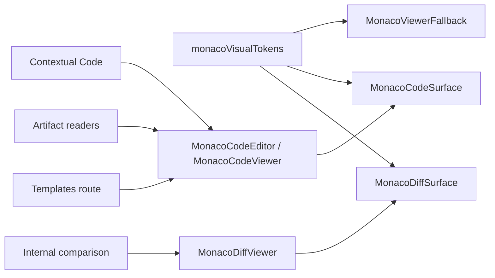

### Guards

- `apps/web/src/app/components/monaco/monacoVisualTokens.architecture.test.ts`
  verifies that Monaco container classes, theme, and option presets stay behind
  the Monaco visual token component.
- Consumer-specific Monaco architecture tests continue to verify contextual
  Code, internal comparison/artifact, and Templates ownership semantics.

### Monaco Visual Token User Stories

| ID            | Actor               | Scenario                                        | Acceptance                                                                            |
| ------------- | ------------------- | ----------------------------------------------- | ------------------------------------------------------------------------------------- |
| US-F24-MV-001 | Frontend maintainer | Adds a Monaco-backed route pane.                | The pane uses the existing Monaco gateway and inherits `monacoVisualClasses.surface`. |
| US-F24-MV-002 | Frontend maintainer | Changes Monaco visual chrome.                   | The change is made in `monacoVisualTokens.ts`, not in each route or frame component.  |
| US-F24-MV-003 | Reviewer            | Reviews Code, Diff, Artifacts, or Templates UI. | All embedded Monaco surfaces use `monacoTheme` and owned option presets.              |
| US-F24-MV-004 | Architecture owner  | Checks route-frame ownership.                   | `RouteWorkbenchFrame` no longer exports Monaco-specific visual tokens.                |

#### Test Matrix

| Scenario                                                | Test                                                 |
| ------------------------------------------------------- | ---------------------------------------------------- |
| Monaco visual classes and options stay centrally owned  | `monacoVisualTokens.architecture.test.ts`            |
| Code editable-access semantics keep using Monaco safely | `codeMonacoEditableAccess.architecture.test.ts`      |
| Diff review surface stays read-only and Diff-owned      | `diffMonacoReviewSurface.architecture.test.ts`       |
| Artifacts payload viewer stays read-only                | `artifactsMonacoReadonlyViewer.architecture.test.ts` |
| Templates generated-source preview stays read-only      | `templatesMonacoPreview.architecture.test.ts`        |

> Acceptance scope status: Accepted. Owner: Frontend / Architecture.
>
> Section status: Accepted. Owner: Frontend / Architecture. Colocation does not merge component responsibilities.

## React Flow Visual Token Component

This component owns the React Flow graph visual tokens used by Canvas graph
projection, generic plugin graph node rendering, and graph-node card chrome.

### Public API

Token ownership is split by concern: `graphCardVisualTokens.ts` owns card layout,
tags, identity tooltips and health borders; `graphMetricVisualTokens.ts` owns
metric rows, operational rails and popovers; `graphColumnVisualTokens.ts` owns
column controls. `graphVisualTokens.ts` retains edge, node-kind and fallback
tokens. Consumers import the owning module directly, without a compatibility
barrel. The model header is content-sized and no longer reserves a last-run slot.

- `graphNodeCardSurfaceClasses`: outer card surface and state classes.
- `graphNodeCardLayoutClasses`: graph-node card internal layout classes.
- `graphNodeMetricRowClasses`: compact card metric row classes.
- `graphNodeTagListClasses`: graph-node tag list classes.
- `graphNodeOperationalRailClasses`: operational metric rail classes.
- `graphNodeHealthPopoverClasses`: operational health popover classes.
- `graphNodeHealthBorderClasses`: healthy, failed, and neutral card-border
  classes projected from `ProjectGraphNodeCardReadModel`.
- `fallbackGraphNodeClasses`: fallback node renderer classes.
- `graphNodeColumnClasses`: optional graph-node column list classes.
- `graphStatusBadgeClasses`: inspector badge tone classes for plugin node
  runtime state.
- `graphNodeKindToneClasses`: semantic border and minimap tones for known node
  kinds.
- `graphFlowPalette`: React Flow edge and fallback minimap palette values.
- `resolveGraphNodeKindTone(kind)`: returns a known node-kind tone or the
  fallback tone.
- `projectCanvasNodeAccessibleHealth(...)`: applies strategy-owned health to a
  focusable React Flow node label without duplicating health rules.

### Invariants

- Canvas edge projection reads edge colors from `graphFlowPalette`.
- Outer Canvas dependencies follow the analyzer's curved cyan 1.5px convention.
  React Flow's Bezier geometry respects source and target handle orientation;
  an SVG marker follows the path without duplicating direction calculations.
  Search highlighting addresses the marker's path, not just its parent, so the
  glyph and dependency line retain the same computed color. Forced-colors uses
  the same child-glyph boundary.
  Selection increases stroke width. Closed execution gates keep their dashed
  line and valve cue. Existing edge selection, context menu and deletion rails
  remain unchanged; these are not nested relational operation controls.
- Node-kind catalogs do not own hex minimap literals.
- Generic graph renderers and plugin-owned dbt node renderer chrome do not own
  `slate-*`, `gray-*`, `neutral-*`, or hex visual decisions.
- Graph-node card presentation components consume responsibility-specific token
  groups instead of a shared catch-all class bag.
- Metric rows and operational rails share one status-tone map. Popovers reuse
  that map with an explicit neutral-surface override; they do not redefine the
  same success, warning, failure or running colors.
- A card's base border comes only from its projected health: solid green for
  healthy, dashed red for failed, and solid neutral when evidence is absent or
  non-terminal. The line style keeps failure distinguishable without color.
- Selection and keyboard focus remain separate rings; they do not replace or
  reinterpret health.
- Cost, runtime, and other overlay borders render on an inner decoration layer;
  they never overwrite the outer health border.
- The focusable React Flow node label includes health from the same card read
  model that selects the border; health is not repeated as a visible status
  chip.
- If a plugin card strategy throws while projecting accessible health, the
  focusable label falls back to canonical default health for that node; plugin
  failure cannot replace the Canvas route.
- Draft-backed and dbt project-file Canvas controllers use the same accessible
  health projector.
- Shell-owned runtime enrichment re-runs that projector from the final node data
  so the focusable label and rendered border cannot diverge.
- Plugin-specific behavior remains in plugin contracts; this component owns only
  presentation tokens.

### Explicit data action

Canvas forms share one presentation contract through
`CanvasRelationalTreeEditorFrame` and the existing Inspector controls. Inspection
shows included Output fields without mutation controls. The textual header action
is `Edit`; editing shows included and excluded fields with the shared inclusion
toggle. Creation starts in editing. Entering or leaving a presentation mode does
not save, query a provider, or change graph semantics. New forms must reuse this
frame, field rows, buttons and semantic tokens instead of introducing local CSS
or another edit/filter state machine. There is no separate `Hide excluded` mode.

Persistence belongs to the existing command owner. Within an active Model draft,
Apply/Cancel owns the complete transaction, including each Source occurrence's
pending Output preference. Existing atomic Model/Transform Output editors retain
their command port and eligibility checks while consuming the same visual Edit
gate. A shared visual interaction does not merge operation-specific validation
or create another persistence authority.

`CanvasNodeDataAction` owns the shared Preview chrome in outer graph cards and
relational operation cards. Reuse `PreviewWarehouseSourceObjectRows` and
`PreviewCanvasTransformRows`; visibility never invokes either query or changes
their existing scope/authorization checks.

Preview opens the bounded data sample in the operational drawer; it does not
start a Run. An explicit Preview or Properties intent leaves focus mode so that
the requested drawer or contextual node window is visible. Opening a card
without its own editor selects Properties, not an unrelated Code tab.
The outer Model card does not repeat inner operation details such as a Filter
predicate; those remain in the selected operation's inspector.

For a Source card, Preview presents the same selected output fields and order
shown by its checks. The source query remains a bounded physical sample; the
drawer projects its columns and matching row values locally. Unchecked fields
must not leak into the visible sample.
Source occurrences inside a Model obey the same external publication boundary in
their Output inspector, pending-instance inspector, catalogue field count, zoomed lexical detail and
Preview. The canonical physical Read is unchanged; these presentation projections
cannot disclose fields that the producer has not published. An unavailable
publication disables Preview instead of exposing the physical warehouse sample.
The Data drawer identifies the sampled node, shows bounded row and column counts,
and keeps headers, types, NULLs, sorting and truncation legible. These are
read-only presentation details, not new query or authoring rails.

The action is hidden at rest and revealed only while its card/action area is
hovered or contains keyboard-visible focus. A mouse-selected card does not pin
the action open. Keep the button mounted and its space reserved: showing it
must not resize the card, move ports or connections, or reset focus. The pointer
must be able to cross the gap between the card and the button without hiding it.
Disabled actions follow the same reveal rule and retain disabled styling.

Use one CSS rule in the shared action owner, not per-card React hover state.
Browser proof must cover outer Source/Model and inner operation cards, leaving
the card, keyboard access, unchanged geometry and no query/save on reveal.

### Transitions

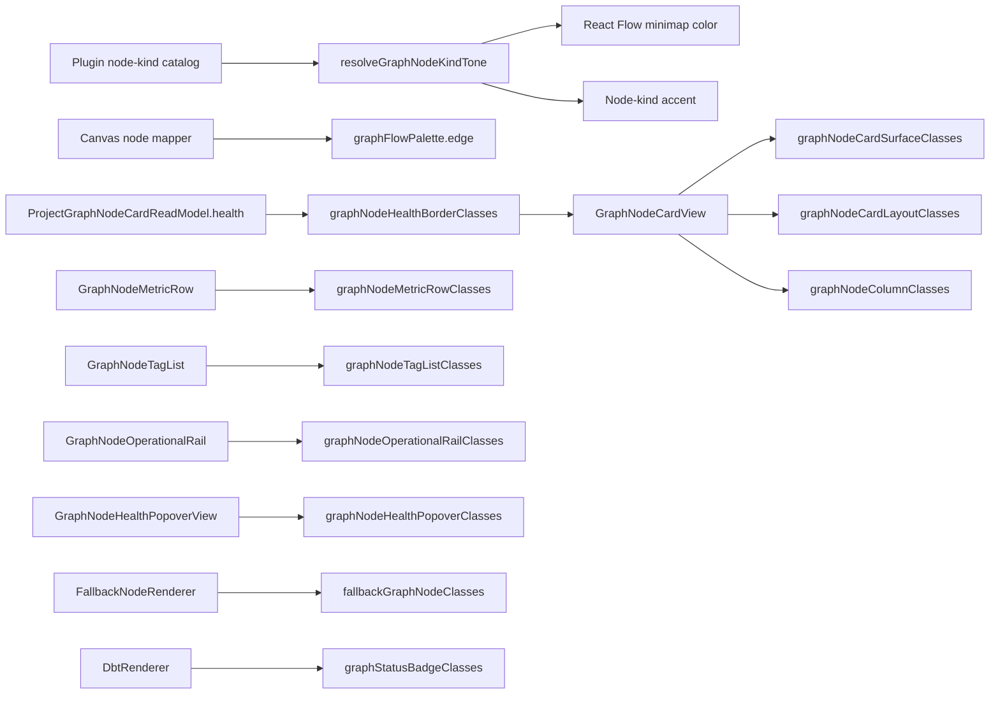

### Consumers

- `nodeTypeCatalog.dbt.ts`
- `dvtNodeTypeCatalog.ts`
- `canvasNodeMapper.ts`
- `GraphNodeRenderer.tsx`
- `GraphNodeCardView.tsx`
- `GraphNodeMetricRow.tsx`
- `GraphNodeTagList.tsx`
- `GraphNodeOperationalRail.tsx`
- `GraphNodeHealthPopoverView.tsx`
- `FallbackNodeRenderer.tsx`
- `DbtNodeRenderer.tsx`

### Drift Guard

The controlled screen-composition proof compares each direction glyph with its
own edge after normal rendering, search highlighting, and accessibility-media
emulation. Media acknowledgement is not a final computed-style receipt. Keep
the complete marker, geometry, edge-reference, accessibility, and computed-color
assertions inside a retryable Cypress assertion against the queried DOM. Use
the existing assertion deadline; do not add sleeps, enlarge timeouts, relax
color equality, or change production CSS to accommodate an intermediate sample.

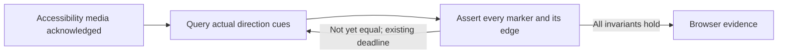

`graphVisualTokenConvergence.architecture.test.ts` rejects reintroduced local
color-family or hex ownership in the graph renderer, fallback renderer, dbt
node renderer, graph-node card presentation components, node-kind catalogs, and
Canvas edge mapper.

### React Flow Visual Token User Stories

| id                      | actor               | story                                                    | acceptance                                                                                                              |
| ----------------------- | ------------------- | -------------------------------------------------------- | ----------------------------------------------------------------------------------------------------------------------- |
| `US-F24-GRAPH-TOKEN-01` | Frontend maintainer | I want Canvas edge colors to come from one graph palette | `canvasNodeMapper.ts` imports `graphFlowPalette` and owns no edge hex literals.                                         |
| `US-F24-GRAPH-TOKEN-02` | Plugin author       | I want plugin node kinds to reuse named visual tones     | dbt and DVT node-kind catalogs call `resolveGraphNodeKindTone` instead of declaring minimap hex values.                 |
| `US-F24-GRAPH-TOKEN-03` | Reviewer            | I want graph renderer visual drift to fail mechanically  | `graphVisualTokenConvergence.architecture.test.ts` rejects local color-family and hex drift in graph rendering modules. |

> Acceptance scope status: Active. Owner: Web / Canvas.
>
> Section status: Active. Owner: Web / Canvas. Colocation does not merge component responsibilities.

## Runs Dense Table Visual Tokens Component

### Purpose

This component owns the visual-token boundary for dense Runs tables. It keeps
Runs list and event chronology tables aligned with the operator-workbench visual
system without giving route components authority over raw color families.

Owned concern: dense table views consume named table tokens; `theme.css` owns
raw semantic values.

### Public API

| API                                          | Kind         | Contract                                                                          |
| -------------------------------------------- | ------------ | --------------------------------------------------------------------------------- |
| `routeWorkbenchDenseTableClasses`            | constant     | Shared dense table field, muted text, subtle text, empty cell, and layout classes |
| `routeWorkbenchStatusToneClasses`            | constant     | Semantic status badge classes for run status and event level tones                |
| `getRouteWorkbenchStatusToneClassName(kind)` | query helper | Returns the badge class for a known semantic status tone                          |

### Invariants

1. The component composes semantic CSS variables such as `--surface-app`,
   `--border-default`, `--text-muted`, and `--status-*`.
2. Runs table view modules do not use `slate-*`, `bg-red-*`, `bg-blue-*`,
   `bg-yellow-*`, `bg-green-*`, or raw hex color classes.
3. The token component does not own row identity, route navigation, filter
   state, sorting, API calls, or event interpretation.
4. Status colors are semantic, not decorative. Run status and event level tones
   must resolve through the same token surface.

### Transitions

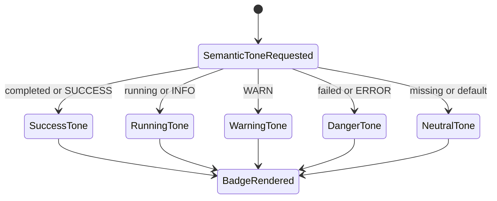

### Consumer Diagram

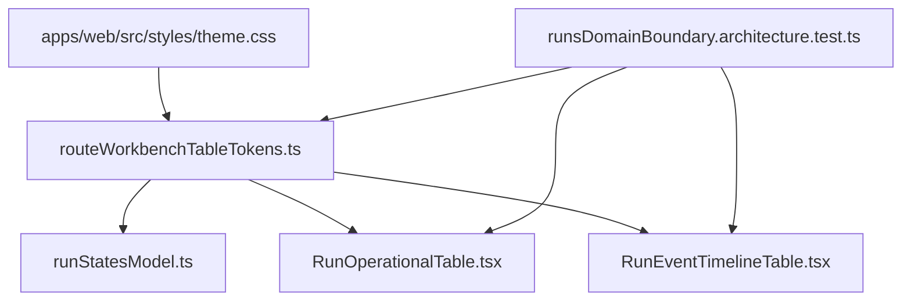

### Consumers

| Consumer                                  | Responsibility                                                  |
| ----------------------------------------- | --------------------------------------------------------------- |
| `RunOperationalTable`                     | Uses dense field, muted, and empty-cell classes                 |
| `RunEventTimelineTable`                   | Uses event level badge tones and subtle text classes            |
| `runStatesModel`                          | Maps run statuses to semantic badge tone classes                |
| `runsDomainBoundary.architecture.test.ts` | Prevents route-level dense-table color hardcodes from returning |

### Negative Rules

- Do not add raw Tailwind color families to Runs dense table view modules.
- Do not add a second status-tone function inside table views.
- Do not move API, query, or event authority into this token module.
- Do not use this component as a global design-system rewrite; it is a narrow
  F-24 convergence point for dense workbench tables.

### Runs Dense Table Visual Tokens User Stories

#### US-F24-RUNS-TOKEN-01: Scan Runs With Workbench Tokens

**As** an operator, **I want** Runs dense tables to use the same visual grammar
as the workbench, **so that** route surfaces feel like one product.

Acceptance:

- Table fields use semantic surface, border, and text tokens.
- Empty and muted table copy use shared text tokens.
- Route components do not own raw `slate-*` field classes.

#### US-F24-RUNS-TOKEN-02: Read Status Without Route Color Drift

**As** an operator, **I want** run statuses and event levels to keep stable
meaning across tables, **so that** warning, danger, success, and running states
do not change by route.

Acceptance:

- Run statuses resolve through `routeWorkbenchStatusToneClasses`.
- Event levels resolve through the same status-tone boundary.
- Table view modules do not contain `bg-red-*`, `bg-yellow-*`, `bg-green-*`, or
  `bg-blue-*` literals.

#### US-F24-RUNS-TOKEN-03: Preserve Dense Table Semantics

**As** a frontend maintainer, **I want** token convergence to avoid changing row
identity, filters, sorting, and navigation, **so that** F-24 stays visual and
does not reopen F-16 behavior.

Acceptance:

- `runId` and `eventId` stay the row identity sources.
- URL-stable filters remain owned by `runOperationalTableModel`.
- Architecture tests guard visual tokens separately from row semantics.

#### Coverage Matrix

| Story                | Surface                       | Test                                                   |
| -------------------- | ----------------------------- | ------------------------------------------------------ |
| US-F24-RUNS-TOKEN-01 | Dense table fields            | `runsDomainBoundary.architecture.test.ts`              |
| US-F24-RUNS-TOKEN-02 | Status and event tones        | `runsDomainBoundary.architecture.test.ts`              |
| US-F24-RUNS-TOKEN-03 | Row semantics remain separate | Existing F-16 table model tests and architecture guard |

> Acceptance scope status: Active. Owner: Web / Runs.
>
> Section status: Active. Owner: Web / Runs. Colocation does not merge component responsibilities.

## Marquez Public-Data Visual System Component

### Purpose

This component owns the Marquez visual system for public-data surfaces. In this
frontend context, `Marquez` is a named visual and narrative direction for
open-data explanation. It is not the OpenLineage backend product, not a runtime
dependency, and not the default styling for the operator workbench.

The concern is semantic encapsulation: public or explanatory views may adopt an
editorial, curated, civic data presentation language while operational routes
continue to use dense, quiet workbench chrome.

### Public API

| API                         | Type              | Purpose                                                                      |
| --------------------------- | ----------------- | ---------------------------------------------------------------------------- |
| `marquezVisualTokens`       | design-token set  | Names public-data color, typography, density, motion, and illustration rules |
| `MarquezPublicDataSurface`  | component pattern | Defines page composition for explanatory public-data pages                   |
| `MarquezNarrativePanel`     | component pattern | Defines source, method, caveat, and evidence panels                          |
| `MarquezDataStoryMetric`    | component pattern | Defines high-level explanatory statistics without dashboard density          |
| `MarquezDatasetCard`        | component pattern | Defines dataset, provenance, license, and update cadence cards               |
| `MarquezMethodologySection` | component pattern | Defines how data was derived, transformed, or filtered                       |

### Visual Tokens

`marquezVisualTokens` is a documented token set until a concrete public-data
route needs code-level extraction. It carries these owned decisions:

| Token group   | Rule                                                                 |
| ------------- | -------------------------------------------------------------------- |
| Palette       | editorial neutrals, civic accent, evidence accent, caution accent    |
| Typography    | readable explanatory hierarchy; no IDE-scale monospace dominance     |
| Density       | more narrative spacing than operator tables; still scan-friendly     |
| Data emphasis | clear source labels, caveats, update cadence, and provenance chips   |
| Interaction   | guided drill-downs and anchored sections instead of command palettes |
| Illustration  | real dataset maps, charts, or diagrams; no abstract decorative blobs |

### Invariants

- Marquez applies only to public-data surfaces, civic/open-data explainers, or
  explicitly approved external narrative pages.
- Marquez must not be applied to operator workbench routes such as Canvas,
  Runs, Code, Diff, Artifacts, Templates, Plugins, Admin, or Cost.
- operator workbench routes must not import or copy Marquez public-data token
  rules.
- Public-data views may reuse shell primitives, Radix/shadcn primitives,
  charts, and route frame constraints, but they must not inherit dense
  workbench tables by default.
- Every Marquez surface must show source, freshness, methodology, and caveat
  affordances when it presents data-derived conclusions.
- Marquez is not a dependency, package, adapter, plugin runtime, or OpenLineage
  integration contract.

### Transitions

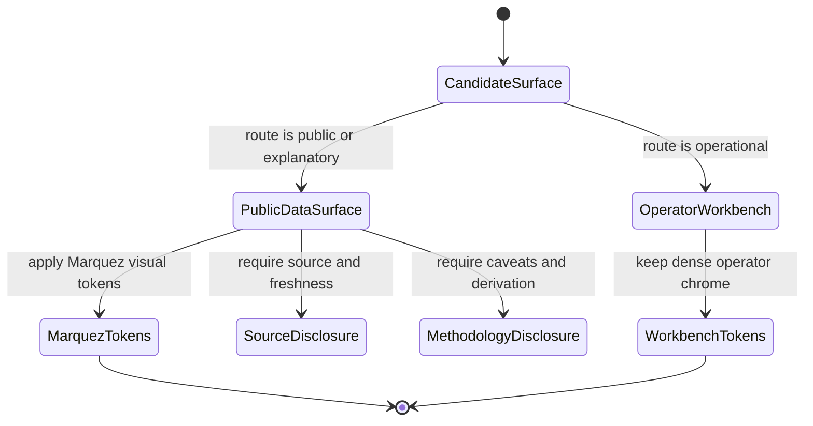

### Consumers

| Consumer                                      | Usage                                                             |
| --------------------------------------------- | ----------------------------------------------------------------- |
| Future public-data routes                     | Adopt the Marquez token set and component patterns                |
| `style-guide.md`                              | Routes frontend slices toward public-data versus operator posture |
| `style-guide.md`                              | Classifies Marquez as a design reference, not a dependency        |
| `screen-manuals-and-user-stories.md`          | Names F-19 as the public-data acceptance direction                |
| `publicDataVisualSystem.architecture.test.ts` | Guards semantic separation and documentation completeness         |
| GitHub issue and PR evidence                  | Owns backlog state, review, and closure evidence                  |

### Component Topology

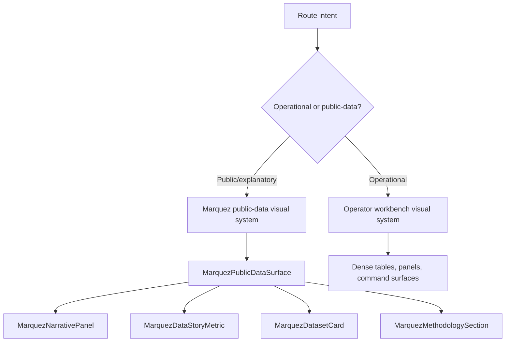

### Drift Signals

- A workbench route document describes Marquez as its visual system.
- A public-data proposal lacks source, freshness, methodology, or caveat
  disclosure.
- A runtime integration document treats Marquez as a frontend dependency.
- A future public-data route copies dense operator-table layouts as its primary
  first-viewport pattern.

### Marquez Public-Data Visual System User Stories

#### US-MARQUEZ-001: Identify A Public-Data Surface

As a product designer, I want a clear rule for when Marquez applies so that
operator workbench routes do not inherit public explainer styling.

Acceptance:

- public-data, civic, and explanatory open-data routes may use Marquez;
- Canvas, Runs, Code, Diff, Artifacts, Templates, Plugins, Admin, and Cost do
  not use Marquez by default;
- proposals name the route intent before selecting the visual system.

#### US-MARQUEZ-002: Read A Data Story With Provenance

As an external reader, I want metrics and claims to include source and freshness
signals so that I can understand whether the public-data story is current.

Acceptance:

- public-data metrics show source and update cadence;
- caveats are visible near the claim they qualify;
- methodology is reachable without opening an operator panel.

#### US-MARQUEZ-003: Reuse Mature Primitives Without Copying The Workbench

As a frontend engineer, I want to reuse shell, chart, and primitive components
without adopting dense operator chrome so that public-data pages stay
maintainable.

Acceptance:

- Radix/shadcn primitives and chart components remain allowed;
- command palettes and dense operational tables are not default page structure;
- narrative sections and dataset cards own the first public-data composition.

#### US-MARQUEZ-004: Prevent Visual-System Drift

As an architect, I want an architecture guard to keep Marquez scoped to
public-data surfaces so that future frontend work does not create an unbounded
second theme.

Acceptance:

- component docs define public API, invariants, transitions, and consumers;
- the UX guide states that Marquez must not be applied to operator workbench
  routes;
- the reference stack states that Marquez is not a dependency.

> Acceptance scope status: Active. Owner: Frontend / Architecture.
>
> Section status: Active. Owner: Frontend / Architecture. Colocation does not merge component responsibilities.

## Canvas Route Chrome Token Component

### Purpose

This component owns compact Canvas shell and status visual tokens. Canvas route
chrome can stay aligned with the operator-workbench visual system without
placing raw Tailwind color families in route controls or status templates.

Owned concern: Canvas route chrome consumes named presentation tokens;
`theme.css` owns raw semantic values.

### Public API

| API                                    | Kind         | Contract                                                   |
| -------------------------------------- | ------------ | ---------------------------------------------------------- |
| `canvasChromeClasses`                  | constant     | Shared shell, separator, button, dialog, and status chrome |
| `canvasDraftStatusToneClasses`         | constant     | Draft save and recovery tone classes                       |
| `resolveCanvasDraftStatusClassName`    | query helper | Resolves `neutral`, `warning`, or `danger` draft tone      |
| `resolveCanvasWorkflowStatusClassName` | query helper | Resolves workflow status text tone for toolbar badges      |

### Invariants

1. Canvas compact shell and draft-status presentation uses `canvasChromeTokens`.
2. Shell and status modules do not contain raw `slate-*`, `rose-*`,
   `amber-*`, `emerald-*`, `gray-*`, or `zinc-*` color classes.
3. The token component does not own Canvas command availability, graph
   mutation, draft persistence, React Flow configuration, or route policy.
4. Raw color values remain in `theme.css` or user-configurable Canvas palette
   code, not in route chrome components.
5. Low-frequency project snapshot actions stay grouped in the Canvas project
   menu instead of consuming persistent toolbar width as separate buttons.

### Transitions

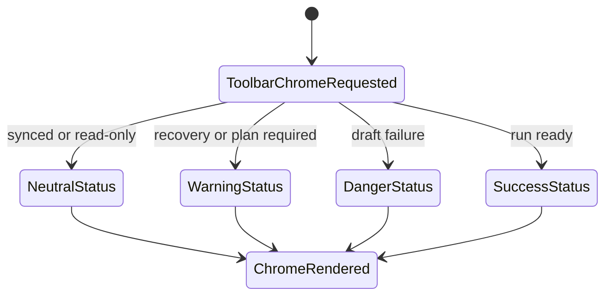

### Consumers

- `CanvasDraftSaveStatus` resolves draft status tone through token helpers.
- Compact Canvas shell builders may consume button, separator, and status
  classes without owning raw color families.

### Consumer Diagram

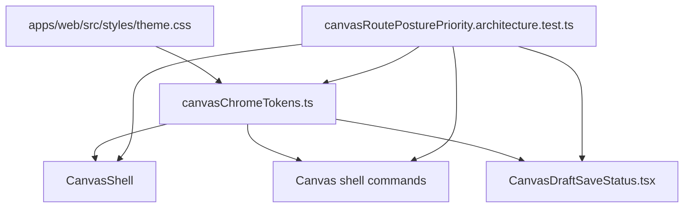

### Negative Rules

- Do not move Canvas command policy into `canvasChromeTokens`.
- Do not move React Flow node, edge, viewport, minimap, or grid palette
  semantics into this component.
- Do not create a second Canvas toolbar color map in a route template.

### Canvas Route Chrome Token User Stories

#### US-F24-CANVAS-CHROME-01: Scan Toolbar Commands With Workbench Tokens

As an operator, I need Canvas toolbar commands to use the same workbench visual
language as the rest of the app, so I can scan project export, import, plan,
and run commands without route-specific color drift.

Acceptance:

- Toolbar container, separators, command buttons, and workflow badges consume
  `canvasChromeClasses`.
- Visual token changes do not alter command enablement or click behavior.

#### US-F24-CANVAS-CHROME-02: Read Draft Posture Without Local Color Rules

As a frontend maintainer, I need draft status and recovery badges to resolve
through one token helper, so draft-save posture does not duplicate warning and
danger color classes in route components.

Acceptance:

- `CanvasDraftSaveStatus` uses `resolveCanvasDraftStatusClassName`.
- `CanvasToolbarDraftStatus` delegates draft-status rendering to
  `CanvasDraftSaveStatus`.
- `canvasToolbarViewModel` uses `resolveCanvasWorkflowStatusClassName`.

#### US-F24-CANVAS-CHROME-03: Keep Compact Shell Chrome Separate From Canvas Policy

As a Canvas route maintainer, I need compact shell visual chrome to use a token
component while graph-first command policy stays in shell builders and presenters,
so F-24 remains visual-system convergence rather than command-policy refactoring.

Acceptance:

- Compact Canvas shell/status presentation uses `canvasChromeClasses`.
- The token component does not import route command, graph, or draft state
  types.

#### Scenario Coverage Matrix

| Story                     | Surface                                                                       | Guard                                             |
| ------------------------- | ----------------------------------------------------------------------------- | ------------------------------------------------- |
| `US-F24-CANVAS-CHROME-01` | `CanvasToolbar`, `CanvasToolbarPrimaryControls`                               | `canvasRoutePosturePriority.architecture.test.ts` |
| `US-F24-CANVAS-CHROME-02` | `CanvasToolbarDraftStatus`, `CanvasDraftSaveStatus`, `canvasToolbarViewModel` | `canvasRoutePosturePriority.architecture.test.ts` |
| `US-F24-CANVAS-CHROME-03` | compact Canvas shell/status presentation                                      | `canvasRoutePosturePriority.architecture.test.ts` |

> Acceptance scope status: Active. Owner: Web / Canvas.
>
> Section status: Active. Owner: Web / Canvas. Colocation does not merge component responsibilities.

## Iconography And Design Tokens Contract

### Purpose

This document fixes the visual base contract for the DVT operator workbench.

It exists to answer five implementation questions before more screens are built:

1. which icon family is standard;
2. which design-token layers the frontend must expose;
3. how the shell and shared components should look and feel;
4. which visual decisions are already locked for `Canvas`, `Runs`, `Diff`,
   `Artifacts`, and `Templates`;
5. which parts of the current frontend are reused versus replaced.

Use it with:

- [DVT Style Guide v0.2](style-guide.md)
- [Frontend Component Inventory](frontend-component-inventory.md)
- [UX Implementation Guide](style-guide.md#section-ux-implementation-guide)
- [Library And Open-Source Reference Stack](style-guide.md#section-library-and-open-source-reference-stack)

### Current Reality

The workbench already has a visual foundation, but it is not governed tightly
enough yet.

Current facts:

- the token source already exists in
  [`apps/web/src/styles/theme.css`](../../../../apps/web/src/styles/theme.css);
- the frontend already imports `lucide-react` broadly across shell, graph,
  runs, and route-level surfaces;
- `@mui/icons-material` is installed in
  [`apps/web/package.json`](../../../../apps/web/package.json), but there are no
  active product imports under `apps/web/src`;
- [`apps/web/src/styles/fonts.css`](../../../../apps/web/src/styles/fonts.css) is
  currently empty, so typography is not yet governed by an explicit contract;
- [`apps/web/src/styles/index.css`](../../../../apps/web/src/styles/index.css)
  still contains some route-specific hard-coded graph colors that should
  eventually fold into semantic tokens.

Decision:

- do not introduce a parallel design system;
- extend the existing theme token layer and make it semantic;
- standardize iconography now before more views diverge.

### Visual Direction

The operator workbench should feel like a mature control surface:

- dark-first and low-glare for long sessions;
- dense, but readable;
- operational, not decorative;
- coherent across routes without making every route look identical;
- clear about status, risk, and action priority.

It should not feel like:

- a purple-accent SaaS dashboard clone;
- a white-background CRUD admin;
- a collage of card grids;
- a freeform IDE where every surface gets equal visual weight.

Visual stance:

- `Canvas` is graph-first;
- `Runs` is evidence-first and can be denser;
- `Diff` and `Templates` are review-first and editor-adjacent;
- `Artifacts` is inspection-first and read-only by default.

Startup and onboarding stance:

- use neutral `ink` and `steel` surfaces for the dominant field;
- reserve `cobalt` for the primary action, focus, progress, and concise
  informational emphasis rather than large decorative fills;
- use the canonical body and title scale; oversized rounded marketing type and
  playful display treatments are not part of the operator workbench;
- keep information in one reading order and remove repeated status or guidance;
- every temporary surface provides a visible, localized dismissal affordance in
  addition to the documented keyboard path.

### Token Architecture

The frontend token model should have four layers.

| Layer             | Role                                                             | Rule                                                            |
| ----------------- | ---------------------------------------------------------------- | --------------------------------------------------------------- |
| Foundation tokens | raw color families, spacing scale, radii, shadows, type families | may change in implementation without changing product semantics |
| Semantic tokens   | surfaces, text, borders, focus, status, charts, overlays         | authoritative contract for product UI                           |
| Component tokens  | toolbar height, panel padding, table row height, icon sizes      | should compose semantic tokens instead of raw values            |
| Route accents     | route-local emphasis when justified                              | may not redefine shell semantics or status semantics            |

Implementation rule:

- new UI code should consume semantic tokens;
- raw color values are allowed only inside the token source, not spread across
  route components.

### Foundation Palette

Raw palette values are an implementation seed, not the product contract by
themselves.

Preferred foundation families:

| Family   | Role                                               | Reference direction                        |
| -------- | -------------------------------------------------- | ------------------------------------------ |
| `ink`    | shell chrome, deep surfaces, graph background      | slate-blue neutrals rather than pure black |
| `steel`  | borders, dividers, muted panels, inactive controls | cool grey with enough contrast             |
| `cobalt` | primary accent and focus language                  | blue-first, not purple-first               |
| `green`  | success and healthy execution                      | status-only, not brand                     |
| `amber`  | warning, lag, partial availability                 | status-only                                |
| `red`    | failure and destructive intent                     | status-only                                |
| `sky`    | informational emphasis and read-only hints         | secondary accent, not primary brand        |

Reference palette seed:

| Token seed   | Reference value | Intended use                     |
| ------------ | --------------- | -------------------------------- |
| `ink-950`    | `#020617`       | app background                   |
| `ink-900`    | `#0b1220`       | shell and route surfaces         |
| `ink-800`    | `#121c2f`       | panels                           |
| `ink-700`    | `#17243c`       | elevated panels and hover        |
| `steel-500`  | `#4b5f84`       | strong borders                   |
| `steel-400`  | `#2f4368`       | default dark border              |
| `cobalt-500` | `#4f8cff`       | primary action                   |
| `cobalt-400` | `#60a5fa`       | focus ring and interactive hover |
| `green-500`  | `#22c55e`       | success                          |
| `amber-500`  | `#f59e0b`       | warning                          |
| `red-500`    | `#ef4444`       | failure                          |
| `sky-500`    | `#38bdf8`       | info and read-only cues          |

### Semantic Token Contract

These semantic groups should exist in the frontend token layer even if the
first implementation maps them onto the current variables in
`theme.css`.

#### Surface tokens

| Token                | Meaning                                         |
| -------------------- | ----------------------------------------------- |
| `--surface-app`      | full-screen shell background                    |
| `--surface-shell`    | top bar, command surfaces, bottom drawer chrome |
| `--surface-route`    | default route background                        |
| `--surface-panel`    | explorer, inspector, side panels                |
| `--surface-elevated` | popover, dialog, raised cards                   |
| `--surface-selected` | selected row, node, or nav item background      |
| `--surface-overlay`  | overlay tint on graph and modal backdrops       |

#### Text tokens

| Token             | Meaning                              |
| ----------------- | ------------------------------------ |
| `--text-strong`   | primary titles and important values  |
| `--text-default`  | normal body text                     |
| `--text-muted`    | secondary metadata                   |
| `--text-subtle`   | low-priority helper content          |
| `--text-inverse`  | text on brand or dark-emphasis fills |
| `--text-disabled` | disabled state only                  |

#### Border and focus tokens

| Token              | Meaning                                     |
| ------------------ | ------------------------------------------- |
| `--border-subtle`  | dividers and low-emphasis separators        |
| `--border-default` | panel and input borders                     |
| `--border-strong`  | selected or emphasized frame                |
| `--focus-ring`     | keyboard focus and primary interaction halo |

#### Status tokens

| Token               | Meaning                        |
| ------------------- | ------------------------------ |
| `--status-success`  | healthy, succeeded             |
| `--status-running`  | active execution               |
| `--status-warning`  | lag, stale, degraded           |
| `--status-danger`   | failed, destructive            |
| `--status-info`     | informational review cue       |
| `--status-offline`  | disconnected or unavailable    |
| `--status-readonly` | allowed to inspect, not mutate |

#### Chart and graph tokens

| Token                    | Meaning                          |
| ------------------------ | -------------------------------- |
| `--chart-success`        | success series                   |
| `--chart-failure`        | failed series                    |
| `--chart-running`        | active series                    |
| `--graph-node-default`   | node baseline                    |
| `--graph-node-selected`  | node selected state              |
| `--graph-edge-default`   | default graph edge               |
| `--graph-edge-highlight` | focused lineage or diff emphasis |
| `--graph-grid`           | canvas background grid or guide  |

### Typography Contract

Typography must feel technical and operational, not marketing-heavy.

Approved type pair:

- UI and reading text: `IBM Plex Sans`
- code, SQL, IDs, hashes, metrics tables, and event streams: `IBM Plex Mono`

Rules:

- route titles use the UI family, not the mono family;
- code, SQL, artifact payloads, SHAs, and step identifiers use the mono family;
- do not hard-code ad hoc font stacks inside components;
- load and govern fonts through
  [`apps/web/src/styles/fonts.css`](../../../../apps/web/src/styles/fonts.css)
  and tokenized font-family variables.

Suggested type scale:

| Token            | Size / line-height | Typical use                   |
| ---------------- | ------------------ | ----------------------------- |
| `--text-display` | `28/34`            | rare page-level headline      |
| `--text-title`   | `20/28`            | route title                   |
| `--text-section` | `16/24`            | panel and table section title |
| `--text-body`    | `14/20`            | default UI body               |
| `--text-meta`    | `12/16`            | metadata, helper labels       |
| `--text-mono`    | `13/20`            | code, SQL, logs, identifiers  |

### Spacing, Radius, And Density

The workbench should use a tight but not cramped density model.

Logical column collections in `NodePropertyTable` use the shared Inspector record
tokens: 12px text with 16px line height, a 28px minimum collapsed summary, compact
padding and a centred 12px chevron. Every generic Workbench Columns consumer uses
that same pattern. Long names wrap and increase row height; expanded metadata
remains readable and complete. Native disclosure, keyboard focus and bounded
scrolling are preserved. This single-line logical collection differs from the
physical Source scanner's two-line facts, whose minimum target remains 44px.

Generic Workbench Inputs/Outputs present each relationship as one compact business
line: direction, related node name and relation. An existing connection value may
appear beneath it as brief context. Do not repeat raw property keys or expose
`nodeId` in this view. IDs remain in the read model and stable row/callback identity.
If the node label is blank or merely repeats that ID, use the existing empty-cell
state instead of inventing a name. Full names and connection values wrap; counts,
order and existing custom cell rendering remain intact. This passive template
does not acquire Source master/detail or reorder behavior.

Rules:

- base spacing scale is `4px`;
- route toolbars, tables, and inspectors use compact spacing by default;
- padding should increase only for dialogs, onboarding, and empty states;
- rounded corners stay restrained; the product is not soft-card heavy.

Recommended component scale:

| Token or component    | Target size                           |
| --------------------- | ------------------------------------- |
| base spacing step     | `4px`                                 |
| shell top bar height  | `56px`                                |
| route toolbar height  | `44px`                                |
| panel header height   | `40px`                                |
| compact button height | `32px`                                |
| default button height | `36px`                                |
| table row height      | `36px` or `40px` depending on density |
| small radius          | `6px`                                 |
| default radius        | `10px`                                |
| large dialog radius   | `14px`                                |

Shadow rules:

- use one low-elevation shadow for overlays and popovers;
- do not stack multiple heavy shadows;
- depth should come mostly from surface contrast and borders, not from glow.

### Iconography Contract

#### Standard pack

`lucide-react` is the standard product icon family.

Rules:

- new product UI must use `lucide-react`;
- do not introduce new icon packs for first-party product UI;
- `@mui/icons-material` is retired inventory only and should not expand;
- if a touched surface still uses a non-standard icon pack later, migrate it
  instead of mixing styles in the same feature.

#### Wrapper rule

All product icons should flow through a small wrapper such as `AppIcon`.

`AppIcon` should own:

- size presets;
- stroke width;
- semantic color application;
- disabled and active-state treatment;
- accessible `aria-hidden` defaults and label handoff.

#### Size and stroke rules

| Token     | Size   | Use                            |
| --------- | ------ | ------------------------------ |
| `icon-xs` | `14px` | inline metadata                |
| `icon-sm` | `16px` | dense tables, chips            |
| `icon-md` | `18px` | default buttons and toolbars   |
| `icon-lg` | `20px` | nav items and panel headers    |
| `icon-xl` | `24px` | empty states and hero callouts |

Default stroke rule:

- use a consistent stroke close to `1.75` to `2`;
- do not mix thin outline icons with filled or heavy icons in the same surface.

#### Usage rules

| Pattern                   | Rule                                                                 |
| ------------------------- | -------------------------------------------------------------------- |
| Left navigation           | icon plus label                                                      |
| Primary route actions     | icon plus label unless the label is already adjacent in the layout   |
| Secondary toolbar actions | icon-only allowed with tooltip                                       |
| Status chips              | icon optional; if used, keep icon stable by status meaning           |
| Empty states              | larger icon allowed, but one icon only                               |
| Tables                    | do not add decorative icons in every cell unless they encode meaning |

#### Semantic icon registry

These meanings should stay stable across the product.

##### Route icons

| Route       | Standard icon |
| ----------- | ------------- |
| `Canvas`    | `GitBranch`   |
| `Runs`      | `Activity`    |
| `Lineage`   | `GitGraph`    |
| `Diff`      | `GitCompare`  |
| `Artifacts` | `FileText`    |
| `Templates` | `Code`        |
| `Plugins`   | `Puzzle`      |
| `Admin`     | `Shield`      |

##### Status icons

| State               | Standard icon   |
| ------------------- | --------------- |
| healthy or success  | `CheckCircle2`  |
| failed              | `XCircle`       |
| degraded or warning | `AlertTriangle` |
| running             | `Activity`      |
| queued              | `Clock`         |
| paused              | `Pause`         |
| offline             | `WifiOff`       |
| read-only           | `Lock`          |

##### Action icons

| Action   | Standard icon    |
| -------- | ---------------- |
| add      | `Plus`           |
| delete   | `Trash2`         |
| run      | `Play`           |
| stop     | `StopCircle`     |
| compare  | `GitCompare`     |
| inspect  | `PanelRightOpen` |
| explorer | `PanelLeftOpen`  |
| import   | `Upload`         |
| export   | `Download`       |
| filter   | `Filter`         |
| search   | `Search`         |

Registry rule:

- route, status, and plugin icons should be declared centrally;
- node-kind icons should live in node or plugin registries, not as ad hoc
  imports scattered through route components.

### Shared Component Visual Rules

#### Shell chrome

| Surface                                | Visual rule                                                       |
| -------------------------------------- | ----------------------------------------------------------------- |
| top bar                                | darkest stable chrome, quiet borders, global context only         |
| shell navigation compatibility surface | separated from route surface, clear active state, icon plus label |
| health banner                          | status-first, compact, never a decorative announcement bar        |
| bottom drawer                          | same shell family, not a second route navigation                  |

#### Route chrome

| Surface         | Visual rule                                                  |
| --------------- | ------------------------------------------------------------ |
| route toolbar   | compact, horizontal, command-first                           |
| context panels  | stable frame, clear headers, independent scroll              |
| primary surface | dominant visual area, minimal ornament                       |
| dialogs         | used only for confirmation, import, or explicit review gates |

#### Data-heavy components

| Component    | Visual rule                                                       |
| ------------ | ----------------------------------------------------------------- |
| tables       | sticky headers, compact rows, status tokens over decorative color |
| cards        | summary only; not the default grammar for dense operational views |
| badges       | low-chroma fills and clear label contrast                         |
| tabs         | route-local segmentation, not top-level navigation                |
| empty states | concise guidance, one icon, one next action                       |

#### Editor-adjacent components

| Surface                 | Visual rule                                                        |
| ----------------------- | ------------------------------------------------------------------ |
| SQL preview in `Canvas` | read-only, secondary, visually subordinate to the graph            |
| `Diff` panes            | monospace-first, high contrast, summary before raw delta           |
| `Artifacts` viewers     | read-only inspection, structured search, no edit affordance        |
| `Templates` preview     | editor-grade preview and diff, but still wrapped in route controls |

### Motion And Interaction Tone

Motion should be restrained and purposeful.

Rules:

- use short transitions in the `120ms` to `180ms` range for panel open, hover,
  and selection feedback;
- avoid decorative floating or bounce effects in the operator workbench;
- use stronger motion only for route changes, panel recovery, and explicit run
  feedback;
- use color and border changes before using animation to communicate state.

### Accessibility And Contrast Rules

Visual maturity is not an excuse for low legibility.

Rules:

- color alone must not carry critical status;
- icon-only controls require accessible labels and tooltip support;
- focus ring must remain visible on dark surfaces;
- muted text must still be readable in panels and dense tables;
- graph overlays, diff highlights, and status chips must stay distinguishable
  under color-vision variation.

### Implementation Rules For `apps/web`

This contract should land through the existing style system, not beside it.

Implementation rules:

1. keep
   [`apps/web/src/styles/theme.css`](../../../../apps/web/src/styles/theme.css)
   as the canonical token source;
2. add semantic token names there instead of route-level hard-coded values;
3. keep
   [`apps/web/src/styles/fonts.css`](../../../../apps/web/src/styles/fonts.css)
   as the font-loading and font-token source;
4. use Tailwind aliases or utility helpers that resolve to semantic CSS
   variables;
5. reduce hard-coded graph colors in
   [`apps/web/src/styles/index.css`](../../../../apps/web/src/styles/index.css)
   over time in favor of tokenized values;
6. do not create a second theme runtime inside React state or component props.

### Immediate Decisions Locked By This Document

1. `lucide-react` is the standard icon family for first-party product UI.
2. `@mui/icons-material` is not approved for new product UI work.
3. The primary visual accent is blue-first, not purple-first.
4. The operator workbench is dark-first and low-glare by default.
5. Typography is technical and operational, with `IBM Plex Sans` plus
   `IBM Plex Mono` as the approved pair.
6. The product uses semantic tokens in the existing theme layer instead of
   scattered raw values.
7. Cards are a supporting summary pattern, not the dominant grammar for dense
   workbench routes.
8. `Canvas`, `Runs`, `Diff`, `Artifacts`, and `Templates` share one visual
   family, with density differences driven by job-to-be-done rather than by
   ad hoc route styling.

> Section status: Active. Owner: Frontend / Architecture. Colocation does not merge component responsibilities.

## Library And Open-Source Reference Stack

This page records the mature libraries and open-source product references that
the DVT frontend should build on instead of re-implementing from scratch.

It also records named design references that are not libraries but still guide
product UX decisions.

### Selection Rules

- prefer libraries that solve complex interaction, accessibility, or rendering
  problems better than an in-house implementation would;
- prefer headless libraries when DVT needs its own visual language;
- wrap third-party primitives behind DVT adapters when they affect core product
  concepts such as graph models, diff surfaces, or editor models;
- use open-source products as design and interaction precedents;
- keep source generation behind governed template or service boundaries instead
  of concatenating provider-specific strings inside UI components;
- do not vendor code from third-party projects without explicit license review.

### Recommended Library Stack

| Area                         | Recommended library                                         | Why it fits DVT                                                                                   |
| ---------------------------- | ----------------------------------------------------------- | ------------------------------------------------------------------------------------------------- |
| Graph canvas                 | [React Flow](https://reactflow.dev/)                        | Mature node-based editor primitives, built-in viewport, minimap, controls, custom nodes and edges |
| Server state                 | TanStack Query                                              | Stable query, cache, polling, and invalidation model for backend-backed views                     |
| Local UI state               | Zustand                                                     | Small and explicit UI-state store for shell and view-local behavior                               |
| Base primitives              | [Radix Primitives](https://www.radix-ui.com/primitives)     | Accessible unstyled React primitives for dialogs, menus, tabs, scroll areas, and focus management |
| Design-system layer          | [shadcn/ui](https://ui.shadcn.com/)                         | Open-code component recipes on top of Radix and Tailwind                                          |
| Dense data tables            | [TanStack Table](https://tanstack.com/table/latest)         | Headless tables for runs, events, artifacts, and diagnostics grids                                |
| Code and diff editors        | [Monaco Editor](https://github.com/microsoft/monaco-editor) | Mature editor model, diff editor, and syntax-aware UX                                             |
| Terminal or live log console | [xterm.js](https://xtermjs.org/)                            | Mature browser terminal and streaming console surface                                             |
| Charts                       | Recharts today                                              | Already used in the codebase for quick metrics and cost views                                     |

### Open-Source Product References

| Product                                             | Use it for                                                                | Do not copy blindly                                                     |
| --------------------------------------------------- | ------------------------------------------------------------------------- | ----------------------------------------------------------------------- |
| [VS Code](https://github.com/microsoft/vscode)      | shell grammar, docked workbench patterns, tab-and-panel behavior          | internal extension model, build system, or product-specific shell logic |
| [Grafana](https://github.com/grafana/grafana)       | observability dashboards, drill-down patterns, panel composition          | data-source model or product taxonomy that does not match DVT           |
| [Backstage](https://github.com/backstage/backstage) | plugin-oriented frontend composition and route-level capability discovery | developer-portal assumptions that do not fit DVT's workbench            |

### Design References

| Reference | Use it for                                                                 | What it is not                                             |
| --------- | -------------------------------------------------------------------------- | ---------------------------------------------------------- |
| `Marquez` | named visual and narrative direction for open-data or public-data surfaces | not a library, framework, component runtime, or dependency |
| VS Code   | operator-workbench shell grammar                                           | not DVT's visual theme for every surface                   |
| Grafana   | operational density and observability drill-down                           | not the presentation model for public explanatory data     |

### Current Fit Against The Codebase

- `apps/web` already uses `@xyflow/react`, TanStack Query, Zustand, Radix-based
  components, Tailwind, and Recharts.
- The missing step is not choosing a new stack from scratch. It is documenting
  where each library is allowed to own complexity and where DVT must keep its
  own domain model.
- Monaco and xterm.js are not active shell primitives yet, but they are the
  right maturity targets for code, diff, and console surfaces.
- The future execution-template workbench should reuse Monaco for preview and
  diff while keeping template semantics and source generation outside React
  component logic.
- The Marquez visual system is a public-data design reference, not a dependency
  or backend integration. It may guide public explanatory surfaces, but operator
  workbench routes continue to use the workbench visual system.

> Section status: Active. Owner: Frontend / Architecture. Colocation does not merge component responsibilities.

## UX Implementation Guide

### Purpose

This document is the implementation guide for the DVT frontend UX.

Its job is not to describe aspiration. Its job is to define:

- which UX target we are implementing;
- which existing libraries and code paths we reuse;
- which layers own which responsibilities;
- which sequence gets us there without rewriting `apps/web`;
- how execution-template and code-generation surfaces fit without turning the
  frontend into a freeform IDE;
- what "done" means for each major frontend surface.

### Target UX

The operator-facing product should converge on a workbench UX that feels closer
to VS Code than to a collection of unrelated dashboards.

That means:

- one persistent shell;
- one active route-level work surface at a time;
- no fixed left navigation rail inside the Canvas workbench;
- no Canvas route command portal inside the persistent global top bar;
- optional contextual panels, drawers, or overlays only when justified by
  active context or explicit user pinning;
- an optional bottom drawer for dense supporting context;
- top menu and command palette discovery for global/workbench commands;
- fast transitions between authoring, code generation, review, and monitoring
  surfaces;
- explicit empty, loading, error, degraded, and read-only states.

For public-data surfaces, the visual direction may diverge from the operator
workbench. The named design direction for that slice is the Marquez visual
system: editorial, curated, and explanatory rather than IDE-like. In frontend
architecture docs, `Marquez` here is a design reference, not the OpenLineage
backend product. It must not be applied to operator surfaces such as
Canvas, Runs, Code, Diff, Artifacts, Templates, Plugins, Admin, or Cost.

### Reuse Strategy

Do not rebuild the frontend from zero.

Use the current stack and deepen it:

| Existing or approved tool | Implementation responsibility                                                   |
| ------------------------- | ------------------------------------------------------------------------------- |
| `@xyflow/react`           | graph viewport, minimap, node/edge interaction                                  |
| TanStack Query            | server-state loading, polling, invalidation                                     |
| Zustand                   | shell, session, graph, run, and status UI state once decomposed                 |
| Radix + shadcn/ui         | shell primitives, menus, tabs, dialogs, drawers, scroll areas                   |
| Recharts                  | current light metrics and cost charts                                           |
| TanStack Table            | dense operational tables for runs, events, diagnostics, and diff lists          |
| Monaco Editor             | SQL, JSON, generated DDL, stored procedure, and diff-heavy read or review panes |
| xterm.js                  | live log or terminal-grade console surface when static panels stop being enough |

Monaco is embedded infrastructure, not the owner of the shell:

- Code opens contextually in the Process Map; retired Diff/Artifacts URLs
  preserve redirect intent only, not permanent peer workspaces;
- Templates retains its declared route and generation-preview owner;
- editability follows the owning capability, not Monaco or an old UI version;
- Canvas and Runs remain non-Monaco-centric.

### Workbench Contract

Every route-level workbench must fit this shell contract:

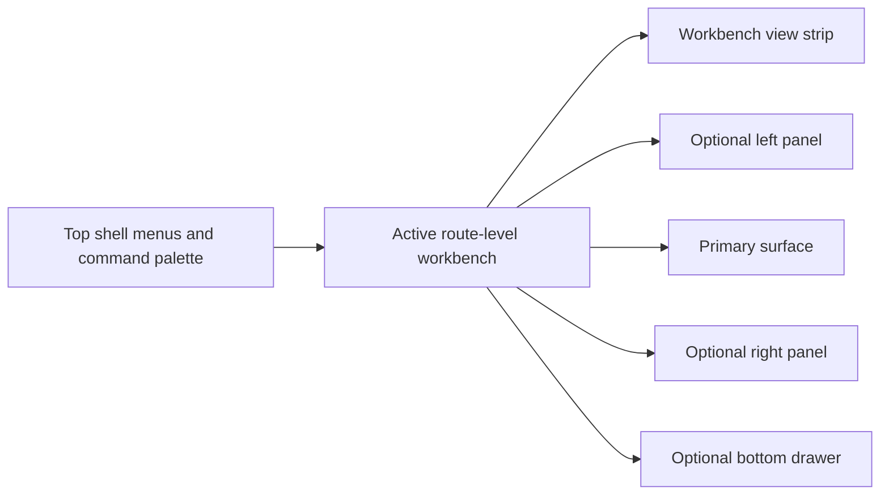

Implementation rules:

1. Keep one persistent shell.
2. Keep one active route-level workbench at a time.
3. Do not introduce a fixed left navigation rail inside Canvas.
4. Use side panels for context, not as hidden second applications.
5. Keep domain semantics in DVT adapters, not in third-party component objects.
6. Reuse mature libraries for hard interaction problems before writing custom
   versions.
7. Treat the per-screen manuals and user stories as the acceptance contract for
   each route-level workbench.

### Ownership Model

#### Shell

Owns:

- top bar;
- health banner;
- command/menu discovery, global navigation fallback, read-only workspace
  context, and any remaining shell navigation compatibility surface;
- route outlet;
- bottom drawer visibility;
- focus mode and global shell controls.

Does not own:

- graph semantics;
- run semantics;
- diff semantics;
- Canvas route command placement;
- feature-local orchestration.

#### Route-Level Workbenches

Own:

- route-specific composition;
- route-specific loading, empty, degraded, and error states;
- route-specific commands;
- route-specific supporting panels and tabs.
- route-specific user-manual expectations and story-level acceptance criteria.

#### Libraries

Libraries own primitives, not product semantics:

- React Flow owns graph interaction primitives;
- TanStack Query owns query orchestration;
- TanStack Table owns dense table primitives;
- Monaco owns code-editor and diff-editor primitives;
- xterm.js owns terminal-grade console rendering if justified.

DVT still owns:

- route behavior;
- domain naming;
- state boundaries;
- capability contracts;
- UX acceptance rules.

#### Generated Source Rule

The frontend may own:

- template selection;
- parameter capture;
- generated-source preview;
- diff, export, and review UX.

The frontend must not own:

- provider execution semantics;
- freeform string-concatenation code generation inside React components;
- hidden mutation of backend templates from view-local state.

Generation contracts, template semantics, and provider-specific translation
must stay behind governed DVT services and backend contracts.

### Implementation Sequence

#### Phase 1. Stabilize the shell grammar

- keep the shell persistent and low-noise;
- formalize left nav, route outlet, optional side panels, and bottom drawer;
- make focus mode and panel recovery consistent.

Primary tasks:

- `F-01`
- `F-15`

#### Phase 2. Fix state and query ownership

- keep state in named slices;
- standardize TanStack Query boundaries and invalidation;
- isolate mock-versus-API behavior behind services and capabilities.

Primary tasks:

- `F-04`
- `F-05`
- `F-06`

#### Phase 3. Harden the main route workbenches

- Canvas as the authoring workbench;
- Runs as the operational workbench;
- Lineage, Code, Diff, and Artifacts as supporting workbenches with the same shell
  grammar.

Primary tasks:

- `F-08`
- `F-09`
- `F-10`
- `F-11`

#### Phase 4. Upgrade dense surfaces

- move runs and event-heavy views to TanStack Table when cards stop scaling;
- deepen `Code` and `Diff` with governed file-history review and revision
  handoff once query boundaries and Monaco-backed review are ready;
- move `Diff` and `Artifacts` to Monaco-backed review panes when basic viewers
  stop scaling;
- prepare `Templates` to reuse Monaco for preview and diff without turning the
  frontend into a freeform IDE;
- move console and log playback to xterm.js only if the product needs
  terminal-grade streaming.

Primary tasks:

- `F-16`
- `F-17`
- `F-18`
- `F-23`

#### Phase 5. Add governed source generation

- add a route-level workbench for execution templates and code generation;
- keep parameter input structured and schema-driven;
- preview and diff generated source before export or apply;
- support governed scaffolds such as Snowflake tasks, procedures, and ETL
  execution templates.

Primary task:

- `F-21`

#### Phase 6. Separate open-data presentation from operator workbench

- keep the workbench grammar for operator routes;
- use the Marquez visual system only for public or explanatory public-data
  surfaces.

Primary task:

- `F-19`

### Definition Of Done By Surface

#### Shell

Done when:

- shell frame is persistent;
- secondary shell actions are consolidated;
- left nav and panel recovery are consistent;
- degraded and offline status are visible.

#### Canvas

Done when:

- explorer and inspector are optional and recoverable;
- graph commands live in the route-local toolbar and never in the persistent
  global top bar;
- first-canvas selection stays quiet until a canvas document exists;
- run and plan handoff works without route confusion;
- runtime overlays do not mutate graph truth.

#### Runs

Done when:

- `/runs` supports real list and filter behavior;
- `/runs/:runId` behaves like one run workspace composed from explicit read
  models;
- runtime authority is aligned to `POST /runs/start`, `GET /runs/:runId`, and
  `GET /runs/:runId/events`;
- snapshot and timeline states are truthful and no fake aggregate detail is
  shown;
- dense tables replace cards where required by scale.

#### Code, Diff, And Artifacts

Done when:

- `Code` supports read-only file browsing with explicit empty, loading, error,
  and read-only states;
- selected-file history stays in `Code`, while revision comparison hands off to
  `Diff`;
- users can review SQL, JSON, and structural deltas without placeholder panes;
- `Diff` and `Artifacts` use Monaco-backed viewers or diff panes where
  complexity justifies them;
- review state stays route-driven and understandable.

#### Console

Done when:

- bottom drawer purpose is explicit;
- real event or log playback is modeled;
- xterm.js is used only if structured panels are insufficient.

#### Execution Templates And Code Generation

Done when:

- template catalog and provider-profile choice are explicit;
- parameter capture is schema-driven instead of raw boilerplate editing;
- generated source can be previewed and diffed through a governed Monaco
  surface before export or apply;
- artifacts such as Snowflake tasks, procedures, and ETL scaffolds carry
  template provenance and workflow context;
- provider semantics still live in governed backend services, not in React
  component logic.

### Reference Documents

- [Screen Manuals And User Stories](screen-manuals-and-user-stories.md)
- [DVT Style Guide v0.2](style-guide.md)
- [Frontend Component Inventory](frontend-component-inventory.md)
- [Iconography And Design Tokens Contract](style-guide.md#section-iconography-and-design-tokens-contract)
- [Frontend Runtime Contract Technical Manual](runs/frontend-runtime-contract-technical-manual.md)
- [Frontend Runtime Contract User Manual](runs/frontend-runtime-contract-technical-manual.md#section-frontend-runtime-contract-user-manual)
- [Library And Open-Source Reference Stack](style-guide.md#section-library-and-open-source-reference-stack)

> Section status: Active. Owner: Frontend / Architecture. Colocation does not merge component responsibilities.
