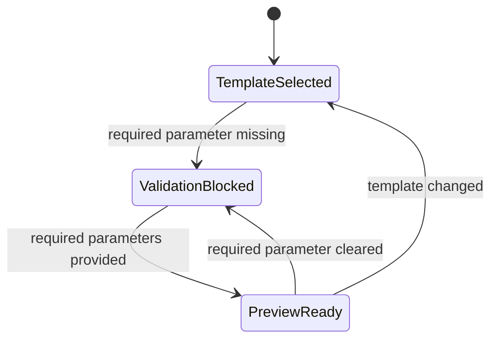
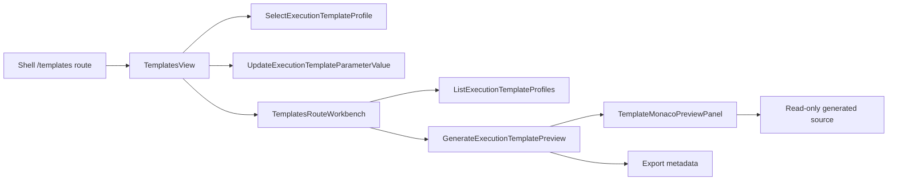
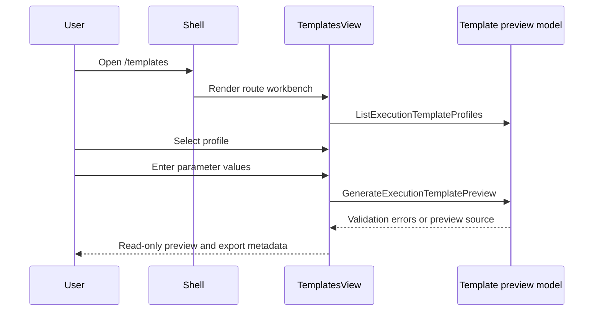
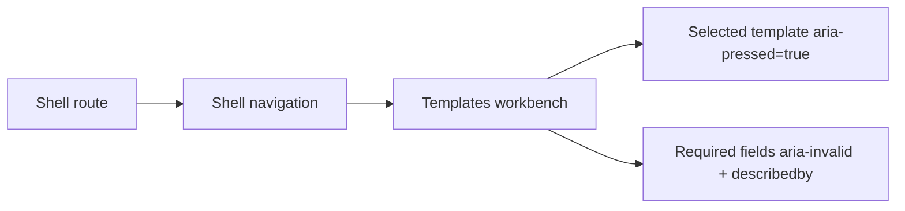
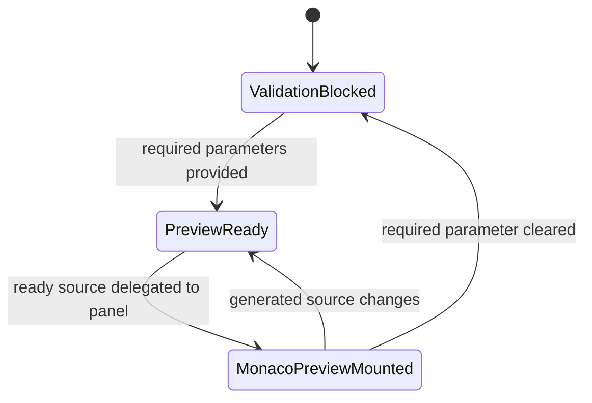
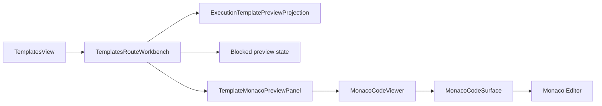

# Execution Template Source Generation Component

## Owned Concern

The Templates workbench owns presentation-local selection, parameter capture,
validation, deterministic preview generation, and export metadata for governed
execution-template scaffolds.

It does not own provider execution, persistence, credentials, backend template
contracts, or Monaco infrastructure. Those remain separate governed surfaces.

## Public API

| API                                       | Surface                                                           | Responsibility                                      |
| ----------------------------------------- | ----------------------------------------------------------------- | --------------------------------------------------- |
| `EXECUTION_TEMPLATE_CATALOG`              | `apps/web/src/app/views/templates/templatesViewModel.ts`          | Built-in read model for available template profiles |
| `resolveExecutionTemplateSelection`       | `apps/web/src/app/views/templates/templatesViewModel.ts`          | Route-local template selection state                |
| `resolveExecutionTemplatePreview`         | `apps/web/src/app/views/templates/templatesViewModel.ts`          | Validation and deterministic preview projection     |
| `TemplatesView`                           | `apps/web/src/app/views/TemplatesView.tsx`                        | Route controller and route-local command handlers   |
| `TemplatesRouteWorkbench`                 | `apps/web/src/app/views/templates/TemplatesRouteWorkbench.tsx`    | Workbench slot renderer                             |
| `TemplateMonacoPreviewPanel`              | `apps/web/src/app/views/templates/TemplateMonacoPreviewPanel.tsx` | Ready generated-source preview adapter              |
| DVT plugin `/templates` view contribution | `apps/web/src/app/plugins/dvt/dvtContributions.ts`                | Shell route registration                            |

## Command And Query Rails

| Rail                                    | Type    | DDD owner                            | Status      |
| --------------------------------------- | ------- | ------------------------------------ | ----------- |
| `ListExecutionTemplateProfiles`         | query   | `ExecutionTemplateCatalogReadModel`  | Implemented |
| `GenerateExecutionTemplatePreview`      | query   | `ExecutionTemplatePreviewProjection` | Implemented |
| `SelectExecutionTemplateProfile`        | command | `ExecutionTemplateSelectionState`    | Implemented |
| `UpdateExecutionTemplateParameterValue` | command | `ExecutionTemplateParameterState`    | Implemented |

## Invariants

- Preview generation is deterministic from the selected template and parameter
  values.
- Required parameters block preview and expose field-specific errors.
- Unknown template ids resolve to the first catalog entry rather than creating
  unowned semantics.
- Generated source is read-only route output; the route does not dispatch,
  persist, or apply generated artifacts.
- Ready generated source is inspected through `TemplateMonacoPreviewPanel` and
  the shared read-only `MonacoCodeViewer` gateway.
- Provider semantics are descriptive profile metadata until backend contracts
  accept provider-owned generation behavior.
- The route uses `RouteWorkbenchFrame` slots and does not create a parallel
  shell layout.

## Transitions

## Component Flow

## Consumers

| Consumer              | Relationship                                                              |
| --------------------- | ------------------------------------------------------------------------- |
| Shell navigation      | Shows Templates as an extended DVT route.                                 |
| Future Canvas handoff | May pass workflow context into the route after a governed rail exists.    |
| Future Diff handoff   | May review generated source deltas after F-17 preview work lands.         |
| F-17 Monaco work      | Provides the read-only Monaco preview adapter for ready generated source. |

## Non-Goals

- No provider execution or apply action.
- No backend persistence.
- No generic template engine.
- No credentials, tenant-specific catalog, or provider API calls.
- No Monaco editing, save, apply, or export command.

## Execution Template Source Generation User Stories

### Stories

| Story id         | Scenario                       | Acceptance criteria                                                                       |
| ---------------- | ------------------------------ | ----------------------------------------------------------------------------------------- |
| US-TEMPLATES-001 | Select a template profile      | User can open `/templates`, see provider profiles, and switch the selected profile.       |
| US-TEMPLATES-002 | Block incomplete generation    | Missing required parameters show field-specific validation and no generated source.       |
| US-TEMPLATES-003 | Generate preview               | Completing required fields produces deterministic read-only source and filename metadata. |
| US-TEMPLATES-004 | Preserve route ownership       | Templates uses the shared route workbench frame and is not embedded as a Canvas tab.      |
| US-TEMPLATES-005 | Avoid hidden backend authority | The route exposes preview/export posture only and does not persist, dispatch, or apply.   |
| US-TEMPLATES-006 | Navigate from shell            | User can reach Templates from shell navigation without manually entering the route URL.   |
| US-TEMPLATES-007 | Understand active form state   | The selected template and required-field errors are exposed through accessible state.     |

### UX Flow

### Negative Scenarios

| Scenario               | Expected result                                                | Guard                                          |
| ---------------------- | -------------------------------------------------------------- | ---------------------------------------------- |
| Required value empty   | Preview remains blocked with explicit required-field message.  | `templatesViewModel.test.ts` and Cypress flow. |
| Unknown template id    | Pure model falls back to first catalog entry.                  | `templatesViewModel.test.ts`.                  |
| Route tries to persist | Architecture guard rejects provider mutation wording in route. | `templatesWorkbench.architecture.test.ts`.     |
| Navigation drift       | Shell navigation still reaches `/templates`.                   | Cypress shell navigation flow.                 |

> Acceptance scope status: Accepted. Owner: See component owner.

## Execution Template Monaco Preview Component

### Owned Concern

The Templates Monaco preview component owns read-only inspection of generated
template source inside the `/templates` route.

It does not own template catalog semantics, parameter validation, source
generation, shell navigation, persistence, provider execution, or Monaco's
third-party editor binding.

### Public API

| API                          | Surface                                                           | Responsibility                                |
| ---------------------------- | ----------------------------------------------------------------- | --------------------------------------------- |
| `TemplateMonacoPreviewPanel` | `apps/web/src/app/views/templates/TemplateMonacoPreviewPanel.tsx` | Adapts one ready generated preview to Monaco. |
| `TemplatesRouteWorkbench`    | `apps/web/src/app/views/templates/TemplatesRouteWorkbench.tsx`    | Delegates ready preview rendering.            |
| `MonacoCodeViewer`           | `apps/web/src/app/components/monaco/MonacoCodeViewer.tsx`         | Lazy read-only Monaco code gateway.           |
| `ExecutionTemplatePreview`   | `apps/web/src/app/views/templates/templatesViewModel.ts`          | Preview projection consumed by the panel.     |

### Command And Query Rails

| Rail                               | Type  | DDD owner                            | Status      |
| ---------------------------------- | ----- | ------------------------------------ | ----------- |
| `GenerateExecutionTemplatePreview` | query | `ExecutionTemplatePreviewProjection` | Implemented |
| `ListExecutionTemplateProfiles`    | query | `ExecutionTemplateCatalogReadModel`  | Implemented |

### Invariants

- Monaco renders only `ready` previews.
- Blocked previews stay in the route validation state and do not mount Monaco.
- `TemplateMonacoPreviewPanel` is read-only and exposes no save, apply, export,
  or dispatch command.
- `TemplatesView` and `TemplatesRouteWorkbench` do not import
  `@monaco-editor/react` directly.
- The shared `MonacoCodeViewer` remains the only gateway from Templates to the
  Monaco code surface.
- Canvas production modules do not become Monaco hosts through this slice.

### Transitions

### Component Diagram

### Consumers

| Consumer            | Relationship                                                    |
| ------------------- | --------------------------------------------------------------- |
| Templates route     | Shows generated source as read-only Monaco preview.             |
| Cypress UX guard    | Proves the route still reaches a ready generated preview.       |
| F-17 parent         | Uses this as the Templates leg of the embedded Monaco strategy. |
| Future Diff handoff | May compare generated source after backend query rails exist.   |

### Non-Goals

- No edit mode.
- No export/download command.
- No backend template persistence.
- No provider execution.
- No route shell changes.

### Execution Template Monaco Preview User Stories

| Story ID      | User               | Goal                                         | Acceptance Criteria                                                          |
| ------------- | ------------------ | -------------------------------------------- | ---------------------------------------------------------------------------- |
| `US-F17D-001` | Analytics engineer | Review generated SQL with editor ergonomics. | A ready Snowflake task preview renders in read-only Monaco.                  |
| `US-F17D-002` | Operator           | Understand why preview is unavailable.       | Missing required parameters show blocked state and field-level messages.     |
| `US-F17D-003` | Maintainer         | Keep Templates route-owned.                  | Architecture guard proves route and workbench do not import Monaco directly. |
| `US-F17D-004` | Maintainer         | Reuse shared Monaco gateway.                 | Templates delegates ready preview to `MonacoCodeViewer`.                     |
| `US-F17D-005` | Product reviewer   | Avoid fake commands.                         | Preview has no save, apply, dispatch, or export command in this slice.       |

#### Scenario Matrix

| Scenario                 | State   | Expected UX                                       | Guard                                         |
| ------------------------ | ------- | ------------------------------------------------- | --------------------------------------------- |
| Required fields missing  | blocked | Validation state only, no Monaco viewer.          | `TemplatesView.test.tsx`                      |
| Required fields complete | ready   | Monaco read-only preview with deterministic text. | `TemplateMonacoPreviewPanel.test.tsx`         |
| Route ownership drift    | n/a     | Route delegates to panel and not editor binding.  | `templatesMonacoPreview.architecture.test.ts` |
| Fake command temptation  | n/a     | No save/export/apply affordance.                  | `templatesMonacoPreview.architecture.test.ts` |

#### Boundaries

- Templates previews generated source only.
- The Monaco panel is not an editor.
- Generated source remains local presentation output until backend contracts
  define a persisted template-generation rail.

> Acceptance scope status: Accepted. Owner: See component owner.

> Section status: Accepted. Owner: See named component boundary. Colocation does not merge component responsibilities.
