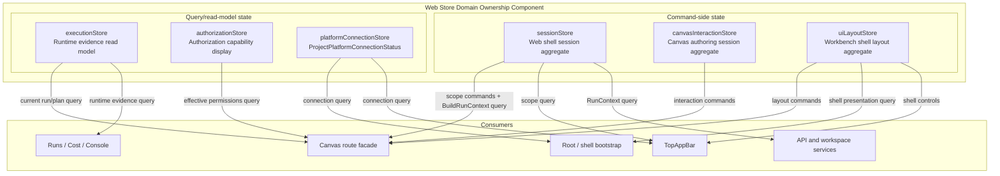
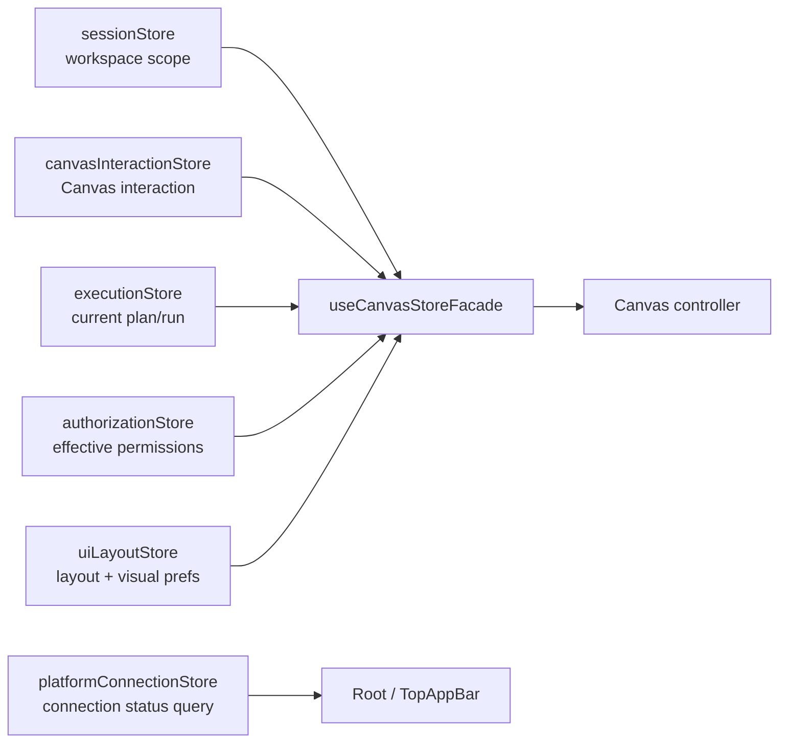
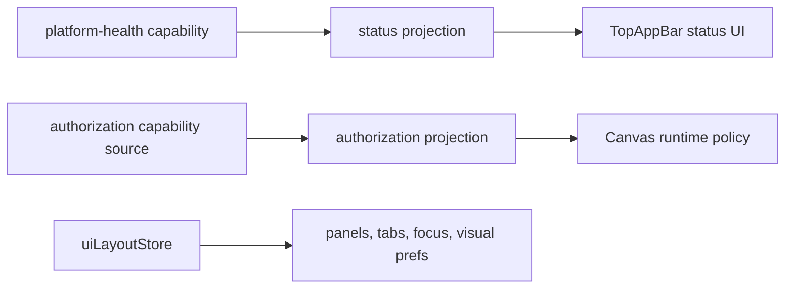

# Web Store Domain Ownership Component

This page is the current component map for the active Zustand store surfaces in
`apps/web`. It exists so F-05 can be reviewed against the code that exists now,
not against the retired `appStore.ts` aggregate.

Use this guide with:

- [Local component guide](./web-store-domain-ownership-local-guide.md)
- [User stories](web-store-domain-ownership-component.md#section-web-store-domain-ownership-user-stories)
- [Fowler analysis mailbox](https://github.com/dunay2/dvt/blob/f921266eaa528f9533cb5545f7678a408920935e/buzon/20260503-codex-fowler-web-store-domain-ownership-analysis-and-remediation.md)
- [F-05 closure plan](../../../planning/proposals/mandatory/frontend-and-ux/f05-store-domain-ownership-closure-plan-20260503.md)

Canonical local paths:

- `docs/architecture/components/web/web-store-domain-ownership-local-guide.md`
- `docs/architecture/components/web/web-store-domain-ownership-component.md`

## Local Guide Boundary

This component page is the review index and ownership map. Detailed public API,
invariants, transitions, consumers, and semantic encapsulation rules live in the
[local component guide](./web-store-domain-ownership-local-guide.md).

The local guide is canonical for method-level usage rules. This page repeats
only the review-critical ownership hook: `connectionStatus is not layout state`.
The detailed transition from the authoritative `PlatformConnectionState` query
into `ProjectPlatformConnectionStatus` is owned by the local guide.

## Current Component Map

| Store                        | Component role              | DDD owner                          | Command/query role | Reason to exist                                                                                           |
| ---------------------------- | --------------------------- | ---------------------------------- | ------------------ | --------------------------------------------------------------------------------------------------------- |
| `sessionStore.ts`            | Workspace session state     | Web shell session aggregate        | command/query      | Owns tenant, project, environment, target adapter, and `RunContext` construction for route and API calls. |
| `canvasInteractionStore.ts`  | Canvas interaction state    | Canvas authoring session aggregate | command            | Owns selected nodes, inspector focus, overlays, viewport, and node position persistence by workspace key. |
| `executionStore.ts`          | Runtime evidence projection | Runtime evidence read model        | query              | Carries current plan/run selections for Canvas, Runs, Cost, and Console.                                  |
| `authorizationStore.ts`      | Authorization projection    | Web authorization read model       | query              | Owns effective UI permissions after the hard cut; no compatibility through `executionStore.ts`.           |
| `uiLayoutStore.ts`           | Workbench shell layout      | Web shell layout aggregate         | command            | Owns panel visibility, focus mode, tabs, grid size, and canvas palette.                                   |
| `platformConnectionStore.ts` | Platform connection status  | Platform health read model         | query              | Owns `ProjectPlatformConnectionStatus` for shell presentation without persisting it as layout.            |

## Component Diagram

## Store Method Inventory

The table is the current method-level ownership map. New methods must be added
here before implementation so the DDD owner and C&Q rail are explicit.

| Store                        | Method or state surface     | Type    | DDD owner                          | Rail                              | Notes                                                                 |
| ---------------------------- | --------------------------- | ------- | ---------------------------------- | --------------------------------- | --------------------------------------------------------------------- |
| `sessionStore.ts`            | `tenantId`                  | query   | Web shell session aggregate        | Workspace scope selection         | Current tenant scope.                                                 |
| `sessionStore.ts`            | `projectId`                 | query   | Web shell session aggregate        | Workspace scope selection         | Current project scope.                                                |
| `sessionStore.ts`            | `environmentId`             | query   | Web shell session aggregate        | Workspace scope selection         | Current environment scope.                                            |
| `sessionStore.ts`            | `targetAdapter`             | query   | Web shell session aggregate        | Workspace scope selection         | Current run target adapter.                                           |
| `sessionStore.ts`            | `setTenantId`               | command | Web shell session aggregate        | Workspace scope selection         | Changes tenant scope.                                                 |
| `sessionStore.ts`            | `setProjectId`              | command | Web shell session aggregate        | Workspace scope selection         | Changes project scope.                                                |
| `sessionStore.ts`            | `setEnvironmentId`          | command | Web shell session aggregate        | Workspace scope selection         | Changes environment scope.                                            |
| `sessionStore.ts`            | `setTargetAdapter`          | command | Web shell session aggregate        | Workspace scope selection         | Changes target adapter.                                               |
| `sessionStore.ts`            | `setSessionContext`         | command | Web shell session aggregate        | Workspace scope selection         | Updates multiple scope fields atomically.                             |
| `sessionStore.ts`            | `buildRunContext`           | query   | Web shell session aggregate        | Build run context                 | Builds command payload context for run actions.                       |
| `canvasInteractionStore.ts`  | `selectedNodes`             | query   | Canvas authoring session aggregate | Canvas interaction updates        | Current selected Canvas node ids.                                     |
| `canvasInteractionStore.ts`  | `impactOverlayEnabled`      | query   | Canvas authoring session aggregate | Canvas interaction updates        | Current impact overlay state.                                         |
| `canvasInteractionStore.ts`  | `columnLevelLineageEnabled` | query   | Canvas authoring session aggregate | Canvas interaction updates        | Current lineage overlay state.                                        |
| `canvasInteractionStore.ts`  | `canvasLayouts`             | query   | Canvas authoring session aggregate | Canvas interaction updates        | Persisted viewport and node positions by workspace key.               |
| `canvasInteractionStore.ts`  | `inspectorNodeId`           | query   | Canvas authoring session aggregate | Canvas interaction updates        | Current inspector focus.                                              |
| `canvasInteractionStore.ts`  | `setSelectedNodes`          | command | Canvas authoring session aggregate | Canvas interaction updates        | Updates selection.                                                    |
| `canvasInteractionStore.ts`  | `toggleImpactOverlay`       | command | Canvas authoring session aggregate | Canvas interaction updates        | Toggles impact overlay.                                               |
| `canvasInteractionStore.ts`  | `toggleColumnLevelLineage`  | command | Canvas authoring session aggregate | Canvas interaction updates        | Toggles column-level lineage.                                         |
| `canvasInteractionStore.ts`  | `setCanvasViewport`         | command | Canvas authoring session aggregate | Canvas interaction updates        | Persists viewport by workspace key.                                   |
| `canvasInteractionStore.ts`  | `setCanvasNodePositions`    | command | Canvas authoring session aggregate | Canvas interaction updates        | Persists node positions by workspace key.                             |
| `canvasInteractionStore.ts`  | `setInspectorNode`          | command | Canvas authoring session aggregate | Canvas interaction updates        | Sets inspector focus.                                                 |
| `uiLayoutStore.ts`           | `leftNavCollapsed`          | query   | Web shell layout aggregate         | Shell panel/layout updates        | Current left navigation display.                                      |
| `uiLayoutStore.ts`           | `explorerPanelWidth`        | query   | Web shell layout aggregate         | Shell panel/layout updates        | Current explorer width.                                               |
| `uiLayoutStore.ts`           | `explorerPanelVisible`      | query   | Web shell layout aggregate         | Shell panel/layout updates        | Current explorer visibility.                                          |
| `uiLayoutStore.ts`           | `inspectorPanelWidth`       | query   | Web shell layout aggregate         | Shell panel/layout updates        | Current inspector width.                                              |
| `uiLayoutStore.ts`           | `inspectorPanelVisible`     | query   | Web shell layout aggregate         | Shell panel/layout updates        | Current inspector visibility.                                         |
| `uiLayoutStore.ts`           | `bottomDrawerHeight`        | query   | Web shell layout aggregate         | Shell panel/layout updates        | Current bottom operational drawer height.                             |
| `uiLayoutStore.ts`           | `bottomDrawerVisible`       | query   | Web shell layout aggregate         | Shell panel/layout updates        | Current bottom operational drawer visibility.                         |
| `uiLayoutStore.ts`           | `focusMode`                 | query   | Web shell layout aggregate         | Shell panel/layout updates        | Current focus-mode state.                                             |
| `uiLayoutStore.ts`           | `gridSize`                  | query   | Web shell layout aggregate         | Shell panel/layout updates        | Current Canvas grid preference.                                       |
| `uiLayoutStore.ts`           | `canvasPalette`             | query   | Web shell layout aggregate         | Shell panel/layout updates        | Current Canvas palette preference.                                    |
| `uiLayoutStore.ts`           | `activeTabs`                | query   | Web shell layout aggregate         | Shell panel/layout updates        | Current shell tab list.                                               |
| `uiLayoutStore.ts`           | `activeTabId`               | query   | Web shell layout aggregate         | Shell panel/layout updates        | Current active shell tab.                                             |
| `uiLayoutStore.ts`           | `toggleLeftNav`             | command | Web shell layout aggregate         | Shell panel/layout updates        | Toggles left navigation.                                              |
| `uiLayoutStore.ts`           | `setExplorerPanelWidth`     | command | Web shell layout aggregate         | Shell panel/layout updates        | Changes explorer width.                                               |
| `uiLayoutStore.ts`           | `setInspectorPanelWidth`    | command | Web shell layout aggregate         | Shell panel/layout updates        | Changes inspector width.                                              |
| `uiLayoutStore.ts`           | `setBottomDrawerHeight`     | command | Web shell layout aggregate         | Shell panel/layout updates        | Changes bottom operational drawer height.                             |
| `uiLayoutStore.ts`           | `toggleFocusMode`           | command | Web shell layout aggregate         | Shell panel/layout updates        | Toggles focus mode.                                                   |
| `uiLayoutStore.ts`           | `toggleExplorerPanel`       | command | Web shell layout aggregate         | Shell panel/layout updates        | Toggles explorer visibility.                                          |
| `uiLayoutStore.ts`           | `toggleInspectorPanel`      | command | Web shell layout aggregate         | Shell panel/layout updates        | Toggles inspector visibility.                                         |
| `uiLayoutStore.ts`           | `toggleBottomDrawer`        | command | Web shell layout aggregate         | Shell panel/layout updates        | Toggles bottom operational drawer visibility and default height.      |
| `uiLayoutStore.ts`           | `hideBottomDrawer`          | command | Web shell layout aggregate         | Shell panel/layout updates        | Hides bottom operational drawer.                                      |
| `uiLayoutStore.ts`           | `showExplorerPanel`         | command | Web shell layout aggregate         | Shell panel/layout updates        | Shows explorer panel.                                                 |
| `uiLayoutStore.ts`           | `hideExplorerPanel`         | command | Web shell layout aggregate         | Shell panel/layout updates        | Hides explorer panel.                                                 |
| `uiLayoutStore.ts`           | `showInspectorPanel`        | command | Web shell layout aggregate         | Shell panel/layout updates        | Shows inspector panel.                                                |
| `uiLayoutStore.ts`           | `hideInspectorPanel`        | command | Web shell layout aggregate         | Shell panel/layout updates        | Hides inspector panel.                                                |
| `uiLayoutStore.ts`           | `setGridSize`               | command | Web shell layout aggregate         | Shell panel/layout updates        | Changes Canvas grid preference.                                       |
| `uiLayoutStore.ts`           | `setCanvasPalette`          | command | Web shell layout aggregate         | Shell panel/layout updates        | Changes Canvas palette preference.                                    |
| `uiLayoutStore.ts`           | `addTab`                    | command | Web shell layout aggregate         | Shell panel/layout updates        | Adds and activates a shell tab.                                       |
| `uiLayoutStore.ts`           | `closeTab`                  | command | Web shell layout aggregate         | Shell panel/layout updates        | Closes a shell tab and resolves next active tab.                      |
| `uiLayoutStore.ts`           | `setActiveTab`              | command | Web shell layout aggregate         | Shell panel/layout updates        | Sets active shell tab.                                                |
| `platformConnectionStore.ts` | `connectionStatus`          | query   | Platform health read model         | `ProjectPlatformConnectionStatus` | Current REST and live-event connection projection for shell display.  |
| `platformConnectionStore.ts` | `setConnectionStatus`       | command | Platform health read model         | `ProjectPlatformConnectionStatus` | Updates the local projection from the authoritative health query.     |
| `executionStore.ts`          | `currentPlan`               | query   | Runtime evidence read model        | Current run/plan display          | Current plan projection.                                              |
| `executionStore.ts`          | `currentRun`                | query   | Runtime evidence read model        | Current run/plan display          | Current run projection.                                               |
| `executionStore.ts`          | `setCurrentPlan`            | command | Runtime evidence read model        | Current run/plan display          | Updates current plan projection.                                      |
| `executionStore.ts`          | `setCurrentRun`             | command | Runtime evidence read model        | Current run/plan display          | Updates current run projection.                                       |
| `authorizationStore.ts`      | `userPermissions`           | query   | Web authorization read model       | Authorization capability display  | Effective UI permissions for Canvas and shell authoring controls.     |
| `authorizationStore.ts`      | `setUserPermissions`        | command | Web authorization read model       | Authorization capability display  | Replaces the effective permissions projection; no execution fallback. |

## Current Cross-Store Composition

`useCanvasStoreFacade` is the active route-level composition seam. It reads the
four stores explicitly and exposes the Canvas controller state needed by the
route. This is allowed because it is a route facade, not a hidden replacement
for `appStore.ts`.

## Closed Drift

| Closed drift                                  | Previous file                               | Current owner                                        | Guardrail                                                                     |
| --------------------------------------------- | ------------------------------------------- | ---------------------------------------------------- | ----------------------------------------------------------------------------- |
| Platform connection inside shell layout       | `apps/web/src/app/stores/uiLayoutStore.ts`  | `apps/web/src/app/stores/platformConnectionStore.ts` | `uiLayoutStore.test.ts`, `platformConnectionStore.test.ts`.                   |
| Permission projection inside runtime evidence | `apps/web/src/app/stores/executionStore.ts` | `apps/web/src/app/stores/authorizationStore.ts`      | `authorizationStore.test.ts`, `webStoreDomainOwnership.architecture.test.ts`. |
| Retired global aggregate store                | `apps/web/src/app/stores/appStore.ts`       | No active owner; surface remains absent.             | `canvasRoutePosturePriority.architecture.test.ts`, query-key guard.           |

Hard cut complete: no open F-05 store ownership drift remains in this branch.
Historical documents may still mention retired surfaces as historical evidence,
but active component governance routes through this page and the local guide.

## Legacy And Barrel Rules

- `apps/web/src/app/stores/appStore.ts` must remain absent.
- `apps/web/src/app/stores/index.ts` must remain absent.
- New store state must be added to one named owner or to a new bounded store
  with this page updated first.
- Route facades may compose stores, but they must not become a generic global
  store API.

## Verification Surfaces

| Rule                                    | Current proof                                                                                       |
| --------------------------------------- | --------------------------------------------------------------------------------------------------- |
| No legacy aggregate store               | `canvasRoutePosturePriority.architecture.test.ts` asserts `appStore.ts` does not exist.             |
| No query imports from retired aggregate | `queryKeyPolicy.architecture.test.ts` forbids `stores/appStore` imports in query surfaces.          |
| Canvas layout remains route-local       | `canvasInteractionStore.test.ts` covers persisted layout hydration.                                 |
| Shell layout remains bounded            | `uiLayoutStore.test.ts` covers persisted layout normalization.                                      |
| Platform status is not shell layout     | `platformConnectionStore.test.ts` and `uiLayoutStore.test.ts` cover the ownership split.            |
| Authorization is not runtime evidence   | `authorizationStore.test.ts` and `webStoreDomainOwnership.architecture.test.ts` cover the hard cut. |

## Closed Ownership Topology

The closed ownership topology now has this shape:

This preserves current product behavior while keeping connection state out of
layout ownership and authorization state out of runtime evidence ownership.

## Web Store Domain Ownership User Stories

These stories cover the active F-05 store domain ownership scenarios. They are
architecture stories: their user is a product user, reviewer, or maintainer
depending on the scenario.

### User Stories

#### US-WEB-STORE-001 - Workspace Scope Selection

As a user changing tenant, project, environment, or target adapter, I want the
workspace scope to be owned by one shell-session store so run actions and
workspace reads use the same scope.

Acceptance:

- `useSessionStore` owns tenant, project, environment, and target adapter.
- `buildRunContext` is the single local query that projects scope into run
  command context.
- No layout or Canvas interaction store owns workspace scope.

#### US-WEB-STORE-002 - Canvas Interaction State

As a Canvas user, I want selection, overlays, inspector focus, viewport, and
node positions to survive route interaction without becoming global app state.

Acceptance:

- `useCanvasInteractionStore` owns Canvas interaction commands.
- Canvas layout persistence remains keyed by workspace.
- Route facades compose this store explicitly.

#### US-WEB-STORE-003 - Shell Layout Control

As a workbench user, I want panels, tabs, focus mode, grid size, and palette to
behave as shell preferences without carrying runtime health or execution
authority.

Acceptance:

- `useUiLayoutStore` owns shell layout commands and visual preferences.
- `connectionStatus is not layout state`.
- Persisted layout storage cannot rehydrate platform connection fields.

#### US-WEB-STORE-004 - Platform Connection Status

As a user looking at the shell connection indicator, I want REST and live-event
connection status to reflect the platform-health read model.

Acceptance:

- `usePlatformConnectionStore` owns `ProjectPlatformConnectionStatus`.
- `Root` updates the projection from the authoritative platform-health query.
- `TopAppBar` reads the projection or a direct health override.

#### US-WEB-STORE-005 - Runtime Evidence Display

As a user inspecting runs, cost, or console context, I want current plan and run
evidence to be available without being mixed with shell layout state.

Acceptance:

- `useExecutionStore.currentPlan` and `useExecutionStore.currentRun` are runtime
  evidence read-model fields.
- Runs, Cost, Console, and Canvas facade consumers read evidence through the
  explicit store.
- Authorization does not share this store after the hard cut.

#### US-WEB-STORE-006 - Authorization Capability Display

As a Canvas user, I want planning, run, edge-edit, plugin, and RBAC actions to
follow one explicit authorization projection rather than hidden runtime
evidence defaults.

Acceptance:

- `useAuthorizationStore.userPermissions` owns effective UI capabilities.
- `useExecutionStore.userPermissions` is forbidden; no compatibility path is
  accepted.
- Canvas route facades compose runtime evidence and authorization explicitly.

#### US-WEB-STORE-007 - Reviewer Semantic Guard

As a reviewer, I want store ownership to be guarded semantically so a future
change cannot reintroduce an aggregate store, hidden barrel, or layout/status
mix while keeping tests green.

Acceptance:

- Store modules start with owned-concern docblocks.
- The local component guide names public API, invariants, transitions, and
  consumers.
- `webStoreDomainOwnership.architecture.test.ts` validates semantic ownership,
  documentation, and hard-cut language.

### Scenario Coverage Matrix

| Story            | Primary files                                             | Required proof                                                               |
| ---------------- | --------------------------------------------------------- | ---------------------------------------------------------------------------- |
| US-WEB-STORE-001 | `sessionStore.ts`                                         | `webStoreDomainOwnership.architecture.test.ts`, `Root.shellChrome.test.tsx`  |
| US-WEB-STORE-002 | `canvasInteractionStore.ts`                               | `canvasInteractionStore.test.ts`, Canvas facade architecture tests           |
| US-WEB-STORE-003 | `uiLayoutStore.ts`                                        | `uiLayoutStore.test.ts`, `webStoreDomainOwnership.architecture.test.ts`      |
| US-WEB-STORE-004 | `platformConnectionStore.ts`, `Root.tsx`, `TopAppBar.tsx` | `platformConnectionStore.test.ts`, `Root.platformHealthBanner.test.tsx`      |
| US-WEB-STORE-005 | `executionStore.ts`                                       | `webStoreDomainOwnership.architecture.test.ts`, runtime view tests           |
| US-WEB-STORE-006 | `authorizationStore.ts`, Canvas facade                    | `authorizationStore.test.ts`, `webStoreDomainOwnership.architecture.test.ts` |
| US-WEB-STORE-007 | Component guide, local guide, mailbox, architecture test  | `webStoreDomainOwnership.architecture.test.ts`                               |

### Scenario Catalog

| Scenario                                            | Story            | Expected result                                                                  | Negative proof                                                                        |
| --------------------------------------------------- | ---------------- | -------------------------------------------------------------------------------- | ------------------------------------------------------------------------------------- |
| User changes workspace scope.                       | US-WEB-STORE-001 | Run context reads the same tenant/project/environment/adapter from session.      | Layout, Canvas interaction, and execution stores do not define workspace scope.       |
| Canvas persists node positions per workspace key.   | US-WEB-STORE-002 | Positions and viewport hydrate only for the matching workspace key.              | A different workspace key does not reuse the previous Canvas layout.                  |
| User toggles shell panels and visual preferences.   | US-WEB-STORE-003 | Layout commands update shell-only state.                                         | Persisted layout cannot restore `connectionStatus` or authorization fields.           |
| Platform health changes while the shell is mounted. | US-WEB-STORE-004 | Root writes `ProjectPlatformConnectionStatus`; TopBar displays that projection.  | `uiLayoutStore` has no `connectionStatus` command, state field, or type import.       |
| A plan or run becomes current.                      | US-WEB-STORE-005 | Runtime views and Canvas read current plan/run from `useExecutionStore`.         | `executionStore` does not expose authorization types, defaults, or `userPermissions`. |
| Canvas policy reads effective user capabilities.    | US-WEB-STORE-006 | Planning, running, edge editing, plugins, and RBAC read `useAuthorizationStore`. | No compatibility selector, bridge, alias, or barrel can route through execution.      |
| Reviewer checks future store changes.               | US-WEB-STORE-007 | Docs, owned-concern docblocks, and semantic architecture tests agree.            | A thin-file-only change cannot pass without matching owner, rail, and story docs.     |

### TDD Traceability

- `platformConnectionStore.test.ts` proved the new platform connection read
  model owns partial status updates.
- `uiLayoutStore.test.ts` proved layout hydration does not revive legacy
  `connectionStatus`.
- `authorizationStore.test.ts` proved effective UI permissions live outside
  runtime evidence.
- `webStoreDomainOwnership.architecture.test.ts` proves the semantic component
  docs, owned-concern docblocks, and hard-cut language remain aligned.

> Acceptance scope status: Active. Owner: Web / Architecture.
