# Web Vitest Changed Suite Router Component

## Purpose

Own the query that maps changed `@dvt/web` files to the smallest safe test
obligations for local development and non-root-sensitive pull requests.

Owned concern: `WebVitestChangedSuiteRouter` converts file paths into catalog
owned suite commands. It accelerates local development and the `Web Frontend
Tests` pull-request lane while preserving full primary-suite coverage on
`main`, manual workflow runs, and root-build-sensitive changes.

## Public API

<!-- markdownlint-disable MD060 -->

| Surface                             | Type     | Responsibility                                                 |
| ----------------------------------- | -------- | -------------------------------------------------------------- |
| `resolveWebVitestChangedSuitePlan`  | function | Maps changed paths to ordered suite names and commands.        |
| `WEB_VITEST_CHANGED_SUITE_COMMANDS` | constant | Names the package-local command for each routed suite.         |
| `test:changed`                      | command  | Runs dependency build once, then routed web suite commands.    |
| `test:canvas-unit`                  | command  | Runs Canvas unit-model focus tests.                            |
| `test:canvas-presentation`          | command  | Runs Canvas presentation focus tests.                          |
| `test:canvas-architecture`          | command  | Runs Canvas architecture focus tests.                          |
| `test:monaco`                       | command  | Runs Monaco route-surface focus tests.                         |
| `test:shell-session`                | command  | Runs app shell, session, scope, and service-composition tests. |
| `test:workspace-services`           | command  | Runs workspace service port/facade focus tests.                |
| `test:web:changed`                  | command  | Root alias for the package-local changed-suite command.        |
| `run-vitest-changed-suites.ts`      | adapter  | Reads Git/`--files` inputs and runs grouped suite commands.    |
| `Web Frontend Tests` PR route       | CI job   | Runs changed-suite routing for ordinary web PR changes.        |

<!-- markdownlint-enable MD060 -->

## Invariants

- The router never changes primary suite ownership.
- Architecture-governance paths route to `architecture`.
- Web source edits also require the complete `architecture` primary suite:
  filesystem-reading guards can inspect sources outside their own focus lane.
  A paired changed test does not replace this obligation. Test-only diffs keep
  exact routing, and the existing full-suite normalization absorbs exact and
  Canvas architecture batches. This retains cross-module boundary evidence
  without another dependency catalog or running every behavioral suite.
- Canvas route paths and Canvas-owned component/inspector surfaces route to
  `canvas-unit`, `canvas-presentation`, or `canvas-architecture` when the file
  type makes that safe.
- Canvas-owned component surfaces under `src/app/components/canvas/**`,
  `src/app/components/inspector/**`, and `src/app/components/InspectorPanel.tsx`
  stay in Canvas behavioral focus lanes. They must not fall back to the full
  `unit` or `presentation` primary suites only because they live outside
  `src/app/views/canvas/**`. The architecture obligation is independent.
- Monaco-scoped paths route to `monaco` when the change is local to Code,
  Artifacts/Diff Monaco guards, or shared Monaco code surfaces.
- App shell, session context, workspace-scope selection, session store,
  API-client context propagation, service composition, and their shared test
  doubles route to `shell-session` before the broad `unit` or `presentation`
  fallback.
- Workspace service paths under `src/app/services/workspace/**` route to
  `workspace-services` before the broad `unit` fallback.
- When a changed source file and its same-stem `*.test.*` or `*.spec.*` file
  both appear in the same diff, the router may run that exact test file instead
  of the broader suite.
- A source without a directly paired changed test requires its complete suite.
  Unrelated exact tests in that suite cannot cancel this requirement. When a
  complete suite is required, its exact tests are included by that run rather
  than executed again in a separate batch.
- Exact changed-test execution is batched by Vitest config, so one changed set
  with many architecture files still pays for one Vitest process for that
  architecture config.
- Governance changes to the suite catalog, configs, package scripts, router
  adapter, or router docs run all current `src/testing/vitestSuites*.architecture.test.ts`
  guards in one exact batch instead of the broad architecture suite. The
  inventory contract detects guards omitted after a split or addition.
- A complete primary suite absorbs its equivalent Canvas focus suite, including
  exact focus tests. The catalog contract proves file-set containment and equal
  execution configuration outside include/exclude patterns. An exact primary
  batch is not a complete suite and cannot absorb a Canvas focus run.
- Monaco, shell-session, and workspace-services retain their own execution
  contexts: their jsdom defaults are not interchangeable with Node primary
  suites. This normalization does not change environments, isolation or workers.
- Source files without a changed same-stem test keep the existing suite
  fallback, so unpaired source edits do not silently lose coverage.
- Non-Canvas `.tsx` paths route to `presentation`.
- Non-Canvas `.ts` paths route to `unit`.
- If no web-relevant changed file exists, the command exits successfully
  without running a Vitest suite.
- Pull-request CI may use `test:web:changed` only when the test scope is web
  and not root-build-sensitive.
- `main`, manual workflow runs, and root-build-sensitive PRs still use
  `test:web:ci`.

## Transitions

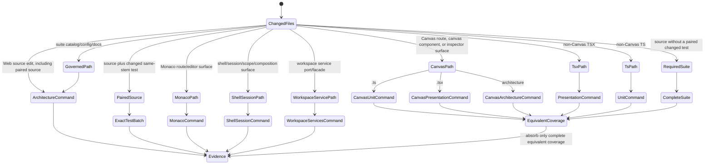

## Consumers

- Local frontend developers use `pnpm --filter @dvt/web test:changed`.
- Reviewers use `pnpm test:web:changed -- --files <paths>` to validate a patch
  without running the full web suite.
- The `Web Frontend Tests` GitHub matrix uses the same changed plan for Vitest
  and the three independent browser capabilities. Local execution without a
  phase still runs every selected obligation.
- Architecture tests use the router API to prevent command drift.
- Documentation uses this component to explain local feedback-loop sizing.

## Component Flow

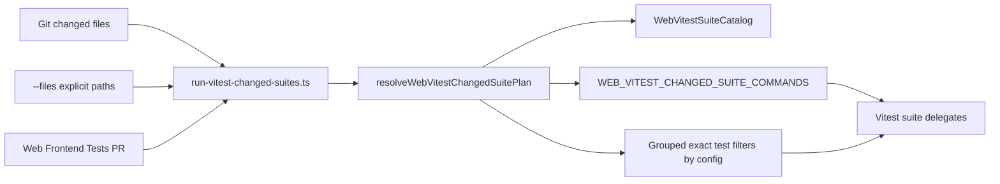

## Negative Rules

- Do not substitute changed Vitest selection for full primary suites on `main`,
  manual workflow runs, or root-build-sensitive pull requests.
- Do not add route-local changed-test scripts when the catalog can route them.
- Do not duplicate include/exclude glob semantics in the command adapter.
- Do not spawn one Vitest process per exact test when the same config can run
  the exact filters together.
- Do not suppress an unpaired source's suite because another test was changed.
- Do not treat Vitest as evidence for a Cypress change. Browser obligations use
  the admitted runtime below; unsupported browser changes fail closed.
- Do not make source files under `apps/web/src/testing/**` production services.

## Browser Evidence Boundary — GH-3540

### Large-graph browser cadence — GH-3604

Issue #3604 admits a bounded cadence change under design
`GH-3604-CANVAS-LARGE-GRAPH-NIGHTLY-V2` (superseding the initial scope to
include the existing CI workflow guard). The last case in
`canvas-ready-node-authoring.cy.ts` renders the canonical 1,000-node,
1,920-edge fixture. Its measured cost was 336,824 ms in the reconciled local
prepush and 130,494 ms in CI run 38998175192. The other thirteen cases are
functional authoring checks, not scale tests. Keeping these concerns in one
spec makes every affected controlled batch pay the stress cost.

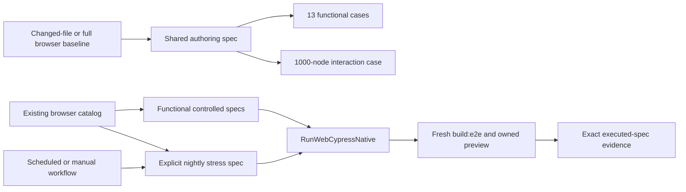

The existing `RouteChangedWebVitestSuites` query owns cadence admission in
`cypress.changed.ts`; cadence is not a fourth runtime capability. Its nightly
inventory is disjoint from the ordinary controlled/available/unavailable
inventory. A changed nightly spec selects its focused cadence guard and must
exist; it does not silently become an unknown file or execute the stress case
in prepush. Unknown browser paths and deleted admitted files still reject.
Ordinary and `--full` browser plans retain all functional specs, but exclude
only this separately scheduled stress case.

The focused cadence guard is also a member of the existing complete governance
guard registry in `vitest.suites.ts`. Global test configuration, the changed-suite
adapter and this component guide must select it alongside every other current
router guard. The existing discovery-based governance-routing regression owns
that obligation; adding a cadence guard must not create a second registry or
weaken the comparison with the actual test inventory.

The explicit manual `pnpm test:web:e2e` Docker command still means all specs
matching the Cypress configuration, including the nightly case. It is not used
by prepush or the PR/main browser matrix. This intentional operator opt-in does
not change the scheduled cadence of the governed changed/full browser plans.

`web-canvas-nightly.yml` runs the literal nightly spec on schedule and manual
dispatch through the unchanged controlled native runner. The runner builds
the application, owns preview startup/cleanup and rejects missing, skipped,
pending or failed Cypress evidence. The workflow uses the existing dependency
setup and explicitly builds `@dvt/web^...` through the canonical
`run-turbo-workspace-task.cjs build` owner before the native runner. The
`test:deps` convenience script is not a preparation authority in CI: its
`DVT_CI=1` short circuit assumes the dependency graph was already built.
The workflow also uses pinned actions, isolated concurrency, failure artifacts and an actionable
failure notification; it does not provision live providers. The thirteen
functional authoring cases, geometry cases at 10/30/60 nodes and inexpensive
large-graph unit tests remain in PR routing. Shared ready-authoring browser
setup has two actual consumers rather than a copied fixture or new runner.
Workflow-only diffs retain the canonical executable CI-tool test catalogue,
because they do not activate Web runtime jobs. The focused
`tools/ci/web-canvas-nightly.test.mjs` guard owns nightly workflow structure,
native command and trigger validation. Web guards own cadence routing, not a
second workflow validator. The CI guard interprets YAML scalars: equivalent
one-line and folded commands pass; wrong specs, appended commands, literal shell
newlines, missing proof and duplicate proof steps reject. Formatting must not
change the verdict. The same CI guard executes the declared build owner's argument
and dispatch path with `DVT_CI=1`, intercepting only process creation, to prove
the cold-runner preparation cannot silently skip. No additional PR matrix is introduced.

| Scenario                              | Opportunity                                  | Fowler pattern                                 | DDD owner                          | Command/query rail                          | Implementation surfaces                                                                           | Unit or package test                                                | Architecture test                                                         | User-flow test                                                     | Out of scope                                            |
| ------------------------------------- | -------------------------------------------- | ---------------------------------------------- | ---------------------------------- | ------------------------------------------- | ------------------------------------------------------------------------------------------------- | ------------------------------------------------------------------- | ------------------------------------------------------------------------- | ------------------------------------------------------------------ | ------------------------------------------------------- |
| Stress runs with functional authoring | Responsibility overload                      | Separate cadence policy from runtime adapter   | WebVitestChangedSuiteRouter        | RouteChangedWebVitestSuites                 | Existing browser catalog and nightly guard                                                        | Changed/full plan excludes only nightly                             | Disjoint fixture consumer admission; missing/unknown files reject         | Retained 13 functional cases and extracted nightly stress          | Other scale thresholds or PR coverage reductions        |
| Global test wiring changes            | Hidden authority                             | Complete existing governance registry          | WebVitestChangedSuiteRouter        | RouteChangedWebVitestSuites                 | Existing `vitest.suites.ts` guard registry                                                        | Global configuration selects all current guards                     | Discovery-based governance-routing regression remains unchanged           | Existing native functional and nightly proofs                      | Dynamic source discovery in production routing          |
| Extraction would duplicate bootstrap  | Duplicate semantics                          | Extract shared infrastructure harness          | Controlled ready-authoring session | RunWebCypressNative                         | canvasReadyAuthoring support and the two specs                                                    | Existing fixture contract                                           | Both consumers reuse setup                                                | Byte-identical stress actions and unchanged functional assertions  | New fixture, runner or product behavior                 |
| Scheduled evidence could disappear    | Hidden authority                             | Explicit workflow adapter and failure evidence | Browser proof runtime              | RunWebCypressNative                         | web-canvas-nightly workflow and focused CI nightly test                                           | Native runner contracts                                             | Exact spec, schedule/manual triggers, pinned actions and reporting        | Real isolated native proof with fresh build and owned preview      | Live provider setup, new PR matrix or timeout increases |
| Equivalent YAML formatting changes    | Test-only confidence and duplicate semantics | One semantic workflow test owner               | Canvas nightly workflow read model | RunWebCypressNative (existing; no new rail) | Focused CI nightly test, existing CI executable-test catalogue, parity test and Web cadence guard | Equivalent scalars pass; wrong command and proof cardinality reject | Focused CI test is registered; Web does not duplicate workflow validation | Existing real native nightly proof, unchanged product and workflow | Other security workflow checks or new runtime behavior  |

No product behavior, timeout, assertion, worker count, required PR check or live
runtime admission changes. This is not a claim that Canvas meets a latency SLA:
the retained stress scenario proves interaction operability. Other CI costs
remain outside this cut. Validation includes the focused cadence and existing
browser-routing guards, the native runner contracts, a real isolated nightly
execution, relevant lint/typecheck, and the normal final prepush and CI gates.

### Additive Browser Catalog Selection — GH-2931

The browser registry currently shares a TypeScript module with execution policy.
Adding one controlled spec therefore invalidates every browser capability. The
registry change is not a policy change; product changes must independently name
their evidence instead of relying on that incidental widening.

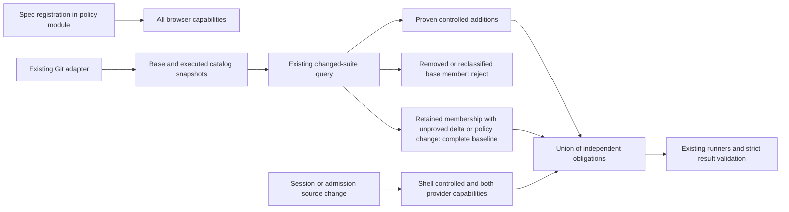

One `apps/web/cypress.catalog.json` replaces the spec arrays; it does not create
a parallel registry. A focused pure catalog module validates its shape and
classifies base/head changes. It accepts the three capability keys plus the
separate `nightly` cadence list, nonempty lists, canonical literal spec paths, and unique disjoint
membership. Unknown keys, duplicates, traversal, globs or malformed current data
reject before execution.

Only additions to `controlled` can narrow catalog-triggered evidence. Existing
controlled membership and relative order, both provider arrays and the nightly list must remain
unchanged. Every addition runs even if its spec file was already present. The
executed catalog must equal the verified HEAD snapshot before narrowing. A valid
base is also a retention witness: every prior member must remain in its original
capability or nightly cadence in both the executed catalog and any valid HEAD
snapshot. Members added in HEAD must also remain in the executed catalog.
Removal or reclassification rejects before any command is selected;
running only the remaining HEAD inventory would silently lose prior evidence.
This applies in full mode and with staged or working-tree divergence. The Git
adapter keeps both immutable witnesses and reports local catalog divergence
explicitly rather than discarding retention evidence. A missing or malformed base (including the first extraction),
reordering, additive provider changes or another unproved but nondestructive
delta selects the complete ordinary baseline. An unreadable Git reference is an
error. Legitimate retirement or cadence migration needs an explicitly governed
policy change, not a data-only catalog deletion or an implicit stress rerun.
The existing adapter owns snapshot reads; the policy owns classification. The
adapter pins one immutable base/head pair for automatic diff discovery and
catalog snapshots, so a moving branch reference cannot hide a catalog addition.

Product changes to session/bootstrap, project onboarding and project admission
retain independent browser obligations: all cataloged controlled shell journeys
and the complete available/unavailable provider capabilities. Test-only changes
do not acquire that product obligation. Shell journeys are derived from the
single catalog, so later session regressions join this obligation automatically.
This preserves real-provider auth evidence and existing shard ownership without
repeating unrelated controlled Canvas journeys. The stress case is excluded from
every ordinary browser plan, including full and policy-triggered plans.

Policy, runner, shared support and `--full` retain the complete ordinary baseline. The
catalog selects every existing router guard. Unknown consumers and missing
physical paths reject before phase/capability selection. No cache hit, previous
log, receipt or successful test is inferred by this selection policy.

| Scenario                    | Opportunity             | Fowler pattern                        | DDD owner                   | Command/query rail                               | Implementation surfaces                                                | Unit or package test                                                                             | Architecture test                                                            | User-flow test                                         | Out of scope                                                |
| --------------------------- | ----------------------- | ------------------------------------- | --------------------------- | ------------------------------------------------ | ---------------------------------------------------------------------- | ------------------------------------------------------------------------------------------------ | ---------------------------------------------------------------------------- | ------------------------------------------------------ | ----------------------------------------------------------- |
| Controlled catalog addition | Responsibility overload | Separate declarative data from policy | WebVitestChangedSuiteRouter | RouteChangedWebVitestSuites                      | Catalog JSON/parser, browser policy, suite composition and Git adapter | Additive delta; invalid shape; reordered/removed/reclassified paths; dirty and missing snapshots | Single registry; full baseline retained; all guards selected                 | Existing exact native spec command and result contract | New runner, general import graph, provider subset selection |
| Session source change       | Hidden authority        | Explicit evidence obligation          | WebVitestChangedSuiteRouter | RouteChangedWebVitestSuites; RunWebCypressNative | Existing browser policy and focused routing guards                     | Source-only, test-only and mixed catalog/source cases                                            | Shell journeys plus complete provider capabilities; union without duplicates | Existing shell and protected-runtime journeys          | Auth behavior, changing assertions or deadlines             |

Delivery is a bounded slice of [#2931](https://github.com/dunay2/dvt/issues/2931),
not completion of its repository-wide tier migration. The next independent
slice may reuse the existing task cache; it must first resolve #3667 and prove input identity,
complete successful execution and before/after stability. This slice neither
reuses historical logs nor changes the existing receipt contract or adds another
receipt subsystem. The existing GH-3604 nightly extraction is incorporated here,
without importing unrelated Sink, Source Import or transport changes. The catalog
parser and its focused guard own cadence shape/disjunction, while the existing
nightly guard owns selection and the CI-tool guard alone validates the workflow.

This section specifies the next implementation of the existing
`RouteChangedWebVitestSuites` query and `RunWebCypressNative` command. GitHub
[#3540](https://github.com/dunay2/dvt/issues/3540) owns delivery status; this
design does not assert that its acceptance has already passed.

The root cause is a type-based fallback: a Cypress `.ts` file selects the
complete Vitest unit suite, but that suite never executes the changed browser
flow. A second cost is API `predev` rebuilding its dependencies recursively
outside the existing Turbo runtime-dependency builder.

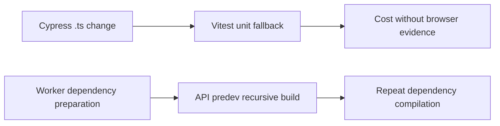

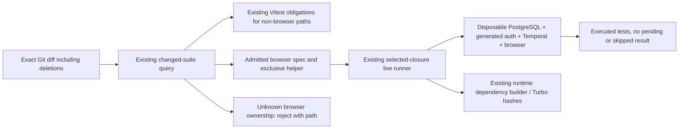

### Admission And Execution

- Initially admit only `canvas-dvt-terminal-transform-preview-live.cy.ts` and
  its exclusive `liveRunEventRecovery.proof.ts` helper to the existing
  `test:e2e:selected-closure:live` command. This is not coverage of the complete
  Cypress inventory. Shared support, other specs, Cypress configuration and
  unknown executable paths require explicit consumer/runtime admission; they
  cannot silently fall back to Vitest or succeed with no command.
- GH-3271 also admits `canvas-relational-tree-workbench.cy.ts`,
  `canvas-relational-workbench-union.cy.ts`,
  `canvas-relational-workbench-removal.cy.ts` and
  `canvas-relational-workbench-viewport.cy.ts` through the same protected runtime.
  They retain their existing UI fixtures; the shared protected-runtime proof
  remains a separate real-provider obligation within that single execution.
- The browser policy is a small pure module (`apps/web/cypress.changed.ts`),
  composed by the existing query. It is not a second repository diff detector
  or a new Vitest suite catalog. The adapter still owns Git discovery and
  process execution only. Policy/adapter/runner changes require the admitted
  live proof as well as their own contract tests.
- Git discovery includes deleted paths. Failure to read the requested range,
  index, working tree or untracked inventory is an error, not an empty diff.
  A deleted admitted spec fails rather than reporting an empty successful run.
  Rename detection is disabled so moving a spec cannot hide its removed path.
- Ordinary changed routing executes both independent obligations. A browser
  change does not require unrelated Vitest unit tests; a mixed diff retains
  the Vitest plan for its genuine Web sources.
- CI resolves and validates the complete plan before selecting a capability or
  provisioning its runtime. Cypress preparation requires selected browser work;
  PostgreSQL and dbt require an available or unavailable provider obligation.
  The controlled capability does not provision providers. Use an
  explicit disposable CI PostgreSQL URL and generated local proof identity;
  no tenant credential, repository secret or development database is required.
- GH-3583 separates Vitest from browser execution. GH-3578 further partitions
  the browser phase by its existing `controlled`, `available` and `unavailable`
  capabilities, retaining `fail-fast: false`, a 25-minute limit per job and a
  distinct existing Turbo-cache variant per producer. This removes shared serial deadlines;
  it does not alter suite selection, workers, assertions or browser admission.
  `--phase=vitest` and `--phase=browser` select disjoint obligations from the
  same complete plan. Planning still rejects unknown browser paths in either
  phase. `--browser-capability=<capability>` is valid only with `--phase=browser`;
  omitting it still executes every selected browser obligation. Invalid,
  repeated or out-of-phase selectors reject. The old `--browser-only` flag stays
  removed. Provider setup and cleanup belong to the provider capabilities;
  sanitized failure/cancellation screenshots have capability-specific names.
  The existing required aggregate requires the
  complete matrix result; cancelled, failed or absent evidence still rejects.
- `main`, manual and root-sensitive runs retain `test:web:ci` and execute the
  admitted browser baseline with `--full --phase=browser`, partitioned by the
  same capability selector in CI. `--full` only adds
  browser baseline obligations to the router: executing it with the Vitest
  phase is invalid, and cannot replace `test:web:ci`. Required check
  names and the Test Suite aggregate stay unchanged.
- The existing live runner owns allocation and cleanup. Missing runtime,
  zero executed tests, pending tests or skipped tests are failures. POSIX
  teardown must stop child process groups and wait before disposing its lease.
  Native browser execution uses a small `run-selected-closure-cypress.cjs`
  child adapter over the installed Cypress module API; it validates the real
  result counters and every expected spec exactly once. Credentials stay in environment
  variables, never CLI arguments. Process lifecycle belongs to
  `live-proof-process.cjs`, shared by this live runner, its browser child and the
  native controlled-preview runner. Each consumer must create and terminate the
  same owned handle; killing a pnpm wrapper alone does not retire its preview
  descendants. This keeps teardown out of selection policy and result validation.
  The native controlled runner owns its build, preview and interactive Cypress
  command lifetimes through that same process owner. It awaits their termination
  before reporting acceptance or settling its result, including readiness and
  browser failures. Cancellation during a pending build or interactive command
  must retire that owned tree without waiting for ordinary command completion.
  A cleanup failure rejects acceptance; if execution also failed, both errors
  remain observable. Its CLI forwards SIGINT and SIGTERM through the same
  owned lifetime, and interrupted or late browser results cannot publish success.
  Scoped Cypress environment changes are restored before returning control;
  late module completion cannot overwrite subsequent caller environment changes.
  Module cancellation invalidates its pending result; it does not claim a
  cancellation API for processes internal to the Cypress module.
  An already responding preview is not owned by the runner and must not be
  terminated. GH-3696 records the demonstrated orphaned-preview failure and its
  bounded lifecycle regression evidence.
  The admitted route explicitly selects native execution. The pre-existing
  manual Docker utility is not admitted CI evidence and is not certified by
  this cut.
- API `predev` delegates to `build-workspace-runtime-deps.cjs dvt-api`. pnpm
  still owns the production dependency closure; Turbo owns ordering, input
  hashes and output restoration. No timestamp cache, build bypass or separate
  freshness authority is added. Other API lifecycle scripts are out of scope.
- The existing repository command catalog classifies the two new runtime
  helpers explicitly as test tooling; unknown commands remain root-sensitive.
  Local `hasWebChange` and CI Web scope include their exact paths so a runner-only
  change cannot miss the live obligation. Workflow contracts inspect effective
  job/step settings rather than counting repeated YAML strings.

### Planning Matrix

| Scenario                 | Opportunity          | Fowler pattern                | DDD owner                            | Command/query rail          | Implementation surfaces                                                                    | Unit or package test                                     | Architecture test                                                     | User-flow test                                                             | Out of scope                                      |
| ------------------------ | -------------------- | ----------------------------- | ------------------------------------ | --------------------------- | ------------------------------------------------------------------------------------------ | -------------------------------------------------------- | --------------------------------------------------------------------- | -------------------------------------------------------------------------- | ------------------------------------------------- |
| Changed browser evidence | Test-only confidence | Policy and adapter separation | WebVitestChangedSuiteRouter          | RouteChangedWebVitestSuites | `cypress.changed.ts`, `vitest.suites.ts`, changed-suite adapter and existing router guards | Spec/helper/source/mixed/unknown/deleted/Git failure     | Exclusive helper consumers, independent obligations, workflow routing | Existing terminal live proof                                               | Admission of every legacy spec                    |
| Real browser CI          | Hidden authority     | Application controller        | Browser proof runtime                | RunWebCypressNative         | `test.yml`, its executable contracts, selected-closure runner/tests, terminal spec         | Runtime unavailable and cleanup failure                  | Full/PR/draft obligations and no skipped evidence                     | Protected API, Temporal and PostgreSQL proof on Linux CI and local Windows | New workflows, check names or mock runtime        |
| API preparation          | Duplicate semantics  | Reuse existing build owner    | Workspace runtime dependency closure | RunWebCypressNative         | `apps/api/package.json`, existing bootstrap contracts                                      | Same dependency closure, repeated invocation uses hashes | No recursive preparation in predev                                    | API readiness in the same live proof                                       | Other lifecycle refactors or application behavior |

The implementation must record exact commands, local and CI timings, and
comparison limits in the issue. Fewer Vitest launches alone do not establish
the repository-wide 50% time target. No isolation, coverage, worker or
authorization rule is relaxed by this boundary.

The [GH-3583 rationale](https://github.com/dunay2/dvt/issues/3583) and
[GH-3578 reviewed partition and conformity matrix](https://github.com/dunay2/dvt/issues/3578#issuecomment-6035954803)
govern the independent execution lifecycles. Previously the browser job put all
three capabilities and their preparation under one 25-minute deadline. The
bounded partition is:

```text
Exact diff -> one validated plan -> Vitest              -> required matrix result
                                -> browser controlled  -> required matrix result
                                -> browser available   -> required matrix result
                                -> browser unavailable -> required matrix result
```

The matrix changes elapsed scheduling, not total evidence or CPU guarantees.
Actual complete CI timings are required before claiming a speed improvement.

### Fixture Consumer Evidence — GH-3578

The [reviewed consumer matrix](https://github.com/dunay2/dvt/issues/3578#issuecomment-5998586830)
extends the existing browser admission, not the product's commands or test
framework. Pure draft builders remain separate from stateful HTTP adapters.
Their real runtime import closure determines affected consumers; a builder name
alone cannot narrow a shared dispatcher's consumers. Unknown and deleted browser
paths still reject before phase filtering or process startup.

The existing command plan represents three distinct runtime obligations:

- Controlled API consumers execute once through the native browser runner.
- Available LIVE consumers execute the exact admitted spec list in one Cypress
  invocation and one protected runtime bootstrap locally, or once per disjoint
  CI shard as specified below. Each spec owns its suite and
  preparation; no spec imports another spec to register its cases. The terminal
  retains its own cases and exclusive helpers. This restores spec isolation
  without repeating PostgreSQL, API, Temporal or outbox startup for every file.
- Unavailable LIVE evidence uses its existing spec and invocation-local
  environment; that environment cannot leak into another obligation.

The same structured result validator must reject missing, unexpected or duplicate
specs, zero tests, malformed counters, failures, pending tests and skips. The
protected LIVE CLI accepts a comma-separated list of unique literal spec paths,
validated before any lease, build or service allocation. Empty entries, globs,
duplicates and traversal reject. Its default is the terminal spec; governed
AVAILABLE execution passes the complete catalog explicitly. Shared helper
consumers must each appear exactly once in that plan. Successful execution of
the terminal filename alone does not establish the consumer inventory.

First authoring is an AVAILABLE consumer without a semantic draft fixture. It
creates its isolated project through the real CreateProject UI and uses the
complete workspace identity returned by that command. The JOIN publication
journey reuses the same gesture. First authoring must still prove the initial
draft is absent, the first node is acknowledged, dragging changes the scoped
layout, and reloading restores it. Observing the real project response must not
stub a successful project, graph, plan or run response.

Removing old cases requires preserving their unique semantic assertions in the
remaining owners first. In particular, UNION retains complete derived-type
equality and the measure scenarios retain standalone and chained forms,
grouping, partition/order, output identity and reload. Captured Workbench seed
normalization reuses production mappers on that same fixture instance; it does
not introduce a generic GET recorder or global fixture repair.

Admission requires measuring each complete job critical path, including setup,
builds, selected runtime, result validation and cleanup, against its unchanged
25-minute budget. All capability/shard matrix jobs must satisfy the existing required
aggregate. The partition preserves the 119 controlled, 53 existing available
and one unavailable cases; first authoring adds one available case. This does
not prove that a stalled case is fixed. Individual
test durations or results from the previous serial layout cannot establish the
new bound. No new workflow, timeout increase or evidence waiver is admitted.

### Available Browser Budget Partition — GH-3656

The existing `RouteChangedWebVitestSuites` query and `RunWebCypressNative`
command retain their application ports, browser catalog and authorization
boundary. PR #3627 run `38614237742` exhausted the available job's 25-minute
budget after 15 of 32 specs passed, while starting spec 16. Other capabilities
passed. This is incomplete execution evidence, not a passing product result.

```text
Before: complete admitted plan -> available [32 specs] -> 25-minute cancellation
After:  complete admitted plan -> available 1/3 -> exact result validation
                              -> available 2/3 -> exact result validation
                              -> available 3/3 -> exact result validation
All three producers -> existing required Test Suite matrix aggregate
```

The existing browser policy partitions its ordered available spec list by
zero-based index modulo three. Every spec belongs to exactly one shard; the
union equals the unpartitioned catalog. Reuse the existing command builder,
protected runtime and strict expected-spec result validator. Do not duplicate
the catalog in YAML, parse command strings, add another runner or alter cases.

The adapter accepts `--browser-shard=1/3`, `2/3` or `3/3` only together with
`--phase=browser --browser-capability=available`. Omission preserves the complete
local invocation. Complete plan admission and physical-path validation precede
shard selection, including in `--plan` mode. Invalid, repeated, out-of-phase
or out-of-capability selectors reject before provisioning. A selected shard
cannot silently admit an empty consumer list.

The existing workflow creates all three available producers for PR and full
baseline execution. Container ownership, Turbo cache variant and screenshot
artifact identities include the shard. Provider setup occurs only when the
selected plan requires it. The unchanged 25-minute deadline and fail-fast-false
policy apply to each producer; a failed, cancelled or missing shard blocks the
existing required aggregate. Controlled, unavailable and Vitest ownership do
not change. Three bootstraps replace one for this capability; lower total CPU
is not claimed.

Separate focused policy/adapter tests prove disjoint complete coverage,
unchanged runtime arguments, selector rejection and validation-before-filtering.
Workflow contracts prove every shard is scheduled with unique resource names
and identical planning/execution selectors. Each complete CI critical path,
including preparation and cleanup, must pass within 25 minutes. Delivery and
measured evidence belong to [issue 3656](https://github.com/dunay2/dvt/issues/3656).

| Scenario                                  | Opportunity    | Fowler pattern                          | DDD owner                   | Command/query rail                               | Implementation surfaces                                                              | Unit or package test                                                        | Architecture test                                                                                     | User-flow test                                                  | Out of scope                                                                      |
| ----------------------------------------- | -------------- | --------------------------------------- | --------------------------- | ------------------------------------------------ | ------------------------------------------------------------------------------------ | --------------------------------------------------------------------------- | ----------------------------------------------------------------------------------------------------- | --------------------------------------------------------------- | --------------------------------------------------------------------------------- |
| Available evidence exceeds one job budget | Boundary drift | Policy separated from execution adapter | WebVitestChangedSuiteRouter | RouteChangedWebVitestSuites; RunWebCypressNative | Existing browser policy, changed-suite adapter, Test Suite workflow and their guards | Disjoint complete partition; invalid selectors; validation before filtering | Workflow schedules every shard with identical plan/execution selection and unique resource identities | All existing available specs through the real protected runtime | Product behavior, new catalogs/runners, timeout increases, total CPU optimization |

### Compiled Client For Real-Provider Browser Proof — GH-3656

The available provider group failed twice while loading development URLs such
as `/src/app/views/Canvas.tsx` and `/src/app/views/RunsView.tsx`. Other failures
showed a page reload that removed an import or Preview dialog. The API remained
available. These observations identify unstable client asset delivery in the
proof; they do not establish its low-level network cause.

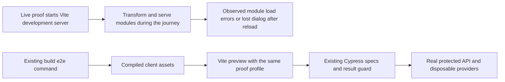

The existing `RunWebCypressNative` command and selected-closure runner retain
their spec selection, provider allocation, authentication and cleanup. An
internal Web runtime adapter uses the existing `build:e2e` command once with
the proof's Web environment, then serves those assets through Vite preview.
Build and preview receive the same API URL, authentication and workspace
profile. The bundle remains stable for the complete invocation.

The adapter owns only build/start/readiness sequencing. It reuses the runner's
process launcher and HTTP readiness port; both child handles remain in the
existing cleanup collection. A failed or signaled build prevents preview from
starting. Preview is ready only when its root returns HTTP 200; missing assets,
early process exit or readiness failure retain the failing proof result.

The canonical repository command catalog must admit this exact lifecycle
adapter as `test-tooling`, alongside the existing browser child and process
adapters. It remains relevant to changed-file validation without product
runtime fan-out. Neighboring unregistered helper paths remain `unknown`, and
the existing discovery/coverage guard must continue to reject them. Catalog
admission does not alter runtime implementation or browser obligations.

| Concern             | Existing owner / proof                                                            |
| ------------------- | --------------------------------------------------------------------------------- |
| Rail and allocation | `RunWebCypressNative`, selected-closure runner                                    |
| Profile and build   | Existing `build:e2e`, identical build/preview environment                         |
| Lifecycle           | Focused adapter tests: ordering, rejected build and readiness, owned handles      |
| Routing             | Existing changed-file catalog selects real provider consumers for adapter changes |
| Acceptance          | All admitted provider specs, unchanged assertions and CI budget                   |

This changes the proof's client serving mode; it adds no product behavior,
command rail, browser retry, exception suppression or fake provider. Runtime
policy tests stay separate from the larger provider-composition test file.

#### Browser Transport Observation

The compiled client still encountered transport failures on two Linux CI
attempts. Session or write requests could fail after a successful API preflight;
the later attempt failed on different calls. Authentication denial, application
mutation, and a vendor-version defect are not established by those observations.
Another identical retry is not the diagnostic owner.

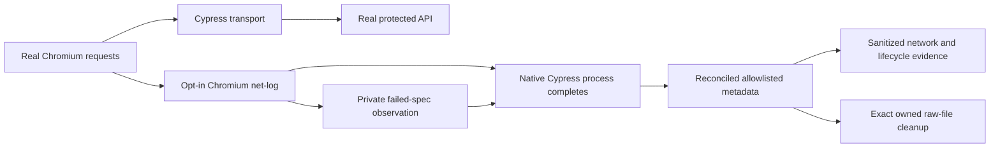

`RunWebCypressNative` retains the same literal scenarios, authentication,
providers, assertions and budget. The existing Cypress Node event adapter
optionally captures Chromium net-log for each admitted available group. A failure
in group 2 or 3 must retain evidence from that same group; group 1's capture does
not establish another group's request outcome. The pure
projection and Node lifecycle have separate owners. Exported JSON contains
event/source identifiers, numeric source dependency links, event kinds, numeric
network errors, method, numeric HTTP status and safe loopback route groups only.
The numeric time-tick offset permits correlation with API wall-clock logs.
Known compiled `index`, `Canvas` and `RunsView` CSS
asset paths retain their ASCII basename and hash so a request can be correlated
with its source ID. A recognized response status line contributes only its
derived numeric HTTP status; absent response headers do not imply an HTTP result.
Headers, bodies, cookies, URL queries, userinfo and
arbitrary raw parameters are omitted. Raw capture is outside artifact
publication and its exact temporary files are removed by their owner.

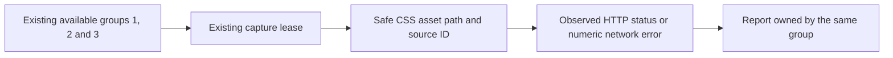

The native parent owns the capture lease and finalization after the Cypress
binary completes. Cypress `after:run` is not the close boundary: a real Windows
proof passed its journey but that hook still saw the Chrome file locked. Node
plugin launch hooks receive only the owned lease through scoped process
environment; that environment is restored on success or failure.

GH-3604's native-completion reconciliation separates an observation from a
finalized report. The `after:spec` hook retains a private, validated observation
for each failed spec before later browser activity can overwrite it. Successful
specs add no observation. The hook does not publish, close or modify Chrome's
capture. Only native completion publishes evidence and removes exact owned files.
Each launch returns its capture identity to the hook adapter. A failed spec is
observed only against the active launch, never against older retained capture
directories. A non-Chromium launch clears that identity. The native lifetime
owner, not the per-spec hook, enumerates all launches for finalization and cleanup.

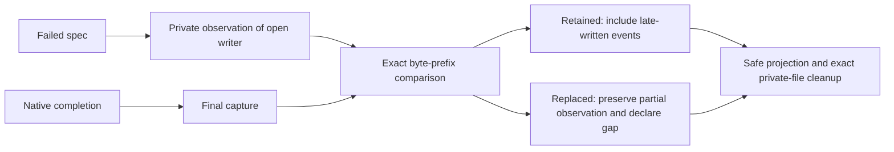

When the final capture retains the exact observed prefix, the failed-spec report
uses the final projection, including events written after the hook. Otherwise it
retains the earlier observation with `continuity=replaced` and
`observationBoundary=after:spec`. This cannot recover an unwritten queue from a
replaced writer. No sleep or stable-size heuristic constitutes a flush
acknowledgement. `captureState=complete` describes a closed JSON document, not
whole-run coverage. The evidence assembler owns reconciliation; the Node adapter
owns hooks and lifetime; the pure mapper owns disclosure policy.
The spec timestamp is a correlation marker, not a claim that all retained events
belong to that spec: the final projection may also contain subsequent activity.

An additional private Chrome process log admits only the exact network-service
restart signal with numeric process/thread identifiers and its timestamp. A
missing process log is explicitly unavailable; absence of a matched signal does
not prove absence of a restart. Raw text and arbitrary errors are never exported.
Both raw logs and private observations remain outside artifact publication and
are removed at native completion, including rejection paths. Malformed or
unreadable captures still fail explicitly. Test error/result payloads are never
serialized. This repairs evidence lifecycle, not a demonstrated transport cause.

The real capture can end before its JSON footer when Cypress terminates Chrome.
The maintained `jsonc-parser` development dependency decodes complete observed
records, with `captureState=terminated` explicitly distinguishing this from a
complete capture. Only EOF closing-array/object errors and a trailing comma are
admitted; malformed headers, middle syntax or unfinished event bodies reject.
No record, footer or successful outcome is fabricated. This Node-only consumer
does not add a production application dependency.

Disabled diagnostics register no launch hooks. Enabled diagnostics reject a
missing or malformed capture and preserve the failing browser result. The
observer adds no request interception, synthetic response, retry, timeout or
security override; recording evidence is not a claim that integration or the
transport defect is complete. Paired projection and lifecycle tests remain
separate from scenario files and register in the existing local gate.

The native runner contract now reaches the optional package-backed loader through
its existing shared proof import. Its exact CI-tool test belongs to the installed
executable partition, not the package-free static partition. The all-mode union,
fail-closed dependency guard and assertions remain unchanged; removing that exact
registration is a negative test, not an exemption from coverage.

Sanitized network reports publish for the enabled available group, independently
of failure screenshots and only
when a report exists. An empty routed group produces neither a capture nor a
synthetic artifact. Artifact admission has its own focused CI contract; malformed
captures and incomplete browser results still reject at their existing owners.

The Cypress config and its three exact Node diagnostic modules are admitted browser
support boundaries for controlled, available and unavailable capabilities. Their
module-load failures affect every capability even when capture is disabled. This
retains complete evidence; unknown configuration and Node neighbors still reject.

### Execution Selection Consumer Closure — GH-3610

The shared `cypress/support/canvasExecutionSelection.ts` helper is not an
exclusive live consumer. Its runtime import closure contains 25 independently
registered specs. A change to its public selection gesture must retain all of
them in their existing real runtimes. Before this admission, the changed-file
query rejects the helper before executing any test; passing a manually selected
live subset cannot satisfy the complete branch obligation.

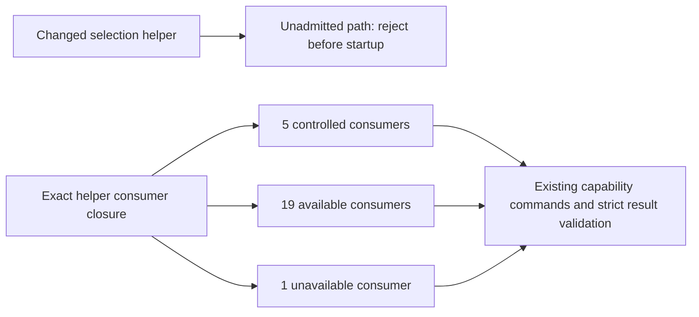

All paths below are relative to `apps/web/cypress/e2e/`:

| Runtime     | Exact consumers                                                                                                                                                                                                                                                                                                                                                                                                                                                                                                                                                                                                                                                                                                                                                                                                                                                                                                            |
| ----------- | -------------------------------------------------------------------------------------------------------------------------------------------------------------------------------------------------------------------------------------------------------------------------------------------------------------------------------------------------------------------------------------------------------------------------------------------------------------------------------------------------------------------------------------------------------------------------------------------------------------------------------------------------------------------------------------------------------------------------------------------------------------------------------------------------------------------------------------------------------------------------------------------------------------------------- |
| Controlled  | `canvas/canvas-happy-path-draggable.cy.ts`, `canvas/canvas-project-snapshot-roundtrip.cy.ts`, `canvas/canvas-ready-node-authoring.cy.ts`, `shell/canvas-workbench-screen-composition.cy.ts`, `shell/shell-layout-contract.cy.ts`                                                                                                                                                                                                                                                                                                                                                                                                                                                                                                                                                                                                                                                                                           |
| Available   | `canvas/canvas-dbt-author-code-run-live.cy.ts`, `canvas/canvas-dbt-selection-recovery-live.cy.ts`, `canvas/canvas-dvt-join-preview-live.cy.ts`, `canvas/canvas-dvt-start-run-boundaries-live.cy.ts`, `canvas/canvas-dvt-terminal-transform-preview-live.cy.ts`, `canvas/canvas-first-authoring-live.cy.ts`, `canvas/canvas-formula-lineage-live.cy.ts`, `canvas/canvas-graph-search-filter-live.cy.ts`, `canvas/canvas-minimap-focus-live.cy.ts`, `canvas/canvas-selected-filter-live.cy.ts`, `canvas/canvas-semantic-persistence-run-live.cy.ts`, `canvas/canvas-semantic-unsupported-live.cy.ts`, `canvas/canvas-source-identity-live.cy.ts`, `canvas/canvas-source-import-live-clean.cy.ts`, `canvas/canvas-sql-progressive-live.cy.ts`, `canvas/canvas-transform-data-sample-live.cy.ts`, `dbt/dbt-project-preview-run-live.cy.ts`, `dbt/dbt-project-yaml-description-edit-live.cy.ts`, `runs/run-controls-live.cy.ts` |
| Unavailable | `canvas/canvas-dvt-runtime-unavailable-live.cy.ts`                                                                                                                                                                                                                                                                                                                                                                                                                                                                                                                                                                                                                                                                                                                                                                                                                                                                         |

The existing controlled and unavailable inventories already contain their
consumers. Add only the five missing available paths: selection recovery, graph
search/filter, minimap focus, file-authoritative project Preview/Run and YAML
description editing. The available inventory therefore contains 31 exact specs;
the controlled and unavailable inventories remain 48 and one. Available here
means the real protected provider runtime is provisioned; it does not redefine
an unavailable selection root as an unavailable Temporal worker.

The existing architecture guard computes the real runtime import closure and
compares it with this exact disjoint matrix. It must reject an omitted consumer,
a wrong runtime, a duplicate registration or an unknown browser path. The
fixture-builder guard remains separate: these five UI/file-authoritative
consumers do not import the semantic draft builder and must not be falsely
classified as fixture consumers. Other unadmitted live specs remain rejected.

Reuse `RouteChangedWebVitestSuites` and `RunWebCypressNative`; do not introduce a
wildcard, another runner, altered assertions, a larger deadline or a result
waiver. Readiness requires executing the complete selected plan and recording
the unchanged CI budget, exact base/head admission and strict result counters
on [issue 3610](https://github.com/dunay2/dvt/issues/3610).

#### Retained Live Consumer Preconditions

The controlled source-binding consumer also waits for the existing bottom-right
success notification to leave the DOM before its normal `Done` click. A toast
marked `data-removed=true` is still present during its exit animation and can
intercept hit-testing. Await actual absence within the existing 20-second
UI-transition budget; do not filter out exiting nodes, force the click, dismiss
or remove the notification artificially, add a fixed wait, or change product
CSS/duration and the global CI budget. Connection, source identities, metadata,
keyboard, accessibility, i18n and exact import-command assertions remain intact.

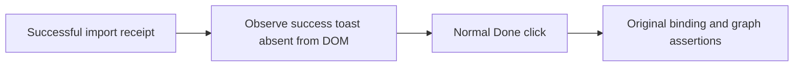

The first six-case execution of those five newly admitted specs passes minimap
focus and exposes five failures in the remaining four specs. Keep their unique
assertions; repair only the obsolete preparation and adapter gestures:

- Selection recovery must not invent an ungranted project or recreate the
  retired graph-owned dbt model path. Use an acknowledged file-authoritative dbt
  project with two executable models. Select one root, disable it through the
  existing Monaco working-tree synchronization rail, and prove that refreshed
  analysis removes it without silently widening execution scope. Only the
  explicit workspace-scope recovery action may admit the surviving model.
  Recovery labels come from the existing owned English copy catalog, not retired
  `Unavailable roots` / `Admitted scope` / `Use workspace scope` labels. Expose
  the real scrollable recovery action before its normal click. Assert the exact
  translated recovery receipt with the affected node ID; the internal strategy
  name `workspace` is not presentation copy.
- Graph search/filter starts the single current Canvas template and owns its
  English presentation precondition. It retains three real authored nodes,
  search navigation, filter/clear counts and unchanged protected draft revision.
  The third, non-transform node comes from the actual unified catalog (`dvt:sink`),
  not the retired `dbt:seed` creation surface. The two Model search matches and
  transform-role filter still admit exactly two of three authored nodes.
- Project Preview/Run uses the fixture's canonical source label and waits for
  its actual graph before selection. Model inspection targets the card title,
  not an expanded field row at the centre of the card. Exact project/analysis
  revisions, no regeneration, dependency scope and real Run events remain.
  Card titles use the actual projected model name (`Order Summary`); exact model
  IDs continue to govern selection, dependencies and completed Run step assertions.
- YAML description editing retains its lossless proposal/apply/revert and
  reopened file/analysis/Run assertions. Node Code is the known-file editor in
  Properties; project Code is the separate project-tree workbench. Do not revive
  the removed contextual node-code workbench to satisfy an old test. The real
  card title opens inspection, and the scrollable project command must be
  exposed before its normal click. Execution selection uses the existing node
  operations menu, not retired card-header selection buttons. Preview values
  retain their exact assertions through the current accessible labels (`Canvas`,
  `Requested resources`, `Project root`), without the retired `value` suffix.

The existing rails remain `InspectCanvasNode`, `SaveWorkspaceFileContent`,
`RouteChangedWebVitestSuites` and `RunWebCypressNative`. SQL and YAML edits must
use their real UI commands and revision-guarded writes, not intercepted success,
direct replacement of the edited file or invented authorization. No product
runtime, contract, executor, acceptance assertion or deadline changes.

Graph search and minimap must also own independently granted projects through
the existing `CreateProject` UI gesture. The complete available plan runs after
other specs have persisted the default workspace draft; an initial `404` in
that shared workspace is not an isolation contract. Read the exact workspace
scope returned by creation, retain absent-draft and unchanged-revision proofs
in that scope, and leave other consumers' drafts intact. This reuses the
existing `liveProjectAuthoring.ts` owner; no random scope, cleanup of another
spec's graph or separate project-creation implementation is admitted.

### Retained Shell Menu Consumers — GH-3622

Menu responsibility changes retain two previously unadmitted browser consumers.
Their runtime is determined by their actual preparation, not by the route name:

| Consumer                                   | Runtime    | Existing evidence owner                                                |
| ------------------------------------------ | ---------- | ---------------------------------------------------------------------- |
| `templates/templates-workbench.cy.ts`      | Controlled | Native browser runner; explicitly controlled bootstrap responses       |
| `shell/active-project-creation-live.cy.ts` | Available  | Protected provider runner; granted live session and real CreateProject |

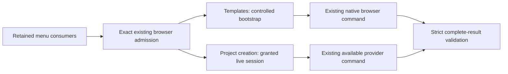

The project-creation consumer reuses `visitWithLiveWorkspaceSession` to initialize
the existing granted scope and requires the existing protected-runtime identity.
It must not rely on a separate manual enable flag. Its original single POST,
empty created workspace, A-to-B scope switching and reload assertions remain
intact. Templates retains its existing controlled responses and both selection
and parameter-validation cases.

Add only these two literal paths. Unknown consumers remain rejected; runtime
policy changes retain all three existing capability obligations. No new runner,
deadline, stubbed project response, product behavior or skipped-result waiver is
introduced. The available inventory becomes 32 specs; the controlled inventory
gains the single Templates consumer. Delivery evidence belongs to
[issue 3622](https://github.com/dunay2/dvt/issues/3622).

<a id="section-web-vitest-changed-suite-router-user-stories"></a>

## Web Vitest Changed Suite Router User Stories

For every source-edit scenario below, the behavioral lane is accompanied by
one complete `test:architecture:run`. Filesystem-reading architecture guards
cross focus boundaries, so a paired test cannot replace that evidence.
Test-only changes remain exact; a complete architecture run absorbs exact and
Canvas architecture batches through the existing suite normalization.

### US-1 Local Canvas Change

As a frontend developer changing Canvas code, I want a local command to run the
Canvas focus suite so that I do not need the full web Vitest loop for every
small Canvas iteration.

Acceptance:

- Given a changed file under `apps/web/src/app/views/canvas/**`,
  `apps/web/src/app/components/canvas/**`,
  `apps/web/src/app/components/inspector/**`, or
  `apps/web/src/app/components/InspectorPanel.tsx`
- When I run `pnpm --filter @dvt/web test:changed`
- Then the command routes to the narrow Canvas suite that matches the changed
  file type.

### US-2 Presentation Change

As a frontend developer changing non-Canvas and non-shell-session TSX
presentation code, I want the changed-suite router to run the presentation suite
so that route or component work gets feedback from the relevant presentation
lane.

Acceptance:

- Given a changed non-Canvas and non-shell-session `.tsx` file under
  `apps/web/src/**`
- When the changed-suite plan is resolved
- Then the selected command is `test:presentation:run`.

### US-2A Canvas Presentation Change

As a frontend developer changing Canvas TSX code, I want the changed-suite
router to run the Canvas presentation focus suite so that I do not pay for the
full Canvas test loop.

Acceptance:

- Given a changed `.tsx` file under `apps/web/src/app/views/canvas/**`,
  `apps/web/src/app/components/canvas/**`,
  `apps/web/src/app/components/inspector/**`, or
  `apps/web/src/app/components/InspectorPanel.tsx`
- When the changed-suite plan is resolved
- Then the selected command is `test:canvas-presentation:run`.

### US-3 Unit Change

As a frontend developer changing non-Canvas and non-shell-session TypeScript
model code, I want the changed-suite router to run the unit suite so that pure
model and service changes do not require presentation tests by default.

Acceptance:

- Given a changed non-Canvas and non-shell-session `.ts` file under
  `apps/web/src/**`
- When the changed-suite plan is resolved
- Then the selected command is `test:unit:run`.

### US-3A Canvas Unit Change

As a frontend developer changing Canvas model code, I want the changed-suite
router to run the Canvas unit focus suite so that pure Canvas model changes do
not run Canvas presentation tests by default.

Acceptance:

- Given a changed non-architecture `.ts` file under
  `apps/web/src/app/views/canvas/**`, `apps/web/src/app/components/canvas/**`,
  or `apps/web/src/app/components/inspector/**`
- When the changed-suite plan is resolved
- Then the selected command is `test:canvas-unit:run`.

### US-4 Governance Change

As a reviewer changing suite catalog, config, or component documentation, I want
the router to run the owning router architecture guard so that command drift is
caught without executing unrelated architecture tests.

Acceptance:

- Given a changed suite governance file
- When the changed-suite plan is resolved
- Then one direct Vitest batch runs all current
  `src/testing/vitestSuites*.architecture.test.ts` guards, including behavioral
  routing and catalog checks, not just the original documentation guard.

### US-4A Canvas Architecture Change

As a reviewer changing Canvas architecture guards, I want the changed-suite
router to run only the Canvas architecture focus suite so that the local proof
stays bounded to Canvas governance.

Acceptance:

- Given a changed `*.architecture.test.*` file under
  `apps/web/src/app/views/canvas/**`, `apps/web/src/app/components/canvas/**`,
  or `apps/web/src/app/components/inspector/**`
- When the changed-suite plan is resolved
- Then the selected command is `test:canvas-architecture:run`.

### US-4B Monaco Surface Change

As a frontend developer changing Code or shared Monaco editor/viewer surfaces, I
want the changed-suite router to run the Monaco focus suite so a two-file editor
change does not execute the whole presentation suite.

Acceptance:

- Given a changed file under `apps/web/src/app/components/monaco/**`
- Or a changed Code route file under `apps/web/src/app/views/CodeView.tsx`
- When the changed-suite plan is resolved
- Then the selected command is `test:monaco:run`.

### US-4C Shell Session Surface Change

As a frontend developer changing app shell, session context, workspace-scope
selection, session store, API-client context propagation, service composition,
or their shared test doubles, I want the changed-suite router to run the shell
session focus suite so a one-scope context change does not execute the full unit
or presentation lanes.

Acceptance:

- Given a changed file under `apps/web/src/app/components/shell/**`,
  `apps/web/src/app/services/session/**`, `apps/web/src/app/services/composition/**`,
  or a changed workspace-scope/session shell support surface
- When the changed-suite plan is resolved
- Then the selected command is `test:shell-session:run`.

### US-5 No Relevant Web Change

As a developer working outside `@dvt/web`, I want the web changed-suite command
to skip cleanly so that it can be used in broader local workflows.

Acceptance:

- Given no web-relevant changed files
- When the command runs
- Then it exits successfully and reports that no web suite was selected.

### US-5A Paired Source And Test Change

As a frontend developer changing a small source module and its directly paired
test, I want the changed-suite router to execute that exact test file so that a
one-module fix does not pay for the whole unit or presentation lane.

Acceptance:

- Given `apps/web/src/app/views/cost/costViewModel.ts` and
  `apps/web/src/app/views/cost/costViewModel.test.ts` are both changed
- When the changed-suite plan is resolved
- Then the selected command is a direct `vitest run` for
  `src/app/views/cost/costViewModel.test.ts`.
- Given only the source file is changed
- When the changed-suite plan is resolved
- Then the router falls back to the governed suite for that file type.
- Given another changed source has no directly paired changed test
- Then that source's complete suite remains required even if the diff contains
  an unrelated exact test from the same suite; the complete suite includes that
  exact test without running it a second time.

### US-5B Canvas Component With Explicit Focus Tests

As a reviewer of a small Canvas component or Inspector patch, I want exact
changed tests to stay inside Canvas focus configs so the router does not run the
full presentation lane only because the component lives outside
`views/canvas`.

Acceptance:

- Given changed Canvas/Inspector component files and their directly paired
  changed exact Canvas focus tests, without another unpaired source in that lane
- When the changed-suite plan is resolved
- Then the selected commands are direct `vitest run` batches using
  `vitest.canvas-unit.config.ts`, `vitest.canvas-presentation.config.ts`, or
  `vitest.canvas-architecture.config.ts`.
- Then the selected suites do not include the full `unit` or `presentation`
  primary suite unless another file also selects one. Source edits still
  require complete architecture coverage.

### US-5C Mixed Canvas And General Changes

As a developer changing Canvas and general Web code together, I want complete
primary coverage to run once instead of repeating its equivalent Canvas subset.

Acceptance:

- Given both a complete primary suite and its equivalent Canvas focus suite
  are required
- Then the primary run includes all focus tests with the same environment and
  isolation, without a second focus process.
- Given only exact primary tests are selected
- Then a required complete Canvas focus suite remains in the plan.
- Monaco, Shell and Workspace focus contexts are not discarded when their
  execution environment differs from primary coverage.

### US-6 Pull-Request Web Change

As a reviewer of an ordinary web-only pull request, I want the `Web Frontend
Tests` job to run the changed-suite router so that a two-file change does not
execute every web Vitest file.

Acceptance:

- Given a pull request with web-relevant files and no root-build-sensitive
  changes
- When the `Web Frontend Tests` job runs
- Then both fixed matrix phases execute `pnpm test:web:changed` with the
  pull-request base ref and their `--phase=vitest` / `--phase=browser` selection.
- Given a push to `main`, a manual run, or a root-build-sensitive pull request
- When the `Web Frontend Tests` job runs
- Then the Vitest phase executes `pnpm test:web:ci` and the browser phase
  executes `pnpm test:web:changed --full --phase=browser`.
- Either phase failing or being cancelled prevents the required aggregate
  from succeeding. Neither phase cancels its sibling on failure.

> Acceptance scope status: Active. Owner: Frontend / CI.
