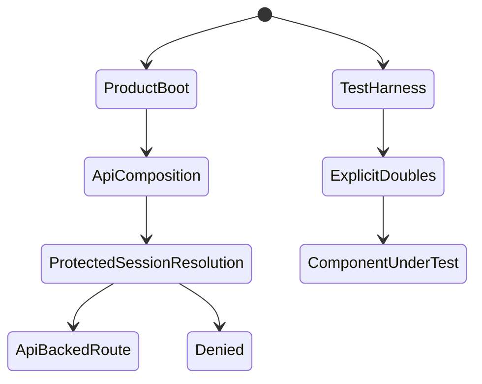
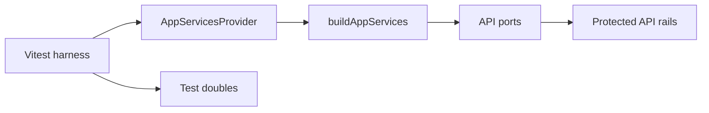
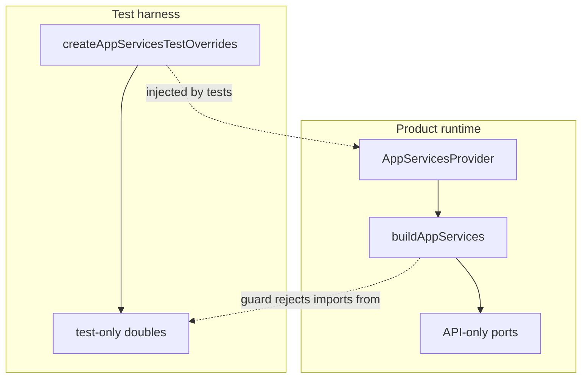

# Web Mock Runtime Hardcut Component

## Purpose

The web composition root is API-only. Fixture data may exist only behind
explicit test doubles and are never selectable by product runtime.

## Public API

| Surface                          | Ownership                         | Consumers                        |
| -------------------------------- | --------------------------------- | -------------------------------- |
| `buildAppServices`               | Product app service composition   | `AppServicesProvider`            |
| `createWorkspacePorts`           | API workspace port composition    | `buildAppServices`               |
| `createPlansService`             | API plan port composition         | `buildAppServices`               |
| `createRunsService`              | API run port composition          | `buildAppServices`               |
| `createAppServicesTestOverrides` | Test-only service double assembly | Vitest suites and test harnesses |

## Invariants

- Product composition never imports `*.mock.ts` or test-double modules.
- Product runtime has no data-source strategy or transport-selection singleton.
- Protected routes always resolve session and workspace context through API
  rail code; there is no mock bypass.
- Missing backend rails fail closed in API adapters.
- Tests that need local data inject explicit port doubles.
- Every hardcut module starts with an `Owned concern:` docblock.
- Documentation describes product behavior as API-only and fixture behavior as
  test-only.

## State Transitions

## Architecture

## Component Boundary

## Transitions

| Transition                       | Allowed owner             | Invariant                                                    |
| -------------------------------- | ------------------------- | ------------------------------------------------------------ |
| Product app boot                 | `AppServicesProvider`     | Calls `buildAppServices` with API ports.                     |
| Protected route session startup  | `AuthRouteGate`           | Resolves API session and workspace context before rendering. |
| Missing backend rail             | API port adapter          | Returns unavailable before transport or command execution.   |
| View/component test data setup   | Test harness              | Injects explicit test doubles through provider overrides.    |
| New runtime capability migration | Owning command/query rail | Adds backend route or keeps product port fail-closed.        |

## Negative Tests

- Product composition source cannot import or call mock adapters.
- Product composition cannot expose a fixture-backed runtime branch.
- `AuthRouteGate` cannot bypass protected session resolution.
- No non-test `*.mock.ts` files may live under `apps/web/src/app/services`.

## Web Mock Runtime Hardcut User Stories

### Stories

1. As an operator using the web shell, I want protected routes to depend on API
   session and workspace context so that the browser cannot silently bypass
   backend authority.
2. As a developer writing a view test, I want explicit app service doubles so
   that tests can use representative data without teaching product composition
   a mock runtime mode.
3. As an architect reviewing web/API drift, I want a semantic architecture guard
   so that mock runtime semantics cannot re-enter the product rail.
4. As a maintainer adding a missing backend rail later, I want the existing API
   port to fail closed until the backend rail exists so that no frontend mock
   fills the semantic gap.
5. As an architect reviewing a hardcut module, I want an `Owned concern:`
   docblock at the module boundary so that each file declares its semantic
   ownership before implementation details.
6. As a maintainer reading component docs, I want product behavior described as
   API-only and fixture behavior described as test-only so that docs do not
   preserve retired runtime choices.
7. As a test author, I want fixture-backed doubles to live under
   `apps/web/src/testing` so that representative data cannot be mistaken for
   product truth.

### Acceptance Scenarios

| Scenario                | Given                         | When                         | Then                          |
| ----------------------- | ----------------------------- | ---------------------------- | ----------------------------- |
| Product route startup   | API-mode web shell            | Protected route renders      | Session/context API resolves  |
| Missing rail            | API workspace capability port | Backend route is absent      | Port returns unavailable      |
| View test               | Test needs fixture data       | Harness renders a view       | Doubles are injected          |
| Product/runtime drift   | Product composition changes   | Architecture test runs       | Mock import is rejected       |
| Semantic docblock drift | Hardcut module changes        | Architecture test runs       | Missing ownership fails       |
| Documentation drift     | Hardcut docs change           | Architecture test runs       | Retired runtime wording fails |
| Test-double containment | Fixture data changes          | Product build imports source | Product import is rejected    |

> Acceptance scope status: Implemented. Owner: Web / API / Architecture.
