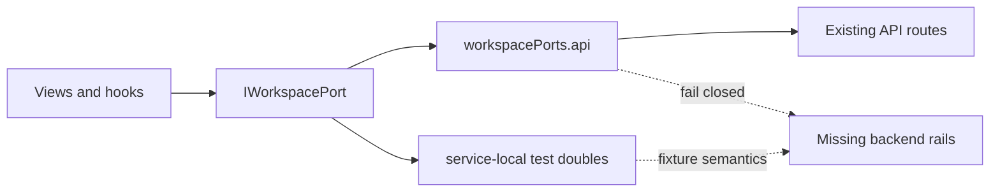
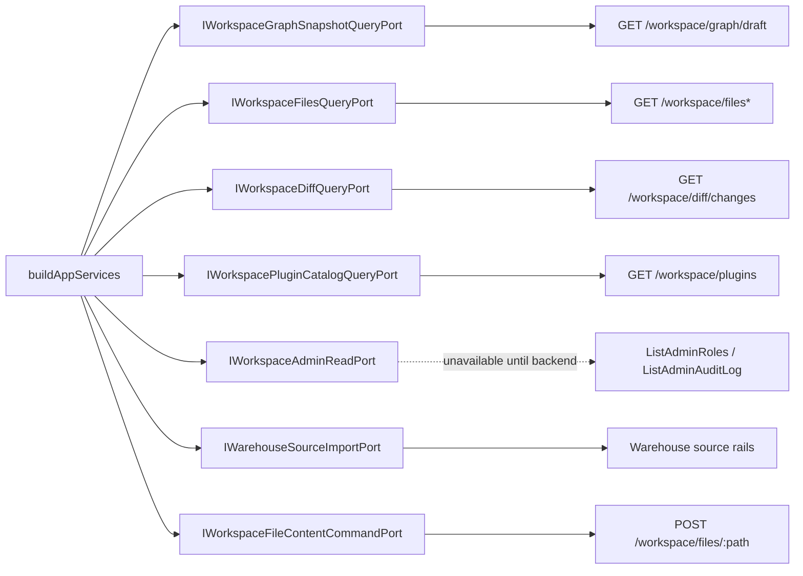
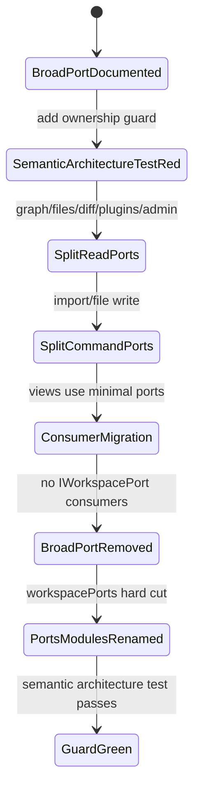

# Workspace Port Decomposition Component

## Purpose

The workspace port decomposition component replaces the broad presentation
`IWorkspacePort` with smaller ports whose names match owned web/API concerns and
accepted or missing command/query rails.

The component prevents one frontend module from looking like the authority for
graph snapshots, files, diff, plugins, admin read models, warehouse import, and
file writes at the same time.

## Owned Concern

Owns web composition of workspace-facing ports by capability.

It does not own backend route implementation, graph draft persistence,
authorization policy, warehouse connector semantics, plugin runtime execution,
admin RBAC truth, or file write semantics.

## Public API

| API                                | Kind                   | Rail                                                                                         | Responsibility                                                                                                          |
| ---------------------------------- | ---------------------- | -------------------------------------------------------------------------------------------- | ----------------------------------------------------------------------------------------------------------------------- |
| `IWorkspaceGraphSnapshotQueryPort` | web query port         | `GetWorkspaceGraphDraft`                                                                     | Return a presentation graph snapshot projected from the protected graph draft read model.                               |
| `IWorkspaceFilesQueryPort`         | web query port         | `ListWorkspaceFiles`, `GetWorkspaceFileContent`                                              | List and read workspace files through existing protected API reads.                                                     |
| `IWorkspaceDiffQueryPort`          | web query port         | `GetWorkspaceDiffChanges`                                                                    | Return authoritative diff changes through `GET /workspace/diff/changes`.                                                |
| `IWorkspacePluginCatalogQueryPort` | web query port         | `ListWorkspacePlugins`                                                                       | Return backend-published plugin catalog/readiness when the backend rail exists; presentation registry remains separate. |
| `IWorkspaceAdminReadPort`          | web query port         | `ListAdminRoles`, `ListAdminAuditLog`                                                        | Return admin roles and audit read models when backend rails exist; unavailable in product runtime until then.           |
| `IWarehouseSourceImportPort`       | web command/query port | `ListWarehouseConnections`, `ListWarehouseConnectionSourceObjects`, `ImportWarehouseSources` | Discover provider-neutral source objects and import supported objects through protected runtime source-import rails.    |
| `IWorkspaceFileContentCommandPort` | web command port       | `SaveWorkspaceFileContent`                                                                   | Persist file content through the accepted scoped backend command.                                                       |

## Invariants

- A web view depends only on the smallest port matching the capability it uses.
- Product runtime must not expose callable methods for routes that do not exist.
- Missing backend rails fail closed before transport.
- Test-only port doubles may support local behavior only inside explicit test
  harnesses.
- Read ports do not expose commands.
- Command ports do not return screen-shaped read models as their primary
  purpose.
- `IWorkspaceGraphDraftAuthoringPort` remains separate from graph snapshot
  presentation reads.
- The composition root may assemble multiple ports, but no broad workspace port
  may become the product API again.

## Previous Shape



## Implemented Shape



## Transitions



## Consumers

| Consumer                              | Target dependency                                              |
| ------------------------------------- | -------------------------------------------------------------- |
| `DiffView` and `useDiffData`          | `IWorkspaceDiffQueryPort`                                      |
| `AdminView` and `useAdminViewData`    | `IWorkspaceAdminReadPort`                                      |
| `ArtifactsView` and artifact loaders  | `IWorkspaceFilesQueryPort`                                     |
| `CodeView` and workspace file queries | `IWorkspaceFilesQueryPort`                                     |
| `LineageView` read path               | `IWorkspaceGraphSnapshotQueryPort` until a lineage rail exists |
| `SourceImportWizard`                  | `IWarehouseSourceImportPort`                                   |
| Canvas plan/run handlers              | smallest graph/files/provenance port required by each action   |
| `buildAppServices`                    | composition-only holder of all ports                           |

## Semantic Fitness Function

The architecture guard for this component must validate semantics, not only a
thin barrel:

- no `IWorkspacePort` interface remains as a broad capability surface;
- every workspace-facing port name has one owned concern;
- read ports do not expose command verbs such as `save` or `import`;
- API-mode ports with accepted backend rails call only scoped protected runtime
  endpoints.
- API-mode unavailable ports reject before transport;
- views import the narrow port they consume instead of a composition-root
  workspace service.
- no `workspaceService*` module remains in the workspace service directory
  after the hard cut.

## Module Docblock Rule

Every module touched by the implementation must start with a short owned-concern
docblock, for example:

```ts
/** Owned concern: adapt workspace file read queries to the protected API file read rails. */
```

Docblocks must name ownership, not implementation mechanics.

<a id="section-workspace-port-decomposition-user-stories"></a>

## Workspace Port Decomposition User Stories

### Story 1: Read workspace files through the file query port

As a web user browsing code or artifacts, I want workspace files to load through
a file-read port so the UI cannot accidentally call graph, admin, diff, or
warehouse import capabilities.

Acceptance:

- Given an authenticated product runtime, when a file tree is requested, then the UI calls the
  workspace files query port.
- Given a file is missing, when the API returns the protected not-found envelope,
  then the file query port raises the existing file-load unavailable state.
- Given the consumer is a file browser, then its dependency shape does not
  include diff, admin, plugin, import, or write methods.

### Story 2: Read graph snapshots through the graph snapshot port

As a canvas or lineage user, I want presentation graph snapshots to come from a
graph snapshot query port so graph reads do not depend on file or admin service
shape.

Acceptance:

- Given a protected graph draft exists, when the graph snapshot is requested,
  then the port projects the draft into the presentation graph snapshot.
- Given the graph draft does not exist, when the graph snapshot is requested,
  then the port returns an empty graph without failing route startup.
- Given a consumer only needs graph projection, then it does not receive file
  write, warehouse import, admin, plugin, or diff methods.

### Story 3: Fail closed for diff until a backend rail exists

As a reviewer, I want diff reads to use a named diff query port so missing
backend support is explicit and cannot be hidden behind a broad workspace
service.

Acceptance:

- Given no `GetWorkspaceDiffChanges` backend rail exists,
  when `DiffView` requests diff changes, then the diff port returns an
  unavailable state before any HTTP call.
- Given a test harness injects diff fixtures, when diff data renders, then the
  fixture path stays test-only and is not product backend truth.

### Story 4: Keep plugin catalog separate from runtime execution

As a platform operator, I want plugin catalog display to be separate from
runtime plugin execution so a static frontend registry cannot imply backend
readiness.

Acceptance:

- Given product runtime is active, when the plugin catalog is requested, then the
  plugin catalog port uses the protected `ListWorkspacePlugins` rail.
- Given static frontend registry entries exist, when navigation renders, then
  they are treated as presentation composition only.
- Given a plugin can execute runtime behavior, then its readiness must come from
  backend capability or catalog evidence.

### Story 5: Keep admin read models out of the workspace port

As an admin user, I want role and audit views to depend on an admin read port so
workspace graph/file capabilities do not imply RBAC or audit authority.

Acceptance:

- Given no admin read rail exists, when admin roles or
  audit log are requested, then the admin read port returns unavailable before
  transport.
- Given a test harness injects fixture roles and audit entries, when they
  render, then they remain test-only and do not imply production RBAC truth.

### Story 6: Fence warehouse source import as command-oriented work

As a data author, I want warehouse source discovery and import to use a
source-import port so browser-local import semantics cannot masquerade as a
backend command.

Acceptance:

- Given an authenticated product runtime, when the wizard opens, then the source import port
  lists connections through `ListWarehouseConnections`.
- Given a connection is selected, when source objects are requested, then the
  source import port lists authorized provider-neutral object metadata through
  `ListWarehouseConnectionSourceObjects`.
- Given supported source objects are selected, then the source import port executes
  `ImportWarehouseSources` against the protected runtime draft and workspace
  file rails.
- Given source-import doubles are used, then they remain explicit test-only
  doubles and do not define product semantics.

### Story 7: Prevent broad-port regression

As an architect, I want a semantic architecture test to fail if a broad
workspace port returns so that future work cannot reintroduce hidden authority.

Acceptance:

- Given a developer adds `IWorkspacePort` with graph, files, diff, admin,
  plugins, import, and write methods, when the architecture test runs, then it
  fails.
- Given a view imports more than its owned capability port, when the architecture
  test runs, then it reports the violating consumer.
- Given all consumers use narrow ports, when the architecture test runs, then it
  passes.

> Acceptance scope status: Implemented. Owner: Web / API / Architecture.
