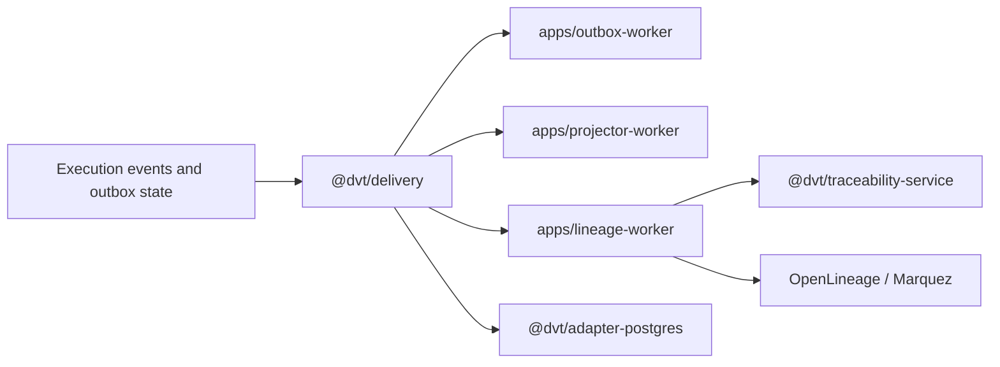
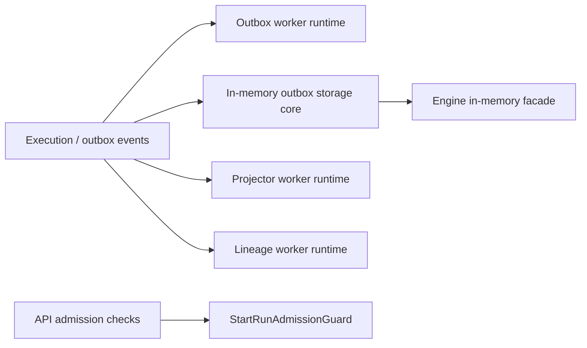
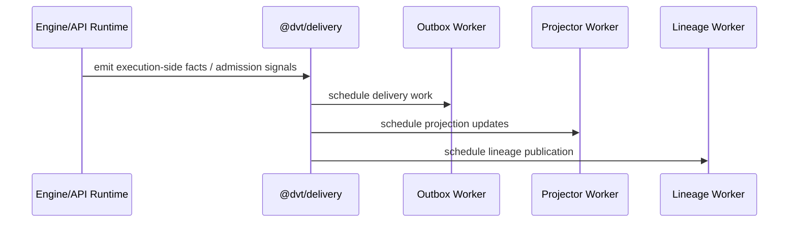
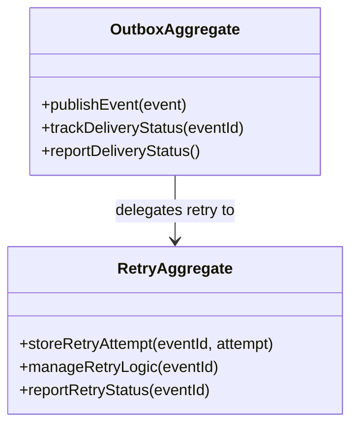
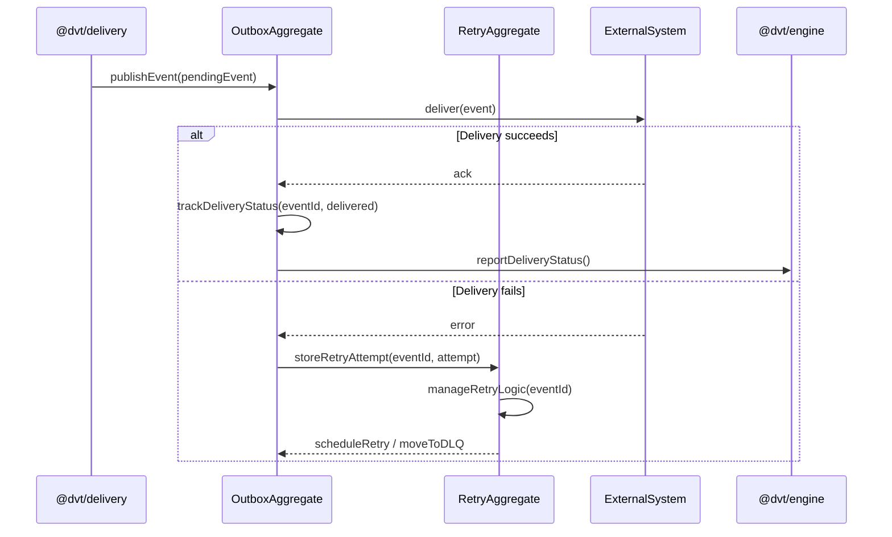
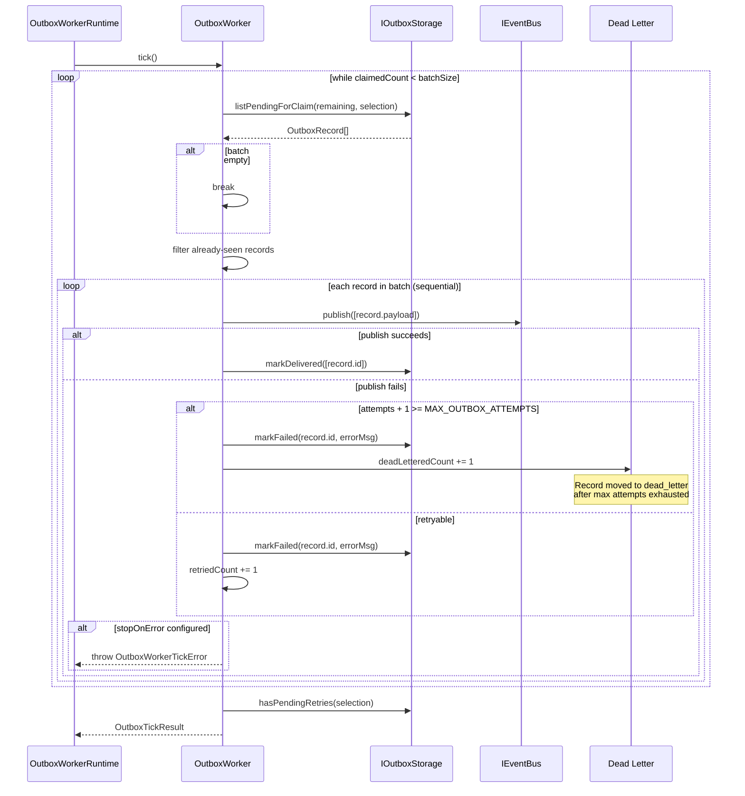

# Delivery Domain

This domain owns downstream processing after execution emits facts.

It covers outbox draining, snapshot projection, lineage publication, retention
and purge runtime wiring, and the worker composition roots that run those flows
in production.

## Scope

- `@dvt/delivery`
- `apps/outbox-worker` (`dvt-outbox-worker`)
- `apps/projector-worker`
- `apps/lineage-worker`

## Current Interactions



## Current Responsibilities

- drain and publish outbox records with worker-safe runtime primitives;
- rebuild and refresh read models through projector runtime flows;
- transform runtime facts into lineage payloads and ship them downstream;
- host retention, purge, and operational control behavior in worker processes.

## Code Anchors

- [OutboxWorkerRuntime.ts](../../packages/@dvt/delivery/src/application/OutboxWorkerRuntime.ts)
- [ProjectorWorkerRuntime.ts](../../packages/@dvt/delivery/src/application/ProjectorWorkerRuntime.ts)
- [LineageWorkerRuntime.ts](../../packages/@dvt/delivery/src/application/LineageWorkerRuntime.ts)
- [apps/outbox-worker/server.ts](../../apps/outbox-worker/src/server.ts)
- [apps/lineage-worker/server.ts](../../apps/lineage-worker/src/server.ts)

## Current Posture

The phase-1 delivery runtime is real and is no longer hidden inside the API or
engine composition roots. Projection, lineage, retention, and purge support
exist, but the remaining work is around hardening the seams, not inventing the
domain from scratch.

## Queued Delta

- `S05` is closed: event-envelope and payload-version hardening are accepted at
  the write boundary and should not be treated as queued delivery work.
- `S07`: fix OpenLineage job naming so downstream lineage is stable and
  diagnosable.
- `S11`: tighten `ILineageSink.jobFacets` and keep lineage contracts aligned
  with emitted payloads.

## Domain Rules

- Delivery consumes emitted runtime facts; it does not become a second owner of
  run lifecycle semantics.
- Worker apps are composition roots and operational hosts around
  `@dvt/delivery`, not parallel libraries with hidden business rules.
- Retention and purge policy must stay visible in docs because these paths are
  operationally sensitive even when the code is already present.

## Related Pages

- [@dvt/delivery](./components/delivery/index.md)
- [dvt-outbox-worker](./components/outbox-worker/index.md)
- [DVT Component Map](./component-map.md)
- [Event Lifecycle and Retention planning view](../planning/domains/event-lifecycle-and-retention.md)

<a id="section-delivery-constraints"></a>

## Delivery Constraints & Invariants

The active delivery package is runtime-oriented, not aggregate-oriented.

### Current invariants

| Constraint                                       | Code surface                                        | Why it matters                                                                       |
| ------------------------------------------------ | --------------------------------------------------- | ------------------------------------------------------------------------------------ |
| Delivery workers stay outside engine ownership   | `application/*.ts` runtimes                         | downstream emission and projection must not reclaim execution authority              |
| Delivery owns in-memory outbox semantics         | `testing/InMemoryOutboxStorageCore.ts`              | engine tests and delivery tests must not drift on retry, DLQ, replay, or claim rules |
| Admission helpers remain explicit                | `backpressure/StartRunAdmissionGuard.ts`            | API admission policy can evolve without moving delivery logic into planner or engine |
| Outbox and lineage processing remain retry-aware | `OutboxWorkerRuntime.ts`, `LineageWorkerRuntime.ts` | delayed delivery must not mutate canonical execution truth                           |

### Code anchors

- [OutboxWorkerRuntime.ts](../../packages/@dvt/delivery/src/application/OutboxWorkerRuntime.ts)
- [InMemoryOutboxStorageCore.ts](../../packages/@dvt/delivery/src/testing/InMemoryOutboxStorageCore.ts)
- [ProjectorWorkerRuntime.ts](../../packages/@dvt/delivery/src/application/ProjectorWorkerRuntime.ts)
- [LineageWorkerRuntime.ts](../../../../packages/@dvt/delivery/src/application/LineageWorkerRuntime.ts)
- [StartRunAdmissionGuard.ts](../../packages/@dvt/delivery/src/backpressure/StartRunAdmissionGuard.ts)

> Acceptance scope status: Active. Owner: Delivery / Docs.

<a id="section-delivery-ddd"></a>

## Delivery DDD Structure

The current package does not expose a central `DeliveryAggregate`. It groups
runtime concerns that consume already-authoritative execution facts.

### Current bounded responsibilities



- `application/` owns worker orchestration and downstream event handling
- `testing/InMemoryOutboxStorageCore.ts` owns reusable local/test outbox
  storage semantics: shard assignment, claim eligibility, retry backoff,
  dead-letter transition, replay, and tenant/run stream ordering
- `backpressure/` owns delivery-side admission helpers
- canonical execution state remains outside this package in engine/state-store

### Code anchors

- [OutboxWorker.ts](../../packages/@dvt/delivery/src/application/OutboxWorker.ts)
- [OutboxWorkerRuntime.ts](../../packages/@dvt/delivery/src/application/OutboxWorkerRuntime.ts)
- [InMemoryOutboxStorageCore.ts](../../packages/@dvt/delivery/src/testing/InMemoryOutboxStorageCore.ts)
- [ProjectorWorkerRuntime.ts](../../packages/@dvt/delivery/src/application/ProjectorWorkerRuntime.ts)
- [LineageWorkerRuntime.ts](../../../../packages/@dvt/delivery/src/application/LineageWorkerRuntime.ts)

> Acceptance scope status: Active. Owner: Delivery / Docs.

<a id="section-delivery-functional"></a>

## Delivery Functionalities

### Active capabilities

- drain outbox records for downstream delivery
- provide one Delivery-owned in-memory outbox storage state machine for local
  and test adapters
- rebuild read models through projector workers
- emit lineage payloads from delivery-side observers and workers
- provide explicit admission helper logic used by API/runtime orchestration

### Code anchors

- [OutboxWorkerRuntime.ts](../../packages/@dvt/delivery/src/application/OutboxWorkerRuntime.ts)
- [InMemoryOutboxStorageCore.ts](../../packages/@dvt/delivery/src/testing/InMemoryOutboxStorageCore.ts)
- [ProjectorWorkerRuntime.ts](../../packages/@dvt/delivery/src/application/ProjectorWorkerRuntime.ts)
- [LineageOutboxObserver.ts](../../../../packages/@dvt/delivery/src/application/LineageOutboxObserver.ts)
- [LineageWorkerRuntime.ts](../../../../packages/@dvt/delivery/src/application/LineageWorkerRuntime.ts)
- [StartRunAdmissionGuard.ts](../../packages/@dvt/delivery/src/backpressure/StartRunAdmissionGuard.ts)

> Acceptance scope status: Active. Owner: Delivery / Docs.

<a id="section-delivery-sequence"></a>

## Delivery Sequence

### Sequence diagram



### Runtime flow position

Delivery consumes execution-side facts and pushes them into delivery,
projection, and lineage runtimes. It does not become the source of truth for
execution or planning state.

### Code anchors

- [OutboxWorkerRuntime.ts](../../packages/@dvt/delivery/src/application/OutboxWorkerRuntime.ts)
- [ProjectorWorkerRuntime.ts](../../packages/@dvt/delivery/src/application/ProjectorWorkerRuntime.ts)
- [LineageWorkerRuntime.ts](../../../../packages/@dvt/delivery/src/application/LineageWorkerRuntime.ts)

> Acceptance scope status: Active. Owner: Delivery / Docs.

<a id="section-outbox-worker-constraints"></a>

## outbox-worker Constraints & Invariants

### Constraints And Invariants

| Constraint / Invariant                                                | Where Enforced           | Description                                                                                                              |
| --------------------------------------------------------------------- | ------------------------ | ------------------------------------------------------------------------------------------------------------------------ |
| Must comply with delivery contracts and event publishing requirements | OutboxAggregate          | All published events must conform to the delivery contracts defined in `@dvt/delivery`.                                  |
| Only interacts with Delivery domain components and engine             | OutboxAggregate boundary | The outbox worker must not reach into planning, infra, or observability domains directly.                                |
| Events must be published at-least-once                                | OutboxAggregate          | The outbox pattern guarantees at-least-once delivery; events must not be silently dropped on transient failures.         |
| Retry attempts must not exceed the configured maximum                 | RetryAggregate           | Once the maximum retry count is reached, the event must be moved to the dead-letter queue rather than retried again.     |
| Only one worker instance may own a given event at a time              | OutboxAggregate          | Concurrent workers must use a row-level lock or ownership claim to prevent duplicate event publication.                  |
| Retry backoff must be non-zero and increasing                         | RetryAggregate           | Retry intervals must increase with each attempt (e.g. exponential backoff) to avoid thundering-herd on external systems. |
| Shard assignment must be tenant-aware                                 | OutboxShardAssignment    | New rows must be assigned to a persisted shard from tenant identity, not from run identity alone.                        |
| Stream ordering must be tenant/run scoped                             | Outbox stream key        | A blocked run for one tenant must not block another tenant that uses the same run id.                                    |

### Validation Examples

- Attempting to publish an event that does not conform to the delivery contract
  schema raises a `ContractViolationError` before delivery is attempted.
- When `RetryAggregate.manageRetryLogic` determines the maximum attempt count
  has been reached, it emits `EventMovedToDLQ` and stops scheduling further
  retries.
- Two worker instances claiming the same event simultaneously: only the one that
  acquires the ownership lock proceeds; the other receives a
  `DeliveryOwnershipConflict` and skips the event.
- A retry with a zero-ms delay is rejected by RetryAggregate as a policy
  violation.
- A noisy tenant with many runs resolves to one tenant-affine shard for the
  current shard count.
- A failed head event for `(tenant-a, run-1)` does not block `(tenant-b, run-1)`.

### Key Files

- `apps/outbox-worker/` - outbox worker runtime and policy enforcement
- `packages/@dvt/delivery/src/` - delivery domain contracts
- `packages/@dvt/delivery/src/outboxShardAssignment.ts` - tenant-aware shard
  assignment policy

> Acceptance scope status: Draft. Owner: Delivery Domain.

<a id="section-outbox-worker-ddd"></a>

## outbox-worker DDD Structure

### DDD Diagram



### Aggregates & Entities

- **OutboxAggregate**: Central outbox model owning event publication and retry logic. Responsible for reliably publishing events to external systems and tracking delivery status.
- **RetryAggregate**: Manages the retry lifecycle for failed events, storing individual retry attempts and enforcing retry policies (backoff, max attempts).

### Domain Events

- `EventPublished`: Emitted when an event has been successfully delivered to an external system.
- `EventPublicationFailed`: Emitted when an event delivery attempt fails and a retry is scheduled.
- `RetryAttemptRecorded`: Emitted when the RetryAggregate stores a new retry attempt for a failed event.
- `DeliveryStatusReported`: Emitted when the OutboxAggregate reports current delivery status to the Delivery Domain.
- `EventMovedToDLQ`: Emitted when a failed event has exhausted all retry attempts and is moved to the dead-letter queue.

### Key Files

- `apps/outbox-worker/` — Outbox worker application
- `packages/@dvt/delivery/src/` — Delivery domain shared contracts and adapters

> Acceptance scope status: Draft. Owner: Delivery Domain.

<a id="section-outbox-worker-functional"></a>

## outbox-worker Functionalities

### Functionalities

| #   | Functionality                   | Description                                                                                                             |
| --- | ------------------------------- | ----------------------------------------------------------------------------------------------------------------------- |
| 1   | Event Publication               | Reads pending events from the outbox store and publishes them to external systems in delivery order.                    |
| 2   | Retry Management                | Tracks failed event deliveries and schedules retry attempts according to the configured backoff and max-attempt policy. |
| 3   | Delivery Status Reporting       | Reports the current delivery status (pending, delivered, failed, retrying) of each outbox event to the Delivery Domain. |
| 4   | Delivery Ownership Coordination | Receives ownership signals from `@dvt/delivery` to ensure only one worker instance publishes a given event.             |
| 5   | Engine Status Feed              | Delivers final delivery status back to `@dvt/engine` so workflow execution can proceed upon confirmed event delivery.   |

### Main Methods

- `OutboxAggregate.publishEvent(event)`: Attempts to deliver a pending event to the configured external target.
- `OutboxAggregate.trackDeliveryStatus(eventId)`: Records the outcome of a delivery attempt for the given event.
- `OutboxAggregate.reportDeliveryStatus()`: Returns a summary of all in-flight and recently completed deliveries.
- `RetryAggregate.storeRetryAttempt(eventId, attempt)`: Persists a retry attempt record with timestamp and attempt number.
- `RetryAggregate.manageRetryLogic(eventId)`: Evaluates whether a further retry should be scheduled or the event moved to DLQ.
- `RetryAggregate.reportRetryStatus(eventId)`: Returns the current retry state (attempt count, next scheduled time) for an event.

### Key Files

- `apps/outbox-worker/` — Outbox worker runtime application
- `packages/@dvt/delivery/src/` — Delivery domain contracts and shared adapters

> Acceptance scope status: Draft. Owner: Delivery Domain.

<a id="section-outbox-worker-sequence"></a>

## outbox-worker Sequence

### Main Flow: Event Publication with Retry



### Global Flow Position

`dvt-outbox-worker` sits at the tail of the Delivery Domain pipeline. `@dvt/engine` emits domain events that are written to the outbox store, then `@dvt/delivery` hands ownership to the outbox worker for external publication. The worker is the only component responsible for dispatching events to external systems. On successful delivery it signals back to the engine; on repeated failure it escalates events to the dead-letter queue. The worker does not originate plans or drive workflow logic — it is purely a reliable delivery mechanism.

### Key Files

- `apps/outbox-worker/` — Outbox worker runtime application
- `packages/@dvt/delivery/src/` — Delivery domain contracts and ownership management

> Acceptance scope status: Draft. Owner: Delivery Domain.

<a id="section-outbox-delivery-architecture"></a>

```yaml
title: Outbox Delivery Architecture
status: Active
owner: Architecture / Docs
last_reviewed: 2026-04-11
```

<a id="section-outbox-delivery-architecture--outbox-delivery-architecture"></a>

## Outbox Delivery Architecture

Outbox worker flow, risks, and architecture notes extracted from the main
implementation architecture pack.

<a id="section-outbox-delivery-architecture--current-design"></a>

### Current Design

The outbox pattern guarantees at-least-once delivery of run lifecycle events
to external consumers (event bus, Kafka, etc.). The `OutboxWorker` implements
a claim-process-deliver loop:

1. **Claim**: `listPendingForClaim()` returns unclaimed outbox records up to
   `batchSize`. Records are filtered against a `seenRecordIds` set to avoid
   reprocessing within the same tick.
2. **Process**: Each record is published individually via `IEventBus.publish()`,
   then marked as delivered. If publishing fails, the record is marked as
   failed with the error message.
3. **Dead letter**: After `MAX_OUTBOX_ATTEMPTS` failures, the record
   disposition changes from `retry` to `dead_letter`.
4. **Backlog detection**: After processing, `hasPendingRetries()` is checked
   to signal whether the next tick should run sooner.

The worker supports configurable `stopOnError` behavior: when enabled, a single
publish failure aborts the entire tick and throws `OutboxWorkerTickError`.

Observer hooks (`onBatchClaimed`, `onRecordDelivered`, `onRecordFailed`) are
called via `safelyObserve()` which swallows observer errors to prevent
telemetry failures from breaking delivery.

<a id="section-outbox-delivery-architecture--known-problems"></a>

### Known Problems

- **Bug DL-01: Sequential record processing**: `processBatch()` at line 117
  iterates records with `for...of` and `await`s each publish individually.
  For a batch of 100 records, this means 100 sequential network round-trips.
  Parallelizing with `Promise.allSettled()` or a concurrency pool would
  significantly improve throughput. The sequential approach was likely chosen
  for simplicity and ordering guarantees, but outbox records are already
  independently identifiable - ordering is provided by `runSeq` at the
  consumer side, not by publish order.

<a id="section-outbox-delivery-architecture--unidentified-design-concerns"></a>

### Unidentified Design Concerns

- **No publish timeout**: `bus.publish([record.payload])` has no timeout. A
  slow or hung event bus connection will block the entire tick indefinitely.
  The `OutboxWorkerRuntime` scheduler will not schedule the next tick until
  the current one completes, so a single slow publish blocks all delivery.
- **`markDelivered` after `publish` is not atomic**: If the process crashes
  after `bus.publish()` succeeds but before `storage.markDelivered()` commits,
  the record will be re-delivered on the next tick. This is acceptable for
  at-least-once semantics, but consumers must be idempotent. This is by design
  but not documented as a contract requirement for `IEventBus` consumers.
- **`claimSelection` is evaluated once per tick**: The `resolveClaimSelection`
  function is called at tick start and the result is reused for all batches
  within the tick. If the selection criteria should change mid-tick (e.g.,
  based on backpressure feedback), the stale selection will be used for the
  entire tick duration.
- **No claim lock between workers**: Multiple `OutboxWorker` instances
  processing the same outbox table will claim overlapping records unless the
  storage implementation provides row-level locking via
  `listPendingForClaim`. The in-memory implementation has no locking, and the
  PostgreSQL implementation should use `SELECT FOR UPDATE SKIP LOCKED` - but
  this is an implementation detail not enforced by the `IOutboxStorage`
  contract.
- **Observer error swallowing hides instrumentation bugs**: `safelyObserve()`
  silently catches all observer errors with an empty `catch {}`. A broken
  metrics exporter or logging pipeline will produce no diagnostic signal.
  At minimum, the catch should increment a `telemetry_error` counter or write
  to `stderr`.

Traces `@dvt/delivery` `OutboxWorker.tick()` flow.



---
