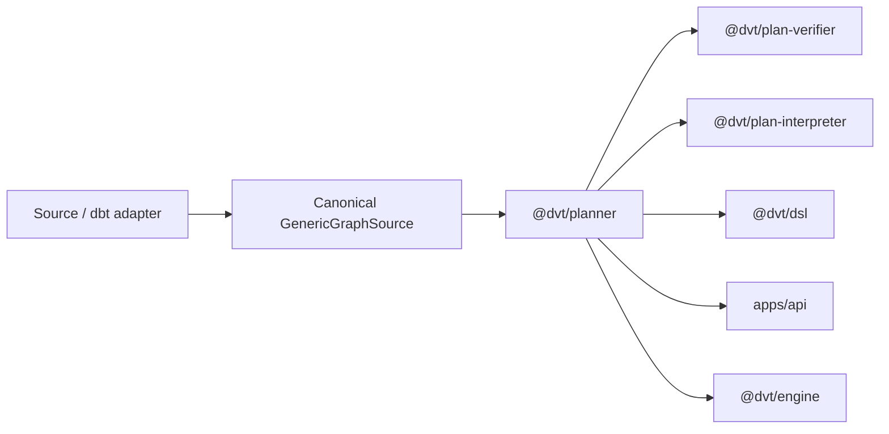
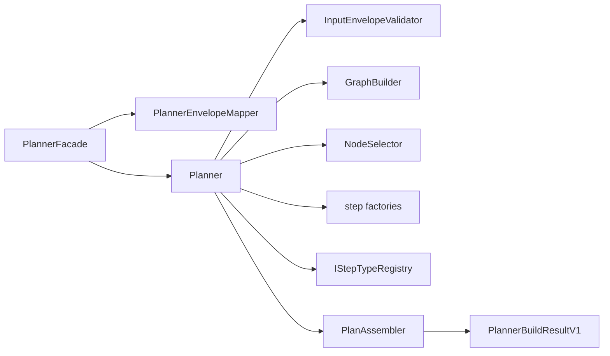
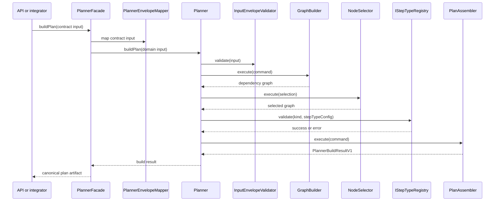

# Planning Domain

This domain owns plan derivation and validation before execution starts.

It covers planner orchestration, canonical graph-source admission, execution-plan
assembly, verification, deterministic interpretation, and DSL evaluation. It does
not own artifact publication, artifact reads, or artifact-reference enrichment.

Current target reading for graph-source generalization:

- [DB-first Component Map](./component-map.md)
- `docs/guides/generic-graph-source-user-manual-20260404.md`

## Scope

- `@dvt/planner`
- `@dvt/plan-verifier`
- `@dvt/plan-interpreter`
- `@dvt/dsl`

## Current Interactions

## Current Responsibilities

- build execution plans from canonical `GenericGraphSource` inputs whose logical
  node identities have already been assigned by the owning authoring/source boundary;
- validate plan structure, integrity, and compatibility;
- provide deterministic DAG interpretation helpers used by runtimes;
- return execution-plan truth without performing artifact I/O or publishing runtime
  artifact references.

Raw dbt manifests are external-authority inputs. They are not a Planner identity
source. Adapter/application boundaries must translate them into the canonical graph
contract before Planner admission, preserving explicit logical IDs rather than
manufacturing them from manifest keys, names, paths, providers, or ordinals.

## Code Anchors

- [PlannerFacade.ts](../../packages/@dvt/planner/src/application/PlannerFacade.ts)
- [PlannerEnvelopeMapper.ts](../../packages/@dvt/planner/src/application/PlannerEnvelopeMapper.ts)
- [verify.ts](../../packages/@dvt/plan-verifier/src/verify.ts)
- [dagAnalyzer.ts](../../packages/@dvt/plan-interpreter/src/dagAnalyzer.ts)

## Current Posture

The planning domain is already on the runtime path. `RC-G1-D` closed the
planner-private behavior-port ownership drift by moving those ports to
`@dvt/planner` while keeping shared serializable vocabulary in `@dvt/contracts`.

ADR-0067 and PR #2967 then completed the artifact hard cut: Planner publishes no
artifacts, exposes no artifact-storage compatibility bridge, and does not own the
generic runtime artifact-reference model. `@dvt/artifacts` owns canonical immutable
artifact publication/read/integrity, while `StepArtifactRef` is the step-kind-agnostic
runtime reference contract.

The remaining planning work is therefore plan-record and plan-store formalization,
not artifact publication or compiled-code enrichment.

## Queued Delta

- `S08`: formalize the plan-record and plan-store model without moving artifact
  publication back into Planner.
- `RC-G1-D`: delivered. Planner-private behavior ports are owner-local in
  `@dvt/planner`, with semantic architecture coverage guarding the split from
  shared serializable planner vocabulary.
- `MW-A2`: `GenericGraphSource` is the canonical planner input. GH-2904 hard-cuts
  the obsolete direct manifest-to-Planner compatibility bridge; source-specific
  translation remains outside the Planner boundary.

## Domain Rules

- Planning produces inputs to execution. It does not own runtime state
  transitions after admission succeeds.
- Planner consumes explicit logical graph identity and must not mint or repair it
  from physical bindings, names, paths, provider coordinates, manifest keys, or
  ordinals.
- Verifier, interpreter, and DSL packages should stay narrow and deterministic.
- Planner does not publish or read artifacts and must not expose artifact-storage
  bridges or compatibility aliases.
- Runtime artifact identity is expressed through the generic `StepArtifactRef`
  contract; artifact I/O and integrity belong to `@dvt/artifacts`.

## Related Pages

- [Planner and Contracts planning view](../planning/domains/planner-and-contracts.md)
- [DVT Component Map](./component-map.md)
- [System Delivery Status](./system-delivery-status.md)
- [Shared Package Architecture](./shared/index.md)
- [ADR-0067](../adr/ADR-0067-canonical-artifact-authority-and-compiled-code-hard-cut.md)

## planner Constraints and Invariants

### Active invariants

| Invariant                                  | Where enforced                                   | Description                                                                                                                                  |
| ------------------------------------------ | ------------------------------------------------ | -------------------------------------------------------------------------------------------------------------------------------------------- |
| Contract-first boundary                    | `PlannerFacade` + `@dvt/contracts` parsers       | Public planner input and output are governed by `PlannerInputEnvelopeV1` and `ExecutionPlanV1`.                                              |
| Cycle detection is fail-closed             | `GraphBuilder` and planner cycle docs            | Planner graph construction must reject cycles rather than degrade into partial execution semantics.                                          |
| `stepKind` is authoritative                | planner domain + `IStepTypeRegistry`             | Planner logic must not silently remap back to legacy `resourceType` semantics.                                                               |
| Policy precedence is explicit              | planner step factories                           | Governance policy values override conflicting node-local settings where the planner contract requires it.                                    |
| Retry ownership is explicit                | `resolvePolicies` + step factories               | Planner materializes top-level `ExecutionStep.retryPolicy`; adapters consume that governed field instead of inventing local retry ownership. |
| Compatibility ingress is normalized        | envelope mapper + manifest derivation seam       | `manifest` and `nodes` compatibility paths must normalize before core planner logic executes.                                                |
| Deterministic plan assembly                | `PlanAssembler`                                  | Equivalent planner input must yield the same canonical plan core payload.                                                                    |
| Planner does not own runtime execution     | package boundary                                 | Planner emits a plan artifact; runtime acceptance and execution stay outside `@dvt/planner`.                                                 |
| Private behavior ports stay owner-local    | planner private behavior-port architecture tests | Planner-private ports live in `@dvt/planner`; shared serializable vocabulary for those ports remains in `@dvt/contracts`.                    |
| Custom policy namespace registry is frozen | planner private behavior-port architecture tests | `ICustomPolicyNamespaceRegistry` remains a compatibility-only seam until a real consumer and ADR-backed reactivation exist.                  |

### Validation examples

- Invalid envelope shape is rejected before graph derivation starts.
- Cyclic graph input fails closed instead of emitting a partial plan.
- Unknown or invalid `stepKind` configuration is rejected at planner build time.
- Canonical output shape is governed by `ExecutionPlan.v1.ts`, not by planner-local schema copies.
- Invalid per-step retry profiles are rejected by shared `ExecutionPlan` schema validation before runtime consumption.
- Planner-private behavior-port modules import shared vocabulary with
  `import type` and do not import peer domains or concrete adapters.
- Custom policy namespace registry modules do not add registry implementation,
  registration, validation, or runtime authorization behavior while frozen.

### Current code anchors

- `packages/@dvt/planner/src/application/PlannerFacade.ts`
- `packages/@dvt/planner/src/domain/InputEnvelopeValidator.ts`
- `packages/@dvt/planner/src/domain/graph/GraphBuilder.ts`
- `packages/@dvt/planner/src/domain/stepFactory/dbtStepFactory.ts`
- `packages/@dvt/contracts/src/contracts/planner/ExecutionPlan.v1.ts`
- `packages/@dvt/contracts/src/contracts/planner/PlannerInputEnvelopeV1.schema.json`
- `packages/@dvt/planner/src/contracts/PlanExecutabilityValidation.ts`
- `packages/@dvt/planner/src/contracts/ExecutionBindingVerification.ts`
- `packages/@dvt/planner/src/contracts/CustomPolicyNamespaceRegistry.ts`

### Canonical references

- [Planner component entry](components/planner/index.md)
- [Planner private behavior ports component](components/planner/planner-private-behavior-ports-component.md)
- [Planner contracts](../contracts/planner/index.md)
- [Planner cycle detection technical manual](../guides/planner-cycle-detection-technical-manual-20260404.md)

> Acceptance scope status: Active. Owner: Planning Domain / Architecture.

## planner Structure and Module Map

### Current structure

The shipped planner is service-oriented and contract-first. It does not expose a
mutable `PlanAggregate` API in the active runtime path.

### Module roles

- `PlannerFacade`: contract boundary and orchestration entrypoint
- `PlannerEnvelopeMapper`: converts contract-level input into planner-domain input
- source-native adaptation: happens before planner admission and stays outside the planner package
- `Planner`: coordinates validation, graph construction, selection, and assembly
- `GraphBuilder` and `NodeSelector`: derive the executable subgraph
- step factories plus `IStepTypeRegistry`: keep per-kind config validation explicit
- `PlanAssembler`: builds the canonical plan artifact

### Current code anchors

- [PlannerFacade.ts](../../packages/@dvt/planner/src/application/PlannerFacade.ts)
- [PlannerEnvelopeMapper.ts](../../packages/@dvt/planner/src/application/PlannerEnvelopeMapper.ts)
- [Planner.ts](../../packages/@dvt/planner/src/domain/Planner.ts)
- [GraphBuilder.ts](../../packages/@dvt/planner/src/domain/graph/GraphBuilder.ts)
- [PlanAssembler.ts](../../packages/@dvt/planner/src/domain/PlanAssembler.ts)
- [ExecutionPlan.v1.ts](../../packages/@dvt/contracts/src/contracts/planner/ExecutionPlan.v1.ts)

### Canonical references

- [Planner component entry](components/planner/index.md)
- [DB-first Component Map](../../component-map.md)

> Acceptance scope status: Active. Owner: Planning Domain / Architecture.

## planner Functional Surface

### Functional responsibilities

1. `Boundary normalization`:
   `PlannerFacade` accepts canonical contract input and maps `graphSource`
   into planner domain input.
2. `Envelope validation`:
   `InputEnvelopeValidator` rejects structurally invalid planner input before
   graph construction begins.
3. `Explicit boundary stop`:
   Source-native adaptation happens before planner admission; the planner
   package does not resolve DBT manifest refs or other source-native ingress
   forms.
4. `Graph construction and selection`:
   `GraphBuilder` and `NodeSelector` build the dependency graph and apply
   selection rules before assembly.
5. `Step materialization`:
   Planner step creation stays `stepKind`-driven and validates per-kind config
   through `IStepTypeRegistry`, while canonical retry ownership is materialized
   on top-level `ExecutionStep.retryPolicy`. Built-in DBT step configs no
   longer carry retry metadata inside `stepTypeConfig`.
6. `Plan assembly`:
   `PlanAssembler` produces the canonical `ExecutionPlanV1` artifact and
   `canonicalPlanCoreJson`, including governed per-step retry/backoff metadata.
7. `Deterministic output`:
   Identical semantic input must produce the same canonical plan core and the
   same `planId`.
8. `Protected runtime handoff`:
   Planner-backed runtime admission, plan persistence, and provider dispatch
   live in `apps/api`, not in `@dvt/planner`.

### Main entrypoints

- `PlannerFacade.buildPlan(input)`
- `PlannerEnvelopeMapper.toDomainBaseInput(input)`
- `InputEnvelopeValidator.validate(input)`
- `GraphBuilder.execute(command)`
- `NodeSelector.execute(command)`
- `PlanAssembler.execute(command)`

### Current code anchors

- [PlannerFacade.ts](../../packages/@dvt/planner/src/application/PlannerFacade.ts)
- [PlannerEnvelopeMapper.ts](../../packages/@dvt/planner/src/application/PlannerEnvelopeMapper.ts)
- [Planner.ts](../../packages/@dvt/planner/src/domain/Planner.ts)
- [GraphBuilder.ts](../../packages/@dvt/planner/src/domain/graph/GraphBuilder.ts)
- [PlanAssembler.ts](../../packages/@dvt/planner/src/domain/PlanAssembler.ts)
- [ExecutionPlan.v1.ts](../../packages/@dvt/contracts/src/contracts/planner/ExecutionPlan.v1.ts)

### Canonical references

- [Planner component entry](components/planner/index.md)
- [Planner contracts](../contracts/planner/index.md)
- [DB-first Component Map](../../component-map.md)

> Acceptance scope status: Active. Owner: Planning Domain / Architecture.

## planner Build Sequence

### Current `buildPlan()` flow

### Boundary note

Planner stops at canonical plan construction. Runtime compatibility validation,
stored-plan lifecycle, and execution dispatch belong to API, verifier, and
engine surfaces, not to the planner package itself. Source-native adaptation
must happen before `buildPlan(...)` reaches the planner boundary.

### Current code anchors

- [PlannerFacade.ts](../../packages/@dvt/planner/src/application/PlannerFacade.ts)
- [PlannerEnvelopeMapper.ts](../../packages/@dvt/planner/src/application/PlannerEnvelopeMapper.ts)
- [Planner.ts](../../packages/@dvt/planner/src/domain/Planner.ts)
- [GraphBuilder.ts](../../packages/@dvt/planner/src/domain/graph/GraphBuilder.ts)
- [NodeSelector.ts](../../packages/@dvt/planner/src/domain/NodeSelector.ts)
- [PlanAssembler.ts](../../packages/@dvt/planner/src/domain/PlanAssembler.ts)

### Canonical references

- [Planner component entry](components/planner/index.md)
- [Planner contracts](../contracts/planner/index.md)
- [DB-first Component Map](../../component-map.md)

> Acceptance scope status: Active. Owner: Planning Domain / Architecture.
