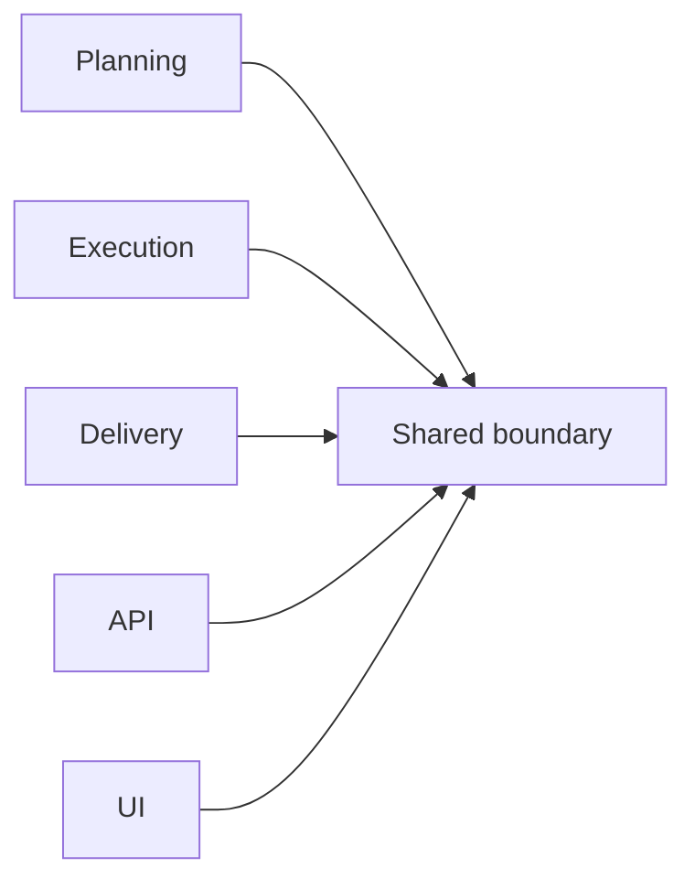

# Shared Boundary Domain

This domain contains the intentionally shared technical surfaces used across
planning, execution, delivery, API, and UI.

It is where genuinely shared contracts, telemetry abstractions, lineage
mapping, and canonicalization helpers belong. It is not a fallback bucket for
ownerless business logic.

## Scope

- `@dvt/contracts`
- `@dvt/observability`
- `@dvt/observability-otel`
- `@dvt/traceability-service`
- `@dvt/crypto`

## Current Interactions



## Current Responsibilities

- publish shared transport and contract shapes that multiple domains really use;
- define observability contracts and the OTel binding path;
- resolve and map lineage payload inputs for downstream emission;
- provide canonicalization and hashing utilities used across planner and
  runtime boundaries.

## Code Anchors

- [contracts index](../../packages/@dvt/contracts/src/index.ts)
- [ExecutionPlan.v1.ts](../../packages/@dvt/contracts/src/contracts/planner/ExecutionPlan.v1.ts)
- [observability index](../../packages/@dvt/observability/src/index.ts)
- [StepStartedLineageMapper.ts](../../packages/@dvt/traceability-service/src/lineage/mapper/StepStartedLineageMapper.ts)
- [crypto index](../../packages/@dvt/crypto/src/index.ts)

## Current Posture

The shared boundary is implemented, and `RC-G1` closed the known contract
ownership drift: domain-private behavior ports now live in owner packages while
`@dvt/contracts` keeps serializable vocabulary, schemas, refs, and event shapes.

## Queued Delta

- `S11`: tighten lineage sink facets without widening the shared surface beyond
  what downstream consumers need.
- keep OTel binding validation honest so observability docs do not overstate
  production readiness.

## Domain Rules

- Only truly shared contracts and technical cross-cutting behavior belong here.
- When ownership is ambiguous, the default fix is owner clarification, not a
  new shared abstraction.
- Shared packages should expose stable boundaries, not hidden orchestration.

## Related Pages

- [Contracts Index](../contracts/index.md)
- [DVT Component Map](./component-map.md)
- [Shared Package Architecture](./shared/index.md)
- [System Delivery Status](./system-delivery-status.md)

<a id="section-crypto"></a>

```yaml
title: Crypto Package
status: Active
owner: Architecture / Platform
last_reviewed: 2026-08-22
```

<a id="section-crypto--crypto-package"></a>

## Crypto Package

This page is the canonical package reference for `@dvt/crypto`.

<a id="section-crypto--current-reality"></a>

### Current Reality

The package name and workspace path now agree: `@dvt/crypto` lives in
`packages/@dvt/crypto`.

The package owns these repository-wide primitives:

- `utf8Bytes()`
- `jcsCanonicalize()`
- `sha256Hex()` and `sha256HexUtf8()`
- `createSha256Hasher()`
- compatibility-only `md5Hex()` and `md5HexUtf8()`
- `secureRandomBytes()`
- `randomUuidV4()` and `randomUuidV7()`

These utilities are imported directly where deterministic canonicalization,
stable hashing, secure entropy or UUID allocation is required. Domain packages
do not re-export the primitives.

<a id="section-crypto--primary-code-anchors"></a>

### Primary Code Anchors

- Public package entrypoint:
  [packages/@dvt/crypto/src/index.ts](../../packages/@dvt/crypto/src/index.ts)
- JCS canonicalization:
  [packages/@dvt/crypto/src/jcs.ts](../../packages/@dvt/crypto/src/jcs.ts)
- SHA-256 helper:
  [packages/@dvt/crypto/src/sha256.ts](../../packages/@dvt/crypto/src/sha256.ts)
- Direct Cut 1 consumers:
  [packages/@dvt/contracts/src/schema-packs/plan-records.ts](../../packages/@dvt/contracts/src/schema-packs/plan-records.ts),
  [packages/@dvt/planner/src/domain/hashing.ts](../../packages/@dvt/planner/src/domain/hashing.ts),
  [packages/@dvt/plan-verifier/src/verify.ts](../../packages/@dvt/plan-verifier/src/verify.ts),
  and
  [packages/@dvt/engine/src/security/planIntegrity.ts](../../packages/@dvt/engine/src/security/planIntegrity.ts)
- Package tests:
  [packages/@dvt/crypto/test/primitives.test.ts](../../packages/@dvt/crypto/test/primitives.test.ts)

<a id="section-crypto--verification"></a>

### Verification

- `pnpm --filter @dvt/crypto test`

<a id="section-crypto--boundary-rule"></a>

### Boundary Rule

Domain packages own their preimages, validation rules and identity prefixes.
Contracts may depend on this runtime-neutral primitive package but not on
runtime or adapter packages. This package is not a generic identity service or
a second domain authority.

<a id="section-crypto--related-docs"></a>

### Related Docs

- [ADR-0012](../adr/ADR-0012-plan-integrity-ownership.md)
- [Canonical Doc Code Matrix](../planning/status/canonical-doc-code-matrix.md)
- [Repository Map](../concepts/repository-map.md)
