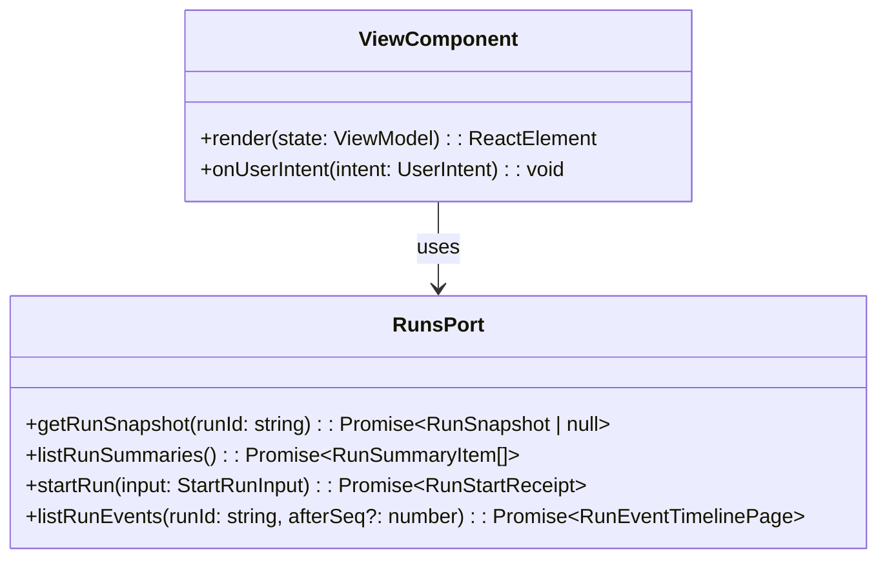
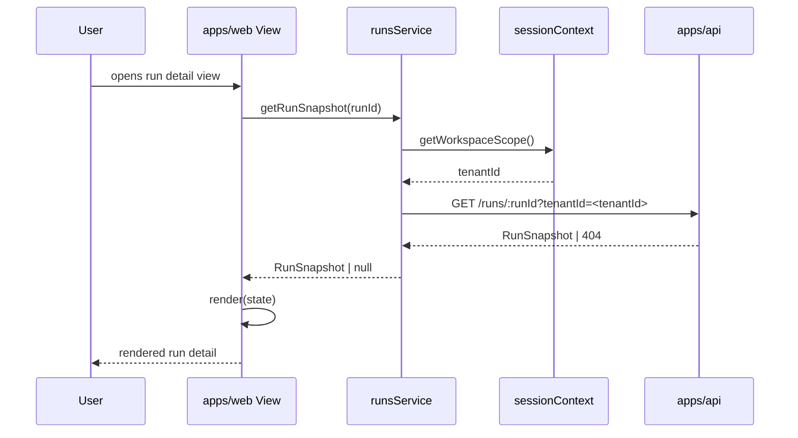
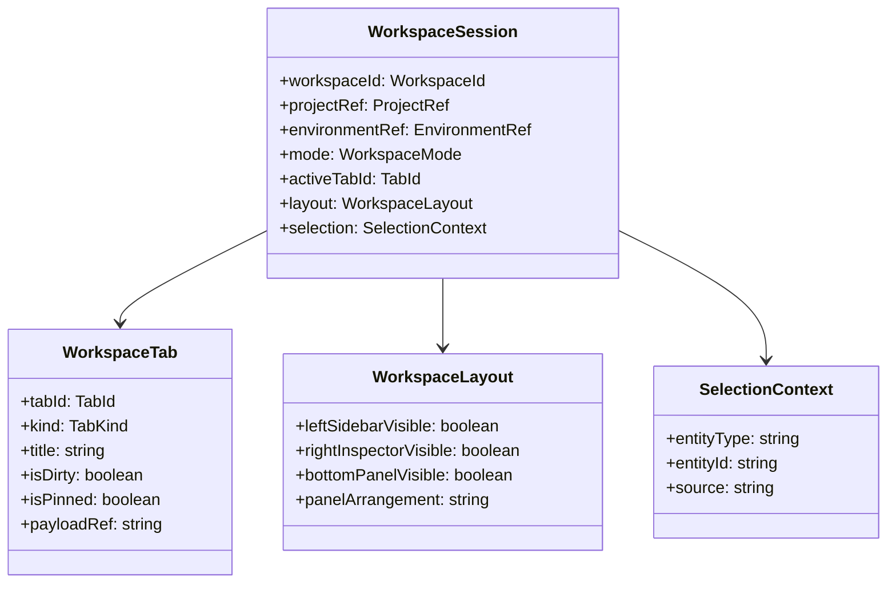
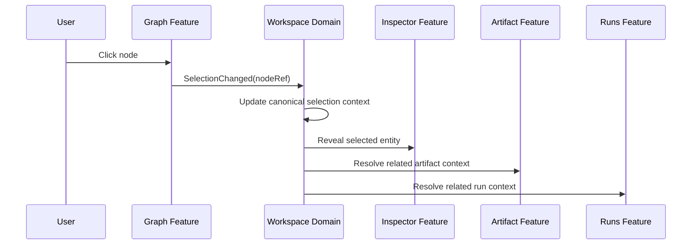

# UI / Visualization Domain

This domain owns the browser-facing DVT experience.

The code lives in the `apps/web` workspace, whose package name is `@dvt/web`.

## Scope

- `apps/web`
- package surface `@dvt/web`
- frontend routing, shell, graph workbench, runs, lineage, diff, artifacts, and
  platform health
- future execution-template and source-generation workbenches

## Current Responsibilities

- bootstrap the browser app and route operators through the current shell;
- render the active workbench views;
- present platform-health state and execution-facing UX;
- model governed source-generation UX for execution templates and provider
  scaffolds without becoming the execution authority;
- keep client composition separate from execution, planner, and persistence
  authority.

## Mature Library And OSS Direction

- [React Flow](https://reactflow.dev/) for node-based graph interaction;
- TanStack Query for server-state and polling;
- Zustand for focused local UI state;
- [Radix Primitives](https://www.radix-ui.com/primitives) and
  [shadcn/ui](https://ui.shadcn.com/) for accessible shell and view primitives;
- [TanStack Table](https://tanstack.com/table/latest) for dense diagnostics and
  operational tables;
- [Monaco Editor](https://github.com/microsoft/monaco-editor) for future code
  and diff panes;
- [xterm.js](https://xtermjs.org/) for future console or streamed log surfaces.

Open-source product references:

- [VS Code](https://github.com/microsoft/vscode)
- [Grafana](https://github.com/grafana/grafana)
- [Backstage](https://github.com/backstage/backstage)

## Related Pages

- [Frontend Architecture](./components/web/index.md)
- [Frontend Data-Boundary Architecture](./components/web/frontend-data-boundary-architecture.md)
- [Frontend Fowler Implementation Pattern](components/web/frontend-data-boundary-architecture.md#section-frontend-fowler-implementation-pattern)
- [Frontend Runtime Modes User Manual](components/web/frontend-data-boundary-architecture.md#section-frontend-runtime-modes-user-manual)
- [Frontend Runtime Contract Technical Manual](./components/web/runs/frontend-runtime-contract-technical-manual.md)
- [Frontend Runtime Contract User Manual](components/web/runs/frontend-runtime-contract-technical-manual.md#section-frontend-runtime-contract-user-manual)
- [Screen Manuals And User Stories](./components/web/screen-manuals-and-user-stories.md)
- [UX Implementation Guide](components/web/style-guide.md#section-ux-implementation-guide)
- [Library And Open-Source Reference Stack](components/web/style-guide.md#section-library-and-open-source-reference-stack)

<a id="section-web-constraints"></a>

## Web Constraints & Invariants

This document records active constraints for the `apps/web` component. The
frontend is a browser shell and presentation boundary; runtime authority remains
behind `apps/api` rails and backend ports.

### Constraints and Invariants

| Constraint / Invariant                             | Where Enforced                           | Description                                                                                                                                 |
| -------------------------------------------------- | ---------------------------------------- | ------------------------------------------------------------------------------------------------------------------------------------------- |
| All data fetching must go through `apps/api`       | Architecture boundary policy             | View components may not directly access database or storage layers; all runtime data is mediated by API rails and frontend service ports.   |
| UI contracts and API definitions must be respected | Port adapter layer / contract governance | Component props and API payloads must conform to frontend DTOs and API route contracts; breaking changes require governed contract updates. |
| Runtime reads and commands are tenant-scoped       | API rail catalog and service adapters    | `GET /runs`, `GET /runs/:runId`, `GET /runs/:runId/events`, and `POST /runs/start` carry authenticated tenant or workspace scope.           |
| Only UI domain and API interactions are permitted  | Architecture boundary policy             | `apps/web` code must not import directly from Planning, Execution, Infra, database, or provider-adapter implementation packages.            |
| Stateless view rendering                           | View component design invariant          | View components derive durable state from query results and service facades; only ephemeral UI state may be local to components.            |

### Validation Examples

- A ViewComponent attempting to import directly from `@dvt/adapter-postgres` is rejected at the architecture boundary; data must route through `apps/api`.
- An API call payload that does not match the defined UI contract schema is rejected by the API layer with a 400 error, not silently dropped.
- A component rendering run status must handle the case where `getRunSnapshot()` returns null (e.g., run not found) without throwing an unhandled exception.
- A run list query without the expected session-derived tenant/workspace scope must fail authorization or validation rather than returning cross-tenant data.

### Key Files

- `apps/web/src/app/services/runs/runsService.ts`
- `apps/web/src/app/services/runs/runsService.api.ts`
- `apps/web/src/app/ports/runs.ts`
- `apps/web/src/app/services/runs/runsApiPayloads.ts`
- Planning DB `command-query-rails` query for current runtime ownership

> Acceptance scope status: Active. Owner: UI / Visualization Domain.

<a id="section-web-ddd"></a>

## Web DDD Structure

This document summarizes the current frontend DDD boundary for the deployable
`apps/web` workspace. The route and DTO authority for run orchestration remains
the protected runtime contract in
[Frontend Runtime Contract Technical Manual](components/web/runs/frontend-runtime-contract-technical-manual.md).

### DDD Diagram



### Aggregates & Entities

- **ViewComponent**: A React component in `apps/web` that renders a route or
  workbench surface from view models and local UI state.
- **RunsPort**: Presentation-facing run boundary implemented by
  `runsService.api.ts`. It wraps protected HTTP calls to `apps/api` and keeps
  transport concerns out of route views.
- **WorkspaceScope**: Session-derived tenant, project, environment, and target
  adapter context used by `startRun` and by list/read tenant-scope queries.

### Domain Events

- UI components do not own runtime domain events. They dispatch user intents
  through ports and render read models returned by governed API rails.
- Runtime event history is read through `listRunEvents(runId, afterSeq?)`; the
  authoritative write-side events remain owned by the runtime backend.

### Key Files

- `apps/web/src/app/services/runs/runsService.ts`
- `apps/web/src/app/services/runs/runsService.api.ts`
- `apps/web/src/app/ports/runs.ts`
- `apps/web/src/app/ports/sessionContext.ts`
- Planning DB `command-query-rails` query for current runtime ownership

> Acceptance scope status: Active. Owner: UI / Visualization Domain.

<a id="section-web-functional"></a>

## Web Functionalities

This document summarizes the active product-facing functionality of `apps/web`.
The current runtime boundary is hexagonal: route views depend on presentation
ports and service facades, while HTTP transport is isolated in adapters.

### Functionalities

| #   | Functionality             | Description                                                                                                |
| --- | ------------------------- | ---------------------------------------------------------------------------------------------------------- |
| 1   | Route and workbench shell | Composes browser routes, plugin views, and shell-owned administrative surfaces.                            |
| 2   | Run status visualization  | Renders run summaries, snapshots, step progress, and timeline events sourced from protected runtime rails. |
| 3   | User interaction handling | Captures user intent and dispatches it through presentation ports such as `IRunsPort`.                     |
| 4   | API integration           | Communicates with `apps/api` through service adapters such as `runsService.api.ts`.                        |
| 5   | Contract compliance       | Keeps frontend DTOs aligned with current API route contracts and runtime rails.                            |

### Main Methods

The following methods are the current `IRunsPort` contract implemented by
[`runsService.api.ts`](../../apps/web/src/app/services/runs/runsService.api.ts)
and defined in [`ports/runs.ts`](../../apps/web/src/app/ports/runs.ts):

- `getRunSnapshot(runId: string): Promise<RunSnapshot | null>`: fetches a tenant-scoped run snapshot from `GET /runs/:runId`.
- `listRunSummaries(): Promise<RunSummaryItem[]>`: lists run summaries from `GET /runs` using tenant, project, and environment scope.
- `startRun(input: StartRunInput): Promise<RunStartReceipt>`: starts a run via `POST /runs/start`; the API owns run identity and admission.
- `listRunEvents(runId: string, afterSeq?: number): Promise<RunEventTimelinePage>`: lists tenant-scoped run events from `GET /runs/:runId/events`.

### Key Files

- `apps/web/src/app/services/runs/runsService.ts`
- `apps/web/src/app/services/runs/runsService.api.ts`
- `apps/web/src/app/ports/runs.ts`
- Planning DB `command-query-rails` query for current runtime ownership

> Acceptance scope status: Active. Owner: UI / Visualization Domain.

<a id="section-web-sequence"></a>

## Web Sequence

This document summarizes the active `apps/web` run-detail fetch sequence. Route
truth remains the protected runtime contract documented in
[Frontend Runtime Contract Technical Manual](components/web/runs/frontend-runtime-contract-technical-manual.md).

### Main Flow: Run Snapshot Fetch



### Global Flow Position

`apps/web` sits at the outermost layer of the DVT system, serving as the browser
application shell and route-level workbench host. It calls `apps/api` for data
through governed service boundaries and port adapters. It has no knowledge of
the Planning, Execution, or Infra domains; all business logic and data access
is delegated downstream through the API layer.

### Key Files

- `apps/web/src/app/services/runs/runsService.ts`
- `apps/web/src/app/services/runs/runsService.api.ts`
- `apps/web/src/app/ports/runs.ts`
- `apps/web/src/app/views/RunsView.tsx`
- Planning DB `command-query-rails` query for current runtime ownership

> Acceptance scope status: Active. Owner: UI / Visualization Domain.

<a id="section-workspace-domain-specification"></a>

## Workspace Domain Specification

### 1. Purpose

This document defines the `Workspace Domain` for the DVT+ frontend.

Its purpose is to formalize the role of the workspace as a first-class frontend domain, describe its responsibilities and boundaries, and establish the initial conceptual model needed to support a workbench-oriented product architecture.

This document is intentionally focused on architectural definition. It does not yet prescribe implementation details for all components or stores, but it does define the domain shape that future implementation must follow.

---

### 2. Context

DVT+ is not a conventional page-based web application. It is evolving toward a frontend that behaves as a product workbench, where users can design, inspect, compare, and operate workflows from multiple synchronized surfaces.

This means the frontend must coordinate:

- multiple simultaneous views
- persistent user context
- shared selection across features
- panel composition
- tabbed work surfaces
- mode-dependent behavior
- relationships between graph, artifacts, runs, lineage, and git views

These concerns do not belong to any single feature such as graph, runs, or artifacts. They belong to the workspace itself.

For that reason, `workspace` must be treated as a domain rather than as a group of layout components.

---

### 3. Domain statement

The `Workspace Domain` is the frontend domain responsible for composing, coordinating, and preserving the user’s active working context across the DVT+ workbench.

It exists to ensure that the frontend behaves as a coherent tool rather than as a collection of unrelated views.

The workspace is therefore the coordination backbone of the frontend.

---

### 4. Why this domain exists

Without an explicit workspace domain, the frontend will tend to fragment in predictable ways:

- each feature owns its own local selection
- panels are opened directly by sibling features
- tabs behave as router artifacts instead of typed work surfaces
- shared context is duplicated or inconsistently updated
- graph, inspector, artifacts, runs, and git views drift apart semantically
- UI behavior becomes hard to reason about and difficult to test

In DVT+, where the same workflow element may need to appear in several projections at once, that fragmentation would become a structural problem.

The workspace domain exists to avoid that outcome.

---

### 5. Responsibilities

The `Workspace Domain` should own the following responsibilities.

#### 5.1 Workspace session

The workspace owns the active workspace session as the canonical representation of the current working surface.

A workspace session may include:

- current project context
- current environment context
- active branch context
- active workspace mode
- open tabs
- active tab
- current layout state
- shared selection context

A workspace session is not equivalent to being on a page. It represents an active working environment.

#### 5.2 Tab and surface management

The workspace owns the lifecycle of work surfaces such as tabs or equivalent view instances.

Examples include:

- graph surface
- artifact surface
- run detail surface
- git diff surface
- lineage surface
- observer surface

A tab must be understood as a typed work surface instance, not as a visual label only.

#### 5.3 Layout composition

The workspace owns layout composition across the workbench, including concerns such as:

- side panels
- bottom panels
- inspector visibility
- split arrangements
- docking behavior
- pinned surfaces
- layout presets
- mode-driven composition changes

This allows layout behavior to remain product-aware and not merely component-local.

#### 5.4 Shared selection and context

The workspace owns the canonical shared selection and active context needed to synchronize multiple feature surfaces.

Examples of selectable entities include:

- graph node
- graph edge
- run
- step
- artifact
- git file
- lineage entity

The workspace should provide a stable, workbench-level representation of what is selected and from where that context originated.

#### 5.5 Active workspace mode

The workspace owns the active mode of the workbench, such as:

- design
- dbt
- etl
- observer
- git
- run-analysis

Mode is a workbench concern because it affects layout, commands, visibility, and the relevance of certain views.

#### 5.6 Cross-feature orchestration

The workspace coordinates interactions that span multiple frontend capabilities.

Examples include:

- selecting a graph node and synchronizing inspector, artifacts, and run context
- opening a run and synchronizing logs, step focus, and graph overlays
- opening a git diff and correlating changed files with graph entities
- switching mode and recomposing the active surface set

This orchestration should be owned by the workspace rather than by any single feature module.

---

### 6. Non-responsibilities

The `Workspace Domain` must not absorb feature-specific logic.

It should not own:

- graph rendering logic
- artifact parsing or artifact-specific domain rules
- run retrieval or execution-specific interpretation
- git diff computation
- lineage computation
- backend transport logic for individual feature domains

These belong to their corresponding feature domains.

The workspace is responsible for coordination and composition, not for replacing feature internals.

---

### 7. Architectural principle

The main architectural rule for the workspace domain is:

> Feature modules should not directly control each other. They should collaborate through workspace-owned context and orchestration.

This means, for example:

- the graph feature should not directly mutate inspector state
- the inspector should not directly open artifact tabs by reaching into artifact internals
- the git feature should not directly control graph-local state
- cross-feature UI consequences should be mediated by workspace state and workspace use cases

This keeps feature boundaries explicit and avoids coupling by convenience.

---

### 8. Core concepts

The workspace domain appears to require, at minimum, the following core concepts.

#### 8.1 Workspace Session

Represents the active workbench state for a user in a given project and environment context.

#### 8.2 Workspace Tab

Represents a typed work surface instance. A tab is not merely a title; it has identity, kind, payload reference, lifecycle, and possibly dirty or pinned state.

#### 8.3 Workspace Layout

Represents the arrangement and visibility of panels and work surfaces.

#### 8.4 Selection Context

Represents the currently selected entity and the origin of that selection within the workbench.

#### 8.5 Workspace Mode

Represents the active operational perspective of the workbench and determines relevant UI composition and actions.

---

### 9. Conceptual model



This diagram is conceptual. It defines the center of the domain without locking the final code-level representation too early.

---

### 10. Suggested internal decomposition

To avoid turning `workspace` into a god module, the domain should be internally decomposed into focused areas.

#### 10.1 Session Management

Owns:

- workspace identity
- project/environment/branch context
- session restoration
- preservation of active work context
- rehydration from persisted state where applicable

#### 10.2 Tab Management

Owns:

- opening tabs
- closing tabs
- activating tabs
- pinning tabs
- deduplication rules
- tab restoration
- tab history

#### 10.3 Layout Management

Owns:

- panel visibility
- split sizes
- docking state
- layout presets
- responsive layout constraints
- mode-aware composition rules

#### 10.4 Context Management

Owns:

- current selection
- focused entity
- compare context
- active run context
- active artifact context
- active cross-surface context

#### 10.5 Workspace Orchestration

Owns higher-level use cases such as:

- open entity in tab
- reveal entity in inspector
- synchronize related panels
- switch mode
- restore prior working context after navigation
- coordinate multi-feature reactions to user actions

---

### 11. Example interaction

The following sequence illustrates the intended role of the workspace domain when a user selects a graph node.



The important architectural property is that the graph feature does not directly control all downstream consequences of selection.

The workspace domain coordinates them.

---

### 12. Initial TypeScript direction

The following contracts are indicative and intentionally strict. They are not the final implementation, but they express the intended domain shape.

```ts
export type WorkspaceMode = 'design' | 'dbt' | 'etl' | 'observer' | 'git' | 'run-analysis';

export type WorkspaceTabKind = 'graph' | 'artifact' | 'run' | 'git-diff' | 'lineage' | 'observer';

export interface WorkspaceSession {
  readonly workspaceId: string;
  readonly projectId: string;
  readonly environmentId: string | null;
  readonly mode: WorkspaceMode;
  readonly activeTabId: string | null;
  readonly tabs: readonly WorkspaceTab[];
  readonly layout: WorkspaceLayout;
  readonly selection: SelectionContext | null;
}

export interface WorkspaceTab {
  readonly tabId: string;
  readonly kind: WorkspaceTabKind;
  readonly title: string;
  readonly payloadRef: string;
  readonly isDirty: boolean;
  readonly isPinned: boolean;
}

export interface WorkspaceLayout {
  readonly leftSidebarVisible: boolean;
  readonly rightInspectorVisible: boolean;
  readonly bottomPanelVisible: boolean;
}

export interface SelectionContext {
  readonly entityType: string;
  readonly entityId: string;
  readonly source: 'graph' | 'runs' | 'artifacts' | 'git' | 'lineage';
}
```

This contract is deliberately conservative. It gives the domain a clear initial shape without prematurely over-designing every reference type.

---

### 13. Suggested placement in the frontend architecture

The workspace should exist as a first-class area of the frontend, not as a secondary utility or purely presentational layer.

An indicative structure is the following:

```text
src/
  workspace/
    domain/
      model/
      events/
      services/
    application/
      open-tab/
      activate-tab/
      change-mode/
      update-selection/
      restore-session/
    infrastructure/
      persistence/
      mappers/
    ui/
      components/
      store/
```

This placement reflects the importance of the workspace domain as the coordination backbone of the workbench.

---

### 14. Initial boundaries

The following initial boundary definition is recommended.

#### Workspace Domain owns

- workspace session model
- tab model
- layout model
- shared selection/context model
- orchestration rules between surfaces
- restoration rules for user work context

#### Feature domains own

- graph-specific rendering and actions
- run-specific representation and behavior
- artifact-specific interpretation
- git-specific diff behavior
- lineage-specific behavior
- inspector-specific rendering and detail composition

This boundary should remain explicit in both code structure and architectural decisions.

---

### 15. Risks

#### 15.1 Workspace becoming a god module

Because it coordinates many surfaces, the workspace domain can easily grow beyond its intended scope.

Mitigation:

- preserve strict non-responsibilities
- keep orchestration use-case based
- do not absorb feature-specific domain logic

#### 15.2 Untyped selection drift

A weakly typed selection model will degrade quickly as the product adds more entity types.

Mitigation:

- introduce canonical entity references early
- evolve from generic selection payloads toward typed references

#### 15.3 Weak tab semantics

If tabs are treated as visual labels or router aliases only, the workbench model becomes too thin.

Mitigation:

- model tabs as typed work surface instances
- preserve identity, payload, and lifecycle state

#### 15.4 Layout state leaking into local component state

If layout behavior remains scattered across local React state, the workspace cannot act as a coherent coordination layer.

Mitigation:

- maintain layout as workspace-owned state
- render UI surfaces from explicit layout models

---

### 16. Conclusion

The `Workspace Domain` should be treated as the frontend coordination domain that owns working context, tabbed surfaces, shared selection, mode-aware composition, and panel orchestration across the DVT+ workbench.

It is therefore not an implementation detail and not a visual wrapper. It is a foundational part of the frontend architecture.

If the workspace domain is designed correctly, the rest of the frontend can evolve as modular feature domains coordinated through explicit context rather than through accidental coupling.

---

### 17. Recommended follow-up documents

This document should be followed by more detailed specifications for:

1. `workspace-session-model.md`
2. `workspace-tab-model.md`
3. `selection-context-model.md`
4. `workspace-layout-model.md`
5. `workspace-orchestration.md`

These documents should refine the domain without breaking the principles established here.

> Section status: Draft. Owner: frontend-architecture. Colocation does not merge component responsibilities.
