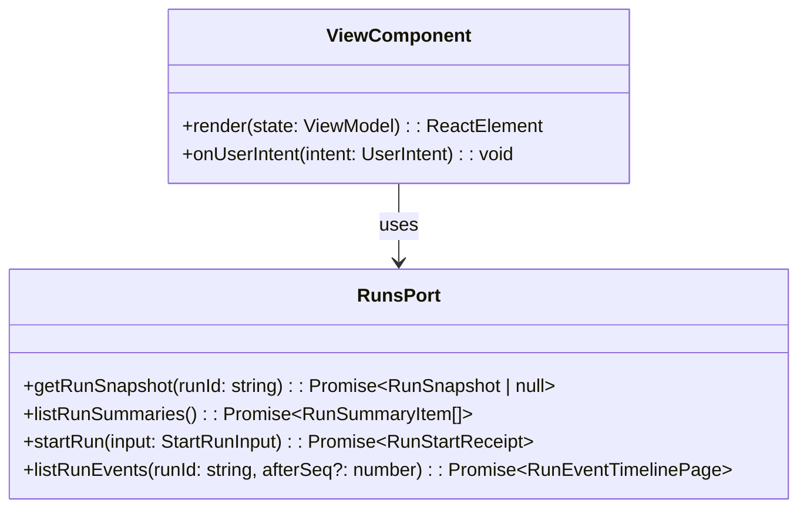
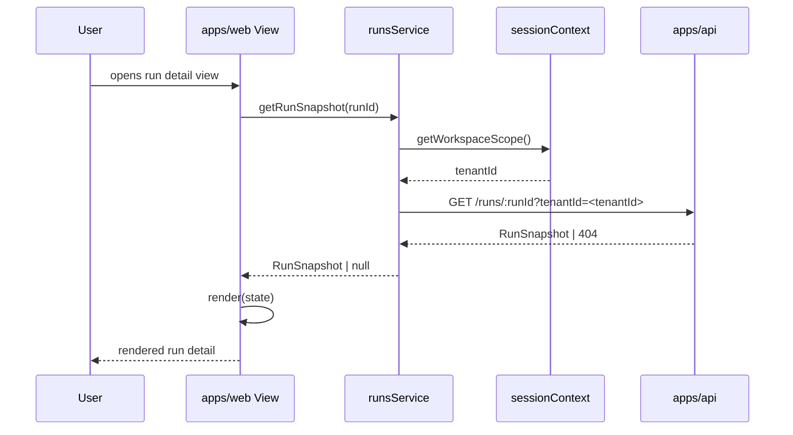

# UI / Visualization Domain

This domain owns the browser-facing DVT experience.

The code lives in the `apps/web` workspace, whose package name is `@dvt/web`.

## Scope

- `apps/web`
- package surface `@dvt/web`
- frontend routing, shell, graph workbench, runs, lineage, diff, artifacts, and
  platform health
- future execution-template and source-generation workbenches

## Current Responsibilities

- bootstrap the browser app and route operators through the current shell;
- render the active workbench views;
- present platform-health state and execution-facing UX;
- model governed source-generation UX for execution templates and provider
  scaffolds without becoming the execution authority;
- keep client composition separate from execution, planner, and persistence
  authority.

## Mature Library And OSS Direction

- [React Flow](https://reactflow.dev/) for node-based graph interaction;
- TanStack Query for server-state and polling;
- Zustand for focused local UI state;
- [Radix Primitives](https://www.radix-ui.com/primitives) and
  [shadcn/ui](https://ui.shadcn.com/) for accessible shell and view primitives;
- [TanStack Table](https://tanstack.com/table/latest) for dense diagnostics and
  operational tables;
- [Monaco Editor](https://github.com/microsoft/monaco-editor) for future code
  and diff panes;
- [xterm.js](https://xtermjs.org/) for future console or streamed log surfaces.

Open-source product references:

- [VS Code](https://github.com/microsoft/vscode)
- [Grafana](https://github.com/grafana/grafana)
- [Backstage](https://github.com/backstage/backstage)

## Related Pages

- [Frontend Architecture](./components/web/index.md)
- [Frontend Data-Boundary Architecture](./components/web/frontend-data-boundary-architecture.md)
- [Frontend Fowler Implementation Pattern](./components/web/frontend-fowler-implementation-pattern.md)
- [Frontend Runtime Modes User Manual](./components/web/frontend-runtime-modes-user-manual.md)
- [Frontend Runtime Contract Technical Manual](./components/web/runs/frontend-runtime-contract-technical-manual.md)
- [Frontend Runtime Contract User Manual](./components/web/runs/frontend-runtime-contract-user-manual.md)
- [Screen Manuals And User Stories](./components/web/screen-manuals-and-user-stories.md)
- [UX Implementation Guide](./components/web/ux-implementation-guide.md)
- [Library And Open-Source Reference Stack](./components/web/library-and-open-source-reference-stack.md)

## Web Constraints & Invariants

This document records active constraints for the `apps/web` component. The
frontend is a browser shell and presentation boundary; runtime authority remains
behind `apps/api` rails and backend ports.

### Constraints and Invariants

| Constraint / Invariant                             | Where Enforced                           | Description                                                                                                                                 |
| -------------------------------------------------- | ---------------------------------------- | ------------------------------------------------------------------------------------------------------------------------------------------- |
| All data fetching must go through `apps/api`       | Architecture boundary policy             | View components may not directly access database or storage layers; all runtime data is mediated by API rails and frontend service ports.   |
| UI contracts and API definitions must be respected | Port adapter layer / contract governance | Component props and API payloads must conform to frontend DTOs and API route contracts; breaking changes require governed contract updates. |
| Runtime reads and commands are tenant-scoped       | API rail catalog and service adapters    | `GET /runs`, `GET /runs/:runId`, `GET /runs/:runId/events`, and `POST /runs/start` carry authenticated tenant or workspace scope.           |
| Only UI domain and API interactions are permitted  | Architecture boundary policy             | `apps/web` code must not import directly from Planning, Execution, Infra, database, or provider-adapter implementation packages.            |
| Stateless view rendering                           | View component design invariant          | View components derive durable state from query results and service facades; only ephemeral UI state may be local to components.            |

### Validation Examples

- A ViewComponent attempting to import directly from `@dvt/adapter-postgres` is rejected at the architecture boundary; data must route through `apps/api`.
- An API call payload that does not match the defined UI contract schema is rejected by the API layer with a 400 error, not silently dropped.
- A component rendering run status must handle the case where `getRunSnapshot()` returns null (e.g., run not found) without throwing an unhandled exception.
- A run list query without the expected session-derived tenant/workspace scope must fail authorization or validation rather than returning cross-tenant data.

### Key Files

- `apps/web/src/app/services/runs/runsService.ts`
- `apps/web/src/app/services/runs/runsService.api.ts`
- `apps/web/src/app/ports/runs.ts`
- `apps/web/src/app/services/runs/runsApiPayloads.ts`
- Planning DB `command-query-rails` query for current runtime ownership

> Acceptance scope status: Active. Owner: UI / Visualization Domain.

## Web DDD Structure

This document summarizes the current frontend DDD boundary for the deployable
`apps/web` workspace. The route and DTO authority for run orchestration remains
the protected runtime contract in
[Frontend Runtime Contract Technical Manual](components/web/runs/frontend-runtime-contract-technical-manual.md).

### DDD Diagram

### Aggregates & Entities

- **ViewComponent**: A React component in `apps/web` that renders a route or
  workbench surface from view models and local UI state.
- **RunsPort**: Presentation-facing run boundary implemented by
  `runsService.api.ts`. It wraps protected HTTP calls to `apps/api` and keeps
  transport concerns out of route views.
- **WorkspaceScope**: Session-derived tenant, project, environment, and target
  adapter context used by `startRun` and by list/read tenant-scope queries.

### Domain Events

- UI components do not own runtime domain events. They dispatch user intents
  through ports and render read models returned by governed API rails.
- Runtime event history is read through `listRunEvents(runId, afterSeq?)`; the
  authoritative write-side events remain owned by the runtime backend.

### Key Files

- `apps/web/src/app/services/runs/runsService.ts`
- `apps/web/src/app/services/runs/runsService.api.ts`
- `apps/web/src/app/ports/runs.ts`
- `apps/web/src/app/ports/sessionContext.ts`
- Planning DB `command-query-rails` query for current runtime ownership

> Acceptance scope status: Active. Owner: UI / Visualization Domain.

## Web Functionalities

This document summarizes the active product-facing functionality of `apps/web`.
The current runtime boundary is hexagonal: route views depend on presentation
ports and service facades, while HTTP transport is isolated in adapters.

### Functionalities

| #   | Functionality             | Description                                                                                                |
| --- | ------------------------- | ---------------------------------------------------------------------------------------------------------- |
| 1   | Route and workbench shell | Composes browser routes, plugin views, and shell-owned administrative surfaces.                            |
| 2   | Run status visualization  | Renders run summaries, snapshots, step progress, and timeline events sourced from protected runtime rails. |
| 3   | User interaction handling | Captures user intent and dispatches it through presentation ports such as `IRunsPort`.                     |
| 4   | API integration           | Communicates with `apps/api` through service adapters such as `runsService.api.ts`.                        |
| 5   | Contract compliance       | Keeps frontend DTOs aligned with current API route contracts and runtime rails.                            |

### Main Methods

The following methods are the current `IRunsPort` contract implemented by
[`runsService.api.ts`](../../apps/web/src/app/services/runs/runsService.api.ts)
and defined in [`ports/runs.ts`](../../apps/web/src/app/ports/runs.ts):

- `getRunSnapshot(runId: string): Promise<RunSnapshot | null>`: fetches a tenant-scoped run snapshot from `GET /runs/:runId`.
- `listRunSummaries(): Promise<RunSummaryItem[]>`: lists run summaries from `GET /runs` using tenant, project, and environment scope.
- `startRun(input: StartRunInput): Promise<RunStartReceipt>`: starts a run via `POST /runs/start`; the API owns run identity and admission.
- `listRunEvents(runId: string, afterSeq?: number): Promise<RunEventTimelinePage>`: lists tenant-scoped run events from `GET /runs/:runId/events`.

### Key Files

- `apps/web/src/app/services/runs/runsService.ts`
- `apps/web/src/app/services/runs/runsService.api.ts`
- `apps/web/src/app/ports/runs.ts`
- Planning DB `command-query-rails` query for current runtime ownership

> Acceptance scope status: Active. Owner: UI / Visualization Domain.

## Web Sequence

This document summarizes the active `apps/web` run-detail fetch sequence. Route
truth remains the protected runtime contract documented in
[Frontend Runtime Contract Technical Manual](components/web/runs/frontend-runtime-contract-technical-manual.md).

### Main Flow: Run Snapshot Fetch

### Global Flow Position

`apps/web` sits at the outermost layer of the DVT system, serving as the browser
application shell and route-level workbench host. It calls `apps/api` for data
through governed service boundaries and port adapters. It has no knowledge of
the Planning, Execution, or Infra domains; all business logic and data access
is delegated downstream through the API layer.

### Key Files

- `apps/web/src/app/services/runs/runsService.ts`
- `apps/web/src/app/services/runs/runsService.api.ts`
- `apps/web/src/app/ports/runs.ts`
- `apps/web/src/app/views/RunsView.tsx`
- Planning DB `command-query-rails` query for current runtime ownership

> Acceptance scope status: Active. Owner: UI / Visualization Domain.
