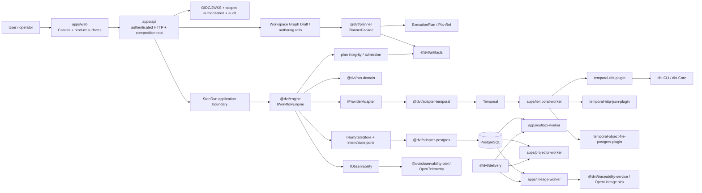
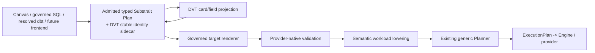
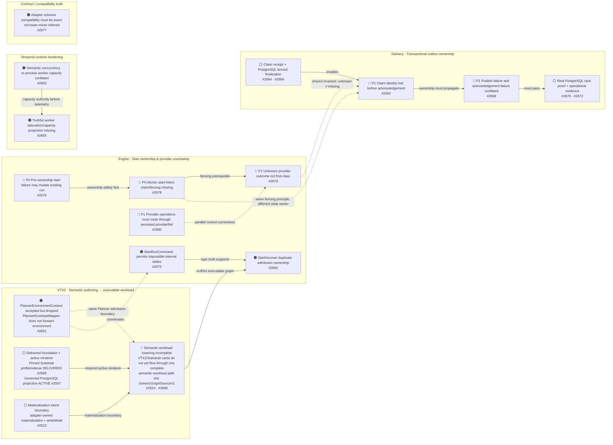
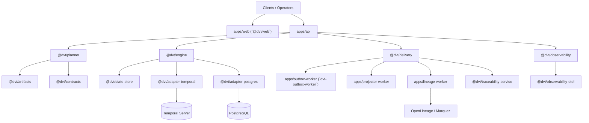
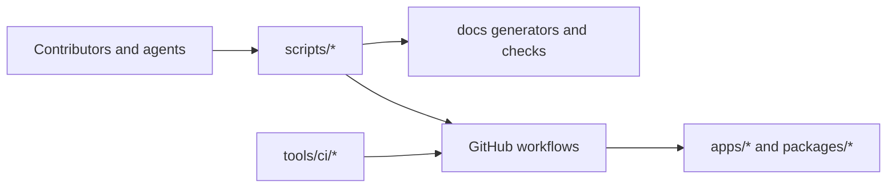

# Reference Architecture

Canonical authored reference for DVT architectural principles, authority boundaries,
and top-level runtime shape.

This page is intentionally small. Component-local detail belongs in
[`docs/architecture/components/`](./components/index.md), cross-component flows belong in
[`docs/architecture/system/`](./system/index.md), and executable source, tests, runtime
composition, accepted ADRs, and Planning DB architecture queries remain stronger evidence
than this prose when they disagree.

## Reading Rule

Distinguish these postures explicitly:

- **AS-IS**: implemented in current source/runtime composition.
- **PARTIAL**: a real boundary exists but product or operational coverage is incomplete.
- **TARGET**: accepted architecture that is not yet an end-to-end executable path.
- **EXTERNAL**: third-party runtime or standard actually used by current source.

Do not promote an accepted target to AS-IS without executable evidence, and do not keep an
implemented slice labeled purely target after it lands.

## Principles

- **Hexagonal boundaries:** domain/application logic depends on DVT-owned contracts and
  ports; infrastructure-specific behavior stays behind adapters or composition roots.
- **Deterministic planning and execution inputs:** plan identity and integrity are stable;
  workflow code remains replay-safe and side effects cross explicit runtime boundaries.
- **Planner / Engine / State / UI authority separation:** the Planner decides executable
  responsibilities, the Engine governs lifecycle, persisted run events record operational
  truth, and the UI authors/presents state through governed application boundaries.
- **Event-sourced run lifecycle:** ordered `RunEvents` are authoritative; snapshots are
  derived. Provider-native status cannot replace canonical DVT status.
- **One authority per kind of truth:** semantic meaning, stable authoring identity, runtime
  planning, lifecycle transitions, artifacts, provider execution, state, delivery, and
  presentation have distinct owners.
- **Replaceable infrastructure where a real boundary exists:** provider/runtime concerns
  stay behind `IProviderAdapter`; a hypothetical second implementation is not sufficient
  reason to create another abstraction.
- **Reuse before build:** use standards and mature libraries for commodity behavior and
  keep DVT-specific code focused on product semantics, governance, and integration.
- **Command/query rail governance:** externally observable behavior reuses named product
  rails instead of being redefined independently by routes, workers, plugins, adapters, or
  UI actions.
- **Mechanical enforcement where possible:** architecture tests, contract tests, CI,
  deterministic serialization, and generated/governed indexes are preferred over prose-only
  rules.
- **Target architecture must not become implementation evidence:** proposals and open PRs
  may inform direction, but `main` remains the source-first baseline.

## Current Authority Map

| Concern                                              | Current authority                                                | Posture      |
| ---------------------------------------------------- | ---------------------------------------------------------------- | ------------ |
| Cross-boundary vocabulary                            | `@dvt/contracts`                                                 | AS-IS        |
| Cryptographic/canonical primitives                   | `@dvt/crypto`                                                    | AS-IS        |
| Workspace/Canvas graph authoring                     | protected Workspace Graph Draft + Canvas authoring rails         | AS-IS        |
| Relational/expression/type/function meaning for VTX2 | pinned Substrait profile                                         | PARTIAL VTX2 |
| Stable VTX2 relation/field identity                  | DVT Substrait authoring sidecar                                  | PARTIAL VTX2 |
| Semantic capability governance                       | `DvtSubstraitCapabilityCatalog.v1`                               | PARTIAL VTX2 |
| Runtime responsibility planning                      | `@dvt/planner` through `PlannerFacade` / `ExecutionPlan`         | AS-IS        |
| Stored-plan parsing/config verification              | `@dvt/plan-verifier`                                             | AS-IS        |
| Execution DAG interpretation/layers                  | `@dvt/plan-interpreter`                                          | AS-IS        |
| Run lifecycle command/read boundary                  | `@dvt/engine` / `IWorkflowEngine`                                | AS-IS        |
| Legal run/step transitions                           | `@dvt/run-domain`                                                | AS-IS        |
| Provider execution translation                       | `IProviderAdapter` implementations                               | AS-IS        |
| Current workflow provider                            | Temporal via `@dvt/adapter-temporal`                             | AS-IS        |
| Operational run truth                                | persisted ordered run events + derived snapshots                 | AS-IS        |
| Immutable plan/code/bundle/context objects           | `@dvt/artifacts`                                                 | AS-IS        |
| Async fact movement and projection refresh           | `@dvt/delivery` + workers                                        | AS-IS        |
| Authentication/authorization/audit                   | `apps/api` protected security runtime                            | AS-IS        |
| Runtime telemetry                                    | `IObservability` + concrete operational metrics/OTel integration | PARTIAL      |
| Product presentation/editor                          | `apps/web` through governed API/application ports                | AS-IS        |

## Bounded Contexts And Runtime Responsibilities

| Context / subsystem          | Responsibility                                                                            | Current status                                      |
| ---------------------------- | ----------------------------------------------------------------------------------------- | --------------------------------------------------- |
| Authoring / Workspace        | protected graph draft, authoring authority, dbt/source-import rails                       | Implemented                                         |
| Planning                     | deterministic selection, policies, graph analysis, plan assembly and hashing              | Implemented and runtime-wired                       |
| Execution                    | admission, intent/recovery, lifecycle commands/queries, provider delegation               | Implemented                                         |
| Run Domain                   | event folding and legal run/step transition invariants                                    | Implemented                                         |
| State                        | run events, snapshots, intent/outbox persistence and operational reads                    | Implemented                                         |
| Artifacts                    | plan, compiled-code, bundle, execution-context and content-addressed artifact boundaries  | Implemented bounded context; storage profiles vary  |
| Delivery                     | outbox movement, sharding, backpressure and projection refresh                            | Implemented                                         |
| Provider Runtime             | Temporal workflow/worker plus capability-specific step plugins                            | Implemented for Temporal                            |
| Traceability / Lineage       | lineage/evidence processing and OpenLineage-facing integration                            | Implemented path; external sink availability varies |
| Observability                | traces, operational metrics/logging and correlation                                       | Partial coverage                                    |
| Security / API               | authenticated command/query boundary, scoped authorization, durable audit and composition | Implemented                                         |
| Web / UX                     | Canvas/workspace authoring and governed run/read surfaces                                 | Implemented surface; feature coverage evolves       |
| Semantic Transformation VTX2 | Substrait-centered semantic authoring/rendering/readiness path                            | bounded AS-IS authoring pilot + broader TARGET      |

## Top-Level AS-IS Runtime Shape



The arrows describe responsibility/runtime handoff, not TypeScript import edges.

### Current runtime facts that must remain explicit

- `apps/api/src/modules/buildProtectedRuntimeModule.ts` is the protected runtime
  composition root. DVT does not require a fictional generic DI/autodiscovery kernel to
  explain current composition.
- `PlannerFacade` is the stable public Planner entry. Planner-owned behavior ports remain
  separate from shared serializable contracts in `@dvt/contracts`.
- `IWorkflowEngine` and `IProviderAdapter` are different boundaries. `TemporalAdapter`
  implements the provider seam; it is not the product workflow-engine facade.
- `IWorkflowEngine.getRunStatus()` reads canonical status from DVT persisted state and must
  not query the provider adapter for canonical truth.
- provider workflows/workers may realize lifecycle facts, but those facts become canonical
  product truth through the DVT event/state rail.
- DBT is a concrete integration/execution capability composed by the Temporal worker DBT
  plugin profile; it is not engine-kernel semantics.
- delivery/outbox is not a universal message bus. Commands and queries retain explicit
  application rails.

## VTX2: Current Slice Versus Target Subsystem

ADR-0064 makes the pinned Substrait logical profile the semantic reference for VTX2 and
keeps DVT's sidecar limited to stable authoring identity/provenance.

### AS-IS on current `main`

The first deliberately bounded Canvas authoring pilot is implemented:

```text
customers(name, email, country)
name -> trim -> upper -> customer_name
```

The Web edits a generated typed Substrait `Plan` for that admitted shape, preserves stable
`RelationId` / `FieldId` through the DVT sidecar, serializes protobuf bytes with SHA-256,
uses the existing Workspace Graph Draft Apply/Cancel/reload rail, and fails closed for
unsupported shapes.

The capability catalog promotes the bounded capabilities proven by Canvas authoring:
named-table `ReadRel`, `RelCommon.Emit`, `ProjectRel`, field selection, scalar-function
expressions, string type, `trim`, `upper`, `lower`, and `concat`. Substrait owns the
official variadic `concat:str` meaning; the DVT profile admits exactly two ordered string
operands with `ACCEPT_NULLS`, and the PostgreSQL renderer projects that recursive expression
through the governed AST. Catalog presence for other relations/functions/types remains
governance metadata, not execution or UI support evidence.

### TARGET beyond that slice

The broader semantic transformation route is still target architecture:



A pending PR or accepted design may implement the next bounded cut, but it is not AS-IS
until merged and evidenced on `main`.

The invariant remains:

```text
Substrait logical operator count
!= Canvas card count
!= ExecutionPlan step count
```

Semantic validity also does not imply renderer support, provider readiness, or visual
exposure.

## External Systems Actually In The Current Architecture

- Temporal — current workflow provider.
- PostgreSQL — current operational persistence provider.
- dbt CLI / dbt Core — concrete dbt execution and analysis path where enabled.
- Filesystem and S3-compatible object storage — artifact/archive storage profiles.
- OIDC/JWKS identity provider — authentication boundary when protected runtime is enabled.
- OpenTelemetry — observability integration standard.
- OpenLineage-compatible sink — lineage publication boundary.
- React/Vite, `@xyflow/react`, Monaco, TanStack Query and Zustand — current Web foundations.

Conductor, BullMQ, Airflow, NATS, Kafka, RabbitMQ, SQLGlot and similar candidates are not
current runtime architecture merely because they have appeared in historical proposals or
open PR discussion.

## Known Documentation Drift To Avoid

- Do not use historical “dbt Cloud improved V2” diagrams as current component inventory.
- Do not describe `@dvt/canonical`, `@dvt/dungeon-master`, `@dvt/divination`, Conductor, or
  BullMQ as current workspaces/providers.
- Do not describe all catalogued Substrait capabilities as admitted; only explicit
  `supported-profile` entries have that status.
- Do not describe the complete SQL/Canvas/dbt -> Substrait -> renderer -> provider path as
  current merely because the semantic authority and first Canvas authoring pilot exist.
- Do not restore SQL as the universal semantic authority; VTX1 SQL-first structures are
  compatibility/current product paths where they still exist, not the VTX2 semantic center.

## Canonical Companions

- System architecture: [`docs/architecture/system/`](./system/index.md)
- Canonical run lifecycle: [`docs/architecture/system/subsystems/canonical-run-lifecycle/`](./system/subsystems/canonical-run-lifecycle/index.md)
- Semantic Transformation VTX2: [`docs/architecture/system/subsystems/semantic-transformation/`](./system/subsystems/semantic-transformation/index.md)
- API component: [`docs/architecture/components/api/`](./components/api/index.md)
- Engine component: [`docs/architecture/components/engine/`](./components/engine/index.md)
- Web graph architecture: [`docs/architecture/components/web/graph/graph-frontend-architecture.md`](./components/web/graph/graph-frontend-architecture.md)
- Task lifecycle: [GitHub Issues](https://github.com/dunay2/dvt/issues)
- Architecture/mechanization authority: Planning DB, bounded by [ADR-0061](../adr/ADR-0061-github-mvp-task-authority-and-planning-db-architecture-boundary.md)
- ADRs: [`docs/adr/`](../adr/index.md)

## Source Anchors For This Reconciliation

- [`apps/api/src/modules/buildProtectedRuntimeModule.ts`](../../apps/api/src/modules/buildProtectedRuntimeModule.ts)
- [`packages/@dvt/planner/src/index.ts`](../../packages/@dvt/planner/src/index.ts)
- [`packages/@dvt/engine/src/ports/IWorkflowEngine.ts`](../../packages/@dvt/engine/src/ports/IWorkflowEngine.ts)
- [`packages/@dvt/engine/src/adapters/IProviderAdapter.ts`](../../packages/@dvt/engine/src/adapters/IProviderAdapter.ts)
- [`packages/@dvt/run-domain/src/index.ts`](../../packages/@dvt/run-domain/src/index.ts)
- [`packages/@dvt/artifacts/src/index.ts`](../../packages/@dvt/artifacts/src/index.ts)
- [`packages/@dvt/delivery/src/index.ts`](../../packages/@dvt/delivery/src/index.ts)
- [`apps/web/src/app/views/canvas/canvasDvtSubstraitPilot.ts`](../../apps/web/src/app/views/canvas/canvasDvtSubstraitPilot.ts)
- [`packages/@dvt/contracts/src/contracts/planner/DvtSubstraitCapabilityCatalog.v1.ts`](../../packages/@dvt/contracts/src/contracts/planner/DvtSubstraitCapabilityCatalog.v1.ts)
- [`docs/evidence/ED-20260826-vtx2-substrait-card-pilot.md`](../evidence/ED-20260826-vtx2-substrait-card-pilot.md)

<a id="section-architecture-problem-register"></a>

```yaml
title: Architecture Problem Register
status: Review
owner: Architecture / Docs
last_reviewed: 2026-09-05
```

<a id="section-architecture-problem-register--dvt-architecture-problem-register"></a>

## DVT+ Architecture Problem Register

Source-first register of **current architecture problems and their delivery owners**.

Baseline reviewed: `main@6db9ba43b946054d8490512a205acd0474a7f006`.

This page preserves the useful pattern of the architecture problem graph while preventing historical reviews from becoming phantom backlog.

<a id="section-architecture-problem-register--governance-rule"></a>

### Governance rule

A red/orange problem may appear here only when all of the following are true:

1. current source/tests/configuration still evidence the problem;
2. the problem has an explicit GitHub issue/epic owner, or is marked `UNOWNED` until one is created;
3. the entry links the concrete source seam and delivery owner;
4. closed/delivered prerequisites are not presented as unresolved defects;
5. issue/document text never outranks current executable source.

Issue state is not itself proof that a defect still exists. Every implementation cut refreshes `main` and closes/narrows stale entries when source changed.

<a id="section-architecture-problem-register--consolidated-current-problem-graph"></a>

### Consolidated current problem graph



<a id="section-architecture-problem-register--traceability-register"></a>

### Traceability register

Each entry has one explicit primary delivery owner. Coordinating issues are listed only where they explain dependency order.

<a id="section-architecture-problem-register--vtx2--planning"></a>

#### VTX2 / Planning

- **S1 — Semantic workload lowering incomplete.** Current evidence: `GenericGraphSourceV1` plus current SQL-first compiler/topology seams. Primary delivery owner: [#2524](https://github.com/dunay2/dvt/issues/2524). Parent programmes: [#2690](https://github.com/dunay2/dvt/issues/2690) and [#2594](https://github.com/dunay2/dvt/issues/2594). Status: `OWNED`.
- **S2 — Planner environment accepted but silently dropped.** Current evidence: `packages/@dvt/planner/src/application/PlannerEnvelopeMapper.ts`. Primary delivery owner: [#2691](https://github.com/dunay2/dvt/issues/2691). Parent: [#2690](https://github.com/dunay2/dvt/issues/2690). Status: `OWNED`.
- **S3 — Substrait foundation delivered; SQL projection still active.** Current evidence: `@dvt/contracts/substrait` and the renderer/projection path. Active delivery owner: [#2597](https://github.com/dunay2/dvt/issues/2597). Parent programmes: [#2594](https://github.com/dunay2/dvt/issues/2594) and [#2650](https://github.com/dunay2/dvt/issues/2650). [#2595](https://github.com/dunay2/dvt/issues/2595) is a delivered prerequisite, not open debt.
- **S4 — Materialization intent must stay adapter-owned and capability-truthful.** Current evidence: PostgreSQL relational execution capability. Primary delivery owner: [#2523](https://github.com/dunay2/dvt/issues/2523). Parent: [#2327](https://github.com/dunay2/dvt/issues/2327). Status: `OWNED`.

<a id="section-architecture-problem-register--engine--start-ownership"></a>

#### Engine / Start ownership

- **E1 — Pre-ownership start failure may mutate an existing run.** Current evidence: `StartRunApplicationService.ts` and `StartRunFailurePolicy.ts`. Primary delivery owner: [#2676](https://github.com/dunay2/dvt/issues/2676). Parent: [#2673](https://github.com/dunay2/dvt/issues/2673). Status: `OWNED`.
- **E2 — Concurrent starts lack durable claim ownership and fenced transitions.** Current evidence: intent service/store and PostgreSQL intent persistence. Primary delivery owner: [#2678](https://github.com/dunay2/dvt/issues/2678). Parent: [#2673](https://github.com/dunay2/dvt/issues/2673). Status: `OWNED`.
- **E3 — Unknown provider outcome is not first-class.** Current evidence: start execution timeout, failure and reconciliation seams. Primary delivery owner: [#2679](https://github.com/dunay2/dvt/issues/2679). Parent: [#2673](https://github.com/dunay2/dvt/issues/2673). Status: `OWNED`.
- **E4 — Provider operations must route through persisted provider identity.** Current evidence: run command, signal and enrichment services. Primary delivery owner: [#2680](https://github.com/dunay2/dvt/issues/2680). Parent: [#2673](https://github.com/dunay2/dvt/issues/2673). Status: `OWNED`.
- **E5 — `StartRunCommand` permits impossible internal states.** Current evidence: Start Run contracts/schema. Primary delivery owner: [#2675](https://github.com/dunay2/dvt/issues/2675). Parent: [#2674](https://github.com/dunay2/dvt/issues/2674). Status: `OWNED`.
- **E6 — Fresh start and recovery duplicate shared admission ownership.** Current evidence: `StartRunAdmissionService` and `RecoverRunApplicationService`. Primary delivery owner: [#2682](https://github.com/dunay2/dvt/issues/2682). Parent: [#2673](https://github.com/dunay2/dvt/issues/2673). Status: `OWNED`.

<a id="section-architecture-problem-register--transactional-outbox"></a>

#### Transactional outbox

- **O1 — Claim identity is lost before acknowledgement.** Current evidence: `packages/@dvt/adapter-postgres/src/PostgresOutboxStore.ts`. Primary programme owner: [#2662](https://github.com/dunay2/dvt/issues/2662), with contract and PostgreSQL implementation in [#2664](https://github.com/dunay2/dvt/issues/2664) and [#2666](https://github.com/dunay2/dvt/issues/2666). Status: `OWNED`.
- **O2 — Publish failure and acknowledgement/finalization failure are conflated.** Current evidence: `packages/@dvt/delivery/src/application/OutboxWorker.ts`. Primary delivery owner: [#2668](https://github.com/dunay2/dvt/issues/2668). Parent: [#2662](https://github.com/dunay2/dvt/issues/2662). Status: `OWNED`.
- **O3 — Claim receipt and fenced PostgreSQL finalization are explicit prerequisites.** Owners: [#2664](https://github.com/dunay2/dvt/issues/2664) and [#2666](https://github.com/dunay2/dvt/issues/2666). Parent: [#2662](https://github.com/dunay2/dvt/issues/2662). Status: `OWNED`.
- **O4 — Race safety needs real PostgreSQL and operational proof.** Current evidence: PostgreSQL smoke, worker and monitor rails. Owners: [#2670](https://github.com/dunay2/dvt/issues/2670) and [#2672](https://github.com/dunay2/dvt/issues/2672). Parent: [#2662](https://github.com/dunay2/dvt/issues/2662). Status: `OWNED`.

<a id="section-architecture-problem-register--temporal--artifacts"></a>

#### Temporal / Artifacts

- **T1 — Semantic concurrency and worker-process capacity have different owners/lifecycles.** Current evidence: `TemporalPolicyMapper`, `TemporalWorkerHost` and worker config. Primary delivery owner: [#2663](https://github.com/dunay2/dvt/issues/2663). Parent: [#2660](https://github.com/dunay2/dvt/issues/2660). Status: `OWNED`.
- **T2 — Worker capacity/saturation lacks one bounded truthful projection.** Current evidence: Temporal worker host/observability. Primary delivery owner: [#2665](https://github.com/dunay2/dvt/issues/2665). Parent: [#2660](https://github.com/dunay2/dvt/issues/2660). Status: `OWNED`.

The inactive SQL-specific compiled-code storage/enrichment family formerly tracked as A1/A2/A3 is retired by the #2667/#2669 hard cut in [#2967](https://github.com/dunay2/dvt/pull/2967). Generic content-addressed artifact storage and independently consumed immutable readers/references remain active and are not part of that retirement.

<a id="section-architecture-problem-register--contract--compatibility-truth"></a>

#### Contract / Compatibility truth

- **G1 — Adapter schema compatibility must be exact and must not become a second runtime admission authority.** Current evidence: `PlanAdmission.v1.ts`, `contracts/compat/plan-compat.json` and the Temporal support descriptor. Primary delivery owner: [#2677](https://github.com/dunay2/dvt/issues/2677). Parent: [#2674](https://github.com/dunay2/dvt/issues/2674). Status: `OWNED`.

<a id="section-architecture-problem-register--coverage-result--2026-09-05"></a>

### Coverage result — 2026-09-05

- **17 graph entries checked: 13 active problems and 4 explicit prerequisites/gates.**
- **All 13 active problems have an explicit issue/epic owner.**
- **0 unresolved defects are unowned.**
- **0 new issues are required by this reconciliation.**
- `#2595` is deliberately recorded as a **delivered prerequisite**, not reopened as backlog.
- The former compiled-code A1/A2/A3 entries are absent because #2967 deletes their source mechanism rather than preserving it as compatibility debt.

If a future source-first audit finds a current defect without an owner, the audit is not complete until either:

- an issue is created and linked here, or
- the finding is explicitly classified `NO-ACTION` / `NOT-A-PROBLEM` with source evidence and removed from the red/orange graph.

<a id="section-architecture-problem-register--source-hierarchy-used"></a>

### Source hierarchy used

This register integrates the surviving architectural principles from the historical V2 material with the current source-first architecture synthesis:

- Planner, Engine, State and UI remain distinct authorities.
- Planning remains separate from orchestration.
- Persistent state outranks provider memory.
- Reuse-before-build and standards-before-private-semantics remain design heuristics.
- Substrait is the bounded semantic center for VTX2, with DVT-owned stable identity/provenance.
- Canvas cards, Substrait operators and runtime steps are deliberately different granularities.

Historical V2 package trees, proposed providers and speculative components are not AS-IS evidence.

<a id="section-architecture-problem-register--maintenance-rule"></a>

### Maintenance rule

For every update:

1. resolve `main` to an exact SHA;
2. reproduce/inspect the source seam;
3. search active issues and PR overlap;
4. update or remove the graph node;
5. ensure every remaining red/orange node has exactly one primary delivery owner;
6. link secondary/coordinating issues without creating duplicate ownership;
7. keep delivered prerequisites visible only when they explain dependency order, never as open defects.

<a id="section-system-overview"></a>

```yaml
title: DVT System Architecture - Supporting Overview
status: Active
owner: Architecture / Docs
last_reviewed: 2026-04-09
```

<a id="section-system-overview--dvt-system-architecture"></a>

## DVT System Architecture

This document is the broad supporting overview for repository-wide
architecture.

It is grounded in the current system shape, but it is still not the canonical
source for runtime truth or architectural invariants. Read these pages first:

1. [Reference Architecture](reference-architecture.md)
2. [System Delivery Status](system-delivery-status.md)
3. [System Architecture](system/index.md)
4. [Subsystem Architecture](system/subsystems/index.md)
5. [Architecture Surface Inventory 2026-04-02](architecture-surface-inventory-20260402.md)

<a id="section-system-overview--how-to-use-this-page"></a>

### How To Use This Page

- use it for the broad system walkthrough;
- use [System Architecture](system/index.md) to see system -> subsystem
  navigation;
- use [Subsystem Architecture](system/subsystems/index.md) to follow end-to-end flows;
- use [DVT Component Map](component-map.md) and [DVT Domain Map](domain-map.md)
  for finer-grained ownership and dependency views.

<a id="section-system-overview--repository-wide-shape"></a>

### Repository-Wide Shape

DVT is an execution-assurance system built around six active layers:

1. UI and entry surfaces that accept or visualize work;
2. planning surfaces that derive and verify executable plans;
3. execution surfaces that own lifecycle semantics and provider interaction;
4. delivery surfaces that project, publish, retain, and trace emitted facts;
5. shared-boundary surfaces for contracts, telemetry, hashing, and lineage;
6. infra and automation surfaces that operate the repository and runtimes.

<a id="section-system-overview--supporting-topology"></a>

### Supporting Topology



<a id="section-system-overview--responsibility-summary"></a>

### Responsibility Summary

| Area                   | Primary surfaces                                                                                              | Role                                                                     |
| ---------------------- | ------------------------------------------------------------------------------------------------------------- | ------------------------------------------------------------------------ |
| UI and entry           | `apps/web`, `apps/api`                                                                                        | expose client UX, auth, admission, commands, queries, and runtime health |
| Planning and artifacts | `@dvt/planner`, `@dvt/plan-verifier`, `@dvt/plan-interpreter`, `@dvt/dsl`, `@dvt/artifacts`                   | derive, verify, and prepare execution plans and compiled-code artifacts  |
| Execution and state    | `@dvt/engine`, `@dvt/state-store`, `@dvt/adapter-temporal`, `@dvt/adapter-postgres`                           | own run lifecycle semantics and state/persistence boundaries             |
| Delivery and retention | `@dvt/delivery`, `apps/outbox-worker`, `apps/projector-worker`, `apps/lineage-worker`                         | publish, project, retain, purge, and trace emitted facts                 |
| Shared boundary        | `@dvt/contracts`, `@dvt/observability`, `@dvt/observability-otel`, `@dvt/traceability-service`, `@dvt/crypto` | define reusable contracts and cross-cutting technical concerns           |

<a id="section-system-overview--reading-route"></a>

### Reading Route

- [System Architecture](system/index.md)
- [Subsystem Architecture](system/subsystems/index.md)
- [DVT Component Map](component-map.md)
- [DVT Domain Map](domain-map.md)
- [Architecture Component Surfaces](components/index.md)

<a id="section-domain-infra"></a>

```yaml
title: Infra Domain
status: Active
owner: Architecture / Docs
last_reviewed: 2026-04-02
```

<a id="section-domain-infra--infra-domain"></a>

## Infra Domain

This domain owns the automation and operating surfaces around the repository.

It covers CI, local validation helpers, docs generators, policy checks, and the
tooling that keeps runtime and documentation changes governed.

<a id="section-domain-infra--scope"></a>

### Scope

- `infra/`
- `scripts/`
- `tools/`
- `.github/workflows/`

<a id="section-domain-infra--current-interactions"></a>

### Current Interactions



<a id="section-domain-infra--current-responsibilities"></a>

### Current Responsibilities

- define and run local validation, hygiene, and docs-sync paths;
- encode CI policy in GitHub workflows and helper tools;
- generate governed views such as docs indexes and planning workboards;
- keep operational rules explicit instead of hiding them in tribal knowledge.

<a id="section-domain-infra--code-anchors"></a>

### Code Anchors

- [hygiene.ps1](../../scripts/hygiene.ps1)
- [sync-docs.cjs](../../scripts/sync-docs.cjs)
- [ci.yml](../../.github/workflows/ci.yml)
- [pr-quality-gate.yml](../../.github/workflows/pr-quality-gate.yml)
- [arc-check.mjs](../../tools/ci/arc-check.mjs)

<a id="section-domain-infra--current-posture"></a>

### Current Posture

Infra is active and rule-bearing. It is not just repository scaffolding. The
docs, hooks, CI policies, and validation commands materially shape how safely
runtime changes can land.

<a id="section-domain-infra--queued-delta"></a>

### Queued Delta

- keep docs-governance surfaces aligned with the architecture cleanup so they do
  not regress into duplicate maps or stale links;
- continue removing CI policy drift where path matching and validation ownership
  are still duplicated.

<a id="section-domain-infra--domain-rules"></a>

### Domain Rules

- Generated docs and workboards are outputs. Their source of truth lives in the
  generators and controlled inputs, not in hand edits to generated files.
- Infra documents process and validation authority, not product runtime truth.
- No hidden bypasses: if the workflow changes, the docs and checks should say
  so explicitly.

<a id="section-domain-infra--related-pages"></a>

### Related Pages

- [Infra Architecture](infra/index.md)
- [Testing and CI Capabilities](../guides/testing-and-ci-capabilities.md)
- [Governance Document and Rule Inventory](../planning/status/governance-document-rule-inventory.md)
- [DVT Domain Map](domain-map.md)
