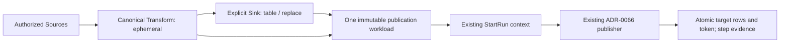
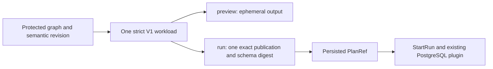

# DVT Operational Workload v1

## Admitted extension: one explicit PostgreSQL Sink

Issue #3115 admits a second Run shape through the same V1 and existing rails.
The following extension is the implementation contract; acceptance evidence is
recorded on that issue, not inferred from this declaration.

The existing terminal Transform `table` output and empty publication boundaries
remain valid. The new shape has a `transform-result` output with `ephemeral`
disposition, no target or publication policy on that output, and exactly one
`sink` publication boundary. That boundary identifies its Sink node, its input
Transform node, an explicit PostgreSQL connection/schema/relation target, and
`postgres-stable-table-publication.v1`. Both node identities belong to the exact
selected graph; the input equals the semantic Transform and differs from the
Sink. The Sink edge is included in the graph identity and profile cardinality.

The workload step identifies the Sink, while the semantic result identifies the
Transform. The entire workload hash binds both, so changing a destination or
publication boundary changes the immutable plan identity. Runtime selects the
publication target using one shared contract policy, not array position or a
fallback Transform target. There is no extra Transform activity or durable
intermediate table; the publisher retains its existing temporary candidate.

Completed PostgreSQL evidence retains the selected publication identity in
required `publication.nodeId`: the Sink ID for explicit publication, or the
terminal Transform ID for its own table result. GetRunStatus and its Web decoder
preserve that identity. Canvas attributes a completed publication to a Sink only
when its graph ID and explicit connection, schema and relation match the evidence.
Names, relation suffixes and legacy materialization without a node identity do
not establish ownership. Missing identity is rejected under the coordinated
development hard cut; no historical evidence is rewritten or guessed.

Authoring explicitly selects `materialized: ephemeral` on the Transform without
`resultTarget`. The Sink confirms `connectionRef` and supplies `schema`, `table`,
`materialization: table`, and `writeMode: replace`. Its connection must equal the
protected Source connection and remains subject to existing scoped catalog and
credential admission. A displayed inherited connection is not confirmation.
The existing persisted kind `sink` and Canvas-qualified kind `dvt:sink` identify
the same DVT output. One contract-owned kind catalog governs protected selection,
metadata validation and SQL field-budget projection; neither spelling bypasses
field validation or changes the required `dvt` plugin and `output` role.

Properties and the model-card menu use the same explicit disposition transition.
Selecting `ephemeral` removes the terminal Transform target atomically; selecting
`table` later does not resurrect it. This is an authoring intent, not a repair on
read: imported or persisted ephemeral-plus-target combinations still reject.

Reject table-plus-Sink, ephemeral Run without Sink, multiple Sinks, missing or
extra effective dependencies, non-terminal Sink, unsupported write modes,
mixed connections and stale identities before dispatch. Unsupported selections
must not silently drop a publication or revert to a terminal Transform workload.
Shared publication-intent validation runs before publishing the derived SQL
artifact as well as before lowering. PreviewPlan does not publish rows, and
Transform row sampling does not change authored disposition or destination.

Compatibility is an additive bounded V1 case, not a parallel V2 or migration.
Producer and consumer deployment must be coordinated: an old worker rejects the
new shape. The approved development cutover does not preserve old histories or
authorize unattended deletion. General ephemeral Run, view/incremental execution,
multiple publications and cross-connection transfer remain outside this slice.

## One contract, explicit intent

[Issue #2524](https://github.com/dunay2/dvt/issues/2524) owns lowering one exact,
protected terminal Transform closure into one Planner workload. The only admitted
format is `dvt-operational-workload.v1`. Required `executionIntent` distinguishes
`preview` from `run`; versions do not encode product intent.

`PreviewPlan`, `CompilePlan` and `StartRun` remain the existing rails. The workload
value object owns immutable execution facts; PostgreSQL projection owns SQL and
the output-schema fingerprint. The existing PostgreSQL plugin owns provider effects.

## Admission

Both intents bind the exact authorized scope, selected graph, semantic hash,
SQL artifact, projection profile/tool and PostgreSQL connection. The output must
identify the single semantic Transform in the graph. Duplicate identities,
stale hashes and unknown members reject.

| Intent    | Output                                                        | Additional required facts                                                                                                                     | Executor admission                                          |
| --------- | ------------------------------------------------------------- | --------------------------------------------------------------------------------------------------------------------------------------------- | ----------------------------------------------------------- |
| `preview` | `ephemeral-preview` and exact node ID                         | None; durable-output members reject                                                                                                           | Rejected before context reads or provider effects           |
| `run`     | `transform-result`, exact node ID and `table` disposition     | Explicit `DvtTransformResultTargetV1`, output-schema digest, stable-table publication policy and empty publication boundaries                 | Existing scope, connection, artifact and publication checks |
| `run`     | `transform-result`, exact node ID and `ephemeral` disposition | No output target; exactly one explicit Sink boundary with the same-connection PostgreSQL target, stable-table policy and output-schema digest | The same scope, connection, artifact and publication checks |

The Run target connection must equal the workload connection. Missing targets,
non-PostgreSQL providers, unsupported dispositions, ambiguous publication
boundaries and missing schema digests reject without Preview fallback.

Physical dependencies and logical Read occurrences are distinct. A JOIN can read
one connected Source repeatedly while retaining one physical graph dependency.
Project, JOIN and Set semantic cardinality checks exclude the single optional
Sink node and its incoming edge; they do not count a Sink as a Read occurrence.

## Stable plan versus attempt

### Ownership boundary

The workload's shared graph, scope and semantic identity checks do not select a
database or depend on DBT. PostgreSQL owns its projection profiles, SQL artifact
constraints, graph cardinality and stable-table publication fields. The V1
composition admits that implementation explicitly; it does not accept an unknown
provider merely because its common envelope is valid.

StartRun coordinates application-owned execution-context preparers. DBT owns
bundle/target preparation; PostgreSQL owns connection/publication preparation.
The existing composition root supplies the implementations. The coordinator owns
caller-reference rejection, one immutable context write and dispatch, not either
provider's rules. Its admitted PlanRef and authorized scope remain authoritative.
No new command, provider registry, wire version or DuckDB executor is introduced.

The plan contains the target, SQL artifact, expected ordered PostgreSQL schema
digest and publication policy. Attempt-specific publication tokens and predecessor
observations belong to the existing StartRun binding, not the stable plan.
Previewing a configured Run plan never executes SQL or publishes the result.
Publication remains governed by [ADR-0066](../../adr/ADR-0066-postgresql-stable-table-publication.md).

## Rejection presentation

PreviewPlan and StartRun reuse their existing `code`, `cause`, and `reason`
envelopes. `DvtOperationalRejection.v1.ts` owns named immutable DVT definitions;
`RunExecutionRejection.v1.ts` owns execution-context and DBT Run definitions.
Both reuse the structural message descriptor from ContractsErrorModel.v1.
`MessageDescriptor<Key, Params>` requires no exception instance or translation
service in admission logic. These fixed-message definitions reuse `cause` as
`messageKey` and one frozen empty `messageParams` value; Web resolves the known
definition from the existing wire identity. No redundant wire fields, dynamic
text substitution or new version is introduced. Parameterized contract exceptions
retain their existing key-specific parameter types.
Binding and projection select definitions, not free-text causes or translated
text. Diagnostic `reason` is not a presentation or branching authority.

Web translates the cause through its existing English/Spanish language preference,
both for StartRun errors and the Preview rejection panel. An unknown DVT or Run cause
gets a localized generic rejection; arbitrary server/provider text is not shown.
No second error envelope, translation infrastructure, or contract version is added.

## Development hard cut and rollout

API, contracts and worker must be deployed together. V2 and old Preview payloads
without an explicit intent are rejected, not rewritten. The retired
`dvt.vtx2.postgres.inner-join.v1` projection identity also rejects for both
intents; current producers emit `dvt.vtx2.postgres.join.v1`. Recreate affected plans
through protected Preview; no migration, alias, fallback or database deletion is
performed. Drain existing executions before changing workers; do not replay old
workloads through a mixed-version deployment. Rollback requires restoring the
matching producer/consumer set and recreating affected plans.

Contract, registry, projector, protected persistence, StartRun binding and plugin
tests cover both intents and fail-closed paths. Historical V2 evidence is retained
as historical proof, not acceptance of this contract.

Governing decisions: [ADR-0035](../../adr/ADR-0035-planner-public-contract-evolution-protocol.md),
[ADR-0064](../../adr/ADR-0064-substrait-semantic-reference-and-bounded-logical-profile.md),
[result target V1](./dvt-transform-result-target-v1.md) and
[rail governance](../../architecture/command-query-rail-governance.md).
