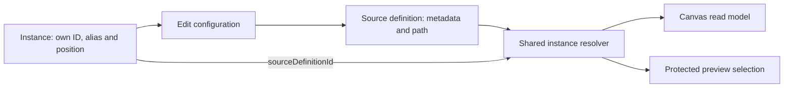

# Shared source configuration and independent Canvas placements

## Authority and rationale

[Issue #3610](https://github.com/dunay2/dvt/issues/3610), the v1 workspace graph
draft persistence contract, command/query rail governance and Planning DB designs
`GH-3610-SOURCE-INSTANCES` and its exact consumer admissions govern this change.
The existing `CreateCanvasNode` and `SaveWorkspaceGraphDraft` commands remain the
only placement and persistence rails. No second contract version or migration.

Previously a second catalogue drop reused the definition ID and became a noop.
Import still registers a definition without placing it. Each explicit drop now
allocates an instance identity; only the definition persists configuration.

## Invariants and bounded consumer changes

- References stay within the canvas, join two input nodes of the same plugin and
  kind, and cannot be missing, self-referencing or chained.
- Instances cannot persist metadata/path overrides. The same resolver projects
  current definition configuration for both Web and protected API selection.
- Removing a placement does not remove its definition or sibling instances.
- Inspector and schema assignment update shared configuration without placing
  the definition. Aliases and geometry remain instance-owned.
- Protected source rebind resolves the definition and traverses all referencing
  instances. Physical coverage deduplicates only a shared definition, never
  independent source definitions from different connections.
- Existing nodes without a reference remain valid. New instances require the
  updated v1 validator and readers; deploy the API before enabling the Web path.

## Validation status

Contract suite: 74 files / 820 tests passed. Focused protected selection/rebind:
8 tests passed. Source roundtrip, repeated-drop, configuration-edit and schema
attachment tests passed. Web and API readers use the shared contract resolver;
an architecture guard asserts that boundary.

The live source import proof passed both scenarios in 2m23s: independent
connections and two placements of one definition persisted across reload. Run:
`pnpm --filter @dvt/web test:e2e:source-import:live`, with the existing local
Temporal test-server binary. A first attempt failed on ambient language before
source import; the test now sets its own presentation preference.

The compact data panel was also inspected in the running application using a
real `client` source sample. At a 1280x720 viewport its content measured 185px:
38px toolbar, expanding grid and 22px footer, with no panel overflow. Refresh is
present once; source, LIVE, provider and query-time details occupy the footer.
The full pre-push gate remains required; this document does not claim integration
or a green gate.

Follow-up preview stability tests: 28 passed, covering metrics during pending
queries, retained table identity/provenance on refresh, failed and empty sources,
publication invalidation and late-result fencing. Outer dependency rendering and
mapper/context tests: 18 passed. The existing native
`canvas-connection-valve.cy.ts` browser proof passed its persisted close/reopen
round trip after replacing custom arrow calculations with Bezier/SVG primitives.

### Bounded closeout on 2026-10-12

Calculated Output editing reuses the existing section's pending-editor authority:
its list remains mounted but hidden while the formula form is active. Focus and
alias drafts survive schema refresh. Focused component tests: 22 passed;
architecture guards: 10 passed; the three JOIN consumer browser cases passed.

Source placement now calls the shared `@dvt/crypto` UUID primitive. Five focused
tests pass, including a browser without `randomUUID`, absent secure entropy and
the existing injected-ID roundtrip. Both source identity/import scenarios passed
separately on the Docker HTTP origin: two specs, two tests, no omissions, 1m36s.
There is no weaker identity fallback or second crypto implementation.

At `e9edd355f`, the full gate passed 5,028 local tests and all 121 controlled
native browser cases, then stopped because the real dbt executable was not
configured. The existing executable was selected explicitly; no installation,
runtime downgrade or skipped live phase was used. An additional Docker inventory
was aborted when Chrome stopped responding during trusted dragging, including
to a read-only debugger diagnostic. Only that proof's container was stopped.

The CI-equivalent native inventory executed all 26 requested live specs:
55 passed and four failed, with no pending or skipped tests. Failure screenshots
identified stale gesture preconditions: scrollable menu commands outside the
viewport, a forced offscreen context click, and Preview covered by the minimap.
Bounded consumers now reveal commands, use public Fit, restore opener focus and
retain normal actionability checks. Three static precondition guards and the
complete 81-test browser-routing suite pass after enabled pre-commit formatting.

The affected real repetitions then passed: two JOIN publication cases (including
A/B publication identity and old-token rejection), persisted LEFT JOIN/Sort/Fetch,
and generated dbt code/Run. The remaining dbt import consumer explicitly owns its
presentation language and awaits connection creation before visiting Connections.
Its final real proof passed in 1m19s, verifying the original source ID, three
columns, YAML identity/fields and no graph-draft creation. No import, publication,
authorization or semantic assertion was removed.

Web lint, typecheck and production build passed; the build retains its existing
large-Monaco-chunk warning. API unit validation passed 1,293 tests. Its 27 existing
PostgreSQL-conditioned omissions were subsequently executed on a separate
disposable database: all four suites passed 33 tests, including six repeated unit
cases, with no omissions. That database was removed after the proof. Contract
validation passed 820 tests and its typecheck.

The exact selection-helper import closure now admits all 25 consumers individually:
five controlled, 19 available and one unavailable. Five previously omitted live
specs join the available inventory (31 total); unknown consumers still reject.
At `01acd8ce7`, their six real cases produced two passes and four failures, without
omissions. One failure is a stale viewport attribute. Three expose a product
regression: file-authoritative models sharing `dvt:transform` enter the native
semantic editor instead of their existing Properties/Code authority. The bounded
correction uses the existing Code capability, respects explicit denial, and keeps
native models unchanged; its unit and live acceptance remain required.

The next real repetition at `36bb4b1a0` proves that authoritative Code now opens
and writes correctly, including lossless YAML apply/revert. It still fails on
three retired consumer expectations and one actual invalid-analysis continuity
defect: unavailable graph analysis clears the editor needed to repair saved SQL.
The bounded inspector correction retains only the same previously admitted file
context in its exact authority and node identity, never graph/Run admission.
Six presentation cases pass for valid repair, cross-authority/node refusal,
explicit close, confirmed fresh removal and absent file authority. Real repair,
complete prepush and exact-head CI acceptance remain required.

The final complete pre-push and exact-head CI remain mandatory before integration.
Passing repetitions do not convert an earlier failed full gate into a green
receipt. GitHub #3610, #3613 and #3614 carry the concrete candidate/gate evidence;
Issue #3612 remains open for unadmitted SQL-function scope.

## No-debt posture

No fake adapter, replacement query, new cache, placeholder, hidden fallback,
relaxed quality rule or hook bypass. Invalid references fail closed.
