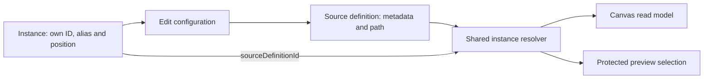

# Shared source configuration and independent Canvas placements

## Authority and rationale

[Issue #3610](https://github.com/dunay2/dvt/issues/3610), the v1 workspace graph
draft persistence contract, command/query rail governance and Planning DB designs
`GH-3610-SOURCE-INSTANCES` and its exact consumer admissions govern this change.
The existing `CreateCanvasNode` and `SaveWorkspaceGraphDraft` commands remain the
only placement and persistence rails. No second contract version or migration.

Previously a second catalogue drop reused the definition ID and became a noop.
Import still registers a definition without placing it. Each explicit drop now
allocates an instance identity; only the definition persists configuration.

## Invariants and bounded consumer changes

- References stay within the canvas, join two input nodes of the same plugin and
  kind, and cannot be missing, self-referencing or chained.
- Instances cannot persist metadata/path overrides. The same resolver projects
  current definition configuration for both Web and protected API selection.
- Removing a placement does not remove its definition or sibling instances.
- Inspector and schema assignment update shared configuration without placing
  the definition. Aliases and geometry remain instance-owned.
- Protected source rebind resolves the definition and traverses all referencing
  instances. Physical coverage deduplicates only a shared definition, never
  independent source definitions from different connections.
- Existing nodes without a reference remain valid. New instances require the
  updated v1 validator and readers; deploy the API before enabling the Web path.

## Validation status

Contract suite: 74 files / 820 tests passed. Focused protected selection/rebind:
8 tests passed. Source roundtrip, repeated-drop, configuration-edit and schema
attachment tests passed. Web and API readers use the shared contract resolver;
an architecture guard asserts that boundary.

The live source import proof passed both scenarios in 2m23s: independent
connections and two placements of one definition persisted across reload. Run:
`pnpm --filter @dvt/web test:e2e:source-import:live`, with the existing local
Temporal test-server binary. A first attempt failed on ambient language before
source import; the test now sets its own presentation preference.

The compact data panel was also inspected in the running application using a
real `client` source sample. At a 1280x720 viewport its content measured 185px:
38px toolbar, expanding grid and 22px footer, with no panel overflow. Refresh is
present once; source, LIVE, provider and query-time details occupy the footer.
The full pre-push gate remains required; this document does not claim integration
or a green gate.

## No-debt posture

No fake adapter, replacement query, new cache, placeholder, hidden fallback,
relaxed quality rule or hook bypass. Invalid references fail closed.
