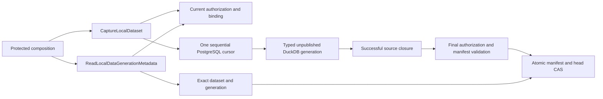

# Internally composed LOCAL capture and exact generation reads

## Capture outcome recovery admission

Review of #3680 found that a native commit followed by an acknowledgement failure
could leave the caller without a generation ID. The store's exact capture lookup
was not exposed by the application composition. The preimplementation plan,
current/target diagrams, Service Layer/Gateway rationale and bounded test matrix
are recorded in [#3394](https://github.com/dunay2/dvt/issues/3394#issuecomment-6315358301)
and Planning DB design `GH-3394-CAPTURE-COMMIT-RECOVERY`.

The correction reuses `ReadLocalDataGenerationMetadata` with an exact
dataset/capture selector, the existing immutable manifest and current scoped view
authorization. It shares the existing validation/authorization/publication
boundary, without automatic acquisition retry or a new transport/query intent.
Required proof includes denial/revocation, invalid or mismatched identities,
failure versus absence, a real committed-but-unacknowledged capture recovered
through production composition, and a cold lookup that creates no database.
These are admission requirements; passing execution evidence is recorded only
after those focused checks actually run.

### Focused recovery execution

The deterministic read-query file first returned **8 new failures / 7 existing
passes**, all new paths missing `readCapture` (3.34 seconds). The first production
attempt mixed API Zod 3 object construction with contract Zod 4 members and failed
with `keyValidator._parse is not a function`; the existing public-parser boundary
was restored, without dependency changes. The corrected explicit command:

```text
pnpm --filter dvt-api exec vitest run test/application/services/readLocalDataGenerationMetadataUseCase.test.ts test/architecture/localDataCaptureComposition.architecture.test.ts test/modules/localDataCaptureRuntime.test.ts --maxWorkers 1
```

passes **18/18**, three files, 11.28 seconds. It retains the original generation
selector and proves current view authorization, denial/revocation, strict input
and ID families, dataset/capture mismatch, storage failure versus absence, and
owned selector/result snapshots across asynchronous authorization. API source/test
typecheck passes with its normal dependency-build prehook.

The isolated supported POSIX proof uses full c489618a source plus the explicitly
hashed worktree overlay, the existing dependency cache and actual builds of all
19 API dependency workspaces (72.49 seconds). The exact selected command from
apps/api is:

```bash
node --require ../../scripts/local-data-private-creation.cjs \
  ../../node_modules/vitest/vitest.mjs run --config vitest.integration.config.ts \
  test/integration/postgresLocalDataAcquisition.proof.ts \
  -t 'governed committed capture|governed authorized metadata absence' --maxWorkers 1
```

Result: **2 PASS / 28 deliberately filtered cases**, 8.94 seconds. PostgreSQL is
actually **15.19** on this reused private lab host, rather than the earlier
29-case proof's PostgreSQL 16. The role is non-superuser/non-RLS-bypass. A real
three-row production-composition capture commits; controlled acknowledgement
loss rejects the caller; exact capture lookup recovers its committed manifest,
denies revoked access and survives native close/reopen without another cursor
read. The second case proves authorized cold capture absence creates no database.
The acknowledgement failure is an explicit injection after a successful native
promotion, not a claim of induced disk failure or a cross-store transaction.

Two earlier lab preparations executed no test bodies: the reused database host
had no dvt_test database, then the source-only archive lacked compiled workspace
entry points. A fresh private proof database/role and the real dependency build
corrected those setup failures; the disposable database and role were removed
after execution. No fake adapter, source substitution or assertion relaxation.

## Direct process launch for creation evidence

Open CodeQL alerts 48/49 identify shell execution in the existing API native-mode
probe and bootstrap test. The plan, process-order diagrams and preservation matrix
were recorded before edits in
[#3394](https://github.com/dunay2/dvt/issues/3394#issuecomment-6315748620), design
`GH-3394-PRIVATE-PROBE-NODE-LAUNCH`. Both standalone probes now launch a fixed Node
bootstrap directly, passing mask/child arguments without shell interpretation.
Only that isolated bootstrap sets umask; the pooled test worker never does.
The actual child retains its optional Node --require preload and has a nine-second
timeout inside the existing ten-second outer timeout. Errors, signals and nonzero
exit remain failures. Production startup, preload, permissions and assertions
are unchanged.

The exact 5efa372e9 source archive plus hash-verified two-file overlay ran on the
existing isolated Linux dependency/native host, Node 22.19.0:

- `node --test tools/ci/local-data-private-creation.test.mjs`: **12/12 PASS**,
  zero skips, 1.13 seconds.
- From apps/api, `node --require ../../scripts/local-data-private-creation.cjs
../../node_modules/vitest/vitest.mjs run
test/infrastructure/DuckDbFileCreationPolicy.test.ts --maxWorkers 1`:
  **3/3 PASS**, 1.72 seconds. Actual DuckDB v1.5.6 DB/WAL modes remain 0644
  for inherited 0022 without preload, and 0600 for 0077 or explicit preload;
  each actual database closes and reopens successfully.
- The Windows startup file separately returns **3 PASS / 9 intentional POSIX
  skips**, 185 ms. It does not establish Windows ACL or POSIX-native evidence.

These are real unchanged behavioral probes, not new tests mirroring the launch
implementation. The existing hosted CodeQL findings are the static failing
evidence. Local process proof is not hosted scanner clearance: the notices stay
open until an exact-head analysis establishes their resolution. The earlier
dependency-audit failure and c489 browser failure are not cleared by this cut.

Owner: [#3394](https://github.com/dunay2/dvt/issues/3394), under #3388.
One review surface: #3680, incorporating the two unique #3679 commits.
The accepted metadata baseline is main `c584133835da031b37e70862e312ca726b32dca3`.

## Design and admission

The original proposal contained a coordinator, PostgreSQL reader and DuckDB store,
but only tests constructed them together. The integrated solution binds those same
owners in the existing protected runtime composition, alongside the authorized
exact-generation metadata query. There is no new executor, runtime registry,
HTTP route, browser activation or raw-row query API.

The design, alternatives, current/target diagrams, Fowler matrix, allowed paths
and negative scenarios were recorded before checkout corrections in
[the owning issue](https://github.com/dunay2/dvt/issues/3394#issuecomment-6253672162).
Planning DB design `GH-3394-COMPOSED-LOCAL-CAPTURE` admits the bounded correction.
`CaptureLocalDataset` is a command; the existing
`ReadLocalDataGenerationMetadata` query is reused. Their internal runtime implementation is recorded in Planning DB;
review/merge acceptance remains a separate gate. No earlier admission of the
offline proposal is claimed and no Planning DB import/rebuild is performed.



Shared exact row invariants belong to the domain; PostgreSQL owns snapshot
preflight and native session lifetime; DuckDB owns physical types, transactions
and publication. Both existing reentrancy/ownership regression sets are retained.
The source callback returning is insufficient: native closure must succeed
before any promotion can run.

## Functional acceptance

Run the existing explicit native proof on an isolated supported POSIX host with
real PostgreSQL and DuckDB. The proof must consume the production composition.
Its grant/audit repository fixtures remain distinct from actual PostgreSQL
SELECT/RLS and native persistence evidence.

| Family                        | Required result                                                                                                            |
| ----------------------------- | -------------------------------------------------------------------------------------------------------------------------- |
| Successful capture and reopen | Multiple bounded batches, exact bigint/text/bool/NULL, actual values after close/reopen, exact dataset/generation metadata |
| FIRST N                       | Requested sample remains a sample; no inference of FULL from target completion                                             |
| Rejected publication          | Revocation, cancellation, budget and source-close failure cannot publish READY                                             |
| Refresh failure               | Previous generation remains selected/readable; stale CAS cannot replace it                                                 |

The existing profile admits PostgreSQL OIDs 20, 16, 25 and 1043 into native
BIGINT/BOOLEAN/VARCHAR. Other mappings fail before READY. This is not evidence
of DECIMAL/timestamp ingestion, unrestricted source size, hard RSS/disk quotas,
global snapshots or instantaneous cancellation of arbitrary callbacks.

## Compatibility matrix

| Boundary                          | Compatibility                                                                                                                |
| --------------------------------- | ---------------------------------------------------------------------------------------------------------------------------- |
| Existing HTTP/UI, Preview and Run | No new surface or activation; current behavior and display limits retained                                                   |
| Public metadata contracts         | Accepted schemas, identity and coverage rules reused unchanged                                                               |
| Internal LOCAL reader             | Planned port becomes an authorized context-plus-exact-selection application query; no deployed legacy reader to preserve     |
| Native storage                    | Existing one-instance workspace foundation and v1 generation catalog; no automatic repair/migration of incompatible catalogs |
| Disabled configuration            | Remains default; LOCAL application capabilities absent and native addon remains lazy                                         |
| Supported hosts                   | POSIX private roots/startup required; enabled Windows configuration fails closed                                             |

## Rollout and rollback

The default remains disabled. On an explicitly configured POSIX service, use the
existing private-creation startup, operator-owned separate roots and current
native resource budgets. This cut binds internal capabilities; it adds no
default grants, public trigger, background capture or LOCAL analytical execution.
Application capture/view permissions must be explicitly supplied by the existing
authorization authority. Source credentials stay with the existing resolver.

Rollback disables the existing configuration and drains the protected runtime
before replacing its process. Retain existing database/WAL files and generation
metadata; do not delete, downgrade or rebuild a reserved catalog as rollback.
An older binary without these internal consumers does not gain data access.

## Native acceptance evidence

The isolated Linux lab uses Node 22.19.0, PostgreSQL 16 and the lockfile-pinned
DuckDB node-api 1.5.6-r.1. It has a disposable database with no published host
port and a non-superuser, non-RLS-bypass capture role. It uses the actual repository
dependency graph and the explicit private-creation preload; no native/SQL stub.

The selected command was run from apps/api:

```bash
node --require ../../scripts/local-data-private-creation.cjs \
  ../../node_modules/vitest/vitest.mjs run --config vitest.integration.config.ts \
  test/integration/postgresLocalDataAcquisition.proof.ts -t 'captures 2053|governed'
```

Result: 12 PASS, 17 deliberately filtered cases, 7.74 seconds overall, 3.705 seconds
in test bodies. The run exercises the production composition factory. It proves
2053 exact rows in three bounded pulls, source closure before publication, native
reopen and authorized exact metadata; sample semantics; abort/revocation/budget
and native source-close failure preserving the old generation; stale CAS rejection;
and authorized cold absence without creating a database. Controlled grant/audit
repositories and post-close fault injection remain fixtures, not real identity
provider/grant persistence evidence. The raw row comparison is a private test
oracle, not a new application query.

The first lab invocation had no test bodies: its source overlay omitted the
already committed shared batch module. The complete source overlay corrected
that lab assembly error before the passing run. No product check was relaxed.

## Complete affected validation

Implementation checkpoint: 334adba98. The normal configured lint-staged tasks
were also applied to the complete historical proposal diff, since inherited
unformatted files and a second formatter pass on expanded helper types remained.
The ordinary commit helper and hooks stay enabled.

The complete acquisition proof (same command above without the -t filter) passes
**29/29, 9.01 seconds**. This adds real SELECT denial, RLS, unsupported-type,
snapshot and Preview guard regressions to the four requested acceptance families.

The explicit affected unit command uses the private preload, vitest.config.ts,
--maxWorkers 2 and exactly these test paths:

```text
test/application/services/captureLocalDatasetUseCase.test.ts
test/application/services/localDataAuthorizationLease.test.ts
test/application/services/localDataAuthorizationPolicy.test.ts
test/application/services/readLocalDataGenerationMetadataUseCase.test.ts
test/architecture/duckDbLocalDataRuntime.architecture.test.ts
test/architecture/localDataCaptureComposition.architecture.test.ts
test/infrastructure/DuckDbFileCreationPolicy.test.ts
test/infrastructure/duckDbGenerationProfile.test.ts
test/infrastructure/DuckDbGenerationStore.appender.test.ts
test/infrastructure/DuckDbGenerationStore.catalog.test.ts
test/infrastructure/DuckDbGenerationStore.recovery.test.ts
test/infrastructure/DuckDbGenerationStore.test.ts
test/infrastructure/DuckDbLocalDataRuntime.storage.test.ts
test/infrastructure/duckDbLocalDataStorageBoundary.test.ts
test/infrastructure/localDataAcquisition.boundaries.test.ts
test/infrastructure/postgresLocalDataBatchCodec.test.ts
test/infrastructure/PostgresRemoteDatasetCursor.reentrancy.test.ts
test/infrastructure/PostgresRemoteDatasetCursor.test.ts
test/infrastructure/PostgresRemoteDatasetReader.lifecycle.test.ts
test/modules/localDataCaptureRuntime.test.ts
test/testExecutionManifest.test.ts
```

It returned 433 PASS / 2 setup failures in 25.19 seconds. Recovery subprocesses
required the actual API dist binary. After pnpm exec tsc -p tsconfig.json built
that binary, repeating only DuckDbGenerationStore.recovery.test.ts returned
2/2 PASS in 4.44 seconds. All 435 affected assertions now have passing evidence;
the earlier incomplete invocation is retained explicitly, not called a pass.

| Command / boundary                                             | Actual result                                                                      |
| -------------------------------------------------------------- | ---------------------------------------------------------------------------------- |
| pnpm exec turbo run build --filter=dvt-api^... --concurrency=2 | 19/19 dependency builds PASS                                                       |
| API pnpm exec tsc -p tsconfig.json --noEmit                    | PASS                                                                               |
| API pnpm exec tsc -p test/tsconfig.json --noEmit               | PASS                                                                               |
| pnpm arch:deps                                                 | PASS; no new unreachable production owner or native public-type leak               |
| pnpm docs:feature-mechanization:implementation                 | PASS, 591 DB manifests; no import/rebuild                                          |
| pnpm --filter @dvt/contracts schema:verify                     | PASS, 25 assertions                                                                |
| pnpm golden:validate                                           | 5 PASS, 0 failed, 1 existing deprecated retry path skipped by its canonical runner |
| pnpm docs:status:generate --code-state-only                    | PASS, DB-free/untracked code-state output                                          |
| pnpm docs:sync; pnpm governance:refresh                        | PASS; coverage 5694/5694, no drift                                                 |
| pnpm audit --prod --json                                       | FAIL: 4 low, 20 moderate, 31 high, 1 critical findings                             |

The audit findings all name package versions already present in accepted main's
lockfile. Its only added package versions are pg-cursor@2.15.3 and
@types/pg-cursor@2.7.2; neither is named by the returned advisories. This comparison
does not convert the failed whole-repository scan into a pass or clear unrelated
security findings. No dependency/security rule is relaxed or unrelated upgrade
bundled into this integration.

The complete local prepush route selects broad browser evidence solely from
apps/api/package.json and the API integration configuration. Its plan was inspected
with pnpm verify:prepush --plan, node scripts/verify-changed.cjs --dry-run and
pnpm test:web:changed --plan. The user explicitly limited local validation to
affected tests. That broad browser battery was not started: full prepush remains
INCOMPLETE under that limit. The previous one-push hook exception belongs to
Tasks #3681 and is not reused. Publishing this candidate needs a separately explicit
exception if the hook still selects that broad route. Required hosted checks
remain required before merge.

## Validation attribution

Status is draft. The commands above and the native matrix are required evidence,
not a claim that they have passed on the integrated head. Historical proposal
runs remain attributed to their own comparisons in the existing evidence and
issue journal. Final exact commands, results, host/runtime versions, limitations,
security checks, ARC classification and fresh base/head DB acceptance will be
recorded here and on #3680 before readiness is claimed.

## Closeout boundaries

The exact affected lint/format command node scripts/check-changed.cjs passes.
The 47 changed API TypeScript files in the tested lab and normalized checkout
have identical emitted executable ASTs under TypeScript 5.9.3 (positions, comments
and redundant expression parentheses excluded); formatter-only changes therefore
did not trigger another complete test run. This is source attribution, not an
additional claim about untested behavior.
Compatibility/bootstrap/catalog tooling passes 26/26 on the isolated POSIX lab;
the host Windows invocation passed 17 and explicitly skipped nine POSIX cases.
During local implementation, no rule, required check, hook or assertion was
disabled or relaxed; no stub, fake
adapter, unfinished production branch or new debt entry was added. Existing risks
remain open with current evidence. The prior failed hook and lab invocations are
recorded above. Full local prepush and whole-repository security-scan PASS are
not claimed. Hosted gates must evaluate the published exact candidate before merge.

The location gate rejected the inherited source-tree README.generations.md. Its
current content was consolidated into the existing API README and its old file
and references retired, rather than adding a validator exception. The corrective
design was recorded before that move in
[the owning issue](https://github.com/dunay2/dvt/issues/3394#issuecomment-6254161153)
and Planning DB GH-3394-LOCAL-CAPTURE-GUIDE-CONVERGENCE. Both rails use the API
README for internal persistence guidance; the metadata query also retains its
existing normative metadata and data-access contract guides.

## Published CI execution-contract reconciliation

Candidate 5ebb1421a was published to #3680 using the user's expressly authorized
single-push exception. Repository hook configuration was unchanged; the first
process-variable attempt entered the direct hook and was stopped before tests,
then a command-local hook-directory override performed the authorized push. That
exception is consumed. Full local prepush remains incomplete and the baseline
global dependency audit remains failed; hosted gates are still required.

The ready-for-review candidate passes hosted API package tests, CodeQL and
Dependency Review. The API job includes environment-routed integration skips;
it is not a claim that those skipped provider cases ran. The explicit 29-case
local PostgreSQL/DuckDB proof remains separately attributed.

CI executable contracts reported 213 passing tests and one real failure:
package-test-matrix.test.mjs still expected the old direct Vitest API script.
The actual API now delegates through its existing private-creation unit runner.
The root cause, bounded matrix and admission were recorded before correction in
[#3394](https://github.com/dunay2/dvt/issues/3394#issuecomment-6254469847), design
GH-3394-PRIVATE-BOOTSTRAP-CI-CONTRACT. The existing matrix/lifecycle assertions are
preserved; exact Node preload and unit/integration configuration assertions are
added. No production runner, routing, policy or skip is changed.

The isolated existing case reproduces RED (one failure, 225 ms total). Running
only node --test tools/ci/package-test-matrix.test.mjs after the correction gives
14/14 PASS, zero skipped, 10.34 seconds on the Windows host. The normal helper and
pre-commit hook remain enabled for this follow-up. A further publication requires
its own authorization if it would omit the broad hook; no authorization is assumed.
