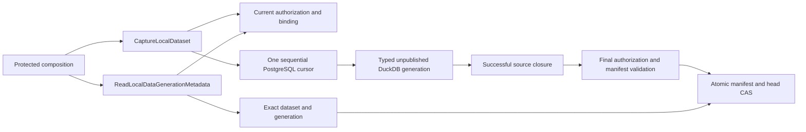

# Internally composed LOCAL capture and exact generation reads

Owner: [#3394](https://github.com/dunay2/dvt/issues/3394), under #3388.
One review surface: #3680, incorporating the two unique #3679 commits.
The accepted metadata baseline is main `c584133835da031b37e70862e312ca726b32dca3`.

## Design and admission

The original proposal contained a coordinator, PostgreSQL reader and DuckDB store,
but only tests constructed them together. The integrated solution binds those same
owners in the existing protected runtime composition, alongside the authorized
exact-generation metadata query. There is no new executor, runtime registry,
HTTP route, browser activation or raw-row query API.

The design, alternatives, current/target diagrams, Fowler matrix, allowed paths
and negative scenarios were recorded before checkout corrections in
[the owning issue](https://github.com/dunay2/dvt/issues/3394#issuecomment-6253672162).
Planning DB design `GH-3394-COMPOSED-LOCAL-CAPTURE` admits the bounded correction.
`CaptureLocalDataset` is a command; the existing
`ReadLocalDataGenerationMetadata` query is reused. Their runtime status remains
planned until actual implementation acceptance. No earlier admission of the
offline proposal is claimed and no Planning DB import/rebuild is performed.



Shared exact row invariants belong to the domain; PostgreSQL owns snapshot
preflight and native session lifetime; DuckDB owns physical types, transactions
and publication. Both existing reentrancy/ownership regression sets are retained.
The source callback returning is insufficient: native closure must succeed
before any promotion can run.

## Functional acceptance

Run the existing explicit native proof on an isolated supported POSIX host with
real PostgreSQL and DuckDB. The proof must consume the production composition.
Its grant/audit repository fixtures remain distinct from actual PostgreSQL
SELECT/RLS and native persistence evidence.

| Family                        | Required result                                                                                                            |
| ----------------------------- | -------------------------------------------------------------------------------------------------------------------------- |
| Successful capture and reopen | Multiple bounded batches, exact bigint/text/bool/NULL, actual values after close/reopen, exact dataset/generation metadata |
| FIRST N                       | Requested sample remains a sample; no inference of FULL from target completion                                             |
| Rejected publication          | Revocation, cancellation, budget and source-close failure cannot publish READY                                             |
| Refresh failure               | Previous generation remains selected/readable; stale CAS cannot replace it                                                 |

The existing profile admits PostgreSQL OIDs 20, 16, 25 and 1043 into native
BIGINT/BOOLEAN/VARCHAR. Other mappings fail before READY. This is not evidence
of DECIMAL/timestamp ingestion, unrestricted source size, hard RSS/disk quotas,
global snapshots or instantaneous cancellation of arbitrary callbacks.

## Compatibility matrix

| Boundary                          | Compatibility                                                                                                                |
| --------------------------------- | ---------------------------------------------------------------------------------------------------------------------------- |
| Existing HTTP/UI, Preview and Run | No new surface or activation; current behavior and display limits retained                                                   |
| Public metadata contracts         | Accepted schemas, identity and coverage rules reused unchanged                                                               |
| Internal LOCAL reader             | Planned port becomes an authorized context-plus-exact-selection application query; no deployed legacy reader to preserve     |
| Native storage                    | Existing one-instance workspace foundation and v1 generation catalog; no automatic repair/migration of incompatible catalogs |
| Disabled configuration            | Remains default; LOCAL application capabilities absent and native addon remains lazy                                         |
| Supported hosts                   | POSIX private roots/startup required; enabled Windows configuration fails closed                                             |

## Rollout and rollback

The default remains disabled. On an explicitly configured POSIX service, use the
existing private-creation startup, operator-owned separate roots and current
native resource budgets. This cut binds internal capabilities; it adds no
default grants, public trigger, background capture or LOCAL analytical execution.
Application capture/view permissions must be explicitly supplied by the existing
authorization authority. Source credentials stay with the existing resolver.

Rollback disables the existing configuration and drains the protected runtime
before replacing its process. Retain existing database/WAL files and generation
metadata; do not delete, downgrade or rebuild a reserved catalog as rollback.
An older binary without these internal consumers does not gain data access.

## Native acceptance evidence

The isolated Linux lab uses Node 22.19.0, PostgreSQL 16 and the lockfile-pinned
DuckDB node-api 1.5.6-r.1. It has a disposable database with no published host
port and a non-superuser, non-RLS-bypass capture role. It uses the actual repository
dependency graph and the explicit private-creation preload; no native/SQL stub.

The selected command was run from apps/api:

```bash
node --require ../../scripts/local-data-private-creation.cjs \
  ../../node_modules/vitest/vitest.mjs run --config vitest.integration.config.ts \
  test/integration/postgresLocalDataAcquisition.proof.ts -t 'captures 2053|governed'
```

Result: 12 PASS, 17 deliberately filtered cases, 7.74 seconds overall, 3.705 seconds
in test bodies. The run exercises the production composition factory. It proves
2053 exact rows in three bounded pulls, source closure before publication, native
reopen and authorized exact metadata; sample semantics; abort/revocation/budget
and native source-close failure preserving the old generation; stale CAS rejection;
and authorized cold absence without creating a database. Controlled grant/audit
repositories and post-close fault injection remain fixtures, not real identity
provider/grant persistence evidence. The raw row comparison is a private test
oracle, not a new application query.

The first lab invocation had no test bodies: its source overlay omitted the
already committed shared batch module. The complete source overlay corrected
that lab assembly error before the passing run. No product check was relaxed.

## Validation attribution

Status is draft. The commands above and the native matrix are required evidence,
not a claim that they have passed on the integrated head. Historical proposal
runs remain attributed to their own comparisons in the existing evidence and
issue journal. Final exact commands, results, host/runtime versions, limitations,
security checks, ARC classification and fresh base/head DB acceptance will be
recorded here and on #3680 before readiness is claimed.
