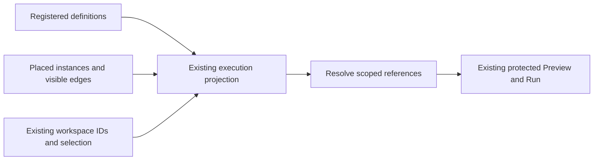

# Canvas Instances And Lossless dbt Project Navigation

[Issue #3747](https://github.com/dunay2/dvt/issues/3747) owns delivery and the exact
commit/check acceptance record. Planning DB owns components, responsibilities,
rails and prospective design admission. Git owns physical files. This evidence
reconciles the final implementation boundaries; chronological failed attempts
remain in the issue and Git history.

AGENTS.md, ADR-0060/0061/0064, command/query and Fowler governance, the native
component guides and PR preflight govern the cut. Policy classifies the complete
diff as ARC-2. Its [risk controls](../risk-register/dbt-project-root-relocation-20261102.md)
remain required alongside lint, tests, schema validation and contract goldens.

## Definitions, Instances And Code

One Elements activity contains independently collapsible Sources and Models.
Click and drag create independent usable instances; Properties and Code
navigation are separate. Availability, registered definition and placed card are
distinct. New native instances persist `definitionId`; the common contract also
reads saved `sourceDefinitionId`. Configuration and paths remain on the
definition. Placement copies no SQL and creates no definition-to-instance edge.

The contract rejects missing, chained, self, type-mismatched and conflicting
references. Query-derived Model dependencies retain existing execution metadata.
Deleting an instance preserves its definition and siblings; deleting the last
placed Model does not unregister its definition. Unregistered hidden models and
unresolved visible nodes remain persistence refusals.

File resources retain their original identity plus scoped layout references.
Inspection and execution resolve the original resource; layout cannot grant
semantic or file writes. Unsupported seeds/snapshots remain inspectable without
advertising placement. Assigned native file-model field/relation identities
survive save/reload; added fields do not silently widen an existing consumer.

Code remains read-only and retains navigation/editor state. It uses the existing
file contribution and inline-reference cards. A file-owned Model reference is
not graph-owned SQL. Workspace path qualification preserves legitimate repeated
segments such as `models/models/orders.sql`. The existing file query orders
directories before files at every depth, so explorers need no duplicate sorting.

## Model Inputs, Preview And Execution

Native file-model consumers reuse `CreateCanvasNode`,
`SaveWorkspaceGraphDraft`, `ProjectDbtGraphFromFiles`,
`PreviewCanvasTransformRows` and protected `PreviewPlan`. The server resolves
the current authorized file authority, schema and connection before native dbt
compilation. It retains manifest identity for provenance and adapts selectors to
the package-qualified model name. No Jinja interpreter or parallel dbt analysis
engine is introduced. Placement/rendering do not compile; native analyzer reuse
and request-level compilation grouping remain with their existing owners.

A typed producer Read is a composition signature, never an invented physical
table. Only server-resolved compilation binds the SQL result. PostgreSQL AST
admission still rejects multiple statements, nested writes, SELECT INTO and
locking. Stale/missing fields, changed types, revisions, connections, scope or
file-view permission refuse consumption. Nullability remains conservative.

A Source or dbt-model input can feed native Model Output directly. Apply/reopen
retains the consumer-owned Read and producer reference, with the existing
single-consumer and occupied-terminal guards. Model-backed Read Preview uses the
canonical model-input inventory and selected-relation query. Physical Source
queries, pending edits and permission guards retain their own admission.

`SYS-WEB-CANVAS-EXECUTION-COMPOSITION` supplies its existing execution seam with
the canonical node inventory and keeps visible edges and workspace IDs as the
execution boundary. A rendering-only node list cannot resolve hidden
definitions. The controller-to-real-projection regression was RED before this
one-line correction; scope and permission regressions remain unchanged.

## Cancel, Layout And Interaction

Semantic dirty comparison excludes presentation positions while actual Apply
requests retain them. Cancel compares against the same already-hydrated baseline,
preserving legacy defaults and scoped Read validation. No second hydration
algorithm or mutable baseline store was added. Changing a selected field or
terminal remains dirty; layout alone does not prompt Keep-your-changes.

One pointer/keyboard policy and scrollbar-free camera serve Canvas and Model.
Inspection preserves card positions. Affected-consumer presentation reuse follows
old and new dependency edges, retains unrelated cards and cancels stale async
completion. File sessions, execution/recovery and camera DOM responsibilities
have separate existing owners. Obsolete Sources/card/cursor paths, local helper
duplicates and unused implementation-only exports were retired. All 45 existing
component-size bounds remain unchanged.

Native evidence reuses the common instance reader, protected placement IDs and
reveal/connect gestures. Trusted field drag, fan-out refusal, semantic digests,
selection, persistence and accessibility assertions remain. Catalogue creation,
placed-card inspection and Code navigation have distinct journeys. File
inspection waits on its existing projected-Model readiness before using Fit;
neither deadline is increased. Explicit public Model closure is asserted before
full navigation; no guard is cleared or draft discarded automatically.

## Lossless Project Root Relocation

`PreviewDbtProjectRootRelocation` inventories the complete authorized subtree and
binds hashes, scope, Canvas and authority revision to a deterministic plan.
`RelocateDbtProjectRoot` reuses the scoped CAS batch, private metadata repository
and sorted PostgreSQL authority locks. Authority kind and Canvas identity remain
unchanged. The inventory is rechecked under the existing mutation lock.

Multiple owners, stale authority, graph/mixed ownership, differing destination
bytes, added files, private files, case aliases, symlinks, invalid UTF-8 and
bounded traversal/size violations fail closed. A private snapshot precedes
publication. Retry finishes only a proven move; ambiguous recovery retains the
snapshot and returns conflict. Completed receipts do not rewrite later edits.
Cleanup removes only empty former source directories.

The real filesystem/PostgreSQL composition, protected-route and authority-store
tests cover rollback/retry, collisions, denied access and concurrent authority.
The local coordinator serializes cooperating operations in one API process; it
is not a distributed filesystem/database transaction.

## Actual Workspace Evidence

The authorized relocation moved five files from `inline_code_demo/` into the
project root, retaining two source YAML files. All seven SHA-256 values were
preserved, with Canvas `ce23643b-69fa-46d0-a902-361af7582335` now bound to `.`.

The shared user page proved two independently persisted `clientes` instances,
their authoritative file and native inline cards, drag/reload/removal, no automatic
edge and live rows. Later, `ventas_por_cliente` fed Model1 Output directly. Its
exact internal Read-card Preview returned **20 rows / four columns / LIVE**.
[Direct Output proof](https://github.com/dunay2/dvt/issues/3747#issuecomment-6629451453)
and [Read-card proof](https://github.com/dunay2/dvt/issues/3747#issuecomment-6633321386)
record the different boundaries.

The user approved `local-postgres-proof` as the dev target. Native dbt created
only the missing `clientes` and `pedidos` parent views; all seven project-file
hashes remained unchanged by that execution. Removing trailing invalid SQL text
was a separate protected SHA-guarded project-data repair with readback. Preview
remains read-only and does not materialize missing dependencies implicitly.
Synthetic warehouse counts remained 202 clients, 1,003 orders and 3,003 details
during the instance verification.

## Validation Record And Acceptance Boundary

| Verified revision/scope                     | Actual result                                                                                                                                                                                                                                                        |
| ------------------------------------------- | -------------------------------------------------------------------------------------------------------------------------------------------------------------------------------------------------------------------------------------------------------------------- |
| Root relocation Contracts/schema/goldens    | 79 files / 1,012 cases; 25 schema checks; five golden paths passed. The existing golden path awaiting #10 was skipped.                                                                                                                                               |
| Root relocation API boundaries              | 39 focused cases, 20 authority/HTTP cases and one real filesystem/PostgreSQL integration passed; source/test typechecks and affected lint passed. A later complete API attempt had 21 failures and two existing environment-guarded skips; it is not green evidence. |
| Native file-model API selection             | Eight focused files / 69 cases passed, including saved instance selection, compilation binding and protected sampling.                                                                                                                                               |
| Full attempt at `3de144622`                 | 716 manifests, Web unit 432 files / 3,374 cases, presentation 368 / 1,994, architecture 129 / 745, build and 52 controlled native specs / 147 cases passed. Later available-browser failures mean the complete prepush did not pass.                                 |
| Hydrated-baseline correction at `7feb478db` | Six unit files / 94 cases, four presentation files / 25 cases, 17 Workbench architecture cases, Web lint/typecheck and hooks passed.                                                                                                                                 |
| Committed native UNION at `7feb478db`       | Both all/distinct cases completed with exit 0, including 3 → 4 → 3 inputs, Apply, Cancel, explicit Close, Canvas return and reopen; no pending/skipped cases.                                                                                                        |
| Remaining available sweep at `7feb478db`    | 22 specs / 38 cases completed: 32 pass, six failures in five specs, zero pending/skipped. These exposed the execution-definition handoff and obsolete inspection/readiness consumers; this is RED evidence.                                                          |
| Current execution handoff regression        | RED before correction; three controller presentation files / 11 cases pass afterward, including invalid-reference, executable-scope and no-write assertions.                                                                                                         |

The final committed-tree native reruns, full `pnpm verify:prepush`, fresh exact
base/head `pnpm docs:feature-mechanization:implementation`, PR checks/comments
and merge must be recorded in GH-3747 and the implementation PR. Partial,
interrupted, failed or older-head results cannot replace them. Ignored local
receipts/logs under `.dvt/project-root-3747/` are diagnostic artifacts, not a
second delivery authority.

Native component commands reconciled ownership, 13 relations and 17 required-test
associations with revision guards. Explicit legacy reclassification retained
component identities and metadata; effective-parent reads preserve overrides.
Missing/stale revisions, cycles, incompatible parents, transaction failure and
legacy replay remain covered. No Planning DB import/rebuild, threshold change or
ownership tie-break was used. The last integrity result has zero blockers/errors
and 102 historical warnings; changed production files had no exact-body duplicate
groups. Those observations do not certify SRP by themselves.

Real scoped Git initialization/status/history and native graph-to-dbt publication
remain open acceptance in #3747. A file explorer does not deliver Git. Native
compilation took roughly 11–17 seconds per sample on this host; no compilation
speedup is claimed. Existing React-act/chart-dimension/Vite warnings remain
disclosed. No new debt, placeholder, fake adapter, bypassed hook or relaxed rule
was introduced.
