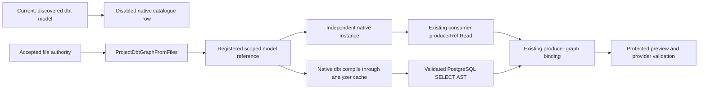
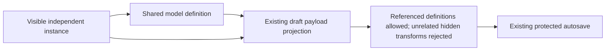

# Lossless dbt Project Root Relocation

## Native Instance And Incremental Presentation Correction

The [instance correction](https://github.com/dunay2/dvt/issues/3747#issuecomment-6616425070)
and [incremental presentation design](https://github.com/dunay2/dvt/issues/3747#issuecomment-6617264511)
reuse `CreateCanvasNode`, `SaveWorkspaceGraphDraft`,
`RenderCanvasContextualGraphSurface` and `PreviewCanvasTransformRows`.
`WorkspaceNodeInstance.v1` replaces the Source-only resolver and accepts saved
`sourceDefinitionId` references. New native Source/Model instances use
`definitionId`; metadata and path remain on the registered definition. Input
dependencies are derived for queries, never persisted as definition-to-instance
connections. One factory and admission callback serve click and drag.

The four consumer cards created by the rejected experiment were corrected through
the protected draft CAS command. Their IDs, names, positions and the original
model were preserved; four automatic edges were removed. No permanent migration
or prototype metadata handler was added. Obsolete factory bindings were removed
from Planning DB and the shared contract received a focused owner.

Deleting or disconnecting another card previously put unrelated models through
`pending` again. The new tests reproduced that transition before the fix. The
existing presentation owner now computes affected consumers, retains unrelated
presentation objects and avoids repeating their schema queries. Cancellation and
pending-field recovery tests remain enabled.

Focused evidence: 54 Web presentation/admission cases passed; 55 native
definition/draft/Inspector cases passed before adding the closed-gate variant;
17 API cases passed, including a saved instance preview through `PlannerFacade`.
The full Contracts run passed 79 files / 1,015 cases before the additional
edge-ID collision case. API unit validation found one obsolete exact-import-count
assertion; it was replaced with the same contracts-only dependency boundary.
Final checks below supersede these intermediate counts when recorded.

The live authorized API returned HTTP 200 for both the original and corrected
instance: the same two output columns, five bounded rows and semantic-plan SHA.
The browser proof used the actual application on port 5173: catalogue click
created a new native instance with Input (4) / Output (2); removing that proof
card preserved the original fields and added no diagram connection.

This correction does not implement the outstanding adapter for consuming
file-owned models inside native transformations. Disabled external-model rows
are an unresolved product limitation, not an accepted prohibition from ADR-0060.

Compatibility: old saved Source references remain readable. Writers using
`definitionId` require the matching Contracts/API/Web release; strict older
readers cannot accept the new field. Roll back application and affected draft
data together from the pre-change snapshot rather than mixing reader versions.

## File Resource Placement Correction

The [prospective correction](https://github.com/dunay2/dvt/issues/3747#issuecomment-6609571907)
is admitted as `GH-3747-RESOURCE-LAYOUT-INSTANCES`. Existing `PersistCanvasLayout`
and `GetCanvasLayout` rails own independent visual references to Sources and
Models; `InspectCanvasNode` retains the accepted file-opening policy from
`GH-3610-FILE-MODEL-OPEN-AUTHORITY`. No file-authority transition or second
semantic graph is introduced.

The previous adapter linked all catalogue drops to edge editing, so it rejected
placement even with a valid project definition. The correction uses the current
authorized/fresh query and hydrated scoped layout. References carry independent
IDs and resource IDs; definition metadata is resolved at render time. Repeated
instances retain separate positions. Removal is limited to placements, and node
inspection/execution resolve to the original definition. The shared catalogue
MIME and graph-coordinate drop anchor are reused by native source placement.

Focused checks executed during implementation:

- Unit suite: resource projection, store retention/rehydration and backed node
  actions, three files / 20 cases passed.
- Presentation suite: Explorer and Viewport, two files / 42 cases passed; the
  first placement-hook run failed on an unavailable test-library import. The
  test now uses the repository's existing React root/act approach; five hook
  cases passed without adding a dependency or changing a timeout.
- File-node opening: 11 unit cases passed, including reference IDs and denied
  Code capability. Shared source drop remains on its existing admission rail.
- Strict root ESLint passed for the directly affected placement, store,
  controller, Viewport, menu and native browser consumer files.

The final affected checks total 95 cases: 20 projection/store/menu, 11 file
opening and 64 presentation cases. The scoped-envelope presentation run had one
remaining old Explorer expectation; that file was corrected and repeated with
25/25 passing. Web package lint and typecheck passed. The native implementation
check accepted 701 DB manifests for base
`650a6b24aadeaac755d5ffd4054afcfa85647c42` and head
`93595cfccb936998bfe70838f0c3ef8ca4b6104a`, after six missing helper/type
associations were admitted through the native rail.
Four affected architecture files also passed all eight cases. Exact scope
commands (including the presentation failure followed by the corrected repeat):

```text
pnpm --filter @dvt/web exec vitest run --config vitest.unit.config.ts src/app/views/canvas/canvasResourcePlacements.test.ts src/app/stores/canvasInteractionStore.test.ts src/app/components/canvas/canvasNodeContextMenuModel.test.ts --reporter=dot
pnpm --filter @dvt/web exec vitest run --config vitest.unit.config.ts src/app/views/canvas/canvasShellNodeProjection.test.ts --reporter=dot
pnpm --filter @dvt/web exec vitest run --config vitest.presentation.config.ts src/app/views/canvas/useDbtProjectFilePlacements.test.tsx src/app/views/canvas/useCanvasGraphHandlers.nodeDrop.test.tsx src/app/views/canvas/explorer/CanvasExplorer.test.tsx src/app/views/canvas/CanvasViewport.test.tsx --reporter=dot
pnpm --filter @dvt/web exec vitest run --config vitest.presentation.config.ts src/app/views/canvas/explorer/CanvasExplorer.test.tsx --reporter=dot
pnpm --filter @dvt/web exec vitest run --config vitest.architecture.config.ts src/app/views/canvas/dbtProjectFileProjection.architecture.test.ts src/app/views/canvas/canvasSourceInstance.architecture.test.ts src/app/views/canvas/canvasLayoutPersistence.architecture.test.ts src/app/views/canvas/explorer/CanvasExplorer.architecture.test.ts --reporter=dot
```

The admission review found that file seeds and snapshots could advertise drag
despite the drop adapter rejecting them. The catalogue now reuses
`isPlaceableCanvasResource` and derives its drag-handler admission from the same
visible item flags. Seeds and snapshots remain inspectable without offering
unsupported placement. The refined Explorer suite passed 26/26 cases. The
pre-push attempt for `659239db6` was stopped only in its verified owned process
tree before this refinement; its partial output is retained and is not accepted
as the final gate.

### Maintenance refinement

The follow-up maintenance review removes the duplicate selected-ID comparator
and local record guard from the interaction store. Selection and inspector order
reuse `areOrderedIdsEqual`; persisted-value validation reuses the existing
canonical primitive guard already consumed by the drop adapter. The native
component command retired exactly two obsolete source associations using the
current binding-set hash. No rail refers to either removed local helper.

Four action-type aliases had no consumers outside their own module. The node
action builder now returns the existing context-menu contract directly. Its
public callable signature and command admission remain equivalent. The store
test also drops its obsolete frozen-node API cast and checks the actual store
type; the placement hook returns its filtered changes directly. No new utility,
service, CSS rule or command/query rail is introduced.

The additional read-only audit covered 76 changed production TypeScript files
and found no further normalized function-body clone candidates after local
identifier renaming. A textual consumer audit of 133 named exports in 55 changed
web files found six implementation-only types, now private to their modules.
`RelationalMovableCard` remains exported: Planning DB explicitly references it
from the producer/consumer `PersistCanvasLayout` rail, so lack of a direct named
import alone is insufficient retirement evidence. The shared explorer's
`sourceRow` CSS is also retained because the internal source catalogue uses it.

`pnpm arch:deps` passed: 412 API modules classified as 408 direct production,
three conditional production and one declared null object, with zero orphan or
misplaced test-support modules and no export cleanup candidates. The post-cleanup
store/menu unit run passed 18 cases, the placement-hook run passed five cases,
and web package lint and TypeScript passed at `b3f2cf119`.

The `43e8f3911` local prepush again passed Monaco (16 cases) and all 431 unit
files / 3,362 cases. Its partial presentation run exposed a Viewport fixture
missing the newly required file-authority metadata and a five-second JOIN-chain
timeout. The owned run was stopped after those two confirmed failures; its logs
are retained and it is not a successful final gate.

The [prospective fixture refinement](https://github.com/dunay2/dvt/issues/3747#issuecomment-6614712224)
is recorded as `GH-3747-CANONICAL-PRESENTATION-FIXTURES`, referencing the existing
`RenderCanvasContextualGraphSurface` rail and the two existing component owners.
Both test paths now have explicit ownership. The Viewport fixture uses actual
file-resource metadata. JOIN-chain starts with a validated persisted draft from
the production factories and reuses existing render/port helpers, removing
repeated setup gestures and selector code. Its real connection gestures, final
card/edge counts, no-write-before-Apply and saved-draft assertions remain; input
model immutability is asserted before and after Apply. The focused repeat passed
all 18 cases, including after helper reuse. No timeout, retry, runtime mock or
skip was added.

Before this refinement, the exact `923c92cfb` prepush passed Monaco (one file,
16 cases) and the complete unit suite (431 files, 3,362 cases). Only its owned
process tree was stopped when presentation began, following the new cleanup
request. Those passing results are retained; the interrupted prepush is not final
acceptance. The final committed refinement requires a fresh complete prepush.

### Actual user-session verification

Browser-only control of the existing Edge Raven tab verified the real project
at `localhost:5173`, Canvas `ce23643b-69fa-46d0-a902-361af7582335`, root `.`.
Dragging onto empty Canvas created `Pedidos 2`, `client 2` and `Pedidos 3`.
Removing only `Pedidos 3` preserved all eight original resources and the two
other placements. `Pedidos 2` opened the original `models/pedidos.sql` in the
read-only Code inspector. After closing the inspector and reloading, both
placement IDs and world coordinates remained identical. `Pedidos 2` and
`client 2` remain visible for review.

The seven expected project files remain present, with only three model SQL
files. `ventas_por_cliente.sql` still matches the earlier recorded SHA-256
`08b449abda600b9f4b0d412ce5fa299e8d4ac5397442451481581c18e16dc2ba`.
The observation record is
`.dvt/project-root-3747/resource-placement-live-browser-evidence.json`.
CDP image capture twice reached its existing five-second deadline; verification
used accessible state and visible DOM. No desktop control or permission change
was used.

The automated live fixture is **not green**: attempt
`20261103T171428513_26836` failed during the API migration `onReady` hook before
the browser. Attempt `20261103T172431020_77140` started the real services and
Chrome, then its `before all` reached the existing 30-second dbt import-analysis
deadline; three subsequent cases were not executed. Those artifacts are
retained. The direct user-session proof does not relabel either failed run.
Main integration still requires the full pre-push acceptance baseline.

No new debt entry, stub, fake product adapter, skipped gate or relaxed deadline
was introduced. Commits used the helper with hooks enabled. Existing
file-defined lineage remains read-only; these are local visual references to
the authoritative resources, not new SQL model definitions.

[Issue #3747](https://github.com/dunay2/dvt/issues/3747) owns delivery. Planning DB
design `GH-3747-DBT-PROJECT-ROOT-RELOCATION` and its
[prospective admission](https://github.com/dunay2/dvt/issues/3747#issuecomment-6585557351)
bound this slice. ADR-0060 governs semantic authority; the command/query and Fowler
rules govern the new location-migration intent. The complete branch evaluator
classified the diff as ARC-2: evidence, risk, lint, tests, schema validation and
contract goldens are required.

## Implemented Boundary

`PreviewDbtProjectRootRelocation` reads one persisted file owner, applies the
existing import policy, inventories every source file and returns a scoped plan
with content hashes and the current authority revision. `RelocateDbtProjectRoot`
uses the existing workspace-file write capability, CAS batch gateway and private
metadata repository. Sorted PostgreSQL authority locks serialize root changes.
The authority kind and Canvas identity remain unchanged.

The batch gateway now accepts an optional complete subtree precondition. It
rejects files added after inspection while holding its existing mutation lock.
The same bounded inventory serves preview and publication; symlinks, invalid
UTF-8, excessive traversal and oversized files fail closed. Shared HTTP scope
authorization was extracted from the existing file routes without changing their
capabilities.

A private snapshot precedes destructive file publication. Retry can finish a
proven move after database rollback. Missing or changed files produce a conflict;
the snapshot remains available rather than silently recreating a later deletion.
Completed receipts replay without rewriting later edits. Cleanup removes only
empty former source directories.

## Executed Evidence

- Contracts: 79 files, 1,012 cases passed after the case-alias refinement.
- Earlier API unit suite with isolated PostgreSQL: 249 files, 1,862 cases passed. One
  existing DuckDB recovery file, two cases, was skipped by its environment guard;
  this is not a claim that those cases ran.
- Focused application, inventory, batch and HTTP boundary: 39 cases passed.
- Authority-store PostgreSQL and protected route boundary: 20 cases passed.
- Real PostgreSQL/filesystem production composition: one integration case passed.
- API source and test TypeScript checks passed; changed API ESLint passed with
  zero warnings. The enabled pre-commit hook formatted and checked the commit.
- `pnpm validate:contracts` passed all 25 checks. `pnpm golden:validate`
  passed five paths; its existing path awaiting issue #10 remained skipped.
- A separate native dbt run after production relocation created all three fixture
  tables and returned `{client_id: 1, order_id: 10}` from the dependent model.
  This proves actual native execution, beyond parse or compilation. Its isolated
  schemas were removed after verification.

The authorized command was also applied to the actual `tenant/project/dev`
workspace. Five imported files moved from `inline_code_demo/` into the root; the
two existing source YAML files remained. All seven SHA-256 values were preserved.
The Canvas remained `ce23643b-69fa-46d0-a902-361af7582335`, now bound to `.`. The
user's SQL, including its existing text, was not normalized or repaired.

The follow-up screenshot exposed mixed folder/file ordering. The existing
`ListWorkspaceFiles` adapter now groups directories first and sorts names within
each group at every depth. Both passive explorers reuse that result without UI
sorting or CSS changes. A real-filesystem regression proves nested order, scope
isolation and unchanged bytes. Planning DB records the existing repository as
`SYS-API-LOCAL-WORKSPACE-FILES`; the
[prospective refinement](https://github.com/dunay2/dvt/issues/3747#issuecomment-6587297304)
reuses the existing query rail. The preceding prepush was stopped only in its
verified owned process tree to refreeze this user-requested revision; its partial
results are not a successful final gate.

Root-relocation plans also reject case-aliased source/destination overlaps before
publication. This avoids treating two spellings of the same Windows path as
independent files; the same conservative rule keeps plans portable.

After these refinements, the full API run reported 1,843 passing cases, 21
failures and the same two existing skips. Twenty failures were 5-second test
timeouts, including two relocation cases; one parse-reuse assertion received
`unavailable` instead of `invalid`. This run is not green and is not attributed to
the environment without further evidence. The real PostgreSQL/filesystem
integration passed again, as did both API TypeScript checks. Isolated reruns and
the final prepush outcome belong in the governing issue's final acceptance record.

Ignored local receipts and logs reside under `.dvt/project-root-3747/`. Task
completion in the governing issue records exact final Git identities and final
gate results; this document does not substitute for that acceptance.

## Project Model Navigation

The follow-up [Elements slice](https://github.com/dunay2/dvt/issues/3747#issuecomment-6588421440)
adds project model navigation through the existing scoped file and dbt graph
queries. `SYS-WEB-PROJECT-ELEMENTS-EXPLORER` owns the bounded adapter and its source
responsibility; the passive explorer owns its extension contract. No model is
copied into GraphDraft. Native selection remains local. The follow-up
[single-catalogue design](https://github.com/dunay2/dvt/issues/3747#issuecomment-6605746494)
opens the declared available model file through the existing guarded Code opener,
retaining the current Canvas route and authority. Sources and Models share one
Elements activity with independent category disclosure and delegated additions.

The focused Explorer run passed 42 cases across three suites. The eleven new
cases cover model visibility, identity deduplication, native versus external
navigation, closed-panel suppression, graph-cache reuse, rejected authority and
tenant/project/environment isolation. Web lint and TypeScript passed. The live
protected configuration read returned the persisted file Canvas binding at `.`.
The exact final prepush and native browser outcomes are recorded in GH-3747;
the preceding f2986a1b5 run was stopped for this user-requested behavior change
and is not final acceptance. The Code guide's five existing documentary source
identities were reconciled with native row CAS and read-back proved that semantic
declarations were unchanged. No Planning DB import or rebuild was performed.

## File Model Reference Admission

The latest user screenshot exposed the missing native file-model consumer.
The following design was recorded before the reference implementation. The
[reference correction](https://github.com/dunay2/dvt/issues/3747#issuecomment-6618506223)
reuses native node admission and producer Reads instead of copying SQL into a
GraphDraft or creating another dbt model file.



The reference owns only the accepted file Canvas and dbt resource identity,
connection reference and assigned output-field identities. Field identities are
allocated once and persisted, never derived from field names or SQL content.
The current analyzer projection must verify the referenced field names/types
and the server-owned connection before use. Missing fields, changed types,
stale project revisions or different scope/connection are refusals. Added fields
do not silently change an existing consumer's selected output contract.
Nullability remains conservative: the current file-model publication does not
prove NOT NULL, so reference fields cannot claim a non-nullable output.

An external publication has a typed Substrait Read signature for composition;
this signature is query data and is never lowered as a physical table. Only the
server-resolved native dbt compilation binds its SQL result. Native parse reuse
stays with the existing analyzer cache. Compilation runs once per distinct model
group in a request and is deferred until data projection or execution needs it.
Placement and rendering do not compile dbt.
The original SQL remains file-authoritative and read-only in Code.

The owning rails remain CreateCanvasNode, SaveWorkspaceGraphDraft,
ProjectDbtGraphFromFiles, RenderCanvasContextualGraphSurface,
PreviewCanvasTransformRows and protected PreviewPlan. The external binding is
an application-port collaboration within these rails, not another endpoint,
SQL interpreter, graph authority or unverified browser-provided SQL channel.

Focused implementation evidence: 35 Web catalogue/admission cases pass,
including repeated click/drop placement, persisted reference identity,
read-only refusal and missing output refusal. The API selection test traverses
the saved draft, real planner selection, scoped producer resolver, compiled
PostgreSQL AST and row-probe port. It caught and corrected an invalid requirement
for a nonempty edge set when sampling a standalone model instance. This test
does not claim a native dbt process or live PostgreSQL execution.

The operational consistency check exposed a separate boundary: the existing
PostgreSQL workload profile requires a native consumer and its input dependency.
A standalone file-model instance is directly sampleable through
PreviewCanvasTransformRows, but does not invent an operational native consumer.
Protected PreviewPlan must preserve that profile, accept the file-model instance
as an input to a native consumer, and reject an isolated reference before
publishing SQL artifacts. The Web admission projection must express the same
condition. No workload cardinality rule is relaxed to admit an unsupported shape.

Live admission found a persistence mismatch before acceptance: a file-model
definition is registered once and intentionally has no placement, while the
draft projectability predicate required every non-source definition to have a
visible card. The result was a visible local instance without an autosave.
The existing draft projection must recognize definitions referenced by visible
instances. Unreferenced hidden transforms, missing visible nodes and edge gaps
must continue to block persistence. This is the existing CreateCanvasNode and
SaveWorkspaceGraphDraft path, with no second persistence command.



Live compilation also exposed a boundary mistake: a manifest `unique_id` such
as `model.code_inline_demo.clientes` was sent directly as a CLI selector. The
producer resolver must retain that identifier for result matching and provenance,
and pass the package-qualified model name to the existing analyzer. This adapts
the reference to dbt's [documented selection syntax](https://docs.getdbt.com/reference/node-selection/syntax);
it does not implement dbt selection or Jinja evaluation. An otherwise successful
compile with no matching compiled model remains a refusal.

The controlled catalogue browser flow must exercise the file-model DTO through
the actual Elements, admission, save and reload surfaces. Its injected API
responses establish the UI boundary only; they are not evidence of native dbt
compilation or a live PostgreSQL query. That environment acceptance remains
separate and is recorded below.

The controlled run reached create/save/reload and exposed a shared interaction
helper defect: it selected a node by any descendant text, including connection
choices naming other cards, then right-clicked the card center over embedded
controls. The shared helper must match the shell's exact accessible name or
node ID and right-click its visible title. Actionability checks remain enabled;
no forced context click is introduced.

The user authorized `local-postgres-proof` as the server-owned `dev` execution
target. After configuring the existing native analyzer/profile and restarting
the same development checkout without reseeding, the project returned HTTP 200,
eight resources and no diagnostics. Two independently clicked `clientes`
instances persisted with different placement IDs, one shared definition and no
automatic edges. Their protected sample queries both returned HTTP 200, the
columns `client_id`/`country`, five live rows and identical row digests. Model
provenance retained the file Canvas identity, `unique_id` and source/analysis
digests. Compilation took approximately 16 seconds per request on this host;
this is not evidence of a compilation performance improvement.

The real browser opened the remaining `clientes` instance's sample and displayed
20 rows, two columns and `LIVE`. Deleting only the second instance preserved the
first. All seven project-file hashes remained unchanged, as did warehouse row
counts: 202 clients, 1,003 orders and 3,003 detail rows.

At code commit `75c50855ad14e34e7e1b46c8de44b1aa3f0327a7`, validation recorded:

| Command or surface                                                           | Result                                                         |
| ---------------------------------------------------------------------------- | -------------------------------------------------------------- |
| `vitest run packages/@dvt/contracts/test/workspaceDbtModelReference.test.ts` | 15 passed                                                      |
| API `test:unit test/application/services/resolveDbtModelProducers.test.ts`   | 15 passed                                                      |
| Web `vitest.canvas-unit.config.ts` model-reference and draft-snapshot suites | 7 passed                                                       |
| Controlled `canvas-happy-path-draggable.cy.ts`                               | 2 passed, no skipped cases                                     |
| API and Web package `lint`                                                   | Passed, zero warnings                                          |
| Web typecheck and API test typecheck                                         | Passed                                                         |
| `pnpm governance:refresh`                                                    | Passed; Git-derived surfaces stable, not proof of DB ownership |
| `pnpm verify:prepush`                                                        | Failed at native component responsibility/ownership validation |

The earlier analyzer cleanup `EBUSY` did not recur in these samples. Its general
cleanup behavior has not been changed or certified by this slice. The HTTP
composition and PostgreSQL producer ownership conflicts are reconciled through
the revision-guarded native commands described below. The authority integrity
check reports no blockers or errors; 102 historical warnings remain within the
unchanged baseline. No import, DB rebuild, ownership tie-break or relaxed
validation was used. Exact final validation outcomes belong in GH-3747 after the
committed, hook-normalized tree is checked.

## Limits

The integration repair extends the existing native component commands rather
than importing or editing query-store data directly. A legacy PostgreSQL package
definition is already registered with responsibilities and ownership but has
level `source`; the local revision table correctly accepts component levels only.
An explicit revision-guarded reclassification to `component` preserves its ID and
metadata, then allows the existing producer component to become its child.
Parent/path reads must use effective DB authority so the command sees that
reclassification. The HTTP correction is one exact exclusion for the composition
root file, leaving its existing runtime-composition responsibility intact.
Negative tests must cover missing/stale revision, invalid source/target levels,
missing/incompatible parent, failed transaction, and unchanged legacy replay.

The final integration run exposed a path-base collision: a project named
`models` with resource `models/orders.sql` must resolve to workspace
`models/models/orders.sql`. The shared qualifier now consumes project-relative
paths without prefix guessing. Initial Code selection recognizes a workspace
preference through exact membership in the authorized file tree. The existing
contribution regression and a direct root-name collision test cover the refusal
to collapse legitimate directories; the optional instance-definition callback
expectation is aligned without changing creation behavior.

The complete Web suites pass at the path-corrected candidate (432 unit files /
3,373 cases and 368 presentation files / 1,982 cases). The remaining architecture
finding identifies mixed camera DOM and measured-fit concerns in the viewport
hook. The camera adapter is extracted without changing the existing size bound,
public behavior, session camera, pointer policy or focus guards. Existing public
viewport and architecture tests cover the separation; no size check is removed.
The Workbench model also reuses the existing `CanvasRelationalTreeWorkbenchProps`
input contract instead of repeating its shape. All 45 existing component size
bounds remain unchanged.

Code remains read-only. This migration does not publish a graph-authored native
model into a file-owned root, change semantic authority, or implement Git
staging/commit/push. Native publication refusals remain enforced. A filesystem and
PostgreSQL transaction do not form one atomic storage transaction: the retained
snapshot and explicit conflict behavior cover interrupted publication. Browser
Bridge returned `Transport closed` during the initial live verification. The
later browser-only Edge connection reached the shared user page without desktop
control or weakened browser confirmations.

## Final Instance And Inspector Regressions

The user also exposed the former operation-only terminal admission: an admitted
dbt model could feed an operator but its Read card could not feed Model Output.
The correction reuses the existing producer inventory and terminal/consumer
guards. A complete direct publication retains its consumer-owned Read and scoped
producer reference through Apply and reopening; it copies neither dbt SQL nor
upstream operations. The prospective rationale, diagrams and bounded negative
cases are recorded in
[GH-3747](https://github.com/dunay2/dvt/issues/3747#issuecomment-6629062637).
The two direct-publication assertions failed before the fix. The focused
Workbench run passes four files / 14 cases, including physical and dbt inputs,
Apply/reopen and the retained single-consumer/occupied-terminal guards. The
shared live session applied `ventas_por_cliente` directly to `Model 1` Output;
its protected sample returns HTTP 200 and the browser shows 20 rows, four
columns and `LIVE` after returning to the Model tab. No intermediate operation
or copied SQL is present. Full committed-tree integration validation remains a
separate gate.

The preceding Preview failure also required the authorized native dbt execution
of `clientes` and `pedidos`: both report `CREATE VIEW` in the configured `dev`
target, and the project's seven file hashes remain unchanged by that execution.
Their absence had made the compiled downstream SELECT fail. Preview remains a
read-only query; it does not create those dependencies implicitly. An earlier
trailing invalid token in the user's `ventas_por_cliente.sql` was removed through
the protected SHA-guarded file command and verified by readback; that intentional
one-file project-data repair is separate from the tracked Raven changes.

The first native browser drag reproduced a real admission failure: a fresh
file-model definition offered a copy payload, but the Canvas drag-over adapter
advertised move. Chrome rejected the incompatible drop. Both admitted catalogue
MIME types now retain copy semantics; read-only refusal is unchanged. A registered
model row also retains its workspace file path instead of losing the description
after first placement. The native browser regression starts with the first drag,
then proves a second independent instance, persistence, movement after reload and
deletion of only the second instance. Both browser cases pass.

The missing `clientes` and `pedidos` cards in an instance's Code inspector had a
different root cause: an external file reference was classified as graph-owned
SQL. The existing editor correctly refused file-context inspection under that
classification. The inspector now delegates valid file references to the existing
dbt file contribution, excluding only those references from graph-owned paths.
Genuine graph path conflicts remain enforced. The shared user page on port 5173
shows both inline cards again; its existing SQL bytes were not changed. There is
no second editor, Jinja evaluator or analysis query.

Deleting the last placed native Model exposed a persistence mismatch. The
serializer and contract retain registered definitions independently of placement,
but the Web readiness guard rejected a registered model with no cards. The guard
now accepts model definitions already present in the local catalogue or confirmed
draft; an unregistered hidden model remains rejected. The red regression failed
only for the registered Model, and all five snapshot cases pass after correction.

The focused Web presentation run passes five files / 75 cases, including path
base collisions, first-drag effect, inspector authority and true ownership
conflicts. Full Web lint and typecheck pass. The three focused browser specs
`canvas-card-field-lifecycle`, `canvas-ready-node-authoring` and
`canvas-relational-card-cancellation` pass all 23 cases. Their journeys close the
inspector or reveal the exact port through existing public controls; they retain
actionability checks and persistence assertions.

The remaining browser sweep exposed a horizontal SVG edge with a zero-height
bounding box. Its keyboard action remains reachable; the append proof now uses
the same focused native Delete key as the existing card-movement proof instead
of `cy.type` on SVG. The shared reveal helper uses keyboard focus and the existing
native background-pan driver when a panel covers the target, preserving pending
inspectors. Saved-window, replacement-input and predicate journeys reuse that
helper. These changes do not alter product
camera behavior, force pointer events or remove semantic/persistence assertions.
The replacement-input journey drops its two source instances at distinct explicit
positions; it must not depend on automatic reflow to separate overlapping drops.

The plain-file Code proof separates the catalogue's one project discovery query
from file inspection. It waits for a schema-validated catalogue projection before
opening Code, then requires no additional graph queries, zero selected-model
analysis and zero file writes while switching YAML and SQL files. Its geometry,
read-only and absent-inline-reference assertions remain in place. The previous
global zero-graph expectation predated the unified Elements catalogue.

The preceding complete prepush attempt passed unit, presentation, architecture
and build checks but failed browser journeys targeting covered controls. It was
interrupted after the cancellation spec stalled and is not successful prepush
evidence. The final committed-tree prepush and exact base/head DB acceptance must
be recorded on GH-3747 and the integration PR before merge.

The [risk record](../risk-register/dbt-project-root-relocation-20261102.md)
documents collision, recovery and deployment boundaries. No new debt, placeholder,
fake adapter, skipped hook or relaxed quality rule was introduced.

The direct-Output committed-tree gate passed all 3,374 unit, 1,990 presentation
and 740 architecture cases and the Web build. Its unpartitioned controlled browser
stalled after 18 complete specs and the three passing Model-session cases; the
owned Chrome CDP connection also timed out. That interrupted gate is not a pass.
The default local adapter now reuses the existing three controlled partitions
sequentially, with a fresh native runner lifetime per partition. Explicit browser
selectors, other capabilities, complete-plan admission, cases and limits remain
unchanged. The red plan tests rejected the former single command for two and 52
consumers; the corrected adapter must preserve the exact disjoint selected union.
This bounds browser lifetime without claiming an established Chrome IPC cause
or a speedup. Final complete prepush evidence remains an integration prerequisite.

The following complete gate passed 1,988 presentation cases but timed out in two
unchanged tests that combined setup with full interaction transactions. Their
canonical preparation now uses explicit five-second native hooks; the behavioral
test deadlines remain five seconds. Model navigation shares one opened two-model
fixture. Source recovery prepares its excluded-field document separately and
disposes that analysis session in `finally`. All Stay/Discard, row identity/focus,
Cancel-then-Apply, exact occurrence/sibling, source immutability and persistence
assertions remain; no product behavior, assertion, retry or global limit changes.

The next live report recovered the whole-Model sample through public Refresh:
20 rows/four columns/LIVE. The protected diagnostic request took 24,801 ms; the
original generic failure is not established as a frontend timeout. A separate
deterministic fault disabled model-backed Read-card Preview by treating every
Read as a physical Source. The existing `connectedModelRelationIds` inventory now
selects the existing protected selected-relation query. Physical Source queries
and missing-reference guards remain; shared node-copy projection supplies the
model label. Five semantic regressions failed before this correction. The shared
user page then proved Preview on `ventas_por_cliente` inside Model 1 returning
20 rows/four columns/LIVE at 2026-11-04T14:22:20.420Z. No query, compiler, CSS,
automatic retry, database mutation or timeout increase was introduced.

The subsequent one-worker gate passed all 3,374 unit cases but exposed a real
startup error publication race in an unchanged CSS-import recovery test. The
route error boundary updated the startup DOM while the route registry remained
pending; later capability settlement could demote the visible error to loading.
The existing boundary now publishes the failure through that same registry and
retires its publication on cleanup, retaining the direct fallback for unregistered
routes. The existing composition case deterministically rejected the pending
registry before the fix; all 22 focused route, startup and operability cases pass
afterward. No retry, timer, deadline, CSS or second readiness store was added.
The interrupted committed-tree gate remains failed evidence, not a passing gate.

The following gate passed all 3,374 unit, 1,994 presentation and 745 architecture
cases and build, then reproduced the native wait after all three Model-session
cases in the first partition. Partitioning did not resolve this wait. Browser
CDP metadata responded while the page channel did not; no dialog was dismissed
or application JavaScript injected during diagnosis. A documented Cypress
`beforeunload`/native-keyboard issue matches this boundary but is not proof of
every local wait's cause. The existing read-only journey now closes its Model
through the public button, verifies Canvas selection and the absence of its tab
and editor, and requires zero draft writes. All original assertions and cases
remain. There is no global cleanup hook, guard removal, forced action, retry or
deadline change. Native spec completion and progression must pass before merge.

The committed closure proved three native Model-session cases and a following
snapshot-roundtrip case with exit zero. The next full gate passed all 52
controlled specs / 147 cases. Its real-services phase then exposed stale Source
consumers: direct legacy-only reference reads missed newly persisted
`definitionId` instances, and a catalogue click still expected pre-placement
inspection. Those consumers now use the existing `workspaceNodeDefinitionId`
reader. One scoped placement helper supports explicit click/drag options and
observes previous placement IDs through the protected draft query, including
offscreen instances. The journey creates an instance before inspecting it and
retains registration, canceled drag, two independent placements, geometry,
reload, additional import and YAML assertions. Transform producer connections
reuse the existing reveal/connect gesture instead of duplicated drag blocks at
an offscreen terminal. Trusted single-field drag, fan-out refusal and formula,
identity, persistence and SQL assertions remain. The interrupted native group is
red evidence; all remaining native consumers must pass before another full gate.

The committed Source/Transform consumer group completed three native specs / five
cases with exit zero. The next available group completed twelve specs, with one
obsolete viewport assertion: clicking the catalogue correctly created a new
instance while the test expected selection of the original. That viewport-only
journey now opens the existing placed Model through the shared navigation gesture
and still requires an unchanged graph-card count, zoom, search, reflow and write
invariants. Instance creation retains its separate native proof. The same group
then stopped progressing before its first UNION case after the keyboard removal
journey had reopened its Model. That journey now also closes through the public
button and verifies Canvas selection, absent Model tab/editor, opener focus, no
sample request and exactly one draft write. This completes the existing user
flow without changing the navigation guard or adding a global cleanup hook.
The stalled group is not passing evidence; affected native progression and the
remaining group still require validation.
