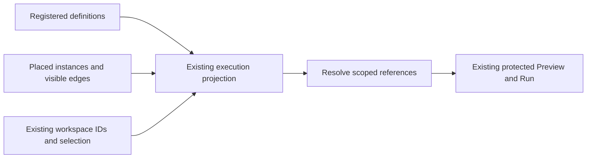

# Canvas Instances And Lossless dbt Project Navigation

[Issue #3747](https://github.com/dunay2/dvt/issues/3747) owns delivery and the exact
commit/check acceptance record. Planning DB owns components, responsibilities,
rails and prospective design admission. Git owns physical files. This evidence
reconciles the final implementation boundaries; chronological failed attempts
remain in the issue and Git history.

AGENTS.md, ADR-0060/0061/0064, command/query and Fowler governance, the native
component guides and PR preflight govern the cut. Policy classifies the complete
diff as ARC-2. Its [risk controls](../risk-register/dbt-project-root-relocation-20261102.md)
remain required alongside lint, tests, schema validation and contract goldens.

## Definitions, Instances And Code

One Elements activity contains independently collapsible Sources and Models.
Click and drag create independent usable instances; Properties and Code
navigation are separate. Availability, registered definition and placed card are
distinct. New native instances persist `definitionId`; the common contract also
reads saved `sourceDefinitionId`. Configuration and paths remain on the
definition. Placement copies no SQL and creates no definition-to-instance edge.

The contract rejects missing, chained, self, type-mismatched and conflicting
references. Query-derived Model dependencies retain existing execution metadata.
Deleting an instance preserves its definition and siblings; deleting the last
placed Model does not unregister its definition. Unregistered hidden models and
unresolved visible nodes remain persistence refusals.

File resources retain their original identity plus scoped layout references.
Inspection and execution resolve the original resource; layout cannot grant
semantic or file writes. Unsupported seeds/snapshots remain inspectable without
advertising placement. Assigned native file-model field/relation identities
survive save/reload; added fields do not silently widen an existing consumer.

Code remains read-only and retains navigation/editor state. It uses the existing
file contribution and inline-reference cards. A file-owned Model reference is
not graph-owned SQL. Workspace path qualification preserves legitimate repeated
segments such as `models/models/orders.sql`. The existing file query orders
directories before files at every depth, so explorers need no duplicate sorting.

## Model Inputs, Preview And Execution

Native file-model consumers reuse `CreateCanvasNode`,
`SaveWorkspaceGraphDraft`, `ProjectDbtGraphFromFiles`,
`PreviewCanvasTransformRows` and protected `PreviewPlan`. The server resolves
the current authorized file authority, schema and connection before native dbt
compilation. It retains manifest identity for provenance and adapts selectors to
the package-qualified model name. No Jinja interpreter or parallel dbt analysis
engine is introduced. Placement/rendering do not compile; native analyzer reuse
and request-level compilation grouping remain with their existing owners.

A typed producer Read is a composition signature, never an invented physical
table. Only server-resolved compilation binds the SQL result. PostgreSQL AST
admission still rejects multiple statements, nested writes, SELECT INTO and
locking. Stale/missing fields, changed types, revisions, connections, scope or
file-view permission refuse consumption. Nullability remains conservative.

A Source or dbt-model input can feed native Model Output directly. Apply/reopen
retains the consumer-owned Read and producer reference, with the existing
single-consumer and occupied-terminal guards. Model-backed Read Preview uses the
canonical model-input inventory and selected-relation query. Physical Source
queries, pending edits and permission guards retain their own admission.

`SYS-WEB-CANVAS-EXECUTION-COMPOSITION` supplies its existing execution seam with
the canonical node inventory and keeps visible edges and workspace IDs as the
execution boundary. A rendering-only node list cannot resolve hidden
definitions. The controller-to-real-projection regression was RED before this
one-line correction; scope and permission regressions remain unchanged.

## Cancel, Layout And Interaction

Semantic dirty comparison excludes presentation positions while actual Apply
requests retain them. Cancel compares against the same already-hydrated baseline,
preserving legacy defaults and scoped Read validation. No second hydration
algorithm or mutable baseline store was added. Changing a selected field or
terminal remains dirty; layout alone does not prompt Keep-your-changes.

One pointer/keyboard policy and scrollbar-free camera serve Canvas and Model.
Inspection preserves card positions. Affected-consumer presentation reuse follows
old and new dependency edges, retains unrelated cards and cancels stale async
completion. File sessions, execution/recovery and camera DOM responsibilities
have separate existing owners. Obsolete Sources/card/cursor paths, local helper
duplicates and unused implementation-only exports were retired. All 45 existing
component-size bounds remain unchanged.

Native evidence reuses the common instance reader, protected placement IDs and
reveal/connect gestures. Trusted field drag, fan-out refusal, semantic digests,
selection, persistence and accessibility assertions remain. Catalogue creation,
placed-card inspection and Code navigation have distinct journeys. File
inspection waits on its existing projected-Model readiness before using Fit;
neither deadline is increased. Explicit public Model closure is asserted before
full navigation; no guard is cleared or draft discarded automatically.

## Lossless Project Root Relocation

`PreviewDbtProjectRootRelocation` inventories the complete authorized subtree and
binds hashes, scope, Canvas and authority revision to a deterministic plan.
`RelocateDbtProjectRoot` reuses the scoped CAS batch, private metadata repository
and sorted PostgreSQL authority locks. Authority kind and Canvas identity remain
unchanged. The inventory is rechecked under the existing mutation lock.

Multiple owners, stale authority, graph/mixed ownership, differing destination
bytes, added files, private files, case aliases, symlinks, invalid UTF-8 and
bounded traversal/size violations fail closed. A private snapshot precedes
publication. Retry finishes only a proven move; ambiguous recovery retains the
snapshot and returns conflict. Completed receipts do not rewrite later edits.
Cleanup removes only empty former source directories.

The real filesystem/PostgreSQL composition, protected-route and authority-store
tests cover rollback/retry, collisions, denied access and concurrent authority.
The local coordinator serializes cooperating operations in one API process; it
is not a distributed filesystem/database transaction.

## Actual Workspace Evidence

The authorized relocation moved five files from `inline_code_demo/` into the
project root, retaining two source YAML files. All seven SHA-256 values were
preserved, with Canvas `ce23643b-69fa-46d0-a902-361af7582335` now bound to `.`.

The shared user page proved two independently persisted `clientes` instances,
their authoritative file and native inline cards, drag/reload/removal, no automatic
edge and live rows. Later, `ventas_por_cliente` fed Model1 Output directly. Its
exact internal Read-card Preview returned **20 rows / four columns / LIVE**.
[Direct Output proof](https://github.com/dunay2/dvt/issues/3747#issuecomment-6629451453)
and [Read-card proof](https://github.com/dunay2/dvt/issues/3747#issuecomment-6633321386)
record the different boundaries.

The user approved `local-postgres-proof` as the dev target. Native dbt created
only the missing `clientes` and `pedidos` parent views; all seven project-file
hashes remained unchanged by that execution. Removing trailing invalid SQL text
was a separate protected SHA-guarded project-data repair with readback. Preview
remains read-only and does not materialize missing dependencies implicitly.
Synthetic warehouse counts remained 202 clients, 1,003 orders and 3,003 details
during the instance verification.

The local static-compilation candidate reused the same bounded native analysis
mechanism across Canvas and internal Read Preview. In the shared Raven session,
Model1 took 14,517 ms cold, 203 ms on Refresh and 122 ms for its internal Read.
Both warm queries had zero dbt subprocess time and new data timestamps, with
20 rows / four columns / LIVE. These observations are not latency guarantees;
cold and dynamic compilation still execute natively. Source/context and operation/
selector guards govern reuse; warehouse rows are never retained.

## Validation Record And Acceptance Boundary

| Verified revision/scope                     | Actual result                                                                                                                                                                                                                                                        |
| ------------------------------------------- | -------------------------------------------------------------------------------------------------------------------------------------------------------------------------------------------------------------------------------------------------------------------- |
| Root relocation Contracts/schema/goldens    | 79 files / 1,012 cases; 25 schema checks; five golden paths passed. The existing golden path awaiting #10 was skipped.                                                                                                                                               |
| Root relocation API boundaries              | 39 focused cases, 20 authority/HTTP cases and one real filesystem/PostgreSQL integration passed; source/test typechecks and affected lint passed. A later complete API attempt had 21 failures and two existing environment-guarded skips; it is not green evidence. |
| Native file-model API selection             | Eight focused files / 69 cases passed, including saved instance selection, compilation binding and protected sampling.                                                                                                                                               |
| Full attempt at `3de144622`                 | 716 manifests, Web unit 432 files / 3,374 cases, presentation 368 / 1,994, architecture 129 / 745, build and 52 controlled native specs / 147 cases passed. Later available-browser failures mean the complete prepush did not pass.                                 |
| Hydrated-baseline correction at `7feb478db` | Six unit files / 94 cases, four presentation files / 25 cases, 17 Workbench architecture cases, Web lint/typecheck and hooks passed.                                                                                                                                 |
| Committed native UNION at `7feb478db`       | Both all/distinct cases completed with exit 0, including 3 → 4 → 3 inputs, Apply, Cancel, explicit Close, Canvas return and reopen; no pending/skipped cases.                                                                                                        |
| Remaining available sweep at `7feb478db`    | 22 specs / 38 cases completed: 32 pass, six failures in five specs, zero pending/skipped. These exposed the execution-definition handoff and obsolete inspection/readiness consumers; this is RED evidence.                                                          |
| Current execution handoff regression        | RED before correction; three controller presentation files / 11 cases pass afterward, including invalid-reference, executable-scope and no-write assertions.                                                                                                         |
| Complete attempt at `46eab8920`             | Unit 432 / 3,377 and presentation 368 / 1,995 passed. Architecture had 744 passes and one failure: the session reached 181 lines against its unchanged <180 bound. Build/native phases did not run.                                                                  |
| Shared static compilation candidate         | Six RED / 40 passing reuse cases before correction; three focused files / 104 cases, API source/test typecheck and full lint pass afterward. The session simplification passes 17 architecture and 25 navigation/state cases.                                        |
| Native static compilation clone             | Seven actual native-analysis calls used three processes: cold, fresh concurrent instance and changed source. Repeats resolved in 48–54 ms; changed source compiled again. The original seven-file project hash remained unchanged.                                   |

The final committed-tree native reruns, full `pnpm verify:prepush`, fresh exact
base/head `pnpm docs:feature-mechanization:implementation`, PR checks/comments
and merge must be recorded in GH-3747 and the implementation PR. Partial,
interrupted, failed or older-head results cannot replace them. Ignored local
receipts/logs under `.dvt/project-root-3747/` are diagnostic artifacts, not a
second delivery authority.

Native component commands reconciled ownership, 13 relations and 17 required-test
associations with revision guards. Explicit legacy reclassification retained
component identities and metadata; effective-parent reads preserve overrides.
Missing/stale revisions, cycles, incompatible parents, transaction failure and
legacy replay remain covered. No Planning DB import/rebuild, threshold change or
ownership tie-break was used. The last integrity result has zero blockers/errors
and 102 historical warnings; changed production files had no exact-body duplicate
groups. Those observations do not certify SRP by themselves.

Real scoped Git initialization/status/history and native graph-to-dbt publication
remain open acceptance in #3747. A file explorer does not deliver Git. Native
compilation retains its cold-process cost; the measured warm improvement applies
only to the admitted static subset. Existing React-act/chart-dimension/Vite warnings remain
disclosed. No new debt, placeholder, fake adapter, bypassed hook or relaxed rule
was introduced.

The explicit Code compilation extension is prospectively recorded in
[GH-3747](https://github.com/dunay2/dvt/issues/3747#issuecomment-6657808041).
The existing selected-model query now runs on the shared Compile action; matching
revision-bound results remain reusable on navigation. Pending, compiling,
recompiling and compiled states describe actual query work. Full input identities
remain conservative; SQL AST equality does not replace native macro/Jinja/profile
invalidation. Plain SQL and YAML remain passive text. Focused evidence before
closeout includes 50 presentation cases and 71 unit cases; subsequent committed
results and the full gate must be recorded on the issue/PR.

Real application inspection also exposed typed file-model references being treated
as graph-generated paths. The [bounded classification correction](https://github.com/dunay2/dvt/issues/3747#issuecomment-6658545036)
uses the existing contract schema, preserving genuine graph ownership and malformed
metadata protection. In the actual shared application, the model moves from Pending
compilation to Compiled on the explicit action and displays both verified inline
references. Plain SQL stays passive; returning to the model retains Compiled. A
clipped visual capture succeeds. This working-tree proof does not replace the
committed native gate or integration evidence.

The [shared browser evidence extension](https://github.com/dunay2/dvt/issues/3747#issuecomment-6659613118)
extracts the existing schema-validated fixture for both presentation and controlled
Code browser tests. The public journey exercises explicit compilation, its busy
state and scoped request, retained cards on return and zero file writes. Native
symbol records point to these actual consumers; the existing Runs assertion helper
records its Cypress spec as its isolation-test consumer. The extracted fixture
passes the existing 35 presentation cases; committed browser and full-gate results
remain separate closeout obligations.

The [signed Model movement correction](https://github.com/dunay2/dvt/issues/3747#issuecomment-6662240499)
addresses a hidden world-origin boundary exposed by free panning. The existing
gesture/drop projection, signed finite authoring coordinates, invertible detail
offset and explicit Fit bounds must agree. The previous exact-head full gate was
interrupted before edits for this correction: architecture 717 and Web unit
432 files / 3,379 cases passed, while presentation was incomplete. It is not a
passing full gate; current committed proof remains required before integration.

The [durable Code analysis correction](https://github.com/dunay2/dvt/issues/3747#issuecomment-6663362701)
backs the existing scoped selected-model query with schema-validated ready
evidence, rather than a persisted compiled flag. A fresh query client restores an
unchanged result without requesting analysis. Changed scope, binding, selection
or project digests cannot restore it. The cache is bounded and has no elapsed-time
expiry; storage failures preserve the live query result. The persistence audit
passes 82 cases across seven files, including existing instance/layout, saved
authoring draft, workspace, language and panel preference recovery. Main Canvas
layout and saved authoring coordinates retain their existing owners. Active Code
file, contextual workbench visibility and Model session camera remain transient
presentation state; they are not claims of durable document or analysis state.
Native browser reload and the final committed gate remain required closeout
evidence.

The [saved Output Preview correction](https://github.com/dunay2/dvt/issues/3747#issuecomment-6664514981)
separates authoring transaction dirtiness from output-affecting changes in the
existing Apply mapper. A detached Source no longer blocks or clears an unchanged
saved dbt-model Read sample. The existing regression fails on the disabled Play
action before the fix and passes afterwards; 17 Preview/producer cases pass.
Apply/Cancel/navigation still retain the complete draft, and changed output,
pending active edits, stale inputs and outside-plan relations keep their guards.
Native browser evidence and the final committed gate remain required.

The [saved sample input-revision correction](https://github.com/dunay2/dvt/issues/3747#issuecomment-6665353876)
uses only the existing canonical projected input identities for sample invalidation.
Declaring an unused physical Source no longer removes an unchanged saved dbt Read
sample. The regression first fails on the removed table, then passes; 24 existing
Preview, producer, analysis and connection cases pass, including used-input changes
and withdrawal. The composition-count hypothesis was rejected without changing
composition admission. The existing relation index also replaces a redundant
reconstruction of plan relation identifiers, and the authoring state predicate
uses one explicit set of admitted states.

The [test-harness cleanup](https://github.com/dunay2/dvt/issues/3747#issuecomment-6665700461)
removes both private document-normalization functions from the route harness and
its second normalization call. The existing controller builder remains the single
owner. Native consultation found no explicit source bindings or implementation
references to the removed support symbols; existing route tests remain the proof
consumers. Current-source inspection of the complete changed Web production slice
finds zero exact-body duplicate groups, and the native rail duplicate query returns
no rows. These bounded results do not claim absence of all semantic duplication
throughout the repository. Final committed validation and integration remain pending.

The [adapter duplicate cleanup](https://github.com/dunay2/dvt/issues/3747#issuecomment-6665946079)
removes sixteen copied scope-parsing functions from four HTTP adapters. One
required-scope projection reuses the existing typed scalar parsers and preserves
field errors and failure precedence. The affected HTTP tests pass 80 cases;
five neighbouring Run parser cases pass. Four output-reader copies now consume
one stream adapter; 86 process/runner tests pass with no skipped cases. Two
focused native components own the shared implementations. Five obsolete source
bindings are removed, and both root-relocation manifests reference the real
shared parser instead of the deleted helpers.

The broader current-source scan also exposes nine pre-existing duplicated
methods in the two older protected-runtime proof runners, including bootstrap
and shutdown. These are recorded for a distinct runtime-consolidation cut;
this extraction preserves process termination and fixture ownership rather than
silently widening that boundary. No claim of repository-wide zero duplication
or completed integration is made by the bounded cleanup.

The [producer destination correction](https://github.com/dunay2/dvt/issues/3747#issuecomment-6670520400)
extends the existing pure connection-provenance projection to validated dbt model
references. Physical Sources and sealed model producers share the same traversal
and connection equality rule; unsupported plugins, malformed references, incoming
lineage on sealed models and conflicting connections still reject. Native
component `SYS-WEB-CANVAS-CONNECTION-PROVENANCE` owns the single resolver, its
inspector call relation and required graph regression. No new product rail or
connection authority is introduced. Provenance unit/graph tests pass 29 cases,
authoring presentation passes six and import/retirement architecture tests pass two.

The [publication admission cleanup](https://github.com/dunay2/dvt/issues/3747#issuecomment-6671058356)
rejects a configured publication without a canonical output schema before artifact
storage. The real publisher regression fails before the change and passes with
the existing selection suite: 16 cases. A separate ephemeral projection may still
serve a sample without manufacturing a publication fingerprint. In the shared
application, the destination can now be selected and saved. Protected Model 1
sampling returns five rows and six columns in 122 ms. Execution Preview remains
rejected because `amount` is `numeric`, outside the existing publication type
contract. The UI now explains unsupported/unresolved types instead of asking for
an ineffective Preview retry. No numeric-to-float conversion, invented digest,
target write or successful Execution Preview is claimed. The complete committed
prepush and main integration remain separate, pending acceptance evidence.

The [operation-session closure correction](https://github.com/dunay2/dvt/issues/3747#issuecomment-6689544902)
completes the existing Preview proof before native browser teardown. The complete
gate passes 723 manifests, 6,482 Web cases and 150 controlled browser cases, then
stalls after the direct JOIN case passes. An unchanged-source isolated run stalls
at the same boundary. Browser protocol reads respond while page reads do not;
no visible JavaScript dialog is reported. Both attempts remain failed completion
evidence. The preceding case deliberately leaves a disconnected Output and an
unused Source as local edits. After retaining every semantic, row-call and
invalidation assertion, the corrected journey uses public Cancel and Close,
asserts editor/tab absence and Canvas activation, and requires no additional
draft write. The existing navigation guard and runner isolation remain intact.
The hook-normalized correction `cce5aab3398b416f5e78d0717e030c54d630cd90`
passes all three operation cases and all three cases of the following chain
persistence spec: six native cases in 38 seconds. Cypress exits normally and
both disposable leases are retired. Strict touched-spec lint and Web typecheck
pass. This establishes completed user navigation without changing the production
guard; the final committed prepush and integration remain required.
