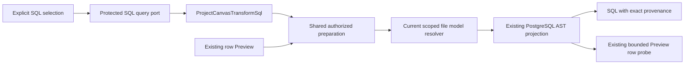
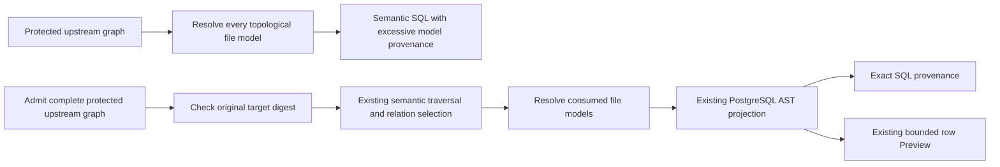
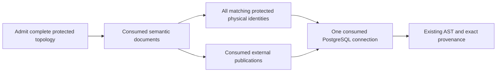

# Authorized Canvas Transform SQL Inspection

## Governing Sources And Admission

[Issue #3765](https://github.com/dunay2/dvt/issues/3765) owns delivery and final
acceptance. The governance inventory, `AGENTS.md`, AI work protocol,
command/query rail governance, Fowler governance, ADR-0060/0061/0064,
[data-access modes](../contracts/data-access-modes.md), and the
[Canvas shell component](../architecture/components/web/graph/canvas-shell-component.md)
govern this change.

Planning DB admitted `GH-3765-AUTHORIZED-TRANSFORM-SQL` before implementation.
Its operability, file-denial, browser-consumer, native-closeout and contract-fact
supplements retain their original source hashes and receipts. The initial
design contains the before/after diagram, alternatives, owner, finite allowed
paths and negative cases. It introduces one missing read intent,
`ProjectCanvasTransformSql`, under existing DVT publication admission.

The canonical evaluator on base
`5d2b580902b70d31ed568f074c3fb87ce914511c` and checkpoint
`297fa6c17803f7c1e1c30f4514d58753bce07f27` examined 172 changed files and
returned ARC-2. The three contracts paths require this evidence and the
[risk record](../risk-register/canvas-transform-sql-query-20261108.md), with
lint, tests, schema validation and contract goldens. It requires neither rollout
notes nor a compatibility matrix. This classification precedes these two added
documents; final acceptance must use the final complete diff.

## Root Cause And Resulting Ownership

The reported native Model had no file of its own. Its canonical JOIN combined
one physical Source and one file-owned dbt model. The browser resolved the
producer signature but supplied no authorized external SQL projection. The
shared PostgreSQL projector correctly rejected that incomplete input. An
upstream `models/clientes.sql` file belongs to a different resource and cannot
stand in for the native Model's output.

The protected API already resolved current file-model results for row Preview.
`ResolveCanvasTransformProjection` now owns that common preparation once:
authorized draft selection, instance resolution, expected digest validation,
current file-producer resolution, terminal closure and PostgreSQL projection.
`ProjectCanvasTransformSqlQuery` returns the SQL read model; the existing
`PreviewCanvasTransformRowsUseCase` adds its existing connection checks and
bounded row probe. SQL inspection has no row-probe or artifact-write dependency.

The Web product adapter calls the protected query. Pure physical-graph
projection assertions use `projectCanvasFixtureToPostgresSql` in the existing
test-support file. The production function
`projectDvtSubstraitTransformOutputToPostgresSql` retains its name and now reads
the authorized query; it is not a deleted symbol.

## Contract And Authority Controls

The additive strict V1 request contains `canvasId`, `transformNodeId` and the
mandatory canonical `semanticPlanSha256`. The HTTP adapter accepts the existing
tenant/project/environment scope and bearer session; client SQL, file paths and
semantic documents are not query inputs. The strict response contains SQL,
draft revision, matching target/digest and exact Source/model provenance.

Graph-view authorization precedes query dispatch. File producers additionally
require the existing file-view permission before analyzer access. A typed file
denial reaches the new SQL adapter as bounded HTTP 403. Existing row Preview
retains its prior HTTP 422 unsupported-projection wire behavior. Invalid or
missing scope/digest is rejected; stale revision, unsupported producer and
malformed response cannot produce partial SQL.

Passive canonical JSON inspection does not request SQL. Explicit SQL selection
uses the current authorized preparation and existing native analyzer reuse.
There is no new persistent compiled flag or server SQL cache. SQL is a read
snapshot authorized at its last explicit request. Web lifecycle guards withhold
responses after transform/graph references or scoped query bindings change,
and after the consumer unmounts. The SQL view does not subscribe to upstream
file-revision or permission-revocation events. The retained Canvas surface can
keep its last snapshot while Code is active; an accepted file update alone does
not invalidate that snapshot. Returning to canonical output and selecting SQL
again rechecks current producer authority and permission. A missing provider
leaves canonical inspection available and SQL unavailable.

## Recorded Validation

### Audited semantic producer selection

The independent integration audit reproduced an admitted protected draft with
an unused file-model predecessor. PostgreSQL correctly projected only
`raw.orders`, but SQL provenance named the unused file model because shared
preparation resolved every topological file reference before semantic traversal.
The audit used the real planner, protected draft resolver, closure and AST
projector with an injected file publication; it did not execute native dbt.

The correction belongs to `ResolveCanvasTransformProjection` and the Preview
preparation branch of `resolveDvtTerminalTransformClosure`, under
`GH-3765-AUDITED-SQL-SEMANTIC-PROVENANCE`. One pure application helper reuses
`resolveProducerDocuments` and `selectDvtSubstraitRelation`; it does not introduce
another traversal engine, SQL rule, semantic IR, transport contract or factory.
Full graph authorization and direct-edge validation precede semantic selection.
The original target digest is checked before external work; a selected subtree
is only an analysis input, never replacement response authority. Operational
closure without a Preview target retains its existing rules.

Filtering only the final provenance array is rejected because it would retain
irrelevant file authorization and compilation. Native and external consumed
producers must instead be selected before the file resolver. Regressions must
prove unused-file exclusion, current mixed/transitive consumption, relation
selection, consumed-file denial, full topology rejection and digest ordering.
The meaningful RED for this correction had three failures and six passes in
`projectCanvasTransformSqlQuery.test.ts`: an unused file invoked the resolver,
the transitive query supplied unrelated nodes, and invalid unused topology
reached the resolver before rejection. After correction, seven API suites pass
80 tests: dependency selection, SQL query, producer row Preview, scoped file
resolution, Transform row Preview, operational workload projection and SQL HTTP
routes. Both API TypeScript checks and full API lint also pass. A first focused
run exposed a missing position in a new test fixture; a first test typecheck and
lint exposed request branding, import ordering and return annotations in new
test code. Those authoring errors were corrected before the passing checks.

These are local API regression results, with no native dbt, provider database or
browser execution claim for the correction. Hook normalization, independent
review, generated/native evidence refresh and exact committed-head prepush
remain integration obligations. The earlier checkpoint results below describe
the original SQL slice and are not substituted for these regressions.

### Audited physical producer selection

Read-only follow-up controls exposed the same topology/consumption mismatch
for physical Sources. The protected planner admitted a physical target, a
file-only selected relation and a native file-only target. Each control passed
with a same-connection unused Source; changing only that Source to another
connection caused `projection_unsupported`. The closure chose its connection
from the complete topological Source list rather than consumed bindings. A
preexisting mixed-connection test encoded this excess restriction.

`GH-3765-AUDITED-PHYSICAL-PRODUCER-SELECTION` keeps the same rails and closure
owner. Preview uses existing `sameConnectedSource` identity semantics to retain
all protected bindings matching consumed source references before choosing its
connection. Retaining every match preserves ambiguity and direct-edge refusals;
the complete topology is still admitted before narrowing. The no-Preview
operational branch retains whole-selection source and connection admission.
Replacing the obsolete negative with consumed mixed-connection and strict
operational negatives preserves the real invariant. SQL and row regressions
also cover an unused foreign Source and file-only relation provenance. No new
helper, traversal, SQL rule, DTO or execution policy is introduced.

The physical continuation's meaningful RED had five failures and 26 passes:
unused foreign Sources incorrectly rejected two SQL node-order variants, a
native file-only target, row Preview and a file-only selected relation. The
first GREEN passes all 31 SQL/producer-row cases. The final affected run passes
**88 tests across seven suites**, both API typechecks and full API lint.
Negatives retain every
matching identity for ambiguity/direct-edge rejection and reject genuinely
consumed physical/external mixed connections and strict operational mixed
selection. These local results precede hook normalization and the exact
committed-head integration gate; they are not a prepush or browser acceptance
claim.

At the checkpoint, the contracts package passed **1,040 tests across 81 files**,
including the six new SQL contract cases. The seven focused API suites passed
**61 tests** after hook normalization. Both API typechecks, API lint, the
contracts build and Web typecheck also passed in the recorded scope. The API
suites retain existing row-consumer behavior, mixed file/physical composition,
permission ordering, stale digest rejection and HTTP failures.

The meaningful authorization RED expected 403 and received 422: one failure and
nine passes before the typed-denial correction. Earlier missing-module REDs
established absent DTO/query/route implementations; they are not presented as
behavioral regression evidence. The original browser projector was also
reproduced against the actual protected user draft and failed at the external
publication guard.

The actual running API returned HTTP **200** for that user's mixed Model,
revision `661989a1-3143-49cb-a7f3-a873e5861eca`, semantic digest
`6d28a26f4f757f06f1ae70b76ead88e48951d86d7cc87916338e2ec4e5eb6743`.
The response contained 750 SQL bytes with a JOIN, one physical Source and one
`model.code_inline_demo.ventas_por_cliente` reference with current content-set
and analysis hashes. The single observed latency was 111 ms; this is functional
evidence, not a latency benchmark. No credentials or source SQL were published
in the evidence summary. That request did not execute row Preview or mutate
the graph or project files.

`pnpm validate:contracts` passed 25 checks over three plan fixtures plus the
golden-results structure. Its existing glossary-source diagnostic was skipped
by the unchanged validator. Both existing JSON schemas compiled successfully;
AJV retained its existing informational unknown-URI-format message.
`pnpm golden:validate` and the hash comparison passed: three implemented
fixtures were hashed, two deprecated baselines retained, and the existing
unimplemented retry path skipped. There were zero hash mismatches. These
unchanged skips are not hidden or counted as executed scenarios. No Docker or
database migration was required for these checks.

## Acceptance Evidence Boundaries

Controlled SQL-viewer and LIVE mixed-producer Cypress consumers are implemented
but their final browser acceptance is not claimed by this record. Their setup
uses the existing protected fixture save protocol, current file-model metadata
and canonical JOIN authoring; the LIVE assertion consumes the real SQL query
and checks provenance and absence of inspection writes or row queries.

Native ownership, source associations, the file-level schema contract and rail
records have passed read-only canonical planning. Their application remains
gated by the preceding integration, final clean source, exact row/binding hashes
and passing acceptance evidence. The schema leaf uses its real file contract;
no function wrapper or invented symbolic Zod implementation binding is added.
Parents retain their coverage-required classification.

Final exact-base/head native acceptance, browser acceptance, governance refresh,
required CI and `pnpm verify:prepush` remain unclaimed until their actual results
are recorded in the issue. No rule or hook was disabled, no new debt was
accepted, and no stub or partial success path was introduced.
