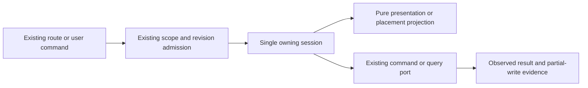

# Pending dependency cohort reconciliation

The [admitted design](https://github.com/dunay2/dvt/issues/3951#issuecomment-7104609423)
reconciles dependency PRs #3992 through #3997 through the existing validation
and runtime owners. Planning DB design `GH-3951-PENDING-DEPENDENCY-COHORT`
records the implementation scope. The complete diff evaluator returns ARC-2
because the dependency declarations include contracts, engine, state-store
and adapter packages.

Vitest, UI, coverage and the internal overrides now resolve to 5.1.1 together.
The bot patch changed the public packages while retaining six internal 3.2.4
overrides. The Web worker configuration also used the removed `poolOptions`
and `minWorkers` settings. Fork isolation, the four-worker local maximum and
one-worker CI maximum now use the supported top-level fields. CI retains its
4 GiB worker heap limit. Suite membership, deadlines and retry policy are unchanged.

The worker configuration regression first failed three cases while 23 passed;
all 26 pass with the new settings. The real coverage contract initially failed
two of four checks. Its CLI lookup now resolves the installed package directory
instead of a removed export, and its config reader uses the current API result.
All four checks pass, including a real failing low-coverage run and a passing
covered control. Explicit source inclusion continues to measure unexecuted files;
the statement/function/line thresholds remain 65 and branch threshold remains 55.

Vitest 5 also widens `ReturnType<typeof vi.fn>` to include constructors. The
affected test fixtures use its public callable `Mock` type, with specific async
signatures where required. This retains their previous callable semantics and
all existing assertions. The Web config uses the current `ViteUserConfig` export.
Constructor mocks use constructable functions in place of arrow functions, as
required by the current runner; resource cleanup and bootstrap assertions remain.

The workspace run exposed a separate duplicate build in the OpenTelemetry test
script. Its existing pretest helper now prepares `observability` for standalone
execution and defers to Turbo when its dependency graph already owns the build.
All nine adapter tests pass in both entry modes; the three helper contract cases
also pass. No coordinator, test-selection change or build bypass is introduced.

Temporal packages move together from 1.25.0 to 1.26.0. Tooltip becomes 1.4.1,
Scroll Area 1.4.0, typescript-eslint 8.73.0 and markdownlint-cli2 0.24.2.
The dependency review action remains pinned by commit, now at its 5.0.1 release.
The lockfile is resolved from these declarations with normal installation hooks.

The complete presentation run exposed a real Escape regression: Tooltip and
Dialog resolved separate DismissableLayer and FocusScope module instances.
The root dependency graph now resolves those singleton interaction families to
1.2.1 and 1.3.1 respectively. The existing closing-animation and focus regression
passes unchanged. No custom event handler or additional interaction registry is
introduced. The upstream [DismissableLayer](https://github.com/radix-ui/primitives/blob/main/packages/react/dismissable-layer/CHANGELOG.md)
and [FocusScope](https://github.com/radix-ui/primitives/blob/main/packages/react/focus-scope/CHANGELOG.md)
patch notes describe callback type compatibility fixes.

The same run found stale shell integration expectations. The tests now follow
the documented Templates-before-Runs order, address Git in the shared rail footer,
and open the Model inputs popover before asserting its exact source count,
drag admission and absence of authoring writes. The existing product owners,
negative assertions and focus lifecycle are retained.

The [Vitest migration guides](https://vitest.dev/guide/migration/) and
[v4 migration requirements](https://v4.vitest.dev/guide/migration.html) govern
the runner adaptation. The [Temporal release](https://github.com/temporalio/sdk-typescript/releases/tag/v1.26.0)
governs the adapter update. The [risk entry](../risk-register/pending-dependency-cohort-20261123.md)
defines the retained acceptance requirements. Full prepush and current hosted
acceptance must be recorded on the integration PR; these focused results do
not attest that boundary.

## Complexity and execution ownership

The [quality design](https://github.com/dunay2/dvt/issues/3951#issuecomment-7108406865)
and [physical separation rationale](https://github.com/dunay2/dvt/issues/3951#issuecomment-7109381331)
apply ADR-0069 and command/query rail governance. Planning DB designs
`GH-3951-CODESCENE-REGRESSION-SIMPLIFICATION` and
`GH-3951-CODESCENE-OWNED-SESSION-SEPARATION` admit the existing component
families and five new implementation or fixture paths. Helper bindings extend
existing rails through revision-checked record operations; their authorization,
negative tests, command/query identities and existing bindings remain intact.

Run-to-Model admission reuses one in-flight command for the same destination.
Code editor contributions project the accepted session without acquiring another
file session, store or subscription. Relational placement retains the existing
state cells, gesture ownership, cancel snapshot and single publication. Plan
preview separates protected graph projection from generic artifact preparation;
the owning action still flushes once, publishes and compiles in order, and
retains written artifact paths when compilation or preview fails. Catalog
migration keeps its existing lifecycle and SQL statement order.

CodeScene's installed extension engine 1.0.80 reviewed the complete integration
code diff after hook formatting at `119784d403b6c88f0f24df4f9740a382a05e2c5a`
against `11b142d1d22dbdb49cdb40f3533fd1e1975e9e60`. The initial candidate
had 75 introduced or degraded findings across 54 files. The final review
returned zero introduced or degraded findings, 71 fixed and 44 improved
findings across 285 reviewed files, with no review failures. Two existing
Planning DB authority scripts did not receive scores from that engine.
Inherited unchanged or improved findings remain visible; no CodeScene rule,
threshold or exclusion was changed.

The eight refactored Cypress specifications retain all 684 assertions and 33
scenarios. Named phases preserve their native gestures, queue order, controlled
transport and live-runtime boundaries. The assertion comparison retains full
`expect` matcher chains and literal `should`/`and` arguments, with nested
callback assertions checked separately. The focused Inspector, removal and
planning run passes 67 tests; session/presentation passes 27, Inspector fixture
tests 42 and warehouse probe tests 24. Web's declared typecheck passes. These
results complement, rather than replace, the final prepush and hosted gates.

The complete runs then exposed one load-sensitive, existing 5-second Model-tab
test. Unchanged sequential measurements were 4,451 ms before the refactor and
4,415 ms after; the concurrent full run exceeded the deadline twice. The
[prospective proof design](https://github.com/dunay2/dvt/issues/3951#issuecomment-7111797637)
and [focused refinement](https://github.com/dunay2/dvt/issues/3951#issuecomment-7111909227)
record the response before implementation. Native design
`GH-3951-MODEL-TAB-INDEPENDENT-PROOFS` retains the existing
`SelectCanvasWorkbenchTab` owner and admits the existing navigation test path.
Four focused cases now prove full-capacity admission and reuse, exact active
editor retention when another tab closes, released capacity, and neighboring
selection after active closure at capacity. They retain the real shell, Model
editors, ARIA bindings and no-write assertions. The two draft-protection cases
remain unchanged. No timeout, retry, worker, isolation or fixture-depth policy
was changed; the failed attempts remain recorded rather than reused as receipts.
All 78 tests in the four concurrent Canvas files pass with the normal four
workers. The two original draft-protection cases are preserved verbatim, and the
tab proof adds direct active-editor identity assertions. The focused CodeScene
review reports no findings for the refactored navigation test.

The next complete run showed that constructing the six-Model starting state
still consumed the released-capacity callback's deadline. The
[replacement fixture design](https://github.com/dunay2/dvt/issues/3951#issuecomment-7112703295),
native `GH-3951-MODEL-TAB-FIXTURE-LIFECYCLE`, supersedes the earlier setup choice.
It follows the existing draft-test lifecycle: a fresh production shell opens six
real Models sequentially in a `beforeEach` explicitly bounded at 5,000 ms, then
the unchanged 5,000 ms test callback proves the command. Those are separate
fixture and command deadlines, rather than the original combined callback
budget. All six tests and 41 assertions remain; no state is shared across tests,
seeded directly, mocked differently, reduced or opened in a batch. The revised
four-file concurrent proof again passes all 78 tests with the normal workers.

The next complete prepush passed all 7,896 Web Vitest tests and the first 20
browser specifications, then exposed a shadowed Runs list fixture. Shared setup
registered a RUNNING response before the completed-result case appended a
COMPLETED response. The controlled transport intentionally uses the first match,
so the completed-status filter correctly produced an empty table. The
[prospective correction](https://github.com/dunay2/dvt/issues/3951#issuecomment-7114573347)
keeps existing designs `GH-3974-RUN-MODEL-RESULT-NAVIGATION` and
`GH-3951-PENDING-DEPENDENCY-COHORT` as owners. Each case supplies one response to
the existing Runs bootstrap helper before entering the actual browser journey.
The shared transport, production filters, all four scenarios, assertions,
keyboard gestures and deadlines remain unchanged. Focused browser diagnostics
and the later complete prepush must establish the result; the failed run is not
a readiness receipt.

The corrected Runs fixture passes all four real-browser cases and preserves all
37 full assertions and scenario names. The remaining controlled shard passes
20 specifications and 68 tests; unavailable-runtime proof passes its browser
case and five provider checks. Available-runtime diagnostics execute all 37
specifications: 88 tests pass and three fail in two specifications. One retains
the old single-entry Back expectation after Result gained its own URL entry;
the [prospective history correction](https://github.com/dunay2/dvt/issues/3951#issuecomment-7115378104)
keeps all publication SHA, token, snapshot and reload assertions and returns
through both Summary and Result entries. The two Model-input opening failures
are traced separately; none of these diagnostics attest readiness.

The [bounded-lifetime decision](https://github.com/dunay2/dvt/issues/3951#issuecomment-7116329009)
is native design `GH-3951-COMPLETE-VALIDATION-LIFETIME`, owned by the existing
`RunChangedSliceVerification` executor. Disjoint observed phases total about
140.15 minutes, exceeding its initial 120-minute whole-plan containment limit.
The diagnostic phases use first and last log writes, rather than claiming a
single successful performance run. Default step and total containment become
180 minutes; the earlier inherited absolute deadline, cancellation, 60-second
cooperative cleanup and 5-second forced retirement remain. Every test and
browser obligation, individual deadline, retry, worker and coverage rule remains.
Only complete awaited execution and final checks can authorize a readiness
stamp. Short-budget cancellation, cleanup and inherited-deadline regressions
remain required alongside a finite-default propagation proof.

The finite-default regression first failed with exit 124 at the former bound;
all nine executor tests pass with the new default, including short cancellation,
owned cleanup and inherited-deadline containment. Individual test deadlines are
unchanged.

Two isolated native-browser traces show the same Inputs trigger opening before
a deferred Radix FocusScope cleanup restores the previous card and dismisses
the newer Popover. The call stack identifies the unmount restoration rather than
an input remount. Both temporary traces were removed and the navigation helper
restored to its original byte hash. The
[focus-handoff rationale](https://github.com/dunay2/dvt/issues/3951#issuecomment-7116742205)
and native `GH-3951-CONTEXT-MENU-FOCUS-HANDOFF` keep the existing
`RenderCanvasContextMenu` query and shared adapter as owners. Its audited catalog
extension retains all old references, symbols and acceptance cycles plus the
five sibling rails. The adapter must honor a consumer callback once, retain
normal opener restoration, and preserve a meaningful newer focus owner in the
closing content's document. No Canvas selector, focus store, registry or business
command is added. Modal and non-modal lifetimes, cancellation and native JOIN
interaction remain required proof.

The [measured history correction](https://github.com/dunay2/dvt/issues/3951#issuecomment-7117407629),
native `GH-3951-RUN-TAB-ATOMIC-NAVIGATION`, supersedes the earlier two-entry
assumption. The timeline proof legitimately visits Diagnostics before Result.
Native traces also show each tab gesture publishing twice, once on mousedown
and again on focus before the controlled selection commits. The existing
`GetRunSnapshot` navigation adapter must commit its URL selection synchronously
through the Router's existing flush adapter. Preserve automatic activation,
Back/Forward, query, hash and unavailable-result behavior without another store
or pending-navigation coordinator. The browser proof must traverse Result,
Diagnostics and Summary explicitly before returning to Canvas, then retain all
exact Run, publication SHA, token, snapshot and reload checks. Its cohesive
return/reopen helper is added to the existing reference rail without replacing
its authority or previous symbols. A real-tab two-event regression must fail
before the fix; native browser proof and the complete gate remain required.

The real-tab regression first reproduced two Router navigations for one gesture;
the synchronous commit passes it, Back and a fresh visit. The eleven focused
Run/shared-UI files pass all 50 tests, and Web's declared typecheck passes. The
final uninstrumented native run passes all 19 cases in both affected
specifications: three JOIN interaction cases and sixteen terminal-publication,
data-action and recovery cases, with no pending or skipped cases. All 37 Runs
assertions and all 84 original terminal assertions remain; the latter adds four
explicit history assertions. Its return/reopen extraction reduces the large
case from 202 to 181 code lines without dropping evidence. Focused CodeScene
review reports zero introduced or degraded findings. Planning DB integrity has
zero errors, blockers, vocabulary or source drift; the existing 101 component
warnings and 26 unresolved references remain, with zero new unresolved
references. These focused results do not replace the final complete prepush or
hosted acceptance.
