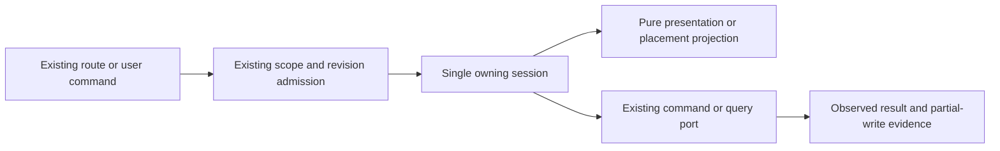

# Pending dependency cohort reconciliation

The [admitted design](https://github.com/dunay2/dvt/issues/3951#issuecomment-7104609423)
reconciles dependency PRs #3992 through #3997 through the existing validation
and runtime owners. Planning DB design `GH-3951-PENDING-DEPENDENCY-COHORT`
records the implementation scope. The complete diff evaluator returns ARC-2
because the dependency declarations include contracts, engine, state-store
and adapter packages.

Vitest, UI, coverage and the internal overrides now resolve to 5.1.1 together.
The bot patch changed the public packages while retaining six internal 3.2.4
overrides. The Web worker configuration also used the removed `poolOptions`
and `minWorkers` settings. Fork isolation, the four-worker local maximum and
one-worker CI maximum now use the supported top-level fields. CI retains its
4 GiB worker heap limit. Suite membership, deadlines and retry policy are unchanged.

The worker configuration regression first failed three cases while 23 passed;
all 26 pass with the new settings. The real coverage contract initially failed
two of four checks. Its CLI lookup now resolves the installed package directory
instead of a removed export, and its config reader uses the current API result.
All four checks pass, including a real failing low-coverage run and a passing
covered control. Explicit source inclusion continues to measure unexecuted files;
the statement/function/line thresholds remain 65 and branch threshold remains 55.

Vitest 5 also widens `ReturnType<typeof vi.fn>` to include constructors. The
affected test fixtures use its public callable `Mock` type, with specific async
signatures where required. This retains their previous callable semantics and
all existing assertions. The Web config uses the current `ViteUserConfig` export.
Constructor mocks use constructable functions in place of arrow functions, as
required by the current runner; resource cleanup and bootstrap assertions remain.

The workspace run exposed a separate duplicate build in the OpenTelemetry test
script. Its existing pretest helper now prepares `observability` for standalone
execution and defers to Turbo when its dependency graph already owns the build.
All nine adapter tests pass in both entry modes; the three helper contract cases
also pass. No coordinator, test-selection change or build bypass is introduced.

Temporal packages move together from 1.25.0 to 1.26.0. Tooltip becomes 1.4.1,
Scroll Area 1.4.0, typescript-eslint 8.73.0 and markdownlint-cli2 0.24.2.
The dependency review action remains pinned by commit, now at its 5.0.1 release.
The lockfile is resolved from these declarations with normal installation hooks.

The complete presentation run exposed a real Escape regression: Tooltip and
Dialog resolved separate DismissableLayer and FocusScope module instances.
The root dependency graph now resolves those singleton interaction families to
1.2.1 and 1.3.1 respectively. The existing closing-animation and focus regression
passes unchanged. No custom event handler or additional interaction registry is
introduced. The upstream [DismissableLayer](https://github.com/radix-ui/primitives/blob/main/packages/react/dismissable-layer/CHANGELOG.md)
and [FocusScope](https://github.com/radix-ui/primitives/blob/main/packages/react/focus-scope/CHANGELOG.md)
patch notes describe callback type compatibility fixes.

The same run found stale shell integration expectations. The tests now follow
the documented Templates-before-Runs order, address Git in the shared rail footer,
and open the Model inputs popover before asserting its exact source count,
drag admission and absence of authoring writes. The existing product owners,
negative assertions and focus lifecycle are retained.

The [Vitest migration guides](https://vitest.dev/guide/migration/) and
[v4 migration requirements](https://v4.vitest.dev/guide/migration.html) govern
the runner adaptation. The [Temporal release](https://github.com/temporalio/sdk-typescript/releases/tag/v1.26.0)
governs the adapter update. The [risk entry](../risk-register/pending-dependency-cohort-20261123.md)
defines the retained acceptance requirements. Full prepush and current hosted
acceptance must be recorded on the integration PR; these focused results do
not attest that boundary.

## Complexity and execution ownership

The [quality design](https://github.com/dunay2/dvt/issues/3951#issuecomment-7108406865)
and [physical separation rationale](https://github.com/dunay2/dvt/issues/3951#issuecomment-7109381331)
apply ADR-0069 and command/query rail governance. Planning DB designs
`GH-3951-CODESCENE-REGRESSION-SIMPLIFICATION` and
`GH-3951-CODESCENE-OWNED-SESSION-SEPARATION` admit the existing component
families and five new implementation or fixture paths. Helper bindings extend
existing rails through revision-checked record operations; their authorization,
negative tests, command/query identities and existing bindings remain intact.

Run-to-Model admission reuses one in-flight command for the same destination.
Code editor contributions project the accepted session without acquiring another
file session, store or subscription. Relational placement retains the existing
state cells, gesture ownership, cancel snapshot and single publication. Plan
preview separates protected graph projection from generic artifact preparation;
the owning action still flushes once, publishes and compiles in order, and
retains written artifact paths when compilation or preview fails. Catalog
migration keeps its existing lifecycle and SQL statement order.

CodeScene's installed extension engine 1.0.80 reviewed the complete integration
code diff after hook formatting at `119784d403b6c88f0f24df4f9740a382a05e2c5a`
against `11b142d1d22dbdb49cdb40f3533fd1e1975e9e60`. The initial candidate
had 75 introduced or degraded findings across 54 files. The final review
returned zero introduced or degraded findings, 71 fixed and 44 improved
findings across 285 reviewed files, with no review failures. Two existing
Planning DB authority scripts did not receive scores from that engine.
Inherited unchanged or improved findings remain visible; no CodeScene rule,
threshold or exclusion was changed.

The eight refactored Cypress specifications retain all 684 assertions and 33
scenarios. Named phases preserve their native gestures, queue order, controlled
transport and live-runtime boundaries. The assertion comparison retains full
`expect` matcher chains and literal `should`/`and` arguments, with nested
callback assertions checked separately. The focused Inspector, removal and
planning run passes 67 tests; session/presentation passes 27, Inspector fixture
tests 42 and warehouse probe tests 24. Web's declared typecheck passes. These
results complement, rather than replace, the final prepush and hosted gates.
