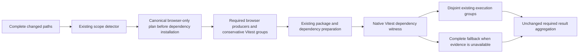
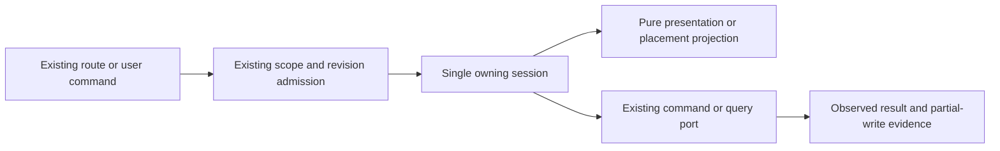

# Pending integration and quality reconciliation

## Dependency impact and CI admission

The [dependency-impact design](https://github.com/dunay2/dvt/issues/3951#issuecomment-7138335463)
and [measured CI alternatives](https://github.com/dunay2/dvt/issues/3951#issuecomment-7138809625)
reuse `RunChangedSliceVerification`, `RouteChangedWebVitestSuites` and the
existing browser selector. They do not introduce a parallel scope catalog.
The accepted direction keeps the existing detector and producer groups:

The native Vitest graph identifies consumers of changed TypeScript and TSX
sources, and of CSS modules with a nonempty verified witness. Architecture
tests remain complete. Global CSS, configuration, missing or deleted paths,
unknown companions, unavailable evidence and empty witnesses retain complete
fallback coverage. Browser-only planning never acquires the Vitest graph.
Exact files are distributed among the existing groups without duplication;
they are not collected in a single serial producer. Explicit complete local
validation and required hosted browser proof retain their admission boundary.

The provisional dependency-free plan cannot establish Vitest absence: in the
measured source-import example it selected two groups before installation,
while the installed witness selected five. The detector therefore retains
conservative Vitest producers and only omits browser producers when the
canonical browser plan proves their absence. Runtime, loader, timeout or
output uncertainty must preserve the complete browser matrix. Full and
root-sensitive runs retain the existing complete path.

The historical resize and source-import runs opened 13 empty browser producers.
Their installation steps consumed respectively 422 and 456 cumulative seconds.
The initial canonical browser-only discovery took approximately 0.26 and 0.27
seconds without packages; the implemented detector adapter took approximately
0.50 seconds in both cases. These are work and startup
measurements, not a claim that the hosted critical path has already improved.
The proposed discovery runs inside the existing detector, avoiding another
serial setup barrier. Hosted elapsed time and queue effects require a new run.

The shared build-cache experiment was rejected: both warm variants already
hit all five dependency builds and completed in approximately 1.2 seconds.
The cache correctness change instead binds producer and restore identities to
the effective Node version and runner architecture. The existing Turbo graph
already limits an isolated front-end style change to Web and its real build
dependencies; the new style-scope regression preserves that behavior and the
broader contracts and lockfile cases. No coverage threshold or required check
is lowered to obtain these results.

The selector's 21 focused suites pass all 714 tests, its 19 changed source
files pass typed lint and receive score 10, and its 32 preflight tests pass.
The workflow now prepares Vitest dependencies and invokes the actual selector
once per producer. It retains the browser planning step needed for provider
preparation. This removes the duplicate, potentially unavailable graph query
before dependency preparation without adding another CLI mode.

The necessary contract-path repair also exposed excessive complexity in the
existing CI scope module. Its public ports retain their identity and delegate
pure manifest comparison and workflow output projection to cohesive modules.
They introduce no path catalog, process or Git acquisition; the optional
crypto-input scan remains lazy. A frozen-source comparison preserves all
12,288 mode/path/package-flag results, including serialized field order, and
400 valid or malformed manifest comparisons. The 13 existing focused suites
pass all 184 tests. The three changed scope modules each receive score 10
in the focused diagnostic; final committed-candidate review remains required.

The local execution comparison uses the unchanged
`PlanExecutionDecisionView.tsx` product source, with SHA-256
`b51bd00860e24aedc4de98f05a9ab969a64884da568717c8ae677eefcac1a91c`,
and the normal four isolated workers. The coarse plan passed 413 presentation
files and 2,453 tests in 871.58 seconds. The related plan passed 156 files and
951 tests in 305.34 seconds, plus 5.57 seconds for selection. Both retain the
complete architecture obligation: its 140 files and 1,174 tests passed in
67.94 seconds as the common part of the comparison. The related plan adds
200 relevant unit tests which the coarse presentation-only plan did not run;
its 751 presentation tests cover the discovered consumers.

The first alternative attempt coincided with the complete Engine suite and
exceeded the existing 5,000-ms missing-producer scenario deadline. It is retained
as a failed attempt. The unchanged scenario then passed alone in 2,364 ms,
and the complete alternative passed without concurrent heavy test suites.
No deadline, retry, worker count or scenario was changed. This sequential
Windows experiment demonstrates local work reduction; it does not isolate
every cache or background-load effect or establish hosted elapsed time.
Final committed-tree package checks, prepush and current required hosted
results remain separate acceptance evidence.

The [admitted design](https://github.com/dunay2/dvt/issues/3951#issuecomment-7104609423)
reconciles dependency PRs #3992 through #3997 through the existing validation
and runtime owners. Planning DB design `GH-3951-PENDING-DEPENDENCY-COHORT`
records the implementation scope. The complete diff evaluator returns ARC-2
because the dependency declarations include contracts, engine, state-store
and adapter packages.

Vitest, UI, coverage and the internal overrides now resolve to 5.1.1 together.
The bot patch changed the public packages while retaining six internal 3.2.4
overrides. The Web worker configuration also used the removed `poolOptions`
and `minWorkers` settings. Fork isolation, the four-worker local maximum and
one-worker CI maximum now use the supported top-level fields. CI retains its
4 GiB worker heap limit. Suite membership, deadlines and retry policy are unchanged.

The worker configuration regression first failed three cases while 23 passed;
all 26 pass with the new settings. The real coverage contract initially failed
two of four checks. Its CLI lookup now resolves the installed package directory
instead of a removed export, and its config reader uses the current API result.
All four checks pass, including a real failing low-coverage run and a passing
covered control. Explicit source inclusion continues to measure unexecuted files;
the statement/function/line thresholds remain 65 and branch threshold remains 55.

Vitest 5 also widens `ReturnType<typeof vi.fn>` to include constructors. The
affected test fixtures use its public callable `Mock` type, with specific async
signatures where required. This retains their previous callable semantics and
all existing assertions. The Web config uses the current `ViteUserConfig` export.
Constructor mocks use constructable functions in place of arrow functions, as
required by the current runner; resource cleanup and bootstrap assertions remain.

The workspace run exposed a separate duplicate build in the OpenTelemetry test
script. Its existing pretest helper now prepares `observability` for standalone
execution and defers to Turbo when its dependency graph already owns the build.
All nine adapter tests pass in both entry modes; the three helper contract cases
also pass. No coordinator, test-selection change or build bypass is introduced.

Temporal packages move together from 1.25.0 to 1.26.0. Tooltip becomes 1.4.1,
Scroll Area 1.4.0, typescript-eslint 8.73.0 and markdownlint-cli2 0.24.2.
The dependency review action remains pinned by commit, now at its 5.0.1 release.
The lockfile is resolved from these declarations with normal installation hooks.

The complete presentation run exposed a real Escape regression: Tooltip and
Dialog resolved separate DismissableLayer and FocusScope module instances.
The root dependency graph now resolves those singleton interaction families to
1.2.1 and 1.3.1 respectively. The existing closing-animation and focus regression
passes unchanged. No custom event handler or additional interaction registry is
introduced. The upstream [DismissableLayer](https://github.com/radix-ui/primitives/blob/main/packages/react/dismissable-layer/CHANGELOG.md)
and [FocusScope](https://github.com/radix-ui/primitives/blob/main/packages/react/focus-scope/CHANGELOG.md)
patch notes describe callback type compatibility fixes.

The same run found stale shell integration expectations. The tests now follow
the documented Templates-before-Runs order, address Git in the shared rail footer,
and open the Model inputs popover before asserting its exact source count,
drag admission and absence of authoring writes. The existing product owners,
negative assertions and focus lifecycle are retained.

The [Vitest migration guides](https://vitest.dev/guide/migration/) and
[v4 migration requirements](https://v4.vitest.dev/guide/migration.html) govern
the runner adaptation. The [Temporal release](https://github.com/temporalio/sdk-typescript/releases/tag/v1.26.0)
governs the adapter update. The [risk entry](../risk-register/pending-dependency-cohort-20261123.md)
defines the retained acceptance requirements. Full prepush and current hosted
acceptance must be recorded on the integration PR; these focused results do
not attest that boundary.

## Complexity and execution ownership

The [quality design](https://github.com/dunay2/dvt/issues/3951#issuecomment-7108406865)
and [physical separation rationale](https://github.com/dunay2/dvt/issues/3951#issuecomment-7109381331)
apply ADR-0069 and command/query rail governance. Planning DB designs
`GH-3951-CODESCENE-REGRESSION-SIMPLIFICATION` and
`GH-3951-CODESCENE-OWNED-SESSION-SEPARATION` admit the existing component
families and five new implementation or fixture paths. Helper bindings extend
existing rails through revision-checked record operations; their authorization,
negative tests, command/query identities and existing bindings remain intact.

Run-to-Model admission reuses one in-flight command for the same destination.
Code editor contributions project the accepted session without acquiring another
file session, store or subscription. Relational placement retains the existing
state cells, gesture ownership, cancel snapshot and single publication. Plan
preview separates protected graph projection from generic artifact preparation;
the owning action still flushes once, publishes and compiles in order, and
retains written artifact paths when compilation or preview fails. Catalog
migration keeps its existing lifecycle and SQL statement order.

The requested quality boundary now requires score 10 for every numerically
graded file in the complete integration cut. Removing regressions alone does
not satisfy that boundary. The original cut contained 71 files below 10.
The installed extension engine 1.0.80 reviewed the clean, hook-normalized
commit `2f0a9dc12fdd80a839f0b42aaa76fc6023b57695` against
`11b142d1d22dbdb49cdb40f3533fd1e1975e9e60`. The engine received all 548
changed paths, reviewed 398 and returned 352 numeric scores of 10. All
126 comparable deltas are nonnegative. The other 46 reviews were ungraded
and 150 inputs received no file review; none is assigned a fabricated score.
The proof verifies the exact commit and every input hash before and after
review. The reconciliation branch was advanced only after this proof passed.
Later source changes require another complete committed-candidate review.
No CodeScene rule, threshold, exclusion, lint rule or component-warning
baseline is relaxed.

The full non-Web validation exposed a dbt cancellation race on Windows.
Node could reject the child process promise before the operating system
released its working directory. Cleanup then reported a resource error
in place of cancellation. The process adapter now waits for the child's
close event on the original process handle before returning control to
cleanup. Six real-child lifecycle cases, all 33 plugin tests, build, typed
lint and type checking passed. A later workspace run passed the plugin but
timed out in two independent suites under concurrent load. Each passed on
its own. Repeating the full non-Web graph at four concurrent tasks passed
85 of 85 tasks in 82.168 seconds. Four tasks executed and 81 reused verified
cache entries. Aggregated output recorded 5,474 passing tests and 149 declared
skips. The 3,634 tracked non-Web source hashes matched before and after the run.

The first complete post-hook review exposed nine remaining findings that
the earlier working-tree diagnostic had not cleared. The correction separates
cohesive test phases, shares actual protected HTTP fixture protocols, gives
the retained Code-workspace lifecycle its own test registration, and unifies
the existing preview-field and drawer-token presentation. The three files
shown in the negative-impact report now each score 10. Cypress assertion and
scenario preservation, the Canvas test assertions and actual package checks
remain independent evidence; a quality score does not replace execution.

The subsequent SRP review separates the former 910-line `PlanPreviewModal`
into a small dialog/action composition and cohesive field, overview,
rejection, evidence and execution-step modules. A separate message type keeps
its public type export, and a semantic CSS module owns the presentation rules.
No additional session, subscription, command or acquisition is introduced.
The existing two suites retain all 12 cases and 90 assertions; the CSS contract
passes 14 cases and the actual Web stylesheet build passes. Typed lint and
Web typecheck also pass.

An isolated Chrome 158 comparison renders the actual component and existing
deterministic fixture before and after extraction at desktop and mobile sizes,
including dbt target, invalid plan and Spanish selection rejection. Both runs
pass all five cases with zero API requests. Across 693 DOM nodes, content,
ARIA and computed presentation properties match. Tab/Escape, disclosure,
Start Run and close callbacks match. All five stable screenshots have identical
PNG bytes and SHA-256 hashes. Raw rectangles sampled during opening animation
differ by capture instant; those samples are not represented as stable geometry
proof. The screenshots disable animation consistently in both runs.

The eight refactored Cypress specifications retain all 684 assertions and 33
scenarios. Named phases preserve their native gestures, queue order, controlled
transport and live-runtime boundaries. The assertion comparison retains full
`expect` matcher chains and literal `should`/`and` arguments, with nested
callback assertions checked separately. The focused Inspector, removal and
planning run passes 67 tests; session/presentation passes 27, Inspector fixture
tests 42 and warehouse probe tests 24. Web's declared typecheck passes. These
results complement, rather than replace, the final prepush and hosted gates.

The complete runs then exposed one load-sensitive, existing 5-second Model-tab
test. Unchanged sequential measurements were 4,451 ms before the refactor and
4,415 ms after; the concurrent full run exceeded the deadline twice. The
[prospective proof design](https://github.com/dunay2/dvt/issues/3951#issuecomment-7111797637)
and [focused refinement](https://github.com/dunay2/dvt/issues/3951#issuecomment-7111909227)
record the response before implementation. Native design
`GH-3951-MODEL-TAB-INDEPENDENT-PROOFS` retains the existing
`SelectCanvasWorkbenchTab` owner and admits the existing navigation test path.
Four focused cases now prove full-capacity admission and reuse, exact active
editor retention when another tab closes, released capacity, and neighboring
selection after active closure at capacity. They retain the real shell, Model
editors, ARIA bindings and no-write assertions. The two draft-protection cases
remain unchanged. No timeout, retry, worker, isolation or fixture-depth policy
was changed; the failed attempts remain recorded rather than reused as receipts.
All 78 tests in the four concurrent Canvas files pass with the normal four
workers. The two original draft-protection cases are preserved verbatim, and the
tab proof adds direct active-editor identity assertions. The focused CodeScene
review reports no findings for the refactored navigation test.

The next complete run showed that constructing the six-Model starting state
still consumed the released-capacity callback's deadline. The
[replacement fixture design](https://github.com/dunay2/dvt/issues/3951#issuecomment-7112703295),
native `GH-3951-MODEL-TAB-FIXTURE-LIFECYCLE`, supersedes the earlier setup choice.
It follows the existing draft-test lifecycle: a fresh production shell opens six
real Models sequentially in a `beforeEach` explicitly bounded at 5,000 ms, then
the unchanged 5,000 ms test callback proves the command. Those are separate
fixture and command deadlines, rather than the original combined callback
budget. All six tests and 41 assertions remain; no state is shared across tests,
seeded directly, mocked differently, reduced or opened in a batch. The revised
four-file concurrent proof again passes all 78 tests with the normal workers.

The next complete prepush passed all 7,896 Web Vitest tests and the first 20
browser specifications, then exposed a shadowed Runs list fixture. Shared setup
registered a RUNNING response before the completed-result case appended a
COMPLETED response. The controlled transport intentionally uses the first match,
so the completed-status filter correctly produced an empty table. The
[prospective correction](https://github.com/dunay2/dvt/issues/3951#issuecomment-7114573347)
keeps existing designs `GH-3974-RUN-MODEL-RESULT-NAVIGATION` and
`GH-3951-PENDING-DEPENDENCY-COHORT` as owners. Each case supplies one response to
the existing Runs bootstrap helper before entering the actual browser journey.
The shared transport, production filters, all four scenarios, assertions,
keyboard gestures and deadlines remain unchanged. Focused browser diagnostics
and the later complete prepush must establish the result; the failed run is not
a readiness receipt.

The corrected Runs fixture passes all four real-browser cases and preserves all
37 full assertions and scenario names. The remaining controlled shard passes
20 specifications and 68 tests; unavailable-runtime proof passes its browser
case and five provider checks. Available-runtime diagnostics execute all 37
specifications: 88 tests pass and three fail in two specifications. One retains
the old single-entry Back expectation after Result gained its own URL entry;
the [prospective history correction](https://github.com/dunay2/dvt/issues/3951#issuecomment-7115378104)
keeps all publication SHA, token, snapshot and reload assertions and returns
through both Summary and Result entries. The two Model-input opening failures
are traced separately; none of these diagnostics attest readiness.

The [bounded-lifetime decision](https://github.com/dunay2/dvt/issues/3951#issuecomment-7116329009)
is native design `GH-3951-COMPLETE-VALIDATION-LIFETIME`, owned by the existing
`RunChangedSliceVerification` executor. Disjoint observed phases total about
140.15 minutes, exceeding its initial 120-minute whole-plan containment limit.
The diagnostic phases use first and last log writes, rather than claiming a
single successful performance run. Default step and total containment become
180 minutes; the earlier inherited absolute deadline, cancellation, 60-second
cooperative cleanup and 5-second forced retirement remain. Every test and
browser obligation, individual deadline, retry, worker and coverage rule remains.
Only complete awaited execution and final checks can authorize a readiness
stamp. Short-budget cancellation, cleanup and inherited-deadline regressions
remain required alongside a finite-default propagation proof.

The finite-default regression first failed with exit 124 at the former bound;
all nine executor tests pass with the new default, including short cancellation,
owned cleanup and inherited-deadline containment. Individual test deadlines are
unchanged.

Two isolated native-browser traces show the same Inputs trigger opening before
a deferred Radix FocusScope cleanup restores the previous card and dismisses
the newer Popover. The call stack identifies the unmount restoration rather than
an input remount. Both temporary traces were removed and the navigation helper
restored to its original byte hash. The
[focus-handoff rationale](https://github.com/dunay2/dvt/issues/3951#issuecomment-7116742205)
and native `GH-3951-CONTEXT-MENU-FOCUS-HANDOFF` keep the existing
`RenderCanvasContextMenu` query and shared adapter as owners. Its audited catalog
extension retains all old references, symbols and acceptance cycles plus the
five sibling rails. The adapter must honor a consumer callback once, retain
normal opener restoration, and preserve a meaningful newer focus owner in the
closing content's document. No Canvas selector, focus store, registry or business
command is added. Modal and non-modal lifetimes, cancellation and native JOIN
interaction remain required proof.

The [measured history correction](https://github.com/dunay2/dvt/issues/3951#issuecomment-7117407629),
native `GH-3951-RUN-TAB-ATOMIC-NAVIGATION`, supersedes the earlier two-entry
assumption. The timeline proof legitimately visits Diagnostics before Result.
Native traces also show each tab gesture publishing twice, once on mousedown
and again on focus before the controlled selection commits. The existing
`GetRunSnapshot` navigation adapter must commit its URL selection synchronously
through the Router's existing flush adapter. Preserve automatic activation,
Back/Forward, query, hash and unavailable-result behavior without another store
or pending-navigation coordinator. The browser proof must traverse Result,
Diagnostics and Summary explicitly before returning to Canvas, then retain all
exact Run, publication SHA, token, snapshot and reload checks. Its cohesive
return/reopen helper is added to the existing reference rail without replacing
its authority or previous symbols. A real-tab two-event regression must fail
before the fix; native browser proof and the complete gate remain required.

The real-tab regression first reproduced two Router navigations for one gesture;
the synchronous commit passes it, Back and a fresh visit. The eleven focused
Run/shared-UI files pass all 50 tests, and Web's declared typecheck passes. The
final uninstrumented native run passes all 19 cases in both affected
specifications: three JOIN interaction cases and sixteen terminal-publication,
data-action and recovery cases, with no pending or skipped cases. All 37 Runs
assertions and all 84 original terminal assertions remain; the latter adds four
explicit history assertions. Its return/reopen extraction reduces the large
case from 202 to 181 code lines without dropping evidence. Focused CodeScene
review reports zero introduced or degraded findings. Planning DB integrity has
zero errors, blockers, vocabulary or source drift; the existing 101 component
warnings and 26 unresolved references remain, with zero new unresolved
references. These focused results do not replace the final complete prepush or
hosted acceptance.

The user's follow-up makes the three remaining workspace-menu warnings an
explicit target. The screenshot's other three files now score 10, while
`CanvasWorkspaceMenuControls.tsx` scores 8.46 with cyclomatic complexity 25, 20
and 14 in its registrar, top-bar identity and menu renderer. The
[prospective closure design](https://github.com/dunay2/dvt/issues/3951#issuecomment-7119149166),
native `GH-3951-WORKSPACE-MENU-COMPLEXITY-CLOSURE`, retains the existing
`ResolveCanvasProjectSnapshotActions` and `SelectCanvasWorkbenchTab` owners.
Separate metadata projection, capability-gated current callback binding,
optional Code close binding, contribution assembly, scoped top-bar projection
and the multi-Canvas selection policy. Preserve the same latest-props reference,
memo dependencies, single registration effect, cleanup identity and subscriptions.
No props-only wrapper, store, coordinator or business command is added. Audited
catalog extensions preserve old authorities, symbols, cycles and sibling rails
and bind each helper to the existing actual behavior proof before implementation.
Complete prepush attempt 11 passed all 7,902 Web tests and at least 105 native
browser cases, then was interrupted for this additional warning reduction;
those results are partial evidence, not a readiness receipt for the final code.

The first extraction passes the 45 actual menu/TopAppBar cases and removes two
original complex methods, but the engine exposes aggregate module complexity.
The [physical refinement](https://github.com/dunay2/dvt/issues/3951#issuecomment-7119303620),
native `GH-3951-WORKSPACE-MENU-OWNED-PROJECTIONS`, admits two sibling modules:
`canvasWorkspaceMenuContributionProjection.ts` owns snapshot/callback binding;
`canvasWorkspaceTopBarReadModel.ts` owns active-Canvas identity and scoped tabs.
Public components retain their subscriptions, ref, memo and registration effect.
Native file selection retains capture, receiver clearing, owner notification
and existing import dispatch in the same order. The additional characterization
requires known callbacks and proves foreign-Canvas exclusion, latest dispatch
and retirement after capability removal. Physical bindings are declared before
file creation; superseded prototype bindings are retired with committed history
through the audited native operation, preserving other evidence and authorities.

## Component responsibility and contract evidence

The original 101 component warnings are resolved at their causes. Mixed
physical ownership categories now delegate to actual capability owners with
explicit boundaries and maintained proofs. The empty CI and repository
metadata categories are retired, with their independent children attached to
the existing organizational workspaces. HTTP capability ownership covers
164 exact paths; API subject ownership covers 262 paths and 214 required
associations while retaining previous evidence identities and responsibilities.

Documentary collections and prospective declarations have distinct typed
semantics. Passive bytes, declared lifecycle and genuine normative links are
verified; executable configuration, code assertions, unresolved references
and implemented product claims cannot receive a documentary exemption. The
native component-kind constraint was changed only after an independently
restored Planning DB backup. No import, projection rebuild, warning baseline,
rule downgrade or fabricated implementation was used to achieve zero warnings.

After the six real contract-tooling promotions, the unchanged strict operational
integrity check passes with zero component, vocabulary and source-drift findings
and no authority-dependent checks omitted. The selected inventory contains
6,564 files with zero missing or ambiguous owners. The raw authority-reference
audit retains its 26 inherited unresolved entries and introduces none; this is
not a claim that those historical reference findings have been eliminated.

The contract tools now read the actual shared corpus and reject missing,
empty or malformed policy input. The unused parallel validator is removed;
the existing CLI and dedicated validation ports retain their responsibilities.
The index check covers 32 contracts, 13 schemas pass, the CLI passes 24 checks,
five idempotency vectors match and 30 executable snippets have no syntax
diagnostics. Both glossary and reference modes inspect 36 files without
findings. The RFC2119 scanner exposes 85 inherited findings: its existing
warning mode accepts them and error mode rejects them. No wording rewrite or
severity reduction conceals that result. The glossary's three literal claims
are a limited lexical projection of existing invariants, not semantic-language
inference or equivalent coverage to the retired generic synonym bans.

## SQL worksheet execution and model publication

The [worksheet design](https://github.com/dunay2/dvt/issues/3951#issuecomment-7148049698)
separates ad hoc SQL execution and history from model authoring. The
[SQL worksheet component](../architecture/components/api/sql-worksheet-component.md)
documents the execution port, read-only transaction, timeout, result limits and
actor-scoped persistence. The [file workflow](https://github.com/dunay2/dvt/issues/3951#issuecomment-7147812883)
uses the existing workspace file, Git history and conditional save ports.
The [conversion design](https://github.com/dunay2/dvt/issues/3951#issuecomment-7148020065)
requires an explicit choice of destination before publication.

The isolated PostgreSQL integration suite passed all three cases after hook
formatting at commit `7659cb3fe`. It exercised a real scoped authorization
grant, execution against the selected connection, history after repository
recreation, rejected writes and timeout recording. All 17 contract tests
passed, including the UTF-8 byte limit. The mounted file and conversion suites
passed 13 tests, including preserving query text after a late file response and
preserving the entered model name when switching destinations. The dbt command
and protected route suites passed 12 tests, including denial with either
required capability missing and refusal when another file owns the model name.

In the coordinated development stack, a browser entered the SQL activity
through the local session, selected the demo PostgreSQL connection and ran
`select 1 as comprobacion_editor_sql`. The result contained one column and one
row. The execution history returned the SQL, selected connection, completion
status and measured duration. This check added one history entry to the demo
workspace. Database restore verification preceded the local grant update.

The SQL worksheet owns one controlled browser journey that covers its editor,
explorer, history, file operations and destination choice. In the changed-file
plan, an isolated worksheet CSS module selected 61 controlled specs before the
routing change and one afterwards. The same source reaches Vitest dependency
selection. A second changed journey runs once, even if also selected directly.
Shared browser infrastructure and ambiguous catalog changes retain the full
plan. The affected routing and nightly architecture suites passed 154 tests.
This measures browser spec selection for a single edit. Hosted duration also
depends on dependency changes, runner startup and concurrent jobs.

The worksheet composition was reduced from 344 to 132 lines at `bea49010b`.
The parent owns the scoped query and editor lifetime. The header, actions,
notices, editor frame and output panel take only the inputs each needs.
TypeScript and typed ESLint passed. Both controlled worksheet cases passed in
native Chrome 158. CodeScene scored all six edited TypeScript files 10/10.
The browser router selects the existing worksheet journey once when all five
new modules change together.

On the full Web plan, 43 of 92 focused file executions also ran under the
same Presentation configuration. The router removes those 43 and keeps the
other 49 under their original configurations (17 Monaco, 22 Shell and 10
Workspace). All primary suites still run. In six local routing suites, 192
cases passed. Four regression cases distinguish different functions, regular
expressions, maps and explicit undefined options when comparing configs.

For the two measured overlap scenarios, scanning the source inventory took
about 157 ms and selecting residual files took 24–28 ms. The alternative
using native Vitest discovery required about 1.36 seconds to load Vitest in
a new process. Both strategies identified the same 1,022 test files. Four
representative isolated changes avoided inventory acquisition entirely.

The Windows integration gate reproduced a browser reset failure between two
specs with Cypress 15.18.1 and Chrome 158. Chrome rejected the wildcard origin
during storage cleanup. Cypress 15.21.2 tracks concrete origins for that
operation. Repeating the same two specs in one Chrome run executed all 12
cases successfully. The dependency lock and the Web and live-proof Docker
runners use the same Cypress release.
