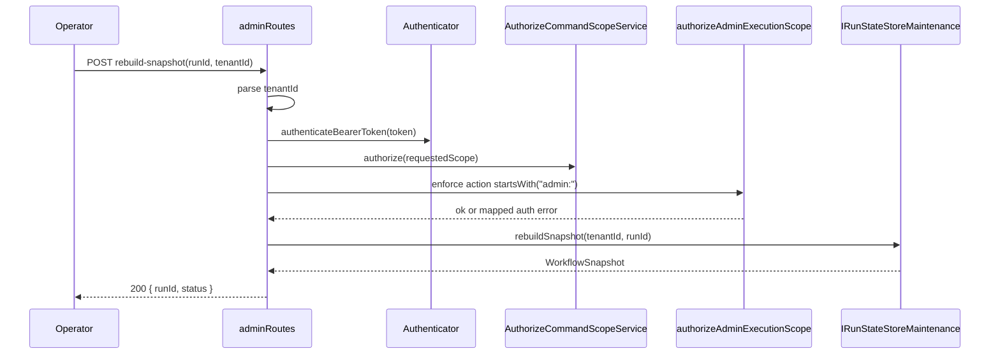

# Admin Rebuild Snapshot Technical Manual

This manual defines the technical behavior of the admin snapshot rebuild
endpoint in the API.

## Scope

- Route: `POST /admin/runs/:runId/rebuild-snapshot`
- Boundary: API entrypoint + authorization + state-store maintenance port
- Purpose: operational snapshot repair from persisted run events
- Activation: route is registered only when protected-runtime OIDC composition
  is complete and `DVT_ADMIN_ROUTES_ENABLED=true`

## Governing implementation

- `apps/api/src/entrypoints/http/adminRoutes.ts`
- `apps/api/src/entrypoints/http/authorizeAdminExecutionScope.ts`
- `docs/contracts/shared/AdminRebuildSnapshotAccess.v1.md`
- `docs/contracts/shared/AdminRebuildSnapshotAccess.v1.schema.json`
- `apps/api/test/contracts/adminRebuildSnapshotAccessContract.test.ts`
- `apps/api/test/entrypoints/http/adminRoutes.test.ts`

## Runtime flow



## Request and response contract

Request:

- path param: `runId` (string)
- body: `{ tenantId: string }`
- auth header: `Authorization: Bearer <token>`

Response `200`:

- `{ runId: string, status: WorkflowSnapshot["status"] }`

Failure envelopes:

- `400` invalid body/tenant (`invalid_body`, `missing_tenant_id`,
  `invalid_tenant_id`)
- `401` authentication failure (`missing_token` and related)
- `403` authorization failure (`action_not_granted`)
- `404` mapped domain error (`run_not_found`)
- `500` uncategorized runtime error (`internal_error`)

## Authorization rules

1. Request must pass standard execution-scope auth.
2. Effective authorized action must be a command with `admin:` prefix.
3. Rebuild route uses command action name `admin:rebuild-snapshot`.
4. Any non-admin action context is rejected as forbidden.
5. If any OIDC prerequisite is missing, the route is not mounted at all and
   requests resolve as `404`, not auth failures.

## Data and tenant invariants

1. Tenant is mandatory and parsed from body.
2. Tenant is validated before authorization and store call.
3. State-store call is scoped by `(tenantId, runId)`.
4. `RunNotFoundError` maps to `404`, no silent fallback.
5. The state-store maintenance port serializes durable snapshot mutation per
   `(tenantId, runId)` or returns a typed transient concurrency failure.

## Failure behavior

- Recoverable input/auth failures return governed HTTP envelopes.
- Unexpected store/runtime failures are logged and normalized to
  `internal_server_error`.
- Legacy string-only not-found errors are intentionally treated as `500`
  to avoid heuristic parsing.

## Test coverage

Contract-level:

- Schema-valid canonical access contract
- Invalid `requiredAction.name` mutation rejected by schema
- Invalid pipeline-order mutation rejected by schema
- Success envelope shape
- Missing tenant input
- Forbidden envelope
- Not found envelope

Route-level:

- 401/403/400/404/500 mappings
- Admin-action prefix enforcement path
- Unexpected runtime failure normalization
- Composition guardrail for `DVT_ADMIN_ROUTES_ENABLED=true` with missing or
  partial OIDC configuration

## Change checklist

When modifying this endpoint:

1. Keep action name and admin prefix guard aligned.
2. Preserve error envelope compatibility.
3. Update both contract and route tests for behavior changes.
4. Run validation gates before push.

## Validation commands

```bash
pnpm --filter dvt-api test -- test/contracts/adminRebuildSnapshotAccessContract.test.ts
pnpm --filter dvt-api test -- test/entrypoints/http/adminRoutes.test.ts
pnpm verify:prepush
```

<a id="section-admin-rebuild-snapshot-user-manual-20260405"></a>

## Admin Rebuild Snapshot User Manual

This manual explains how operators use the admin endpoint that rebuilds a run
snapshot from persisted events.

### Context

Use this operation when run status looks stale, missing, or inconsistent in
read views and you need to force snapshot reconstruction.

### Audience

- on-call operators
- support engineers
- QA reviewers validating incident recovery

### What this action does

`POST /admin/runs/:runId/rebuild-snapshot` replays the run event history and
overwrites the materialized snapshot for that run and tenant.

The endpoint returns only:

- `runId`
- `status`

### Access requirements

1. Admin routes must be enabled in the API deployment.
2. Caller must send a valid Bearer token.
3. Authorization must grant command action `admin:rebuild-snapshot`.
4. Request body must contain a valid non-empty `tenantId`.

### Request format

```http
POST /admin/runs/{runId}/rebuild-snapshot
Authorization: Bearer <token>
Content-Type: application/json

{
  "tenantId": "tenant-a"
}
```

### Success response

`200 OK`

```json
{
  "runId": "r42",
  "status": "RUNNING"
}
```

### Error responses

- `401 unauthorized`: missing/invalid token.
- `403 forbidden`: action not granted for caller.
- `400 bad_request`: invalid request body or tenant identifier.
- `404 not_found`: run does not exist in requested tenant scope.
- `500 internal_server_error`: unexpected rebuild failure.

### Operator procedure

1. Confirm incident scope (`tenantId`, `runId`, observed mismatch).
2. Call rebuild endpoint once with admin token.
3. Verify `200` response and returned status.
4. Re-check the affected run status views.
5. If status is still inconsistent, escalate with request/response evidence.

### Recommended evidence to capture

- UTC timestamp of request
- tenant and run identifiers
- HTTP status code
- response body
- post-action status check result

### Example curl

```bash
curl -X POST "https://<api-host>/admin/runs/r42/rebuild-snapshot" \
  -H "Authorization: Bearer <token>" \
  -H "Content-Type: application/json" \
  -d '{"tenantId":"tenant-a"}'
```

### References

- [Admin route implementation](../../apps/api/src/entrypoints/http/adminRoutes.ts)
- [Access contract tests](../../apps/api/test/contracts/adminRebuildSnapshotAccessContract.test.ts)

> Section status: Active. Owner: Operations / Support / Docs. Colocation does not merge component responsibilities.
