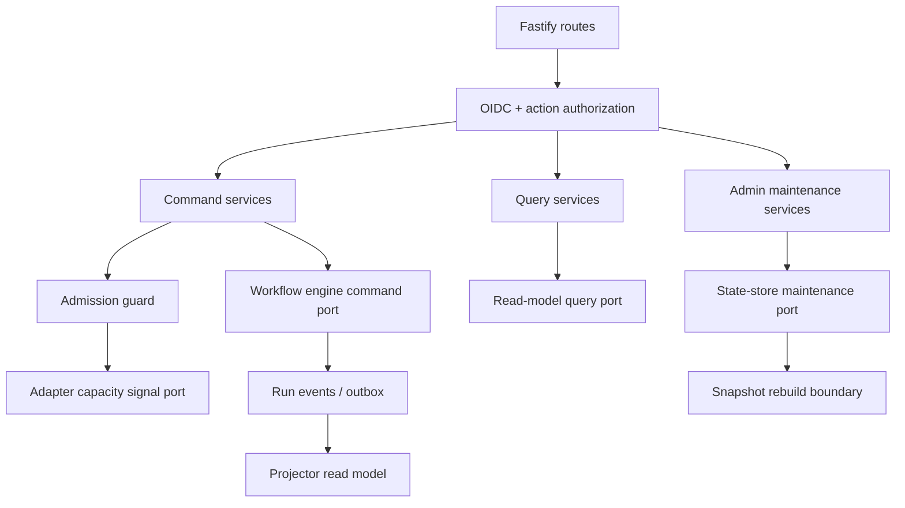
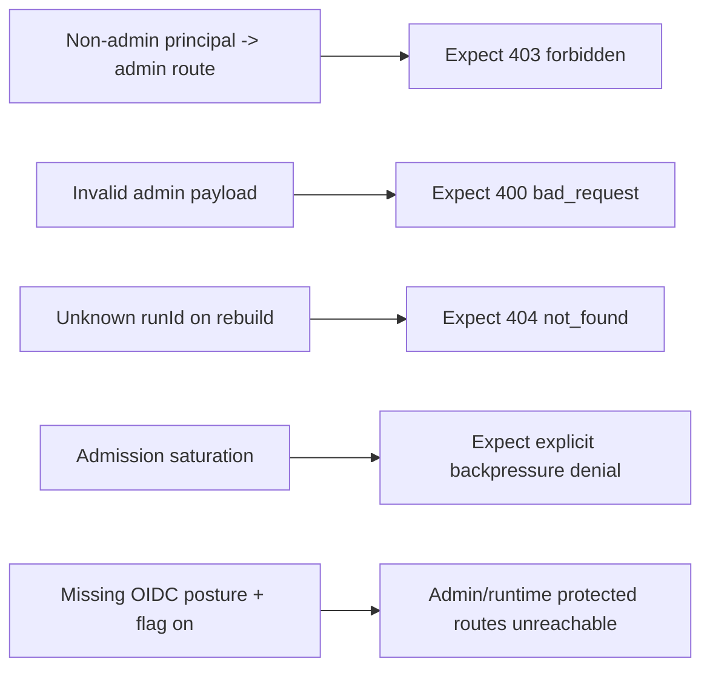
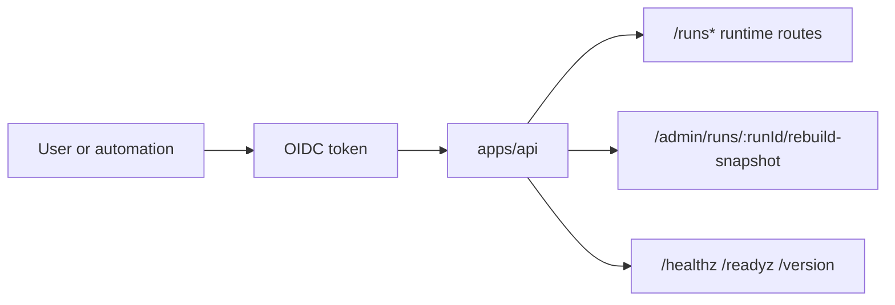

# API Control-Plane Technical Manual

This manual defines the target technical posture for API runtime safety,
admission, RBAC, and observability for the existing tasks (`AR-C1`, `AR-C2`, `AR-C3`,
`AR-C4`).

## Architectural Intent

- SOLID and SRP at service/module boundaries
- CQRS split between command and query routes
- hexagonal ports for engine/adapters/state store
- Fowler-style event sourcing and projection read models

## Technical Topology

## Class And Module Responsibilities

| Module/Class                                                      | Responsibility                                           | Must not do                     |
| ----------------------------------------------------------------- | -------------------------------------------------------- | ------------------------------- |
| `startRunRoute.ts`                                                | parse/validate transport input and map response envelope | domain mutation logic           |
| `startRunRoute`                                                   | shared authz, telemetry, and admission dispatch          | direct DB or adapter calls      |
| `BackpressureAwareStartRunUseCase`                                | apply admission and backpressure policy                  | HTTP mapping                    |
| `EngineStartRunUseCase`                                           | call engine command boundary                             | token parsing                   |
| `listRunsUseCase` / `getRunStatusUseCase` / `getRunEventsUseCase` | CQRS query path with authz-first posture                 | mutate run state                |
| `adminRoutes.ts`                                                  | admin transport and envelope mapping                     | feature-flag-only security      |
| `stateStoreRoles.ts`                                              | explicit read/write/maintenance role wiring              | ad hoc aggregate reconstruction |

## Procedures

### Runtime Command Procedure

1. parse route payload and tenant scope
2. enforce action grant
3. run admission policy (including backpressure signals)
4. dispatch to engine command port
5. map typed result to HTTP envelope

### Runtime Query Procedure

1. enforce action grant first
2. read from read-model/state query boundary
3. optionally enrich with bounded enrichment seam
4. map typed query result to HTTP envelope

### Admin Maintenance Procedure

1. require explicit admin action
2. call maintenance port (`rebuildSnapshot`)
3. return typed success or typed not-found/bad-request envelope

## Invariants (Must Hold)

| ID                         | Invariant                                                                              | Evidence target                           |
| -------------------------- | -------------------------------------------------------------------------------------- | ----------------------------------------- |
| `INV-C1-ADMIN-RBAC`        | admin maintenance routes require explicit admin action grant                           | route unit + contract tests               |
| `INV-C2-CQRS`              | query routes never mutate run lifecycle state                                          | architecture tests + route/use-case tests |
| `INV-C3-ADMISSION`         | command acceptance requires admission pass with explicit backpressure reason on denial | use-case tests                            |
| `INV-C4-MAINTENANCE-TYPED` | maintenance not-found and bad-request stay typed and stable                            | contract tests                            |
| `INV-C5-OBSERVABILITY`     | every implemented canonical SLO signal has explicit metric and alert policy            | SLA runbook                               |

## Observability Truth Model

- Implemented now:
  - `dvt_api_run_start_latency_seconds`
  - `dvt_api_plan_compile_latency_seconds`
  - `dvt.api.run_status.snapshot_staleness_result_total`
  - `dvt.api.run_status.snapshot_staleness_fallback_unknown_total`
  - `dvt_outbox_oldest_claimed_lag_seconds`
  - `dvt_delivery_outbox_drain_lag_seconds`
  - `dvt_delivery_event_delivery_latency_seconds`
- Planned instrumentation:
  - none; AR-C2 remains open for dashboard/alert evidence, not metric emission
- Rule: no review should treat planned metrics as active alert sources.

## Negative Test Plan

Required negative suites:

- `apps/api/test/entrypoints/http/adminRoutes.test.ts`
- `apps/api/test/contracts/adminRebuildSnapshotAccessContract.test.ts`
- `apps/api/test/integration/protectedRuntime.integration.test.ts`

The protected runtime integration lane now uses seam files under
`apps/api/test/integration/protectedRuntime.integration.*.ts` for auth,
bootstrap, persistence, runtime scenarios, workspace-draft scenarios, and
assertions. The executable entrypoint remains
`protectedRuntime.integration.test.ts`.

Instrumentation-negative review scenarios (documentation gate):

- fail review if a document claims alerting on a metric not emitted in code
- fail review if PromQL uses a metric name that cannot be found in telemetry emission code
- keep `AR-C2` open until metric emission + dashboard/alert evidence is committed

## TDD Execution Order

1. add/extend failing contract test for envelope and schema invariants
2. add/extend failing route/use-case negative test
3. implement minimal production change
4. run package tests
5. run `pnpm verify:prepush`

## Delivery Gate

A runtime change is not complete unless:

- invariants above are reflected in tests
- at least one negative case per changed boundary exists
- SLA/runbook mapping remains aligned with emitted signals

## API Control-Plane User Manual

This manual describes how a consumer should use the current authenticated API
surface safely and predictably.

### Audience

- frontend engineers consuming runtime endpoints
- operators invoking runtime/admin endpoints
- automation clients using token-based access

### Entry Surface

### Route Families

| Family            | Endpoints                                                                  | What the caller gets                             |
| ----------------- | -------------------------------------------------------------------------- | ------------------------------------------------ |
| Runtime commands  | `POST /runs/start`, `POST /runs/:runId/signal`, `POST /runs/:runId/cancel` | command acceptance or typed error envelope       |
| Runtime queries   | `GET /runs`, `GET /runs/:runId`, `GET /runs/:runId/events`                 | paged run state and event timeline               |
| Admin maintenance | `POST /admin/runs/:runId/rebuild-snapshot`                                 | maintenance result with access contract envelope |
| Operational       | `GET /healthz`, optional `GET /readyz`                                     | liveness/readiness state                         |

### Access Rules

| Endpoint                                   | Required action                                              |
| ------------------------------------------ | ------------------------------------------------------------ |
| `POST /runs/start`                         | `run:start`                                                  |
| `GET /runs`                                | `run:list`                                                   |
| `GET /runs/:runId`                         | `run:view`                                                   |
| `GET /runs/:runId/events`                  | `run:logs:view`                                              |
| `POST /runs/:runId/signal`                 | `run:signal` (or `run:cancel` for CANCEL compatibility path) |
| `POST /runs/:runId/cancel`                 | `run:cancel`                                                 |
| `POST /admin/runs/:runId/rebuild-snapshot` | `admin:rebuild-snapshot`                                     |

### Caller Procedures

1. Authenticate and obtain a bearer token.
2. Include tenant-scoped parameters required by the route.
3. Use command routes for mutations and query routes for reads.
4. Treat `401` as token/auth posture failure and `403` as scope/action denial.
5. For admin routes, require explicit admin grant; feature flags are not access control.

### Expected Error Envelopes

- `400 bad_request`: malformed payload or required query/path mismatch
- `401 unauthorized`: token/auth context invalid
- `403 forbidden`: authenticated principal lacks required action
- `404 not_found`: missing target resource or route inactive due composition posture
- `500 internal_error`: unexpected runtime failure

### User-Side Negative Scenarios To Validate

- token valid but missing action grant -> must return `403`
- tenant mismatch between token context and request -> must deny
- invalid command payload -> must return typed `400`
- admin endpoint with non-admin principal -> must return `403`

### TDD Consumption Checklist

Before integrating a new client flow:

1. Write a failing consumer test for one successful call and one deny path.
2. Wire the client request against the documented envelope.
3. Keep assertions on `code`, `message`, and HTTP status, not free-text logs.
4. Add one stale/unknown freshness assertion when consuming `GET /runs/:runId`.

### SLA And Operations

Runtime expectations and thresholds are governed in:

- [API Runtime SLA Canonical](../runbooks/api-runtime-sla-canonical-20260404.md)
- [Backend MVP Control-Plane Runbook](../runbooks/backend-mvp-control-plane-runbook-20260329.md)

### What Is Observable Now Vs Target-State

Observable now:

- `dvt_api_run_start_latency_seconds`
- `dvt_api_plan_compile_latency_seconds`
- `dvt.api.run_status.snapshot_staleness_result_total`
- `dvt.api.run_status.snapshot_staleness_fallback_unknown_total`
- `dvt_outbox_oldest_claimed_lag_seconds`
- `dvt_delivery_outbox_drain_lag_seconds`
- `dvt_delivery_event_delivery_latency_seconds`

Target-state only (not emitted yet as active metrics):

- none; pending AR-C2 closure is dashboard/alert wiring and sustained evidence

> Section status: Active. Owner: API / Product / Docs. Colocation does not merge component responsibilities.
